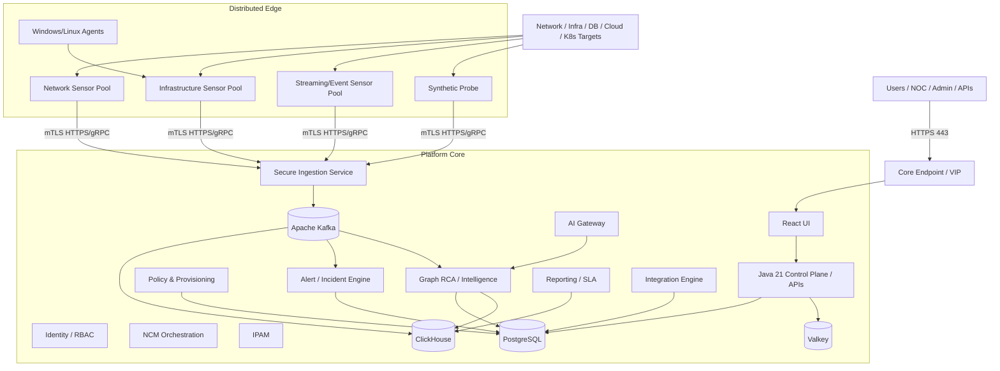
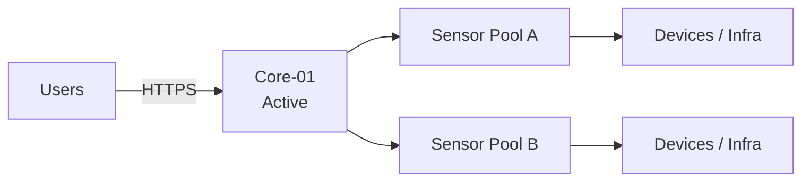
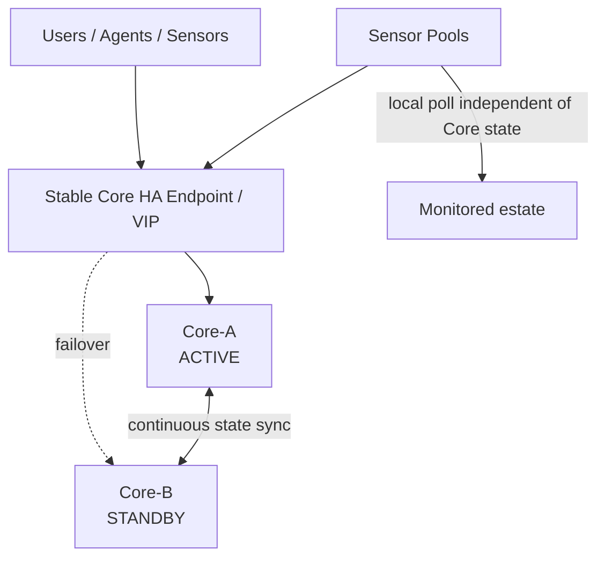
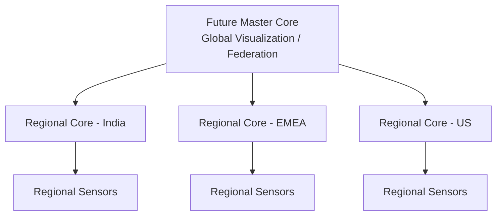
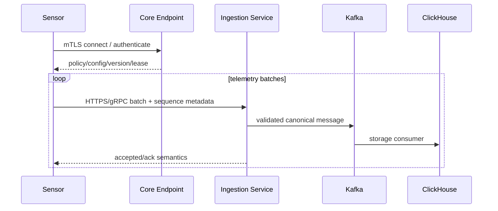
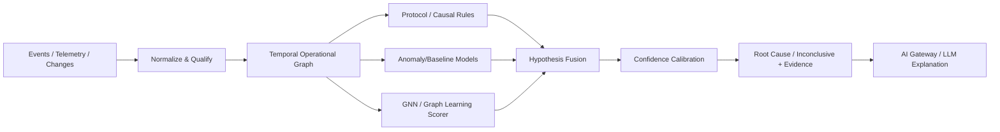
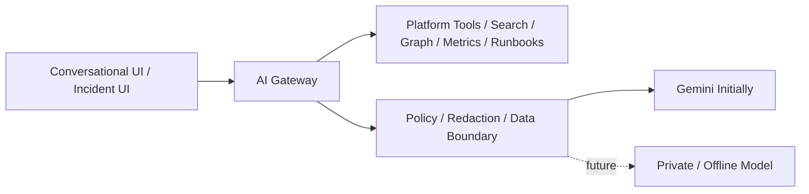
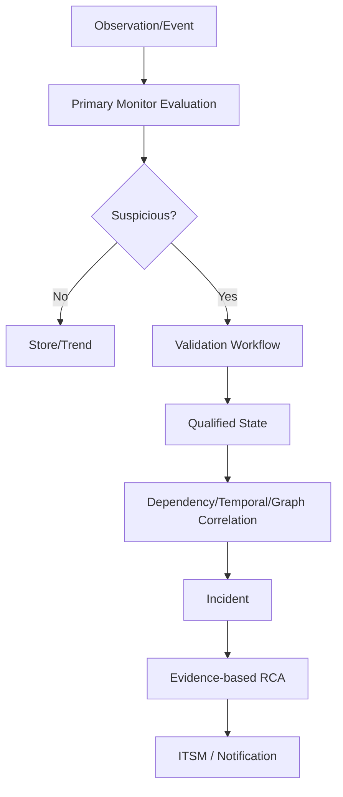
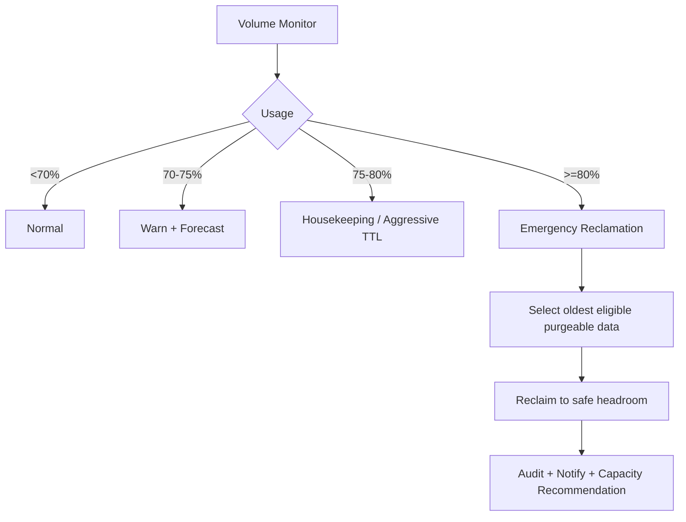

# Platform — Master Architecture Document

**Document ID:** PLATFORM-ARC-001
**Version:** 3.3.0
**Status:** Authoritative Mother Reference — System Architecture Authority (**A2.1 NORMALIZED_V1**)
**Product name:** Platform (internal engineering/build identifier) / AmrudAi (commercial/customer-facing product name)
**Depends on:** `Platform_01_BRD.md`, `Platform_02_PRD.md`
**Companions:** `Platform_04_HLD.md`, `Platform_05_LLD.md`, `Platform_06_Dataflow.md`, `Platform_07_OSS_Catalog.md`, `Platform_08_Requirements_Traceability.md`, `Platform_12_Decision_Source_Register.md`
**Normalization state:** NORMALIZED_V1
**Last reconciliation:** 2026-10-11 — Issue #200/#202/#206 Tranche A Sensor RAM ratio correction (≥4 GB/vCPU; retains v3.3.0); prior Phase 1/1.5 certification-envelope reconciliation, BUILD-011 eBPF map policy (Issue #168) and Issue #142 Phase-1 observability closure retained

---

## 1. Architecture mandate
Platform is a clean-room enterprise product delivering **Unified Network & Infrastructure Observability** (commercial name: AmrudAi). The architecture defines the target Phase-1 capability set for network and infrastructure monitoring, temporal operational topology, telemetry quality/trust, cross-signal investigation, active path observability, Flow/log/event correlation, bounded Linux process-to-network evidence via eBPF, Service Assurance / SLI / SLO / Error Budget, cloud and Kubernetes monitoring, deterministic RCA, and change intelligence (subject to applicable implementation, benchmark and certification gates), while remaining lightweight, low-latency, simple to deploy, safe under failure and operationally explainable.

The architecture is governed by the following constraints already decided:

- Working product name is **Platform** (commercial product name: **AmrudAi**).
- Core and Sensor run on Ubuntu/RHEL; no Windows Core/Sensor initially.
- Core, Sensor and Agent are separate builds.
- One Core for standalone (Phase 1 certification envelope); exactly two full Core nodes for HA (Phase 1.5 certification envelope). Exactly-two-Core HA remains fixed architecture and must not be downgraded.
- HA is Active/Standby with less-than-60-second Core service restoration target under the Phase 1.5 envelope. Phase 1 makes no Core-HA availability claim.
- All Core components run on Core nodes; no mandatory third Core/governance node.
- Sensors continue polling during Core unavailability/failover; multi-Sensor assignment generation/fencing remains Phase 1 mandatory.
- Sensor → Core uses secure HTTPS/gRPC over mTLS to a Platform ingestion endpoint; Kafka is internal to Core.
- Kafka, ClickHouse, PostgreSQL and Valkey are baseline Core technologies; no separate eBPF database, graph database, or trace backend is introduced.
- Go for Sensor/Agent runtime, Java 21 for Core control plane, React/TypeScript UI, Python where appropriate for AI/analytics/NCM.
- UI is HTTPS only and does not expose an application endpoint on TCP/80.
- Core and Sensor managed storage have a mandatory 80% storage-protection watermark.
- DR capability is required in v1.0 and remains mandatory for Phase 1; HA is distinct from DR.
- **Hard Phase-1 product boundaries:**
  - Full APM, bytecode instrumentation, method-level timing, continuous profiling, flame graphs, and RUM are excluded.
  - Full DPI, always-on packet capture, TLS decryption, and packet payload reconstruction are excluded. (Existing bounded incident-triggered packet evidence remains active and is preserved).
  - Mandatory GPU/NPU, third Core node, dedicated trace database, dedicated graph database, and separate eBPF backend are excluded.
- Gemini is accessed through an AI Gateway; causal RCA is not LLM-only.
- Platform is independent from ThoughtData and NetAI and must not reuse their proprietary implementation assets.

---


**Maturity:** `SPECIFIED != IMPLEMENTED != TESTED != BENCHMARKED != CERTIFIED != DEPLOYED`.

## 2. Architecture principles
| ID | Principle | Consequence |
|---|---|---|
| ARC-P01 | Core is the brain, Sensors are the collection edge | Central control/policy/identity/RCA lives in Core; protocol collection is distributed. |
| ARC-P02 | Locality first, capacity always | Place Sensors near devices but never overload them merely to minimize RTT. |
| ARC-P03 | Asynchronous over WAN | A poll must not require synchronous DB access across WAN. Sensor queues isolate WAN/Core disruption. |
| ARC-P04 | Central policy authority | Sensors are headless execution nodes. Desired state originates from Core. |
| ARC-P05 | One canonical entity graph | SNMP/flow/syslog/NCM/API observations converge on one entity identity and relationship model. |
| ARC-P06 | Evidence before AI | Deterministic/protocol/topology evidence is authoritative; ML/GNN augments ranking/anomaly detection; LLM explains/interacts. |
| ARC-P07 | Inconclusive is valid | RCA may explicitly return insufficient evidence rather than invent a cause. |
| ARC-P08 | Preserve evidence | Correlation suppresses noise for workflow but never destroys child-event evidence. |
| ARC-P09 | Policy-driven behavior | Polling, thresholds, validation, retention, placement and workflow are configured through hierarchical policy. |
| ARC-P10 | Protect live monitoring | Historical storage is reclaimable before live monitoring is allowed to stop due to disk pressure. |
| ARC-P11 | Fail safe | Ambiguous HA conditions must not create two authoritative active Cores. |
| ARC-P12 | Modular, not microservice-heavy by default | Fit the 8C/32G Core target by avoiding unnecessary JVM/service overhead. |
| ARC-P13 | API-first implementation, UI-first experience | All normal customer workflows use UI backed by stable APIs. |
| ARC-P14 | Security by default | HTTPS/mTLS, least privilege, auditing, secret protection and signed artifacts are baseline. |
| ARC-P15 | Clean-room + approved OSS | Reuse commodity permissive OSS; own differentiated Platform logic. |
| ARC-P16 | Operational context to action | Preserve entity/alert/incident context from observation through bounded verification, CLI, investigation and evidence capture; low-risk diagnostics are immediate while privilege-changing/destructive operations retain stronger controls. |
| ARC-P17 | Evidence-led service assurance | SLA/OLA/Provider-SLA/SLO results are reproducible from versioned policy, calendar, scope and evidence; unknown/partial measurement is explicit. Report artifacts are PDF/CSV only and reporting may not starve live monitoring. |

---


### Core invariant — No Data ≠ Device Down
Monitoring-path failure must not automatically become a device-down conclusion. Architecture and Alert Qualification must distinguish **UP**, **DOWN**, and **UNKNOWN / NO DATA / path-unavailable** (and related semantic states such as MONITORING_DEGRADED) rather than collapsing collector failure into DOWN.

## 3. System context and high-level logical architecture


The diagram is logical. Internal process boundaries may be consolidated to meet resource targets.

---


**Role taxonomy note:** diagrams/text that say “Streaming/Event Sensor” map to product roles `FLOW` and/or `LOG`. Runtime `STREAMING_EVENT` is an implementation mismatch requiring reconciliation (see §9).

## 4. Deployment architecture
### 4.1 Standalone deployment



Core-01 runs the complete Core stack. Sensors are separate installs and remain responsible for collection.

### 4.2 Two-node HA deployment

**Status:** SPECIFIED / **P0** / **NOT PRODUCTION CERTIFIED**. **Certification envelope:** Phase 1.5. Exactly two full Core nodes Active/Standby remains fixed architecture and must not be downgraded to P1; a Phase 1 standalone certificate must not imply this HA envelope. Unresolved P0 work includes active authority/fencing, Kafka consumer ownership, PostgreSQL replication/failover/fencing/rewind, ClickHouse replication/promotion/fencing, stable Core endpoint/VIP, Sensor reconnect/re-anchor, push-protocol continuity, split-brain failure behavior, HA ACK RPO evidence (distinct from site/DR RPO), failover under load and backlog replay. Sensor assignment ownership/lease/fencing remains a Phase 1 mandatory multi-Sensor safety requirement even with standalone Core and must not be deferred solely because Core HA is Phase 1.5. Exact mechanism selection is a dedicated P0 engineering spike constrained by exactly two Core nodes, no silent split-brain, minimal operational complexity and no unnecessary third full Core. This baseline does **not** select Patroni, repmgr, ClickHouse Keeper, Raft, Consul, etcd or a third coordination service.




Requirements:

- one Active and one Standby only;
- both have the Core software and Core-local data components;
- stable HA endpoint abstracts node identity;
- Sensors/Agents must not require manual reconfiguration when Active changes;
- Sensor local buffering protects monitoring during failover;
- automatic promotion occurs only when the peer can be safely considered failed/fenced by the HA algorithm;
- if the failure state is ambiguous, the system prefers preventing dual-active even if this delays UI promotion.

### 4.3 Why no third Core

The customer-facing architecture intentionally remains two full Core nodes, consistent with the requirement and lessons from incumbent NMS HA patterns. This does **not** mean every internal distributed technology is used in its textbook multi-node quorum mode. Core-local components must be adapted to a two-node active/passive product topology rather than forcing a third full server onto the customer.

### 4.4 Future federation

Future only, not initial scope:



Future federation should keep high-volume raw telemetry regional and move summaries/incidents/global inventory upward, inspired by distributed NMS lessons such as SolarWinds EOC and ManageEngine LiteCentral patterns without copying their implementation.

---


## 5. Control plane, data plane and Core modular architecture

### 5.1 Control plane responsibilities

Core control plane owns: tenancy, IAM/RBAC policy evaluation targets, inventory identity, desired-state/policy versioning, Sensor/Agent enrollment and placement decisions, job/lease/fencing generation, alert/incident authority, NCM orchestration, integration configuration, licensing administration, audit authority, UI/API serving.

### 5.2 Data plane responsibilities

Data plane owns: Sensor/Agent collection, local durable spool, mTLS upload to Core ingest, internal Kafka fan-out, normalization, ClickHouse historical analytics inserts, and reconstructable caches in Valkey. Sensors/Agents never speak Kafka on the WAN.

### 5.3 Trust boundaries

- Users/UI: HTTPS/TLS only (no application :80)
- Sensors↔Core and Agents↔Core/Sensor: mTLS
- Kafka/ClickHouse/PostgreSQL/Valkey: inside Core trust boundary
- Monitored devices: protocol-specific credentials via Credential Profiles; no browser reusable secrets

### 5.4 Modular Core

To satisfy the 8 vCPU / 32 GB target for the reference ≤2,500-device workload, the Java control plane should be modular rather than split into dozens of always-running JVM microservices.

Recommended runtime grouping:

- `platform-core-app`: tenant/admin, inventory, provisioning, policy, groups, alerts/incidents, IPAM control, NCM orchestration, integration orchestration, reporting control, audit APIs.
- `platform-ingest`: secure Sensor/Agent ingress, schema validation, sequencing and Kafka production.
- `platform-query`: optimized telemetry/query endpoints, possibly co-resident initially.
- `platform-ai`: AI Gateway/tool orchestration, separable process/service if Python/model runtime is required.
- `platform-analytics`: Python jobs for learned baselines/GNN training/evaluation where needed; not necessarily continuously resident on small Core.

Resource boundaries must be benchmarked and configured so Java, Kafka and ClickHouse cannot each independently consume the machine.

---


## 6. Core data technologies and authority model
### 6.1 PostgreSQL — authoritative transactional state

Use PostgreSQL for:

- tenant/customer definitions;
- users/roles/resource scopes;
- inventory identity/current state metadata;
- sites/groups/tags;
- credential metadata/references;
- monitoring policy definitions and versions;
- Device Pack metadata;
- provisioning/discovery jobs;
- current alerts/incidents/workflow state;
- NCM/IPAM metadata/current state;
- integration configuration;
- licensing;
- report/dashboard definitions;
- HA/installation metadata;
- AI configuration/feedback metadata;
- audit index/metadata as required.

PostgreSQL is the primary authoritative state store for control-plane data.

### 6.2 ClickHouse — high-volume historical analytics

Use ClickHouse for:

- numeric telemetry;
- state telemetry;
- NetFlow/IPFIX/sFlow;
- syslog/events;
- traps/event history;
- historical alerts/incidents where analytical access is needed;
- audit history where policy permits;
- RCA evidence/time-window facts;
- SLA/capacity facts;
- telemetry quality;
- historical topology/change facts where suitable.

Separate tables by workload rather than forcing all records into a generic table.

### 6.3 Kafka — internal durable streaming backbone

Kafka is mandatory internally for:

- ingestion decoupling;
- fan-out to storage, alerting, RCA and integrations;
- backpressure isolation;
- event ordering by key/partition;
- replay within configured retention.

Kafka is **not** exposed directly over customer WAN to Sensors. Sensors communicate through the Platform Ingestion Service.

Kafka is not the authoritative long-term telemetry database.

### 6.4 Valkey — cache/ephemeral state

Use Valkey for:

- caches;
- session/short-lived state where appropriate;
- frequently accessed derived values;
- rate limiting/short locks where semantics are safe.

Valkey must not become the only copy of business-critical persistent state.

---


### ClickHouse vs Elasticsearch (absorbed from ARCH-DB)
**Decision:** ClickHouse is the primary high-volume telemetry/analytical database. PostgreSQL remains the transactional control store. Elasticsearch is not part of the core architecture. OpenSearch can be added later only if real customer full-text/log-search requirements justify another stateful service.

Reasons:

- Platform's dominant hot paths are append-heavy telemetry, time-window aggregation, high-cardinality Flow dimensions, rollups and analytical scans.
- Columnar ClickHouse provides a better architectural fit for those workloads and supports compression/TTL/aggregation patterns required by the 80% storage-protection design.
- Avoiding another mandatory JVM search cluster reduces CPU/RAM/operational footprint.
- ClickHouse remains a storage/query engine; Platform owns tenant/query policy, canonical data schema, rollups, retention and search UX.


### Valkey degradation requirement
Valkey is reconstructable ephemeral/cache state **ONLY** and must never become authoritative business state. Architecture requires Core to **degrade safely if Valkey is unavailable** rather than convert cache loss into authoritative data loss. Current hard-dependency behavior, if present, is an implementation gap under #92.

## 7. Exactly-two-Core HA and stateful-service strategy
The two-Core topology creates special engineering requirements because textbook Kafka controller quorums and ClickHouse Keeper quorums normally prefer an odd number of voting members.

This section is the **Phase 1.5 HA certification envelope**. Phase 1 certifies one authoritative standalone Core with mandatory backup/restore and site-loss DR; it does not claim two-Core service continuity. HA ≠ DR.

Platform therefore adopts these architectural rules:

1. **The product HA topology is authoritative:** exactly two full Core nodes in HA (Phase 1.5 cert).
2. **PostgreSQL:** use primary/standby streaming replication with controlled promotion/fencing semantics.
3. **ClickHouse:** maintain a second up-to-date Core copy through an implementation specifically validated for two-node active/passive failover. Candidate mechanisms include dual-write/backfill or controlled replica strategy; the final certified mechanism is a P0 engineering design spike and must not falsely claim quorum guarantees that are not present.
4. **Kafka:** treat Kafka as an internal transport, not the sole copy of telemetry. Sensor durable spools are the edge replay source; ClickHouse/PostgreSQL are persistent destinations. The exact Kafka active/passive/failover implementation for two Core nodes is a P0 design spike. It must preserve the no-third-Core requirement and prove failover behavior experimentally.
5. **No hidden split-brain:** a two-node partition must not result in two writable authoritative Cores.

This is an explicit technical risk area and requires failure testing before GA.

---


### Open HA P0 mechanisms (must remain explicit)

Exactly-two-Core HA is **USER-FIXED** product topology and the Phase 1.5 certification envelope. The following remain **OPEN P0 / NOT PRODUCTION CERTIFIED** until evidence closes them (do not invent selections here):

1. Active authority and fencing (including ambiguous partition / split-brain behavior) — Phase 1.5
2. Sensor assignment generation/ownership/lease/fencing for multi-Sensor estates — **Phase 1 mandatory** (standalone Core); not deferred to Core HA
3. PostgreSQL promotion, rejoin, rewind and fencing — Phase 1.5
4. Kafka ownership/failover and consumer ownership under Active/Standby — Phase 1.5
5. ClickHouse continuity/promotion/fencing (no false quorum claims on two nodes) — Phase 1.5
6. Stable Core HA endpoint/VIP behavior — Phase 1.5
7. Sensor reconnect/re-anchor and push-protocol continuity across Core failover — Phase 1.5
8. HA ACK RPO evidence for the certified permanent one-Core HA failure matrix (`ACKED-FOR-DELETION TELEMETRY RPO = 0`) — Phase 1.5; distinct from site/DR RPO and from Phase 1 standalone deletion-ACK durability
9. Failover-under-load / backlog replay evidence — Phase 1.5

**Not selected by documentation alone:** Patroni, repmgr, ClickHouse Keeper, Raft, Consul, etcd, or a third full Core/coordination server. Spike constraints: exactly two nodes, no silent split-brain, minimal ops complexity.


### Kafka HA acceptance conditions (absorbed from ARCH-KAFKA)
Kafka is mandatory and internal to the Core trust boundary. Sensors do **not** connect directly to Kafka over customer WANs. External telemetry path is:

```text
Device/Agent -> Sensor -> local spool -> mTLS HTTPS/gRPC -> Core Ingestion -> Kafka -> normalization/enrichment -> ClickHouse/Alert/RCA
```

The exact internal replication/fencing implementation under the requirement of exactly two full Core nodes is a **P0 engineering spike**. Architecture acceptance conditions are fixed even though the library-level mechanism is not:

- never expose two simultaneous authoritative Active Cores;
- acknowledge telemetry only at a durability point compatible with replay requirements;
- maintain Sensor sequence/idempotency identity so failover/replay does not double-count;
- recover the Standby Core and Kafka processing within the certified <60-second Core failover target where the failure scenario is in the certification matrix;
- Sensor polling must continue even if Core/Kafka is unavailable.


## 8. Implementation-truth register (Issue #92 — architecture exposure)

A2.1 does **not** implement runtime fixes. The following current gaps must remain visible so agents do not treat SPECIFIED architecture as CERTIFIED production:

| Gap | Normative target | Current maturity / note |
|---|---|---|
| Exactly-two-Core HA stateful mechanisms | Active/Standby &lt;60s; fail-safe fencing | **SPECIFIED / OPEN P0 / NOT PRODUCTION CERTIFIED** — see §7 and §40 |
| Production Sensor runtime wiring | Universal Go Sensor with governed scheduler/workers/spool/uploader | Target normative; **production entrypoint does not yet use the entire governed runtime/scheduler architecture** |
| Persistent IAM/RBAC authority | IdentityDirectory / PermissionGrantDirectory production authority | **NOT IMPLEMENTED** on current main as durable production authority |
| Discovery authorization | Tenant/RBAC-integrated Discovery | Intentionally **fail-closed** while permission integration incomplete |
| Sensor Pool / Region physical persistence | Logical placement model | Logical design ≠ implemented physical schema |
| Replay relational integrity | Idempotent durable ACK/replay | Known defect class under #92 |
| Entity phantom references | Canonical entity integrity | Known defect class under #92 |
| ClickHouse lifecycle | Partition/retention/rollup/storage protection | Required; **not implemented/certified** as complete lifecycle |
| Valkey authority | Reconstructable ephemeral/cache only | Architecture requires graceful Core degradation if Valkey unavailable; **hard-dependency behavior is an implementation gap** |
| Deep pagination / query scale | Protected pagination and query bounds | Incomplete |
| Index/query mismatches | Contracts match indexes | Incomplete |
| Cardinality / noisy-neighbour | Per-tenant enforcement | Incomplete / not certified |
| Retention/backup runtime | Operable retention + backup/restore | Incomplete |
| DB privilege separation | Runtime vs migration privileges | Required; not certified |
| Secret-default startup protection | Reject insecure defaults | Incomplete |
| Certificate rotation concurrency | Safe rotation policy | Gap |
| Durable audit persistence | Tamper-evident durable audit | Common emitter logging ≠ durable audit |
| Audit actor attribution | Complete actor fields | Incomplete where applicable |
| Flow/NTA production runtime | FLOW role receiver path | **Not implemented/certified** as production Flow/NTA runtime |
| Native production packaging | deb/rpm/MSI GA path | Incomplete relative to full packaging certification |
| Counter64 derived semantics | Exact raw path + derived delta/rate/reset/wrap | Raw Counter64 path **IMPLEMENTED+TESTED** (PR #84); derived semantics remain **SPECIFIED / NOT IMPLEMENTED/CERTIFIED** |


## 9. Sensor architecture

### Canonical Sensor roles

Standard production: `NETWORK`, `INFRASTRUCTURE`, `FLOW`, `LOG`. Conditional: `SYNTHETIC`, `CLOUD_API`. `COMBINED` only for lab/dev/small governed profiles unless certified. Runtime `STREAMING_EVENT` is an **implementation mismatch / migration gap**, not the long-term product role.

### Implementation truth

Current production Sensor entrypoint does **NOT** yet use the entire governed runtime/scheduler architecture. Target architecture below remains normative; implementation remains incomplete until evidence closes the gap.

### 9.1 Sensor runtime

Production Sensor deployment-role direction: standard `NETWORK`, `INFRASTRUCTURE`, `FLOW`, `LOG`; conditional dedicated `SYNTHETIC` / `CLOUD_API`; `COMBINED` for lab/dev/small deployments unless separately certified. Current runtime `STREAMING_EVENT` is an implementation/general streaming role requiring **IMPLEMENTATION RECONCILIATION** toward explicit FLOW/LOG product roles. One Universal Sensor codebase.


Recommended language: Go.

Reasons:

- efficient goroutines/network I/O;
- strong permissively licensed protocol ecosystem;
- low runtime footprint compared with multi-JVM edge components;
- straightforward single-binary packaging;
- suitable for SNMP, flow, gNMI, SSH, REST, cloud and Agent ingestion.

Rust may be introduced only for benchmark-proven hotspots, not as a blanket requirement.

### 9.2 Internal Sensor worker pools

Sensor isolates workloads into bounded worker pools:

- ICMP/traceroute;
- SNMP;
- SSH/NETCONF/CLI;
- REST/API;
- gNMI/streaming;
- discovery/topology;
- NCM execution;
- flow/event receivers;
- Agent ingress;
- local spool/uploader;
- diagnostics/health.

A high-rate Flow workload must not starve SNMP polling or NCM safety tasks.

### 9.2.1 SNMP execution architecture

SNMP scheduled polling is a **Network Sensor data-plane capability** coordinated by Core control state. The production path is:

```text
Core policy / assignment / Credential Profile reference
        ↓
Sensor scheduler + fenced assignment
        ↓
Capability Pack poll plan
        ↓
SNMP Poll Planner
        ↓
GoSNMP adapter
        ↓
typed varbind normalization
        ↓
durable Sensor spool
        ↓
Core ingestion / Kafka
        ↓
ClickHouse + graph/inventory/state consumers
```

Protocol-library code is not independently authoritative product behavior. The Sensor runtime owns worker isolation, leases/fencing, timeout/cancellation, durability and capacity; the network/SNMP layer owns protocol semantics, poll planning, error classification and typed normalization; Capability Packs own vendor/product mappings; Core owns policy, assignment, credential authorization and canonical downstream contracts.

Poll planning is capability-aware and bounded. It may adapt GET/GETNEXT/GETBULK/WALK grouping, max repetitions, timeout/retry and controlled fallback using Device Pack compatibility, observed `tooBig`/timeout behavior, RTT and Sensor budget. Scheduling uses deterministic spreading across the configured interval and bounded per-device concurrency so eligible work is distributed rather than aligned at minute boundaries. Restart or Sensor reassignment must not intentionally reshape the entire estate into a burst. The exact generic scheduler algorithm is governed separately; SNMP must remain compatible with it.

The normal scheduled SNMP operational-metric default is **5 minutes**. That default does **not** mean every available OID is polled every five minutes. Collection remains monitor-definition / Capability-Pack driven. Availability/liveness is a separate plane and may normally use approximately 60 seconds according to policy. Event/streaming telemetry remains event/stream driven.

Adaptive SNMP polling may temporarily accelerate cadence under explicit reason/audit with minimum safe interval, bounded duration, cooldown, maximum promoted targets and Sensor capacity guardrails. A broad outage must not accelerate thousands of affected devices into a retry/poll storm. `NO DATA != DEVICE DOWN` remains invariant.

SNMP trap/inform reception is a Streaming/Event Sensor capability when event volume warrants separation. It is independently budgeted from routine polling.


### 9.3 Sensor local storage

The Sensor stores only operational state required for continuity:

- job/policy cache;
- enrollment identity/certificates;
- local spool;
- logs/diagnostics;
- upgrade rollback assets;
- bounded discovery/transient state.

It is not a full independent historical NMS database.

### 9.4 Sensor communication



Exact acknowledgment semantics must ensure data is not silently lost when Core fails after accepting a batch; LLD defines the sequence/replay contract.

---


### Why Sensor is Go (absorbed from ARCH-SENSOR)
The Universal Sensor Runtime is Go to minimize footprint, simplify Linux packaging and maximize concurrency for SNMP/API/network I/O. Rust may be used only for benchmark-proven hotspots; it is not a second general Sensor application framework.

Sensors execute protocol adapters and bounded local buffering. They do **not** own the customer source of truth or a full long-term monitoring database. This intentionally takes the useful locality/autonomy lesson from ManageEngine Probes while avoiding per-Probe database synchronization complexity.


## 10. Agent architecture boundary

Agents (Windows/Linux) are distinct builds. They enroll via Core, receive Sensor association for collection paths, use mTLS identity, and must not become licensed/actively monitored without onboarding approval (or trusted auto-approval policy). Agents are not causal RCA authorities. Optional local/private inference providers are not Agents and must not participate in HA quorum (see §14 / §22).

Detailed Agent product behavior: `Platform_02_PRD.md`. EDS placement: §22.

## 11. Placement architecture (Region, Site, Sensor Pool)
Core owns placement policy. Placement may incorporate observed locality/capacity/completion evidence as **placement-learning recommendations**. Recommendations do not silently override pinned/manual placement or pool policy without authorized auto-rebalance controls.

### 11.1 Sensor suitability score

Inputs include:

- reachability;
- RTT;
- packet loss;
- capacity/work units;
- CPU/RAM/disk/queue;
- site/region affinity;
- allowed/forbidden pools;
- protocol compatibility;
- HA spare capacity;
- maintenance state.

The engine chooses the best **eligible** Sensor, not necessarily the lowest RTT.

### 11.2 Placement modes

- Automatic.
- Recommendation requiring approval.
- Manual pin.
- Sensor Pool assignment.

### 11.3 Rebalancing

A controller detects sustained imbalance and proposes/makes movement according to policy. Hysteresis and minimum-improvement thresholds prevent oscillation.

---


**Physical persistence note:** logical Region/Site/Sensor Pool architecture is required. Do not imply physical Region/Sensor Pool schema currently exists merely because logical design exists (#92).

## 12. Canonical entity model and temporal operational graph
### 12.1 Entity identity

Every observed object receives a stable internal `entity_id` independent of transient IP/hostname.

Canonical identity is tenant-aware and may use:

- serial;
- hardware UUID;
- SNMP engine ID/sysObjectID;
- MAC;
- cloud resource ID;
- virtualization ID;
- Kubernetes UID;
- hostname + namespace/context;
- administrator reconciliation.

### 12.2 Monitor Definition

Every normalized metric should derive from a Monitor Definition containing at least:

- `metric_key`;
- entity type/scope;
- source protocol;
- source path/OID/query;
- value type/units;
- collection interval/policy;
- quality rules;
- threshold/baseline applicability;
- visualization hints;
- Device Pack provenance.

Protocol source does not dictate dashboard semantics. SNMP/REST/WMI/gNMI can normalize to the same semantic metric.

### 12.3 SNMP typed evidence and identity

SNMP does not normalize into a numeric-only pipe. Varbinds and notifications may become:

- exact counter observations;
- numeric gauges/measurements;
- state observations;
- inventory facts;
- topology/relationship facts;
- operational events/traps;
- collection-quality/exception evidence.

Raw `Counter32`/`Counter64` identity and exact integer value are preserved before delta/rate derivation. A floating-point rate is a **derived metric**, not a substitute for the authoritative raw counter. Counter wrap/reset/discontinuity uses source type, prior sample, elapsed time, `sysUpTime`, `ifCounterDiscontinuityTime` or equivalent evidence where available. A decrease is **not** automatically treated as `2^64` wrap; discontinuity/reboot/interface-recreation/source evidence is evaluated first and wrap is inferred only where protocol/quality evidence permits.

**Implementation truth (current main after PR #84):** Sensor exact Counter64 source values now remain exact through Core typed canonicalization, Kafka serialization and ClickHouse raw `UInt64` persistence, including values above `2^53`, across the Java signed-long boundary and through `2^64-1`. The ordinary numeric measurement path remains floating-point and separate. Non-canonical/ambiguous Counter64 representations fail closed; replay identity/canonical collapse and restart persistence are tested. Therefore the **raw exact Counter64 transport/persistence path is IMPLEMENTED and TESTED**, but it is **not yet BENCHMARKED or CERTIFIED**, and derived delta/rate/reset/wrap/discontinuity semantics remain **SPECIFIED but NOT IMPLEMENTED/CERTIFIED**. No new datastore was introduced.

Interface identity is canonical and temporal. `ifIndex` is an observation/index, not permanent identity; reconciliation uses stable evidence such as ifName, ifDescr, ifAlias, MAC, entPhysical/slot-port and Device Pack rules so history survives legitimate index renumbering.

---


### 12.4 Graph layers

The graph includes:

- physical/L1;
- L2 switching/VLAN/FDB;
- L3 IP/routing;
- protocol adjacencies;
- MPLS/VRF/LSP;
- VXLAN/EVPN/tunnels;
- SD-WAN;
- server/virtualization/storage dependencies;
- cloud/Kubernetes relationships;
- business-service/manual logical dependencies;
- Sensor assignment/monitoring dependencies;
- incident causal edges.

### 12.4.1 Protocol adjacency is distinct from failure dependency

The existing Network Sensor/Device Pack layer normalizes governed LLDP-MIB and CISCO-CDP-MIB neighbor observations as typed evidence. Each source record has tenant, reporting entity/interface, advertised chassis/device and local/remote port IDs, source protocol/vantage, timestamp, TTL/freshness and quality. A remote advertisement is not authenticated identity. Interface reconciliation uses ifName/ifAlias/physical-port evidence and handles ifIndex renumbering.

The **single existing canonical temporal Graph authority** owns versioned adjacency, conflicting one-sided observations and derivation of directional failure/service dependencies. LLDP/CDP L2 adjacency is not a parent-child arrow; directional edges require independent L3/route, forwarding, path, redundancy, service, configuration or approved CMDB/manual evidence. Graph as-of event-time snapshots and source/quality controls govern correlation. Neither absent CDP/LLDP nor stale topology proves DEVICE_DOWN.

Ownership remains BUILD-041/043/046 discovery and interface evidence, BUILD-066 entity reconciliation, BUILD-072 graph, BUILD-080–084 alert/correlation and BUILD-100 deterministic RCA. No new graph store, microservice, permanent ifIndex authority or packet-capture dependency is selected.


### 12.5 Relationship provenance

Every edge stores:

- relationship type;
- source protocol/user/Device Pack;
- first/last observed;
- current/historical state;
- confidence/quality;
- evidence reference.

### 12.6 Temporal snapshots

The system must reconstruct graph state around an incident time window using relationship history rather than assuming current topology always represents past topology.

---


## 13. Graph intelligence / GNN architecture
### 13.1 Learning incorporated

The graph-intelligence architecture explicitly incorporates lessons from graph-first network RCA products, including NetAI GraphIQ concepts observed in public/supplied material:

- topology is a reasoning substrate;
- multi-layer correlation matters;
- temporal ordering and propagation path matter;
- blast radius is part of diagnosis;
- child alarm evidence remains visible;
- conversational AI should sit on top of graph/evidence, not replace it.

### 13.2 Hybrid pipeline



### 13.2.1 Deterministic common-cause and fault-signature reasoning

One Core evidence/RCA pipeline implements topology fault propagation, versioned expert rules, and optional small deterministic fault-signature/codebook scoring. Codebook hypotheses list required, supporting, contradictory and not-applicable symptoms; observed states are TRUE/FALSE/UNKNOWN, with UNKNOWN not treated as a failed or negative test. Compare evidence time, qualified graph direction, redundancy, alternate paths, expected effects and source trust. Explain each rank/rejection by rule version, graph snapshot and evidence IDs; choose INCONCLUSIVE if proof is insufficient.

The incident/notification layer may reversibly silence duplicate downstream **notifications** only after qualified common-cause corroboration. It never deletes child alerts, changes device health, erases SLA evidence or treats ML scores as operational authority. AI anomaly/GNN models remain optional secondary scorers, never the only gate for parent selection or alert suppression.


### 13.3 GNN role

GNN is not permitted to declare an unsupported cause solely because a learned score is high. Its role is to rank/score graph hypotheses, detect propagation/structural patterns and assist evidence collection.

### 13.4 Model governance

Model artifacts must record:

- model/version;
- training/evaluation dataset version;
- feature schema;
- graph schema version;
- inference timestamp;
- input graph snapshot/time window;
- score/confidence/calibration;
- known limitations.

Production rollout follows canary/model-quality gates. A bad model can be disabled without disabling deterministic RCA.

### 13.5 GNN framework

**TBD after OSS/licence/performance evaluation.** PyTorch/PyTorch Geometric or another framework may be evaluated, but no framework is frozen by this architecture document.

Base Platform sizing must not assume a dedicated GPU. Optional GPU acceleration may be introduced only after benchmark and commercial justification.

---


### GNN constraints (absorbed from ARCH-GNN)
The operational graph carries entity/time/relationship/evidence provenance. A GNN layer is allowed only as a learned scorer over that graph. Candidate OSS runtime is PyTorch + PyTorch Geometric subject to P0 benchmark, packaging and license scan.

Inputs can include:

- node type/vendor/model/site/service/criticality embeddings;
- relationship types and confidence;
- temporal deltas, anomaly scores and alert/event states;
- protocol-state transitions (BGP/OSPF/interface/VRRP/etc.);
- NCM/configuration changes;
- telemetry freshness/quality and missing evidence;
- incident labels and confirmed root cause from operator/PIR feedback.

Outputs can include:

- root-candidate ranking;
- propagation likelihood;
- blast-radius/impact score;
- anomaly/relationship-interest score.

The causal engine then fuses GNN scores with deterministic evidence. The GNN cannot override hard contradiction or create an unsupported causal edge. Every RCA response remains explainable and can be `INCONCLUSIVE`.


## 14. AI Gateway architecture
The AI Gateway isolates product logic from Gemini/provider specifics.



The model receives tool-grounded context rather than unrestricted direct database credentials. AI never receives stored secrets. Tool calls are authorized as the initiating user/service and audited.

---


LLM/AI must never become direct privileged authority. Tool use is mediated through deterministic allowlisted actions, authorization, schema validation and audit.

## 15. Alert qualification and incident architecture


SNMP timeout is evidence, not automatic device-down truth.

Recovery follows its own validation state machine before incident closure.

---


## 16. Policy architecture
Policies are immutable-versioned definitions with hierarchical assignment.

Precedence:

`Platform Default < Tenant < Business Unit/Region < Site < Group < Device < Metric/Data Type`.

Each effective value is explainable: source policy, version, override path, actor and time.

Policy evaluation uses constrained expression logic such as CEL where appropriate; arbitrary user code is not required for standard operation.

---


## 17. Provisioning architecture
### 17.1 Stages

Input → Normalize → Validate → Identity/Duplicate Check → Sensor Candidate Test → Protocol/Auth Test → Device Identification → Monitoring/Profile Fit → Capacity Preview → Approval → Provision → Verify.

### 17.2 Preflight execution location

Protocol tests must execute from the actual candidate Sensor(s), not from Core, so firewall/ACL/path results represent production monitoring conditions.

### 17.3 Error model

Provisioning failures are structured error codes with evidence and remediation, not raw stack traces.

---


**Discovery authorization gap:** customer Discovery routes may be intentionally fail-closed while persistent IAM/RBAC permission integration is incomplete (#92). Target architecture remains as specified.

## 18. Extensibility architecture (Device / Technology / Capability Pack)
### 18.1 Device Pack

Device Pack is the primary extension unit joining collection, identity, topology, dashboards, alerts, NCM and RCA semantics.

### 18.2 MIB/API/YANG provenance

Every imported external artifact records provenance, version, copyright/licence/redistribution status and owner. Customer-supplied files remain customer-scoped unless redistribution rights exist.

### 18.3 Signed packages

Device Packs are versioned and signed; import/update supports compatibility checks and rollback.

---


Flow/NTA strengthens Network/Flow contracts under existing `REQ-NET-004` authority. Log/SIEM strengthens syslog/OTLP/application/OS/container/cloud/custom governed log contracts under existing network/integration/data owners; Platform is not a full SIEM replacement and does not mandate Elasticsearch/OpenSearch/Loki. Cloud/full-stack strengthens `REQ-INF-008..010` (AWS/Azure/GCP/OCI roots) and Phase 1.5 Serverless/FaaS monitoring under `REQ-SLS-001..009` (AWS Lambda, Azure Functions, Google Cloud Functions, Google Cloud Run; OCI Functions future). Extensibility/API Studio/Webhook strengthens `REQ-EXT-001..007` under the single Capability Pack architecture. ITSM/Automation strengthens `REQ-INT-001..005`. **SPECIALIZED MASTER NOT REQUIRED AT THIS BASELINE** for these domains; `Platform_23` remains the highest specialized master.


## 19. NCM and remediation architecture
The UI uses Platform APIs/control paths rather than direct browser-to-target network access. Contextual actions create bounded diagnostic/investigation jobs in Core; Core authorizes tenant/resource scope, selects an eligible Sensor/Agent/vantage, and routes execution to the appropriate existing worker/domain. Results return as typed evidence with source/vantage, event/result time, quality and correlation identifiers.

Architectural rules:

- extend the modular Core/Sensor/Agent domains first; no new mandatory standalone diagnostics microservice or database is introduced by this capability;
- browsers do not gain arbitrary target-network reachability or reusable device secrets;
- target selection is canonical-entity/resource scoped by default; ad-hoc targets, if separately permitted, are bounded and protected against cross-tenant/arbitrary-network abuse;
- on-demand diagnostics and continuous tests have timeout/rate/concurrency/cancellation limits so NOC actions cannot starve scheduled monitoring;
- multi-vantage execution uses Sensor/Agent eligibility and capacity rules and preserves contradictory results;
- monitored observations and fresh operator-triggered verification remain distinguishable while sharing a common evidence model;
- Investigation Sessions reference existing telemetry/config/topology/flow/audit evidence rather than indiscriminately duplicating it;
- deterministic diagnostic packs define checks and safety bounds; AI may explain evidence or suggest the next authorized check but is not execution authority.


## 20. Operational troubleshooting architecture
The UI uses Platform APIs/control paths rather than direct browser-to-target network access. Contextual actions create bounded diagnostic/investigation jobs in Core; Core authorizes tenant/resource scope, selects an eligible Sensor/Agent/vantage, and routes execution to the appropriate existing worker/domain. Results return as typed evidence with source/vantage, event/result time, quality and correlation identifiers.

Architectural rules:

- extend the modular Core/Sensor/Agent domains first; no new mandatory standalone diagnostics microservice or database is introduced by this capability;
- browsers do not gain arbitrary target-network reachability or reusable device secrets;
- target selection is canonical-entity/resource scoped by default; ad-hoc targets, if separately permitted, are bounded and protected against cross-tenant/arbitrary-network abuse;
- on-demand diagnostics and continuous tests have timeout/rate/concurrency/cancellation limits so NOC actions cannot starve scheduled monitoring;
- multi-vantage execution uses Sensor/Agent eligibility and capacity rules and preserves contradictory results;
- monitored observations and fresh operator-triggered verification remain distinguishable while sharing a common evidence model;
- Investigation Sessions reference existing telemetry/config/topology/flow/audit evidence rather than indiscriminately duplicating it;
- deterministic diagnostic packs define checks and safety bounds; AI may explain evidence or suggest the next authorized check but is not execution authority.


## 21. Browser CLI architecture
Browser → Core WebSocket Session Broker → assigned Network Sensor → SSH device.

- credential never exposed to browser;
- command/session audit;
- role/scope/approval/JIT controls;
- optional session recording;
- CLI change becomes RCA timeline evidence.

---


## 22. IPAM architecture
IPAM authoritative current state lives in PostgreSQL and is enriched by discovery/graph observations. It supports IPv4/IPv6 (including dual-stack estates), VRF/VLAN namespaces, DHCP/DNS integration and history/forecast facts in ClickHouse where useful.

NetBox-like external tools may integrate, but Platform IPAM remains coherent with Platform canonical inventory and authorization.

---


## 23. Endpoint diagnostics (EDS) and local intelligence placement
Authoritative system/event/telemetry/audit/RCA/replay/ingestion-ordering instants remain absolute UTC. Storage and M2M contracts use UTC-capable RFC3339/ISO-8601. Interactive UI display resolves an effective IANA zone:

```text
explicit dashboard/view/session override
→ saved user display_timezone preference
→ browser/device local IANA timezone
→ tenant.timezone
→ UTC
```

Operational policy timezones (maintenance, SLA/business calendar, scheduled-report execution, business-hours) are separate fields. Display preference never rewrites them. Host OS timezone of Core/Sensor/Agent is not product authority.


## 24. Recurring scheduling and freshness architecture
No scheduler microservice. Core owns desired schedule/policy, placement, recurring assignment and generation/fencing. Sensor executes currently authorized work and retains durable recurring desired-state for temporary Core outage/failover.

Do not conflate Monitor Group, Scheduling Class and Execution Class. Recurring definitions require cadence **and** freshness. Deterministic versionable 64-bit phase spreading uses stable inputs (tenant/assignment/entity/monitor definition) and must not make Sensor identity dominant. Admission order: priority/scheduling class → freshness urgency → fairness → cost/capacity. Bound concurrency; coalesce/skip missed cycles with quality evidence; never invent historical samples.

Failure-domain backoff, resource-pressure deferral and recovery ramp (liveness → critical → operational → detail → topology → inventory) are mandatory. Adaptive/event refresh is bounded by min interval, duration, cooldown, max targets, capacity, tenant policy, audit reason and automatic reversion. Agent local gauge sampling (~30–60s) may forward governed lower-rate summaries; never average raw monotonic counters.

Capability Pack contracts carry applicable cadence/freshness/cost semantics. Self-monitoring must expose scheduler, queue depth, freshness debt, ingestion lag, dropped telemetry, replay state, spool, Kafka, PostgreSQL, ClickHouse, resource pressure, dependency health, integration forwarding and Flow/Log health coherently in Administration/Health UI without inventing a new monitoring database.


## 25. Display timezone architecture
Authoritative system/event/telemetry/audit/RCA/replay/ingestion-ordering instants remain absolute UTC. Storage and M2M contracts use UTC-capable RFC3339/ISO-8601. Interactive UI display resolves an effective IANA zone:

```text
explicit dashboard/view/session override
→ saved user display_timezone preference
→ browser/device local IANA timezone
→ tenant.timezone
→ UTC
```

Operational policy timezones (maintenance, SLA/business calendar, scheduled-report execution, business-hours) are separate fields. Display preference never rewrites them. Host OS timezone of Core/Sensor/Agent is not product authority.


## 26. Ingestion, telemetry durability and pipeline integrity

### Ingestion responsibilities

Validation, durable ACK boundary, replay, idempotency, sequencing and telemetry integrity are Core ingest concerns. Sensor→Core transport is HTTPS/gRPC over mTLS. Kafka is internal only.

Canonical Sensor telemetry durability:

```text
durable spool stream identity
→ PostgreSQL pending reservation
→ Kafka transactional publish
→ PostgreSQL finalize
→ Sensor ACK
```

At-least-once. Concurrent pending-reservation HTTP retries may amplify Kafka republish (P1 hardening). PR #59 insert-token/dedupe-window correctness is superseded; bounded Kafka→ClickHouse micro-batching remains future P1 performance work after benchmark.

**Deletion-authorizing ACK durability (FROZEN governance; physical mechanism NOT selected):**

Phase 1 and Phase 1.5 share the same ACK contract shape but different certified failure matrices:

1. **Phase 1 standalone deletion-ACK durability:** if Core issues an ACK authorizing Sensor durable-spool deletion, that telemetry must survive the certified standalone failure matrix (application/process/service crash/restart, governed host reboot and other explicitly certified recoverable failures). Catastrophic destruction/loss of the single Core/storage is **not** Phase-1 zero-RPO HA; recovery uses backup/restore and the declared Phase-1 DR profile.
2. **Phase 1.5 HA deletion-ACK invariant:** if Core issues an ACK authorizing Sensor durable-spool deletion, that telemetry must survive every failure in the certified permanent single-Core HA failure matrix. Equivalent technical target: `ACKED-FOR-DELETION TELEMETRY RPO = 0` for those HA scenarios (distinct from site/DR RPO).

Conceptual lifecycle:

```text
Sensor durable spool
→ Core acceptance
→ certified durability barrier for the active envelope (standalone matrix or HA matrix)
→ deletion-authorizing ACK
→ Sensor may delete acknowledged segment
```

`HA_DURABILITY_DESIGN_GATE` (after BUILD-061 / before BUILD-062) must produce both the Phase 1 standalone deletion-ACK durability gate outputs and the Phase 1.5 HA durability gate outputs without renumbering BUILD IDs. Closure of physical HA mechanisms (dual watermark, Kafka ISR/topology, synchronous PostgreSQL design, ClickHouse replication, Patroni/repmgr/Keeper, witness, etcd/Consul/Raft, Sensor quorum, new coordinator) remains an output of that gate / BUILD-120–124 engineering — not selected here.

1. Exact two-Core Kafka failover implementation and acceptance model.
2. Exact two-Core ClickHouse synchronization/failover implementation.
3. Exact HA fencing mechanism for ambiguous node/network failures.
4. DR RPO/RTO and activation topology.
5. Exact GNN framework/model architecture and optional GPU profile.
6. Exact certified Sensor density beyond current planning baseline.
7. Future regional/Master Core release design.
8. Final compliance certification roadmap.

No TBD above may be converted into an external product claim until engineering certification.

---


### Pipeline integrity (absorbed from ARCH-X2)
The ingestion architecture must prove continuity across Sensor produced → ingestion accepted → Kafka persisted → normalization processed → ClickHouse inserted. Counters for rejected, duplicate, late, replayed and intentionally dropped records are first-class. Pipeline loss is an operational incident under **No Silent Failure**; missing evidence reduces RCA confidence.


**PR #81 durability semantics are retained:** durable spool stream identity → PostgreSQL pending reservation → Kafka transactional publish → PostgreSQL finalize → Sensor ACK (at-least-once). Concurrent pending-reservation HTTP retries may amplify Kafka republish (P1 hardening). Exact LLD contracts remain in Platform_05/17.

## 27. Data lifecycle architecture
### 27.1 Data classes

- numeric telemetry;
- state telemetry;
- flows;
- syslog/log events;
- traps/events;
- alerts/incidents;
- audit;
- NCM versions;
- topology/history;
- SLA/report aggregates;
- configuration/identity.

### 27.2 Rollups

Raw → configurable rollup resolutions → longer-term aggregates → optional archive.

For numeric values store relevant min/max/avg/count/first/last/percentile. Counters use delta/rate semantics. States use availability/duration/transition semantics.

Raw SNMP counters that can exceed IEEE-754 exact-integer range require exact unsigned storage semantics (for example ClickHouse `UInt64`) or an equivalently exact representation. They must not be coerced into `Float64` before delta/reset logic. State, inventory and topology facts remain separate from numeric metric storage even when collected in the same SNMP transaction. A logical exact-counter family is required; a dedicated Kafka topic name is an implementation option when an equivalently typed contract is proven.

### 27.3 Query resolution selection

Query service chooses suitable table/resolution based on requested range and availability; UI indicates historical resolution.

---


## 28. Storage protection architecture


Implemented independently for relevant Core and Sensor volumes. Monitoring has higher priority than historical raw retention.

Emergency deletion must use efficient partition/TTL operations rather than billions of row-level deletes where possible.

---


## 29. Security, IAM and audit architecture
### 29.1 Trust boundaries

- Browser/user ↔ Core: HTTPS/OIDC/SAML/local auth.
- Sensor ↔ Core: mTLS.
- Agent ↔ Core bootstrap and Agent ↔ Sensor telemetry: mTLS.
- Core internal services: TLS/mTLS according to deployment threat model.
- Device connections: protocol-specific secure method and credential policy.
- External integrations: HTTPS/TLS/mTLS/OAuth etc.

### 29.2 Secrets

Secrets are encrypted at rest, accessed by reference, masked in UI/logs, never included in exports/AI by default and separated from ordinary inventory.

### 29.3 Authorization

Server-side resource authorization with tenant, scope, action and condition. UI hiding is only presentation.

### 29.4 Audit

All state-changing/security-sensitive operations produce structured audit events. Audit export to SIEM supported.

### 29.5 Supply chain

Release produces SBOM, checksums, provenance and third-party notices. Dependency additions pass OSS licence/security policy.

---


### Enterprise security readiness (absorbed from ARCH-SEC-READINESS)
Platform is architected for highly regulated deployments: server-side tenant isolation, mTLS, TLS-only UI, MFA/SSO, least privilege, separate credential use/reveal permission, signed artifacts, audit, SIEM export, secret masking, KMS/HSM integration points, PKI rotation, offline installation and hardening profiles. Architecture must preserve pathways for FIPS-capable cryptographic modules and CIS/STIG-style OS hardening. No certification is claimed until actually completed.


**IAM implementation truth:** required production architecture includes persistent IdentityDirectory / PermissionGrantDirectory authority. That durable production authority is **not implemented** on current main. Discovery authorization remains fail-closed until permission integration is complete. Target architecture is unchanged.

**Audit implementation truth:** enterprise target includes durable/tamper-evident audit. Current common emitter logging is **not equivalent** to durable audit persistence. Actor attribution gaps remain where applicable (#92).

## 30. Data sovereignty and regional placement
Platform's canonical tenant/entity/data-class model must carry a placement/jurisdiction attribute so future regional Core federation can keep raw telemetry in designated regions while exposing only permitted summaries globally. The initial single-Core product must not pretend to provide multi-region sovereignty, but schemas/APIs/storage abstractions must not make regional placement impossible later. This is separate from tenant isolation.


## 31. Cross-cutting architecture capabilities
### 31.1 Desired-state reconciliation

Core Policy/Sensor Control shall maintain a distinction between **desired state** and **observed/applied state** for Sensor assignments, policy versions, Device Pack versions, credential versions, Agent/Sensor versions and monitoring enablement. Drift is a first-class state and feeds Platform Operations, audit and remediation workflows.

### 31.2 Migration architecture

Migration Studio shall be adapter-based. External exports/APIs are parsed into a **staging canonical model**, mapped to Platform entities/sites/groups/tags/credentials-by-reference/policies where semantics are safely translatable, then reviewed before commit. External source products never become runtime authorities inside Platform.

### 31.3 Technology lifecycle intelligence

Lifecycle metadata is an enrichment domain joined to canonical inventory. Source/provenance and retrieval date are mandatory because vendor support dates change and may have licensing restrictions. Lifecycle intelligence must not contaminate core identity if the metadata is stale/unavailable.

### 31.4 Operational knowledge and PIR

Runbooks/known issues are versioned knowledge artifacts. Incident closure can create a PIR artifact assembled from immutable timeline/evidence with human-approved CAPA. AI may summarize but not silently rewrite authoritative operator conclusions.

### 31.5 Effectiveness/quality analytics

Platform shall analyze its own monitoring intelligence: alert policy effectiveness, qualification outcomes, RCA accuracy, telemetry quality, Sensor efficiency and pipeline integrity. These analytics are essential for proving the low-noise/meaningful-AI product proposition. UI architecture shall preserve internationalization foundations (locale-aware presentation where applicable) and accessibility constraints; detailed screen contracts remain in `Platform_09_UI_UX_Master.md`.

### 31.6 Central branding and white-label architecture

Platform separates internal engineering and build identity from external customer-facing commercial branding:

- **Internal / engineering build identity:** `Platform` remains the internal engineering, repository, package, namespace, schema, service, build, test, and document filename identifier.
- **Commercial / customer-facing product name:** `AmrudAi` is the default commercial product name displayed on customer-facing UI surfaces, public documentation branding, and customer-facing reports.
- **Central branding contract:** Branding shall not be hard-coded across disparate UI components or backend services. Core provides a central, tenant-aware branding configuration model defining:
  - `internal_product_id`: `"platform"` (immutable technical identifier)
  - `default_commercial_product_name`: `"AmrudAi"` (default commercial brand)
  - `default_light_background_logo_ref`: governed relative static asset reference (`amrud_blk.png`) for light-background surfaces and PDF reports
  - `default_dark_background_logo_ref`: governed relative static asset reference (`amrud_whi.png`) for dark-background surfaces and top navigation
  - `favicon_ref`: optional / `null` by default (no default favicon asset is shipped in the repository; custom favicon references may only be supplied through optional white-label configuration overrides)
  - `browser_title_template`: browser window/tab title format (e.g., `"{page_title} | {effective_commercial_product_name}"`)
  - `report_header_footer_identity`: report branding headers/footers (template-configurable, optional/null by default)
  - `white_label_override_enabled`: boolean flag allowing enterprise/MSP tenants to override logos, product name, and theme accents while preserving platform schema and data integrity
- **Effective brand resolution:**
  - **Default:** `effectiveCommercialName = "AmrudAi"`, `effectiveLightLogo = "amrud_blk.png"`, `effectiveDarkLogo = "amrud_whi.png"`.
  - **White-label override:** Where a governed, licensed tenant or MSP white-label configuration is active, customer-facing UI and customer-facing PDF reports resolve to the tenant/MSP configured commercial name and governed logo.
  - **Technical identity preservation:** Internal technical identity always remains `"Platform"`.
  - **Data-only CSV:** CSV reports contain tabular data only without embedded imagery.
- **Governed logo assets:** Logo assets (`amrud_blk.png` for light surfaces / PDF reports, `amrud_whi.png` for dark surfaces / UI headers) are stored in governed relative product asset locations (`ui/public/brand/` for web static assets, `core/src/main/resources/brand/` for report generation resources). Absolute developer paths (such as `/home/gagan/nms/logo/...`) must never be exposed or referenced in production configuration. Logo rendering must preserve aspect ratio without stretching and ensure WCAG contrast compliance.
- **Report branding:** Generated PDF reports prominently display the effective commercial product logo (defaulting to the governed AmrudAi logo: `amrud_blk.png` for light background, `amrud_whi.png` for dark background, preserving aspect ratio, or the tenant/MSP logo where a governed white-label configuration is active) and effective commercial branding. CSV reports contain data only and do not require image assets.

---

## 32. Development, packaging and service-runtime architecture
### 32.1 Docker Compose is the normative local runtime

Platform standardizes local engineering on **Docker Compose**. Podman compatibility is not a required architecture target. This deliberately reduces variation in networking, volume behavior, health checks and tooling across coding agents and engineers.

The host boundary is strict:

```text
Host laptop
  ├─ Docker Engine / Moby-compatible daemon + Compose plugin
  ├─ Git
  ├─ IDE/editor
  └─ project repository
       ↓
Docker networks/containers/volumes
  ├─ Core/UI/API
  ├─ Kafka
  ├─ ClickHouse
  ├─ PostgreSQL
  ├─ Valkey
  ├─ Network/Infrastructure/Streaming Sensors
  ├─ mock protocol devices/exporters
  └─ test runners
```

No architectural test may depend on a manually installed host PostgreSQL/Kafka/Java/Node runtime.

### 32.2 Reboot-safe local architecture

Stateful development services use Docker named volumes with explicit ownership. Compose files must use health checks and service dependencies based on health rather than arbitrary sleeps. Images and configuration are pinned/versioned. The stack must recover after normal Docker daemon/laptop restart without silent data loss.

Recommended development restart policy is `unless-stopped` for long-lived local services; disposable test profiles should use explicit lifecycle control and be recreated cleanly.

### 32.3 Production is native-service first

Production Core/Sensor/Linux Agent are installed as native Linux packages and managed by `systemd`; Windows Agent is managed by Windows Service Control Manager. Container runtime is not a production prerequisite for the initial customer installation model.

### 32.4 Service supervision architecture

Every mandatory runtime process required by the selected deployment profile is supervised. Linux Core, Sensor and Agent services use dedicated non-login service identities, least privilege, explicit filesystem ownership and `systemd` units with boot enablement, dependency-aware startup and bounded restart behavior. Separately managed mandatory Core runtime dependencies, including PostgreSQL, ClickHouse, Kafka and Valkey when deployed as independent processes/services, are covered by the same boot-start and supervised-recovery invariant. Windows Agent runs as a dedicated Windows Service with automatic start and recovery actions.

A host reboot or recoverable process crash must not require routine customer action to restore the selected monitoring/control profile. Automatic boot/start and supervised recovery preserve the component's existing authority, role, fencing, replication, durability and rejoin contracts. Recovery orchestration must not self-promote a Standby into an authoritative role, bypass Core Active/Standby fencing, bypass PostgreSQL/Kafka/ClickHouse replication/durability/safe-rejoin rules, create dual-active authority, repeatedly force-start a component whose local state is known unsafe/corrupt/incompatible, or treat PID/process existence as recovery success. If safe automatic recovery cannot be established, the component remains FAILED, DEGRADED or RECOVERING with actionable health/diagnostic evidence and a governed operator/runbook path. For standalone/non-HA deployments, normal bounded supervised restart remains mandatory. Exactly-two-Core HA authority/fencing and stateful failover/rejoin mechanics remain owned by BUILD-120–124; this continuity requirement does not select Patroni, repmgr, ClickHouse Keeper, Kafka quorum topology, etcd, Consul, Raft, witness nodes, a third Core, or a new supervisor service. Optional, scheduled or on-demand workers need not remain resident when no enabled workload requires them. A restart mechanism is not allowed to hide a persistent fault: after configured repeated failures, the component must remain diagnosable and the Platform must raise a visible health condition.

### 32.5 Observability of Platform itself

Platform self-observability is mandatory. Every deployment unit emits structured logs and health metrics. The operational model must support:

- process/service health and uptime;
- restart/crash-loop counts;
- CPU/RAM/disk/queue/backlog;
- DB/Kafka/ClickHouse connectivity;
- registration/certificate status;
- last successful poll/ingest/sync;
- error-code and correlation-ID search;
- support-bundle generation with secret redaction.

### 32.6 Windows certification exception

Windows Agent source can be cross-compiled and most functional tests can run in containerized CI, but GA certification of Windows Service installation, reboot auto-start, SCM recovery, MSI behavior and Windows-specific permissions requires an isolated Windows runner/VM. This is an OS-compatibility test environment, not permission to install Platform development dependencies directly on the primary developer laptop.

---


## 33. Scalability and performance architecture
### 33.1 Core reference target

Up to 2,500 devices under SNWP-2500-v1: 8 vCPU / 32 GB RAM mandatory optimization target.

### 33.2 Sensor planning baseline

- 4 vCPU / 16 GB / 150 GB local SSD: ~800 normal network devices planning baseline.
- 8 vCPU / 32 GB: engineering benchmark objective ~2,000–2,500 normal network devices where workload permits (NOT CERTIFIED).

### 33.3 Horizontal scaling

Scale collection by adding Sensors/Sensor Pools first. Core grows when ingestion/query/concurrency/RCA/report workload requires it, not linearly with device count alone.

### 33.4 Future multiple Cores

Large/global environments may later use autonomous regional Cores with a Master Core/federation layer. Not initial scope.

---


- ClickHouse materialized rollups/appropriate partitioning.
- Server-side pagination and query limits.
- Valkey caching for hot derived state.
- Asynchronous reports/exports.
- Virtualized browser tables.
- No browser-side processing of millions of records.
- Bounded worker/concurrency pools.
- Batch Sensor uploads/compression where useful.
- Adaptive polling to spend resources where evidence justifies it.
- Query/cardinality guardrails.

---


**Capacity/cardinality:** Architecture requires per-tenant limits, API/query protection, high-cardinality protection, backpressure and workload profiles. Do not claim benchmark certification from this document alone.

## 34. Backup, restore, DR and upgrades
Architecture must separate:

- HA: same-deployment service continuity via exactly-two-Core Active/Standby (Phase 1.5 certification envelope).
- Backup/restore: recover data/configuration (mandatory in Phase 1).
- DR: recover from site-level loss, including redeploy/endpoint redirection for the declared Phase-1 DR profile (mandatory in Phase 1; HA ≠ DR).

DR is mandatory v1.0 / Phase 1. Exact contractual/external RPO/RTO is TBD; internal technical RPO/RTO engineering targets are Master technical authority.

Upgrade architecture uses preflight, backup, compatibility checks, Sensor drains, component migration, validation and rollback. Device Packs/Agents/Sensors support staged/canary rollout.

---


## 35. Architecture lessons and incumbent learnings
### 35.1 Do not turn every Sensor into a full independent NMS database

This creates sync/reconciliation complexity. Sensors stay lightweight with durable spool and bounded operational state.

### 35.2 Do not make Core poll everything

Collection belongs near devices. Core focuses on control, visualization, correlation, policy, RCA and reporting.

### 35.3 Do not expose Kafka to WAN/Sensors

Keep Kafka internal. mTLS HTTPS/gRPC ingress is easier to secure, firewall and evolve.

### 35.4 Do not equate AI confidence with truth

Every RCA hypothesis must show evidence and support `INCONCLUSIVE`.

### 35.5 Do not hard-code enterprise thresholds

Operational policies must be editable with inheritance and impact preview.

---


### Incumbent learnings (absorbed from ARCH-INCUMBENT-LEARNINGS)
### SolarWinds lessons retained

- two full application/Core nodes are a valid customer-facing HA model;
- polling scale should be increased horizontally with additional collection engines rather than making the main Core poll everything;
- at very large scale, independent regional instances can be federated under a higher visualization layer.

### ManageEngine lessons retained

- collectors/Probes should be near monitored devices and multiple can exist in the same location for scale;
- remote collectors need local autonomy during WAN disruption;
- centralized configuration is essential; customers should not administer individual Sensors as independent NMS products;
- at very large scale, keeping detailed historical data regionally and federating summaries can reduce central load.

### Platform improvements

- Sensors are headless and Core-authoritative;
- asynchronous mTLS ingestion and local spool reduce sensitivity to Core/Sensor RTT;
- Sensor Placement Engine uses actual reachability/RTT/capacity/HA/security, not only geography;
- streaming Flow/syslog is separable from polling so heavy event load cannot starve SNMP;
- global/regional Master Core is future architecture only, not a V1 dependency.


## 36. Open-source technology baseline and supply-chain architecture
The following are recommended/approved candidates subject to version-level OSS catalogue scanning:

| Module | OSS / technology | Architecture use |
|---|---|---|
| Core framework | Java 21 + Spring Boot | Control plane/API/modules |
| Messaging | Apache Kafka | Internal event/telemetry backbone |
| Schema | Avro/Protobuf + Apicurio Registry | Event/schema governance |
| Control DB | PostgreSQL | Transactional authority |
| Telemetry analytics | ClickHouse | Metrics/flow/log/event analytics |
| Cache | Valkey | Cache/ephemeral state |
| SNMP | GoSNMP | Sensor SNMP engine |
| MIB | gosmi + approved MIB tooling | MIB Studio/Device Packs |
| Flow | GoFlow2 | NetFlow/IPFIX/sFlow parsing |
| ICMP | Go x/net/icmp | Ping/probes |
| SSH | Go x/crypto/ssh | Sensor SSH/CLI plumbing |
| gNMI | OpenConfig gNMI | gNMI transport |
| YANG | goyang/ygot | YANG/model utilities |
| REST/OpenAPI | Go HTTP + kin-openapi | API Studio/runtime |
| Windows agentless | masterzen/winrm | WinRM plumbing |
| Redfish | Gofish | Hardware API |
| VMware | govmomi | vSphere |
| Kubernetes | client-go | K8s |
| OTel | OpenTelemetry Collector/libraries | OTLP ingest |
| NCM | Nornir/scrapli/scrapli_cfg/NAPALM/NTC Templates/Jinja2 where licence/dependency scan passes | NCM execution/parsing |
| UI (current implementation) | React 18 / TypeScript / Vite / plain CSS | Current web application stack (`ui/package.json`); no Tailwind/Radix/Redux/Zustand/Next.js |
| UI build tooling | Node.js 20 / npm / Vite / TypeScript | Docker-only UI build toolchain (see OSS-111..115) |
| UI HTTPS proxy (dev) | NGINX Open Source | Dev UI static/TLS reverse proxy only (OSS-110; not mandatory production Core) |
| Core JSON logging | logstash-logback-encoder | Structured log encoding (OSS-116; Platform owns fields/redaction/taxonomy) |
| UI approved future primitives | Apache ECharts, TanStack Table/Query, react-grid-layout, Cytoscape.js, MapLibre GL JS, xterm.js | Architecturally approved allow-list primitives; not current `ui/package.json` dependencies (see `Platform_07`) |
| Expressions | CEL | Safe policy/formula expressions |
| PDF/CSV | Apache PDFBox / Apache Commons CSV | Report artifacts; Apache POI is import/provisioning-only where XLSX input is supported |
| Analytics | Polars, NumPy, scikit-learn | Batch/ML analytics |
| GNN | TBD | Candidate framework subject to benchmark/licence review |
| OSS compliance | ORT, Syft, Trivy, ScanCode | SBOM/licence/security pipeline |

Platform should not embed entire external NMS/IPAM/dashboard products as core product authorities. Libraries are preferred over nested products when domain models would conflict.

---


### Authoritative technology decision map (absorbed from ARCH-OSS-FULL)
The v1 document listed only names. The v2 architecture freezes how OSS is used and where Platform code begins. Exact versions are pinned by release and governed by `Platform_07_OSS_Catalog.md`. **Current UI implementation** is React + TypeScript + Vite + plain CSS. Chart/table/topology/map/terminal libraries listed below remain approved architectural primitives until implemented; Tailwind/Radix are not current dependencies. Authoritative dependency truth-state lives in `Platform_07_OSS_Catalog.md`.

| ID | Domain | Capability | OSS / Technology | License | Decision | Runtime | How Platform uses it | What remains custom |
|---|---|---|---|---|---|---|---|---|
| OSS-001 | Core Framework | Core control plane/API | Spring Boot | Apache-2.0 | USE | Core | Java 21 modular Core framework, REST/API, security integration, configuration, lifecycle. | Do not build web/application framework plumbing. Platform-specific domain modules, policies, authorization semantics and workflows remain custom. |
| OSS-002 | Streaming | Internal durable event/telemetry backbone | Apache Kafka | Apache-2.0 | USE | Core | Internal message backbone for normalized telemetry, events, audit, alert/RCA processing and async integration. Kafka is not exposed directly to Sensors. | Kafka is commodity streaming; Platform owns topic contracts, idempotency, routing, retention, replay semantics and two-Core failover integration. |
| OSS-003 | Streaming | Go Kafka client | franz-go | BSD-3-Clause | USE | Core/Sensor utilities | Efficient Go Kafka producer/consumer where Go components communicate with internal Kafka. | Do not write Kafka protocol client. Wrap behind Platform producer/consumer interfaces. |
| OSS-004 | Schema Registry | Schema governance | Apicurio Registry | Apache-2.0 | USE | Core | Registry for Avro/Protobuf schemas and compatibility rules. | Avoid proprietary schema-registry lock-in; Platform owns subject naming, compatibility policy and release governance. |
| OSS-005 | Schema | Event serialization | Apache Avro | Apache-2.0 | USE | Core/Schemas | Candidate/default for selected event families needing schema evolution. | Schema choice is per contract; Platform owns canonical event definitions. |
| OSS-006 | Schema | RPC/event serialization | Protocol Buffers | BSD-3-Clause / bundled notices | USE | Core/Sensor/API | Typed RPC/event contracts where protobuf/gRPC is appropriate. | Platform owns canonical schemas and compatibility rules. |
| OSS-007 | Transactional Data | Authoritative control/config database | PostgreSQL | PostgreSQL License | USE | Core | Tenants, inventory, policies, RBAC metadata, device definitions, current state, IPAM, NCM metadata, licensing, workflow state. | Do not use PostgreSQL as the primary high-volume telemetry store. Platform owns schema and migrations. |
| OSS-008 | Telemetry Data | High-volume analytics/time-series store | ClickHouse | Apache-2.0 | USE | Core | Metrics, flow, syslog/events, alert history, incident evidence, audit history, SLA/capacity facts and analytics. | Chosen over Elasticsearch as primary store for resource-efficient analytical telemetry. Platform owns schemas, TTLs, rollups and query planner. |
| OSS-009 | Cache | Cache/ephemeral state | Valkey | BSD-3-Clause | USE | Core | Query cache, ephemeral coordination/state where data loss is acceptable/reconstructable. | Do not store authoritative state only in cache. |
| OSS-010 | Identity | Identity federation | Keycloak | Apache-2.0 top-level; transitive scan required | USE/WRAP | Core | OIDC/SAML/LDAP/AD federation, authentication flows and MFA integration. | Keycloak answers identity/authentication; Platform owns tenant/resource authorization. Every distribution must scan Keycloak transitive dependencies. |
| OSS-011 | Authorization | General policy decision engine | Open Policy Agent (OPA) | Apache-2.0 | CANDIDATE | Core | Candidate for selected coarse-grained authorization/policy decisions. | Do not make OPA the owner of Platform domain authorization without a benchmark/design decision. Platform RBAC/resource-scope semantics remain custom. |
| OSS-012 | Expressions | Safe expression language | CEL (cel-java / cel-go) | Apache-2.0 | USE | Core/Sensor | Threshold formulas, dynamic groups, constrained policy expressions and safe user-defined conditions. | Use non-Turing-complete CEL rather than arbitrary Python/JavaScript in customer policy paths. Platform defines allowed variables/functions/cost limits. |
| OSS-013 | Data Interchange | Columnar in-memory interchange | Apache Arrow | Apache-2.0 with bundled third-party notices | OPTIONAL | Core/Analytics | Efficient analytical interchange where it materially reduces copies/serialization. | Only introduce where benchmark justifies it. |
| OSS-014 | Search | Optional dedicated full-text search | OpenSearch | Apache-2.0 | OPTIONAL-LATER | Core | Add only if customer log search requirements exceed ClickHouse text-search capability. | Not mandatory in V1 to keep footprint low. Elasticsearch is not the core store. |
| OSS-020 | Network Collection | SNMP v1/v2c/v3 | GoSNMP | BSD-style | USE/WRAP | Sensor | SNMP Get/GetNext/GetBulk/Walk plus protocol support for certified notifications and privileged SET. | Do not reimplement BER/SNMP. Platform owns scheduling, Credential Profiles, Poll Planner, typed normalization, validation, retry and policy; routine monitoring is read-only. |
| OSS-021 | Network Collection | MIB parsing | gosmi | MIT | USE/WRAP | Core Studio/Sensor build tooling | Parse SMIv1/v2 MIBs for MIB Studio, OID metadata, enums, tables and notifications. | Platform owns MIB provenance, dependency workflow, metric semantics, Device Pack generation and redistribution controls. |
| OSS-022 | Network Collection | NetFlow/IPFIX/sFlow parsing | GoFlow2 | BSD-3-Clause | USE/WRAP | Streaming Sensor | Decode NetFlow v5/v9, IPFIX and sFlow. | Platform owns enrichment, canonical flow schema, cardinality controls, Kafka publishing and analytics. |
| OSS-023 | Network Collection | ICMP | golang.org/x/net/icmp | BSD-3-Clause | USE | Sensor/Agent | ICMP echo and low-level packet operations. | Platform owns scheduling, statistics, validation workflows, jitter/loss aggregation and path correlation. |
| OSS-024 | Network Collection | DNS protocol | miekg/dns | BSD-style | USE | Sensor/Agent | Detailed DNS synthetic checks where standard resolver APIs are insufficient. | Platform owns test definitions, validation and SLA semantics. |
| OSS-025 | Network Collection | SSH | golang.org/x/crypto/ssh | BSD-3-Clause | USE/WRAP | Sensor | SSH transport for CLI, discovery, diagnostics and NCM. | Platform owns credential brokering, command controls, session audit and vendor behavior. |
| OSS-026 | Network Collection | CLI/NETCONF automation | scrapligo | MIT | CANDIDATE/USE | Sensor | Go network CLI/NETCONF automation where it fits Sensor runtime. | Wrap behind Device Pack adapter; avoid lock-in to vendor/platform naming. |
| OSS-027 | Network Collection | gNMI | OpenConfig gNMI | Apache-2.0 | USE/WRAP | Sensor | gNMI Get/Set/Subscribe protocol and reference client components. | Platform owns subscription policy, normalization, capacity controls and graph semantics. |
| OSS-028 | Network Collection | YANG parsing | OpenConfig goyang | Apache-2.0 | USE | Core Studio/Sensor | YANG model parsing for Device Pack/YANG support. | Platform owns YANG Studio workflow, provenance and mapping. |
| OSS-029 | Network Collection | YANG model utilities | OpenConfig ygot | Apache-2.0 | USE | Core Studio/Sensor | YANG-centric validation/marshal/unmarshal utilities. | Platform owns canonical mapping and compatibility policy. |
| OSS-030 | API Connectors | OpenAPI parser/validator | kin-openapi | MIT | USE | Core Studio/Sensor | OpenAPI/Swagger import, validation and schema handling for API Studio. | Platform owns endpoint discovery, field/metric/entity inference, chained-call orchestration and Device Pack generation. |
| OSS-031 | Logs/Events | Log/syslog collection helper | Fluent Bit | Apache-2.0 | CANDIDATE/INTEGRATE | Streaming Sensor/Agent | Use as an integration/collection component where appropriate for log ingestion and parsing. | Do not make Fluent Bit the Platform event model. Platform owns normalization, cardinality, retention and alert/RCA semantics. |
| OSS-040 | Infrastructure | Windows WinRM | masterzen/winrm | Apache-2.0 | USE/WRAP | Infrastructure Sensor | WinRM command/collection plumbing for Windows agentless monitoring. | Platform owns secure policy, metrics, credentials, diagnostics and retries. |
| OSS-041 | Infrastructure | Host metrics helpers | gopsutil | BSD-3-Clause | USE | Agent/Sensor | Cross-platform host process/CPU/memory/disk/network primitives where suitable. | Use native OS APIs where required for accuracy; Platform owns schema and collection policy. |
| OSS-042 | Hardware | Redfish/Swordfish | Gofish | BSD-3-Clause | USE/WRAP | Infrastructure Sensor | Redfish/Swordfish hardware inventory/health collection. | Platform owns normalized hardware entity model and vendor packs. |
| OSS-043 | Virtualization | VMware vSphere | govmomi | Apache-2.0 | USE/WRAP | Infrastructure Sensor | vCenter/ESXi inventory, topology and metrics via vSphere APIs. | Platform owns graph, monitoring policy, dashboards and alerts. |
| OSS-044 | Containers | Kubernetes client | client-go | Apache-2.0 | USE/WRAP | Infrastructure/Cloud Sensor | Kubernetes API, inventory, events and workload discovery. | Platform owns canonical K8s graph and correlation. |
| OSS-045 | Observability | OpenTelemetry / OTLP | OpenTelemetry Collector + contrib | Apache-2.0 | USE/INTEGRATE | Sensor/Core ingestion | OTLP metrics/logs ingestion and selected receivers/exporters where appropriate. | Platform does not market full APM initially. Trace storage/UX is future-ready only. |
| OSS-046 | Containers | Docker/container runtime API | Moby/Docker client libraries | Apache-2.0 | CANDIDATE | Infrastructure Sensor | Container runtime inventory/metrics where Docker API is used. | Use only required client APIs and version-pin. |
| OSS-047 | Cloud | AWS API/monitoring | AWS SDK for Go v2 | Apache-2.0 | USE/WRAP | Cloud Sensor | AWS inventory/monitoring API access. | Platform owns entity normalization and policy. Version-level dependency scan mandatory. |
| OSS-048 | Cloud | Azure API/monitoring | Azure SDK for Go | MIT / component-specific review | USE/WRAP | Cloud Sensor | Azure inventory/monitoring APIs. | Version-level component/license scan required. |
| OSS-049 | Cloud | GCP API/monitoring | Google Cloud Go | Apache-2.0 | USE/WRAP | Cloud Sensor | GCP APIs and monitoring integrations. | Platform owns entity normalization and policy. |
| OSS-060 | NCM | Network task orchestration | Nornir | Apache-2.0 | USE/WRAP | NCM Worker | Parallel inventory/task orchestration for network automation where Python NCM workers are used. | Platform owns tenancy, approvals, job safety, scheduling and audit. |
| OSS-061 | NCM | Network CLI | scrapli | MIT | USE/WRAP | NCM Worker | Fast sync/async network device connections and command execution. | Platform owns device packs, credentials, RBAC and session policy. |
| OSS-062 | NCM | Configuration load/diff/commit | scrapli_cfg | MIT | USE/WRAP | NCM Worker | Config prepare/load/diff/commit operations. | Platform owns approval, rollback workflow, compliance and evidence. |
| OSS-063 | NCM | Multi-vendor abstraction | NAPALM | Apache-2.0 top-level; transitive review mandatory | YELLOW/CANDIDATE | NCM Worker | Use where driver coverage materially accelerates NCM. | Do not approve blindly: drivers/transitive dependencies can introduce additional license obligations. Prefer scrapli/scrapligo paths where practical. |
| OSS-064 | NCM | CLI parsing templates | NTC Templates / TextFSM | Apache-2.0 | USE/WRAP | NCM Worker/Device Packs | Reusable TextFSM parsers/templates for CLI output. | Platform must track template provenance/vendor compatibility and may override with certified Device Pack parsers. |
| OSS-065 | NCM | Configuration templating | Jinja2 | BSD-3-Clause | USE | NCM Worker | Safe parameterized configuration templates. | Platform owns template lifecycle, validation, approval and secret redaction. |
| OSS-080 | UI | Web UI framework | React | MIT | USE | Browser | **CURRENT_RUNTIME:** primary UI framework (`ui/package.json`). | Platform owns product UX, accessibility and role-aware behavior. Current styling is plain CSS. No embedded Grafana. |
| OSS-081 | UI | Charts | Apache ECharts | Apache-2.0 with bundled BSD notices | USE | Browser | **APPROVED_NOT_IMPLEMENTED:** approved chart primitive; not currently wired in `ui/package.json`. | Platform owns panel/query/alert semantics and dashboard builder. |
| OSS-082 | UI | Tables | TanStack Table | MIT | USE | Browser | **APPROVED_NOT_IMPLEMENTED:** approved table primitive; not currently wired. | Combine with server-side pagination/virtualization when implemented. |
| OSS-083 | UI | Server state/query caching | TanStack Query | MIT | USE | Browser | **APPROVED_NOT_IMPLEMENTED:** approved query-cache primitive; not currently wired. | Platform API remains source of truth. |
| OSS-084 | UI | Dashboard grid | react-grid-layout | MIT | USE | Browser | **APPROVED_NOT_IMPLEMENTED:** approved dashboard-grid primitive; not currently wired. | Platform owns permissions, dashboard schema, persistence, versioning and accessibility. |
| OSS-085 | UI | Topology graph rendering | Cytoscape.js | MIT | USE | Browser | **APPROVED_NOT_IMPLEMENTED:** approved topology primitive; not currently wired. | Platform owns operational graph semantics, confidence, historical topology and RCA relationships. |
| OSS-086 | UI | Geospatial maps | MapLibre GL JS | BSD-3-Clause | USE | Browser | **APPROVED_NOT_IMPLEMENTED:** approved map primitive; not currently wired. | Map code license does not license map tiles/data. |
| OSS-087 | UI | Browser terminal | xterm.js | MIT | USE | Browser | **APPROVED_NOT_IMPLEMENTED:** approved terminal primitive; not currently wired. | Browser never receives device credentials; Session Broker owns access and audit. |
| OSS-088 | UI | Styling | Tailwind CSS | MIT | OPTIONAL | Browser | **NOT CURRENT:** Tailwind is not a current or required UI dependency. Current styling is plain CSS. | Design tokens/accessibility and product theming remain Platform-owned. |
| OSS-089 | UI | Accessible primitives | Radix UI | MIT | CANDIDATE | Browser | **CANDIDATE only; not current.** Do not treat Radix as required. | Platform visual language remains custom; plain CSS is current styling. |
| OSS-100 | Reporting | PDF | Apache PDFBox | Apache-2.0 with external-component notices | USE | Core/Report Worker | Generate and manipulate PDF reports. | Platform owns report template/layout/SLA semantics. |
| OSS-101 | Provisioning/Import | XLSX import parsing | Apache POI | Apache-2.0 with subcomponent notices | USE | Core/Provisioning | Parse and validate authorized XLSX provisioning/migration import templates where supported. | XLSX is not a report/export artifact format; reports are PDF/CSV only. |
| OSS-102 | Reporting | CSV | Apache Commons CSV | Apache-2.0 | USE | Core/Report Worker | CSV generation/parsing. | Commodity function; Platform owns export authorization and limits. |
| OSS-103 | Analytics | DataFrames | Polars | MIT | USE | Analytics Worker | Efficient batch analytics/transforms when SQL alone is insufficient. | Do not put Polars in hot ingestion path without benchmark. |
| OSS-104 | Analytics | Numerical arrays | NumPy | BSD-3-Clause | USE | Analytics/AI | Numerical operations. | Version-level scan required. |
| OSS-105 | Analytics | Classical ML | scikit-learn | BSD-3-Clause | USE | Analytics/AI | Baselines, anomaly models, classification/regression where appropriate. | Models are evidence inputs, not sole RCA truth. |
| OSS-106 | Analytics | Compatibility dataframes | pandas | BSD-3-Clause | OPTIONAL | Analytics/AI | Use only where third-party/model tooling requires pandas compatibility. | Prefer Polars for large batch work to reduce overhead where feasible. |
| OSS-107 | GNN | Deep learning runtime | PyTorch | BSD-3-Clause top-level; installed-package license expression includes bundled components | CANDIDATE/P0 BENCHMARK | AI/GNN Worker | Primary candidate for GNN R&D/training/inference because of mature ecosystem. | Not frozen until CPU/GPU footprint, reproducibility, packaging and transitive licenses pass benchmark/review. |
| OSS-108 | GNN | Graph neural networks | PyTorch Geometric | MIT | CANDIDATE/P0 BENCHMARK | AI/GNN Worker | Primary candidate for temporal/topology graph experiments and message-passing models. | GNN only ranks hypotheses/impact; deterministic/protocol evidence remains authoritative. |
| OSS-109 | Graph Analytics | Graph algorithms prototype | NetworkX | BSD-3-Clause | OPTIONAL/DEV | AI/Engineering | Offline prototyping/evaluation of graph algorithms. | Not suitable for high-rate production graph serving at scale without benchmark. |
| OSS-120 | OSS Governance | OSS policy/compliance | OSS Review Toolkit (ORT) | Apache-2.0 overall | USE-TOOLING | CI/CD | Dependency analysis, policy-as-code, attribution, SPDX/CycloneDX SBOM and source archive. | Tooling only; still requires policy/legal review. |
| OSS-121 | OSS Governance | SBOM generation | Syft | Apache-2.0 | USE-TOOLING | CI/CD | Generate SPDX/CycloneDX SBOM. | Tooling output must be archived per release. |
| OSS-122 | OSS Governance | Vulnerability/license/secret scanning | Trivy | Apache-2.0 | USE-TOOLING | CI/CD | Scan containers/filesystems/SBOMs for vulnerabilities, licenses and secrets. | Scanner classifications do not replace legal policy. |
| OSS-123 | OSS Governance | Deep license/source scan | ScanCode Toolkit | Apache-2.0 overall; reference datasets/third-party have additional licenses | USE-TOOLING | CI/CD/Legal | Deep license/copyright/package detection. | Use as tooling, not shipped runtime; comply with its own notices/data licenses. |


### OSS supply-chain (absorbed from ARCH-OSS-GOV)
The build/release architecture includes ORT, Syft, Trivy and ScanCode. Each release produces SBOMs, notices, license texts, checksums and provenance. Vendor/customer MIB/YANG/SDK/content provenance is stored in Device Pack metadata. No engineer may add an arbitrary GitHub dependency outside the catalogue/approval flow.


Exact versions and catalogue admission remain governed by `Platform_07_OSS_Catalog.md`.

## 37. Self-monitoring architecture

Platform must monitor itself: collectors, Sensors, queues, ingestion lag, dropped telemetry, DB health, backlog, data freshness, resource pressure and dependencies. Scheduler/queues/freshness debt/spool/Kafka/PostgreSQL/ClickHouse/Flow/Log health must be visible in Admin/Health UI **without requiring a new monitoring database**. Structured logs, health state, correlation IDs and support diagnostics are mandatory. Secrets must never be logged.

## 38. ADR summary
| ADR | Decision | Status |
|---|---|---|
| ADR-001 | Product is clean-room, independent from ThoughtData/NetAI | Accepted |
| ADR-002 | Core/Sensor Linux: Ubuntu 24 LTS + RHEL 9 initial certification | Accepted |
| ADR-003 | Core HA = exactly two full nodes, Active/Standby (Phase 1.5 cert envelope; Phase 1 = standalone one Core) | Accepted |
| ADR-004 | Sensors poll independently and buffer through Core failover | Accepted |
| ADR-005 | Sensor→Core via HTTPS/gRPC mTLS ingestion, Kafka internal | Accepted |
| ADR-006 | Kafka + ClickHouse + PostgreSQL + Valkey baseline | Accepted |
| ADR-007 | ClickHouse primary high-volume analytics store; no Elasticsearch core dependency | Accepted |
| ADR-008 | Go Sensor, Java 21 Core, React/TS UI, Python selected analytics/NCM/AI | Accepted |
| ADR-009 | One Universal Sensor Runtime with selectable roles | Accepted |
| ADR-010 | Sensor placement is locality + capacity + policy aware | Accepted |
| ADR-011 | Canonical entity + temporal multi-layer graph is first-class | Accepted |
| ADR-012 | RCA hybrid deterministic/protocol/graph/ML/GNN; LLM separate | Accepted |
| ADR-013 | GNN augments; cannot independently prove causality | Accepted |
| ADR-014 | Customer operational behavior policy-driven through UI | Accepted |
| ADR-015 | Core/Sensor 80% storage protection mandatory | Accepted |
| ADR-016 | UI HTTPS only, no TCP/80 application listener | Accepted |
| ADR-017 | DR architecture mandatory v1.0 | Accepted |
| ADR-018 | DPI/full APM excluded initial scope | Accepted |
| ADR-019 | Full Master/Regional Core federation future only | Accepted |
| ADR-020 | Excessive microservice decomposition avoided in small Core | Accepted |
| ADR-021 | Exact two-node Kafka/ClickHouse failover mechanism requires P0 engineering spike | Open implementation decision |
| ADR-022 | GNN framework/GPU profile not frozen until benchmark/licence review | Open implementation decision |

---


## 39. Architecture risk register
| Risk | Impact | Required mitigation |
|---|---|---|
| Two-node stateful services without third quorum | Split brain/data availability | Fail-safe active/passive design, fencing/positive failure confirmation, Sensor replay, failure lab before GA |
| 8C/32G Core target too aggressive for all-in-one Core stack | Product footprint misses goal | Strict resource envelopes, modular runtime, benchmark SNWP-2500-v1, tune Kafka/ClickHouse/Java memory |
| High-cardinality custom APIs/OTel | Storage/query blow-up | Cardinality guardrails, quotas, mapping review, alerting |
| Flow/syslog overload starves polling | False gaps/alerts | Separate worker pools and dedicated Streaming Sensor thresholds |
| Stale topology leads to wrong RCA | Wrong diagnosis | edge provenance/freshness, telemetry quality, confidence reduction, inconclusive outcome |
| GNN overconfidence | Wrong root cause | constrained fusion, calibration, evidence requirement, benchmark, model disable path |
| LLM hallucination | Unsafe advice | tool-grounding, data boundary, no direct execution, approval, explicit evidence |
| Retention/80% purge removes required evidence | Investigation/compliance issue | protected classes, legal hold, rollups, audit/notification, archive |
| Customer policy overloads Sensors | Monitoring degradation | capacity impact simulation and policy safety limits |
| OSS relicensing/transitive dependency risk | Commercial/legal risk | OSS Catalogue, SBOM, scans, scheduled licence/security watch |

---


## 40. Architecture acceptance gates
Architecture is accepted for implementation only when engineering plans explicitly address:

- two-Core split-brain prevention;
- two-Core PostgreSQL/ClickHouse/Kafka failover/replay behavior;
- Sensor spool durability/idempotency;
- SNWP-2500-v1 benchmark;
- Sensor workload model;
- canonical identity and graph history;
- RCA evidence schema and inconclusive behavior;
- security trust boundaries and PKI;
- storage-protection safety;
- upgrade/DR/backup mechanics;
- full UI/API authorization enforcement;
- observability of Platform itself.

---


## 41. Explicit architecture TBDs and open P0s

The following remain explicitly unresolved / TBD. No TBD may be converted into an external product claim until engineering certification:

1. Exact two-Core Kafka failover + acceptance model (**OPEN P0**)
2. Exact two-Core ClickHouse sync/failover (**OPEN P0**)
3. Exact HA fencing for ambiguous failures (**OPEN P0**)
4. DR RPO/RTO + activation topology (**TBD**)
5. Exact GNN framework/model + optional GPU profile (**TBD / P0 benchmark**)
6. Exact certified Sensor density beyond planning baseline (**benchmark required**)
7. Future regional/Master Core release design (**future**)
8. Final compliance certification roadmap (**TBD**)
9. Licence post-expiry grace duration (**RESOLVED 2026-09-30 — Founder:** 15 days / `EXPIRED_GRACE_15D`; T-7 pre-expiry banner remains distinct)

Additional open HA mechanism bullets in §7 remain in force.


## 42. Mother-reference cross-document contract

Normative companions:

- `Platform_07_OSS_Catalog.md` — approved/candidate OSS by module
- `Platform_08_Requirements_Traceability.md` — global REQ/PRD index
- `Platform_09_UI_UX_Master.md` — UI/shell contracts
- `Platform_10_Protocol_Security_Connector_Master.md` — protocol/credential matrix
- `Platform_11_Sizing_Capacity_Storage_Master.md` — MWU/sizing/storage constants
- `Platform_12_Decision_Source_Register.md` — USER-FIXED vs ARCH-DELEGATED vs TBD/P0
- `Platform_17_API_Event_and_Data_Model_Contracts.md` — API/event/data contracts
- `Platform_18_Security_Threat_Model.md` — threat model
- Specialized masters `Platform_19`..`Platform_23` for assigned domains

**OSS rule:** implementation teams may not add a runtime/build dependency merely because it is open source. It must be admitted to the Platform OSS Catalogue by exact version, transitive license/CVE scan and release policy.

Packaging detail remains `Platform_15`/`Platform_16`. A2.1 only defines architecture boundaries for packaging/runtime separation.

---

## 43. A2.1 migration note

A2.1 absorbed Version 3.0 ARCH-* blocks, v3.1 packaging/runtime sections and v3.2.2 timezone/scheduling/EDS/local-intelligence handoffs into the numbered normative architecture above, and corrected out-of-order headings. Chronological appendices and residual “must-not-lose” checklists are not current normative truth. Git history preserves chronology.

---

## 44. Unified Network & Infrastructure Observability architecture and eBPF integration — v3.2.2

> **Reconciliation reference:** Issue #142 (Master Chat comment `5909076167`). Governed by `REQ-INF-013` (bounded Linux Agent eBPF process-to-network telemetry), `REQ-NET-016` (active path hop/loss/latency/fingerprint observability), `REQ-INF-008` (cloud network depth closure), and `REQ-INF-010` (OTLP phase boundary).

### 44.1 Product positioning and required Phase-1 capability set

AmrudAi Phase 1 is **Unified Network & Infrastructure Observability**. It defines the required Phase-1 capability set (subject to applicable implementation, benchmark and certification gates) unifying network monitoring, infrastructure monitoring, temporal operational topology, telemetry quality and trust, cross-signal investigation, active path observability, Flow/log/event correlation, bounded Linux process-to-network evidence via eBPF, Service Assurance / SLI / SLO / Error Budget, cloud and Kubernetes monitoring, deterministic evidence-led RCA, and change intelligence into a cohesive, low-footprint platform.

### 44.2 Hard product boundaries

Phase 1 explicitly enforces strict architectural boundaries:
- **No full APM:** No code-level transaction tracing, no Java/.NET bytecode instrumentation, no method-level timing, no continuous profiling, no flame graphs, and no Real User Monitoring (RUM).
- **No full DPI:** No always-on bulk packet capture, no TLS decryption, and no continuous packet payload reconstruction. (Existing bounded, incident-triggered packet evidence under `PRD-OIV-002` remains active and is preserved).
- **No dedicated new backends:** No mandatory GPU/NPU hardware, no third Core node for quorum, no separate eBPF database or service, no standalone trace database (Jaeger/Tempo), and no dedicated graph database. PostgreSQL, ClickHouse, Kafka, and Valkey remain the sole authoritative data stores.

### 44.3 eBPF process-to-network telemetry architecture

The eBPF integration follows a strictly bounded, non-flooding edge pipeline:
```text
Linux Kernel (eBPF Probes)
  → Linux Agent Collector (BPF ring buffer reader, bounded explicit-loss-accounted maps)
  → Bounded Local Aggregator (bounded configurable buckets: process/service + remote IP/port + protocol)
  → Durable Agent Disk Spool
  → Assigned Sensor (mTLS HTTPS/gRPC)
  → Sensor Durable Spool
  → Core Ingestion Service
  → Internal Kafka
  → ClickHouse / Temporal Graph / RCA Engine
```
- **Outcome:** Resolves which process, service, or container is communicating with which remote endpoint, along with connection performance (active/new/closed sockets, bytes TX/RX, RTT, retransmissions, failures).
- **Data Minimization:** Strictly zero payload capture, zero TLS decryption, zero HTTP/SQL inspection, zero continuous profiling/stack traces, and no environment variable reading.
- **Initial socket-state map (BUILD-011):** `BPF_MAP_TYPE_HASH` with explicit bounded `max_entries`, explicit insertion-failure / drop accounting, and no silent eviction. Platform's stronger invariant is **no silent loss**. `BPF_MAP_TYPE_LRU_HASH` is not permanently banned and may be reconsidered later only if exact or conservatively provable eviction/loss accounting is designed, tested and independently certified.
- **Resource Priority:** Core monitoring and telemetry durability strictly take precedence. If map capacity or bounded Agent memory budgets derived from BUILD-019 / BUILD-130 benchmark certification are approached, the collector transitions to `RESOURCE_GUARDED`, sheds records to an aggregate bucket, and marks records with `shed_records_count > 0`.

### 44.4 Active path observability architecture

Active path probing is executed by Network Sensors toward monitored infrastructure, WAN circuits, and cloud targets:
- **Flow-Preserving Active Path Tracing:** Active path probing evaluates flow-stable techniques (such as Paris-traceroute-style techniques evaluated by BUILD-040 across ICMP, TCP where appropriate, and UDP where certified) to maintain constant flow identifiers across probes and prevent ECMP route fluttering where supported.
- **Hop & Change Telemetry:** Measures hop and destination latency, loss, and jitter where reliable, and MPLS label stacks when observable from supported protocol extensions; computes opaque, versioned, deterministic path fingerprints; detects route divergence and emits `PathChangeEvidence` records.
- **Causal Integrity:** Intermediate packet drops or hidden hops record unresponsive/hidden states without asserting target DOWN. Multi-vantage contradictions are preserved as evidence.

### 44.5 OpenTelemetry phase boundary

- **Phase 1:** Ingestion and storage of OpenTelemetry metrics and structured logs. Extraction of W3C `trace_id` and `span_id` as correlation reference fields on logs, events, and alerts.
- **Phase 1.5:** May add bounded customer-provided trace and dependency evidence (such as trace_id, span_id, service identity, dependency edges, latency/error summaries, or selected exemplars) subject to separate implementation and certification; it does not automatically imply a full distributed trace backend, storage of all spans, unlimited trace retention, APM, bytecode agents, or a trace database. Full distributed trace storage/analysis requires future explicit architecture change control.

### 44.6 Cloud network depth closure

Cloud monitoring under `REQ-INF-008` is clarified to include first-class Phase-1 cloud network entities and relationships where provider APIs permit: account/subscription/project, region, VPC/VNet/network, subnet, route table, route, NIC, security policy, NAT, load balancer, transit/interconnect/private endpoint where applicable, workload, Kubernetes relation, and material control-plane change evidence. Cloud/provider flow logs are SUPPORTED WHEN ENABLED/CERTIFIED (subject to provider capability, customer policy, privacy, cost, API/rate limits, cardinality, storage, and certification) and are not a mandatory universal Phase-1 dependency.


### 44.8 Phase 1.5 Serverless / FaaS monitoring architecture — Issue #268

Serverless / FaaS monitoring is a Phase 1.5 extension of existing Cloud Sensor + Capability Pack architecture (`REQ-SLS-001`..`REQ-SLS-009`). Architecture decisions:

1. **Reuse, do not fork:** Collection, normalization and connector health run in Cloud Sensor / CloudProviderAdapter paths governed by Capability Packs (BUILD-036 Phase 1.5 scope; BUILD-026 pack runtime). Core remains authoritative for tenant identity, policy, canonical entity graph, alert qualification, incident correlation, RCA, reporting and audit.
2. **No new plane:** Do not introduce a mandatory serverless microservice, separate control plane, dedicated serverless database, second entity model or mandatory in-function Agent (`REQ-SLS-002`).
3. **Collection default:** Provider-native inventory/monitoring/log/event/change APIs plus governed OpenTelemetry where available. Customer OTel instrumentation is optional enrichment, not a baseline prerequisite.
4. **Entity graph:** Account/Subscription/Project → Region → Serverless Service → Function/Service → Version/Revision/Alias → Trigger/Event Source → Downstream Dependency (`REQ-SLS-003`). Edges carry temporal provenance/confidence. Provider IDs never override Platform tenant/entity authority.
5. **False-alert invariant:** Monitoring-path/connector failures produce MONITORING_DEGRADED / STALE / UNKNOWN / connector-health evidence; they MUST NOT assert Function DOWN (`REQ-SLS-005`). `No Data ≠ Function Down` is normative.
6. **Investigation:** Serverless entities participate in Investigation Workbench / canonical graph RCA; provider status is supporting evidence; `INCONCLUSIVE` remains valid (`REQ-SLS-008`).
7. **Maturity:** SPECIFIED only. Listing AWS Lambda / Azure Functions / Google Cloud Functions / Google Cloud Run is not implementation or certification. OCI Functions remain future unless promoted.

### 44.7 Sizing overlay OBS-P1 over SNWP-2500-v1

Observability Phase 1 capabilities are governed by the versioned `OBS-P1 enrichment overlay` defined in `Platform_11` §8.1. OBS-P1 benchmarks must prove whether eBPF local aggregation, active path probing, and cloud-network enrichment fit within existing planned hardware baselines (Network Sensor current planning baseline: 4 vCPU / 16 GB RAM / 150 GB SSD for ~800 normal network devices, with 8 vCPU / 32 GB RAM as an engineering benchmark objective for 2,000–2,500 devices — NOT CERTIFIED) under low-compute non-interference gates; they may not be pre-declared certified.

---

## Phase-1 endpoint operations architecture — Issues #169/#170

### Installed-software inventory

No new microservice, database or endpoint daemon is introduced.

Logical target path:

`Windows/Linux OS source → BUILD-011/014 typed software_inventory_snapshot evidence boundary (or certified BUILD-030/031 agentless producer) → BUILD-016 Agent structured-envelope/durable delivery (Agent path) → BUILD-062 Core acceptance/authority → BUILD-063/064 stream/history realization as required → BUILD-098 reconciliation/current-state/change evidence/query → PostgreSQL current authority + Kafka/ClickHouse history where appropriate → Query/UI/Timeline/RCA consumers (when available)`.

Current implementation state: production Agent collection is scalar (`HostCollector → Sample → Observation → CollectionBatch`) and cannot truthfully carry structured software inventory as metric labels. BUILD-011/014 must not claim downstream persistence; BUILD-030/031 are optional certified producers, not hard prerequisites for the Agent path.

Source-native identity is retained; normalization across package ecosystems is nullable/versioned and shall not merge similarly named products without sufficient evidence. Absence/removal inference requires a `COMPLETE`, non-truncated, authoritative `FULL` snapshot for the same source/scope. Software-change evidence is corroborating only and must not be a hard runtime prerequisite for deterministic RCA.

### Process/service monitoring

Discovery/collection may observe transient PIDs, but durable monitoring policy binds to stable service/unit or executable selectors. Monitoring definitions are governed by BUILD-070; collectors execute effective policy and do not become policy authorities.

### Criticality and Monitoring Profile

Criticality is business metadata. Monitoring Profile is operational behavior. Mapping is an existing policy concern, not a collector concern. `AUTO_FROM_CRITICALITY` and `EXPLICIT_PROFILE` are distinct assignment modes. Policy changes pass through existing capacity/admission/versioned desired-state/reconciliation mechanics so a mass Criticality edit cannot create an uncontrolled polling storm.

### Triggered Fast RCA

Triggered Fast RCA is a product-level composition of existing architecture:

`monitoring observation → capture eligibility → Diagnostic Job / ENDPOINT_DIAGNOSTIC_SNAPSHOT → bounded evidence → existing durable path → Live Evidence / Investigation / Incident Evidence Window → deterministic Core RCA revision`.

No second diagnostic scheduler, evidence store, transport, endpoint RCA engine, alert engine or causal database is permitted.

Cross-vantage evidence is requested only when entity relationships, policy, capability, authorization and capacity justify it. Physical hardware evidence comes from BUILD-032/OOB, VMware evidence from BUILD-033, storage evidence from BUILD-034, path evidence from BUILD-040, and other domains from their owning connectors. All vantages retain independent provenance and contradictions.

Endpoint indicators are factual evidence qualifications. Core alone owns probable cause, confidence, contradictions, missing evidence, alternatives and `INCONCLUSIVE`.


---

## 45. v3.3.0 architecture reconciliation — ACP-001..ACP-018

### 45.1 One extensibility and evidence architecture

Capability Pack remains the only pack/runtime extension architecture. Official OOB targets, Integration Packs, Device/Network Packs and future customer/partner classifications must load through existing Core/Sensor/Agent/connector boundaries and canonical entity/event/evidence contracts. No new database or Core service is introduced merely for a pack.

Investigation Workbench is a UI/query/orchestration projection over existing Investigation Session, Unified Operations Timeline, Incident Flight Recorder, canonical graph and RCA authorities. Path Intelligence extends existing active-path collection and temporal graph. Neither creates another evidence store, topology authority or RCA engine.

### 45.2 Governed OTLP ingress

Two deployment profiles are architecturally permitted:

1. application/SDK/customer Collector -> assigned Streaming/Event/Infrastructure Sensor OTLP ingress -> existing bounded Sensor durability -> Core ingestion/Kafka/ClickHouse;
2. customer-central Collector -> controlled Core OTLP ingress where locality/routing makes Sensor ingress impractical.

Both profiles use one trust contract: TLS/mTLS or scoped credential as certified, server-derived tenant/source identity, bounded request/decompression size, quotas, redaction, schema/semantic normalization, quality/drop accounting, backpressure and canonical service/entity resolution. Resource attributes never establish tenant authority. PostgreSQL owns source/policy/control metadata; ClickHouse owns high-volume metrics/log history and Phase-1.5 sampled spans if approved; Kafka remains internal transport; Valkey remains ephemeral. No dedicated trace datastore is authorized.

### 45.3 Integration Fabric placement

The existing modular **Integration Service** owns canonical external-object adapters, connection/capability profiles, transactional outbox/inbox processing, mappings, inbound authentication, bounded poll fallback, retry/rate limits, loop prevention, conflicts, health and audit. Vendor-specific adapters remain modules/Integration Packs rather than ServiceNow/Jira/BMC logic embedded across Incident, NCM or CMDB modules. A separate Integration microservice is not mandatory and requires future evidence of independent scaling/fault/security/lifecycle need.

### 45.4 CMDB and graph authority

External CIs are bindings to canonical entities. External relationships enter the existing canonical temporal graph as declared/external-provenance edges with authority/freshness/confidence/lifecycle; they may coexist with independently observed technical edges. They cannot silently replace observed routing/topology/runtime truth. No second graph or CMDB/entity database is created.

### 45.5 NCM assurance architecture

NCM execution continues through existing NCM orchestration/worker and assigned Sensor/device adapter boundaries. Change Assurance adds a plan/evidence lifecycle and references canonical topology/service/incident/change/audit state rather than duplicating them. Approval validity is checked against immutable Change Plan version, exact target-set hash, rendered configuration/template hash and approved maintenance window before execution; local Platform RBAC/policy/preconditions remain independently authoritative.

**Phase 1 independently certifiable NCM subset:** backup/version/diff/compliance/golden-state and controlled manual CLI only when RBAC/credential brokering/audit are certified. Mass push, canary/staged automated privileged execution and automated remediation default to Phase 1.5 unless Founder change control promotes them.

Firmware remains Phase 1.5 and uses governed artifact storage/repository references; firmware binaries are not stored in PostgreSQL/ClickHouse telemetry tables.


### 45.6 Formal v3.3 architecture requirement anchors

These exact IDs are governed by the architecture decisions in §45.

- `REQ-CMDB-004` — External CI relationships reuse the canonical temporal graph and preserve source/authority/confidence/freshness/lifecycle alongside observed technical relationships.
- `REQ-OTEL-002` — OTLP tenant/source authority is server-derived from authenticated ingress; telemetry resource attributes are identity evidence, never tenant authorization.
- `REQ-OTEL-004` — OTel reuses PostgreSQL control/policy, ClickHouse analytical history, Kafka internal transport and Valkey ephemeral/cache roles; no mandatory new telemetry/trace database is introduced.

---

## 46. Phase 1 / Phase 1.5 certification envelopes — Issue #200 / #202

Architecture target ≠ implementation ≠ tested ≠ benchmarked ≠ certified ≠ deployed. Mother Reference set version remains **3.3.0** through Tranche A; v3.4.0 is reserved for gated Tranche D.

| Envelope | Core topology | Tenancy cert | Durability / continuity | NCM / AI notes |
|---|---|---|---|---|
| **Phase 1** | One authoritative standalone Core; multiple Sensors/Agents/sites | Single-customer enterprise; tenant-aware contracts retained; no MSP/shared-tenancy cert claim | Standalone deletion-ACK for certified recoverable failure matrix; backup/restore + site-loss DR mandatory; Sensor assignment fencing mandatory; no Core-HA claim | Deterministic RCA without mandatory LLM; `REQ-MIA-033` applies to certified local-AI profiles; NCM read-only/low-risk subset independently certifiable |
| **Phase 1.5** | Exactly two full Core nodes Active/Standby; positive fencing; split-brain prevented | MSP/shared multi-tenancy + noisy-neighbor adversarial certification | `ACKED-FOR-DELETION TELEMETRY RPO = 0` for certified permanent one-Core HA failures; Sensor reconnect/re-anchor + push HA continuity | Privileged NCM automation defaults; firmware Phase 1.5 |

BUILD-011 technical post-merge at `179a72837d050f4c757858452d3719c2e8978b95` does not certify Phase-1 GA, Core HA, capacity or eBPF physical transport. Physical HA mechanisms remain unselected (BUILD-120–124 / `HA_DURABILITY_DESIGN_GATE`).

---

## Phase 2 Enterprise RFP Readiness Reconciliation — Issue #269

The Phase-2 enterprise expansion MUST extend the existing Core/Sensor/Agent/Capability-Pack/Integration-Service architecture. It does not authorize a second monitoring platform, a vendor-specific Core fork, a new graph authority, a new generic telemetry database or microservice proliferation.

Architecture placement:
- technology breadth → Capability Packs executed by existing Sensor/Agent/Cloud/API surfaces;
- external APM/NPM/DPI/SIEM/CMDB/ITSM/change evidence → Integration Service / Integration Packs → canonical identity/evidence contracts;
- regulated-enterprise deployment → existing on-prem/air-gap/PKI/security/backup/DR architecture strengthened by certification;
- Phase-2 AIOps → existing telemetry-quality, graph, incident, RCA, OIV and controlled-remediation modules;
- Phase-2.5+ native full APM/DPI requires separate architecture/change control.

External-tool evidence is supporting evidence with provenance/confidence. It never becomes independent tenant/entity/incident/RCA authority merely because a vendor declares a condition.
