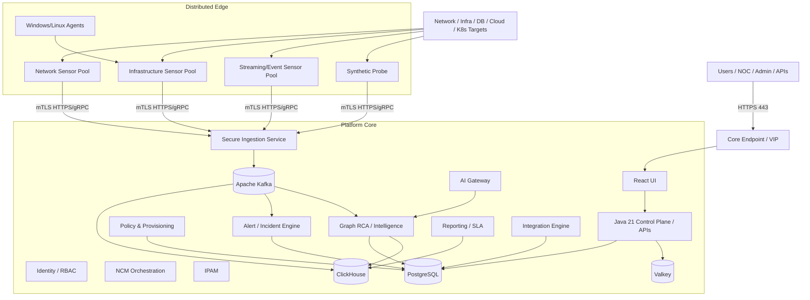
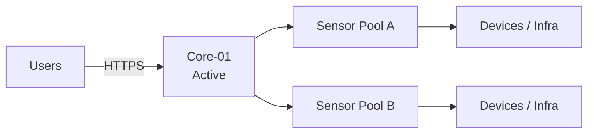
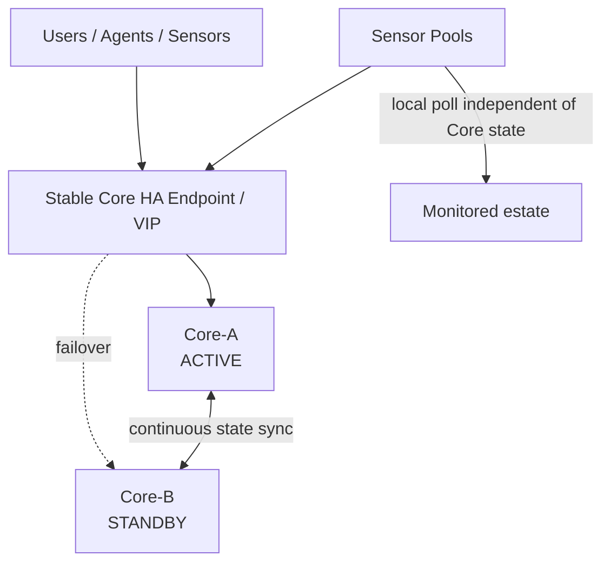
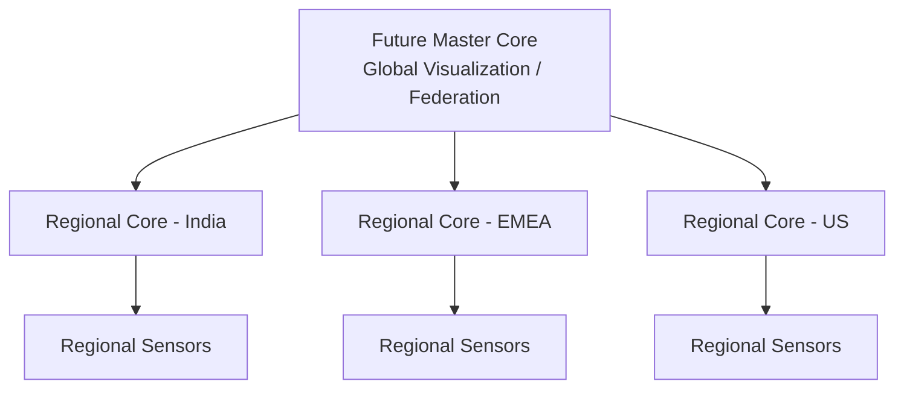
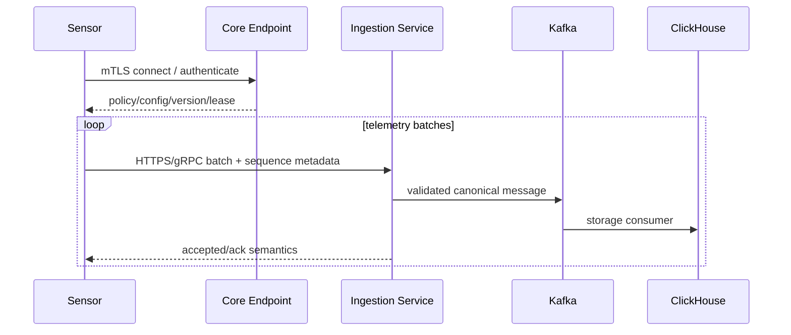
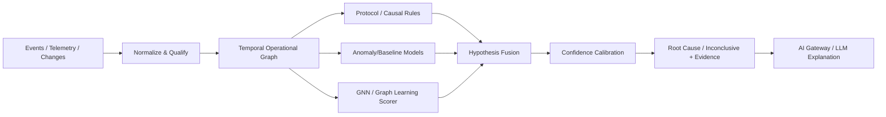
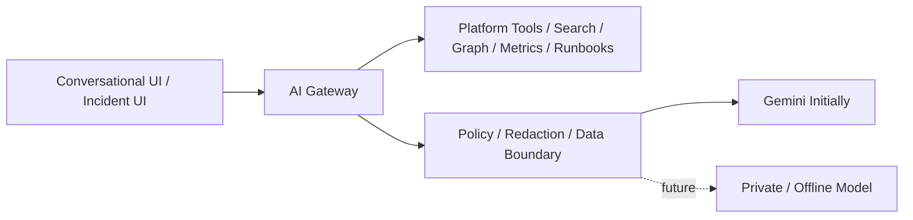
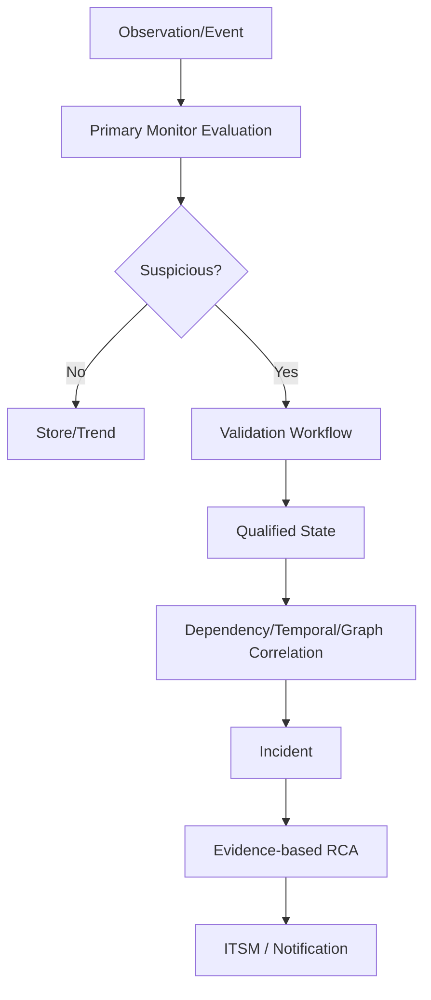
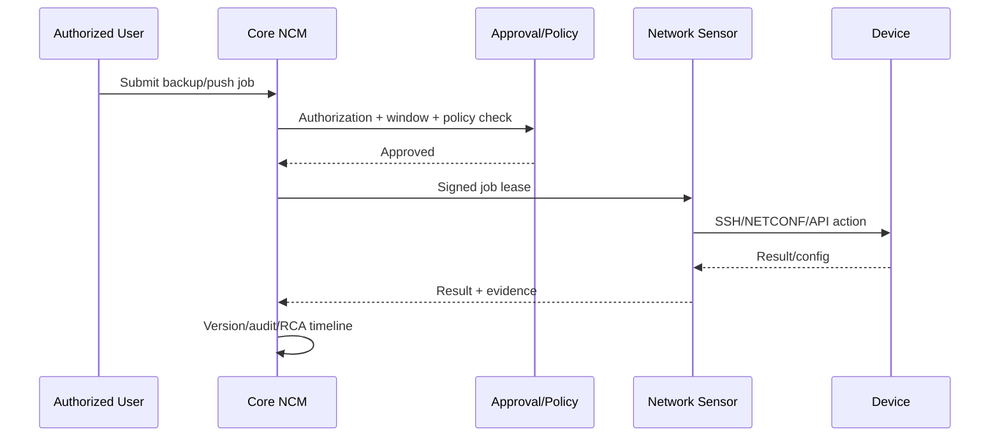
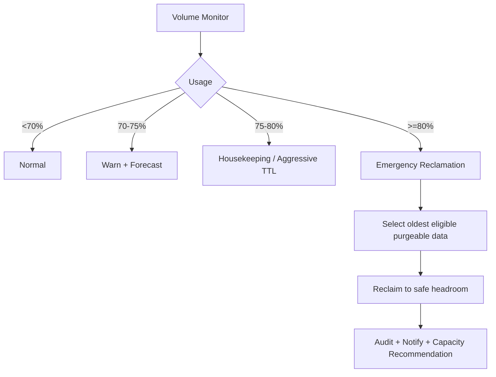

# Platform — Master Architecture Document

**Document ID:** PLATFORM-ARC-001  
**Version:** 3.2.3  
**Status:** Authoritative Mother Reference — Engineering Source of Truth
**Business requirements:** `Platform_01_BRD.md`  
**Product requirements:** `Platform_02_PRD.md`  

---

## 1. Architecture mandate

Platform is a clean-room enterprise network and infrastructure operations product. The architecture must support high monitoring breadth while remaining lightweight, low-latency, simple to deploy, safe under failure and operationally explainable.

The architecture is governed by the following constraints already decided:

- Working product name is **Platform**.
- Core and Sensor run on Ubuntu/RHEL; no Windows Core/Sensor initially.
- Core, Sensor and Agent are separate builds.
- One Core for standalone; exactly two full Core nodes for HA.
- HA is Active/Standby with less-than-60-second Core service restoration target.
- All Core components run on Core nodes; no mandatory third Core/governance node.
- Sensors continue polling during Core failover.
- Sensor → Core uses secure HTTPS/gRPC over mTLS to a Platform ingestion endpoint; Kafka is internal to Core.
- Kafka, ClickHouse, PostgreSQL and Valkey are baseline Core technologies.
- Go for Sensor runtime, Java 21 for Core control plane, React/TypeScript UI, Python where appropriate for AI/analytics/NCM.
- UI is HTTPS only and does not expose an application endpoint on TCP/80.
- Core and Sensor managed storage have a mandatory 80% storage-protection watermark.
- DR capability is required in v1.0.
- Full DPI and full APM are excluded initially.
- Gemini is accessed through an AI Gateway; causal RCA is not LLM-only.
- Platform is independent from ThoughtData and NetAI and must not reuse their proprietary implementation assets.

---

## 2. Architecture principles

| ID | Principle | Consequence |
|---|---|---|
| ARC-P01 | Core is the brain, Sensors are the collection edge | Central control/policy/identity/RCA lives in Core; protocol collection is distributed. |
| ARC-P02 | Locality first, capacity always | Place Sensors near devices but never overload them merely to minimize RTT. |
| ARC-P03 | Asynchronous over WAN | A poll must not require synchronous DB access across WAN. Sensor queues isolate WAN/Core disruption. |
| ARC-P04 | Central policy authority | Sensors are headless execution nodes. Desired state originates from Core. |
| ARC-P05 | One canonical entity graph | SNMP/flow/syslog/NCM/API observations converge on one entity identity and relationship model. |
| ARC-P06 | Evidence before AI | Deterministic/protocol/topology evidence is authoritative; ML/GNN augments ranking/anomaly detection; LLM explains/interacts. |
| ARC-P07 | Inconclusive is valid | RCA may explicitly return insufficient evidence rather than invent a cause. |
| ARC-P08 | Preserve evidence | Correlation suppresses noise for workflow but never destroys child-event evidence. |
| ARC-P09 | Policy-driven behavior | Polling, thresholds, validation, retention, placement and workflow are configured through hierarchical policy. |
| ARC-P10 | Protect live monitoring | Historical storage is reclaimable before live monitoring is allowed to stop due to disk pressure. |
| ARC-P11 | Fail safe | Ambiguous HA conditions must not create two authoritative active Cores. |
| ARC-P12 | Modular, not microservice-heavy by default | Fit the 8C/16G Core target by avoiding unnecessary JVM/service overhead. |
| ARC-P13 | API-first implementation, UI-first experience | All normal customer workflows use UI backed by stable APIs. |
| ARC-P14 | Security by default | HTTPS/mTLS, least privilege, auditing, secret protection and signed artifacts are baseline. |
| ARC-P15 | Clean-room + approved OSS | Reuse commodity permissive OSS; own differentiated Platform logic. |

---

## 3. High-level logical architecture



The diagram is logical. Internal process boundaries may be consolidated to meet resource targets.

---

## 4. Deployment architecture

### 4.1 Standalone deployment



Core-01 runs the complete Core stack. Sensors are separate installs and remain responsible for collection.

### 4.2 Two-node HA deployment



Requirements:

- one Active and one Standby only;
- both have the Core software and Core-local data components;
- stable HA endpoint abstracts node identity;
- Sensors/Agents must not require manual reconfiguration when Active changes;
- Sensor local buffering protects monitoring during failover;
- automatic promotion occurs only when the peer can be safely considered failed/fenced by the HA algorithm;
- if the failure state is ambiguous, the system prefers preventing dual-active even if this delays UI promotion.

### 4.3 Why no third Core

The customer-facing architecture intentionally remains two full Core nodes, consistent with the requirement and lessons from incumbent NMS HA patterns. This does **not** mean every internal distributed technology is used in its textbook multi-node quorum mode. Core-local components must be adapted to a two-node active/passive product topology rather than forcing a third full server onto the customer.

### 4.4 Future federation

Future only, not initial scope:



Future federation should keep high-volume raw telemetry regional and move summaries/incidents/global inventory upward, inspired by distributed NMS lessons such as SolarWinds EOC and ManageEngine LiteCentral patterns without copying their implementation.

---

## 5. Core component architecture

### 5.1 Modular Core

To satisfy the 8 vCPU / 16 GB target for the reference ≤2,500-device workload, the Java control plane should be modular rather than split into dozens of always-running JVM microservices.

Recommended runtime grouping:

- `platform-core-app`: tenant/admin, inventory, provisioning, policy, groups, alerts/incidents, IPAM control, NCM orchestration, integration orchestration, reporting control, audit APIs.
- `platform-ingest`: secure Sensor/Agent ingress, schema validation, sequencing and Kafka production.
- `platform-query`: optimized telemetry/query endpoints, possibly co-resident initially.
- `platform-ai`: AI Gateway/tool orchestration, separable process/service if Python/model runtime is required.
- `platform-analytics`: Python jobs for learned baselines/GNN training/evaluation where needed; not necessarily continuously resident on small Core.

Resource boundaries must be benchmarked and configured so Java, Kafka and ClickHouse cannot each independently consume the machine.

---

## 6. Core data technologies

### 6.1 PostgreSQL — authoritative transactional state

Use PostgreSQL for:

- tenant/customer definitions;
- users/roles/resource scopes;
- inventory identity/current state metadata;
- sites/groups/tags;
- credential metadata/references;
- monitoring policy definitions and versions;
- Device Pack metadata;
- provisioning/discovery jobs;
- current alerts/incidents/workflow state;
- NCM/IPAM metadata/current state;
- integration configuration;
- licensing;
- report/dashboard definitions;
- HA/installation metadata;
- AI configuration/feedback metadata;
- audit index/metadata as required.

PostgreSQL is the primary authoritative state store for control-plane data.

### 6.2 ClickHouse — high-volume historical analytics

Use ClickHouse for:

- numeric telemetry;
- state telemetry;
- NetFlow/IPFIX/sFlow;
- syslog/events;
- traps/event history;
- historical alerts/incidents where analytical access is needed;
- audit history where policy permits;
- RCA evidence/time-window facts;
- SLA/capacity facts;
- telemetry quality;
- historical topology/change facts where suitable.

Separate tables by workload rather than forcing all records into a generic table.

### 6.3 Kafka — internal durable streaming backbone

Kafka is mandatory internally for:

- ingestion decoupling;
- fan-out to storage, alerting, RCA and integrations;
- backpressure isolation;
- event ordering by key/partition;
- replay within configured retention.

Kafka is **not** exposed directly over customer WAN to Sensors. Sensors communicate through the Platform Ingestion Service.

Kafka is not the authoritative long-term telemetry database.

### 6.4 Valkey — cache/ephemeral state

Use Valkey for:

- caches;
- session/short-lived state where appropriate;
- frequently accessed derived values;
- rate limiting/short locks where semantics are safe.

Valkey must not become the only copy of business-critical persistent state.

---

## 7. Two-Core stateful-service strategy

The two-Core topology creates special engineering requirements because textbook Kafka controller quorums and ClickHouse Keeper quorums normally prefer an odd number of voting members.

Platform therefore adopts these architectural rules:

1. **The product topology is authoritative:** exactly two full Core nodes in HA.
2. **PostgreSQL:** use primary/standby streaming replication with controlled promotion/fencing semantics.
3. **ClickHouse:** maintain a second up-to-date Core copy through an implementation specifically validated for two-node active/passive failover. Candidate mechanisms include dual-write/backfill or controlled replica strategy; the final certified mechanism is a P0 engineering design spike and must not falsely claim quorum guarantees that are not present.
4. **Kafka:** treat Kafka as an internal transport, not the sole copy of telemetry. Sensor durable spools are the edge replay source; ClickHouse/PostgreSQL are persistent destinations. The exact Kafka active/passive/failover implementation for two Core nodes is a P0 design spike. It must preserve the no-third-Core requirement and prove failover behavior experimentally.
5. **No hidden split-brain:** a two-node partition must not result in two writable authoritative Cores.

This is an explicit technical risk area and requires failure testing before GA.

---

## 8. Sensor architecture

### 8.1 Sensor runtime

Recommended language: Go.

Reasons:

- efficient goroutines/network I/O;
- strong permissively licensed protocol ecosystem;
- low runtime footprint compared with multi-JVM edge components;
- straightforward single-binary packaging;
- suitable for SNMP, flow, gNMI, SSH, REST, cloud and Agent ingestion.

Rust may be introduced only for benchmark-proven hotspots, not as a blanket requirement.

### 8.2 Internal Sensor worker pools

Sensor isolates workloads into bounded worker pools:

- ICMP/traceroute;
- SNMP;
- SSH/NETCONF/CLI;
- REST/API;
- gNMI/streaming;
- discovery/topology;
- NCM execution;
- flow/event receivers;
- Agent ingress;
- local spool/uploader;
- diagnostics/health.

A high-rate Flow workload must not starve SNMP polling or NCM safety tasks.

### 8.3 Sensor local storage

The Sensor stores only operational state required for continuity:

- job/policy cache;
- enrollment identity/certificates;
- local spool;
- logs/diagnostics;
- upgrade rollback assets;
- bounded discovery/transient state.

It is not a full independent historical NMS database.

### 8.4 Sensor communication



Exact acknowledgment semantics must ensure data is not silently lost when Core fails after accepting a batch; LLD defines the sequence/replay contract.

---

## 9. Device/Agent placement architecture

Core owns placement policy.

### 9.1 Sensor suitability score

Inputs include:

- reachability;
- RTT;
- packet loss;
- capacity/work units;
- CPU/RAM/disk/queue;
- site/region affinity;
- allowed/forbidden pools;
- protocol compatibility;
- HA spare capacity;
- maintenance state.

The engine chooses the best **eligible** Sensor, not necessarily the lowest RTT.

### 9.2 Placement modes

- Automatic.
- Recommendation requiring approval.
- Manual pin.
- Sensor Pool assignment.

### 9.3 Rebalancing

A controller detects sustained imbalance and proposes/makes movement according to policy. Hysteresis and minimum-improvement thresholds prevent oscillation.

---

## 10. Canonical data model

### 10.1 Entity identity

Every observed object receives a stable internal `entity_id` independent of transient IP/hostname.

Canonical identity is tenant-aware and may use:

- serial;
- hardware UUID;
- SNMP engine ID/sysObjectID;
- MAC;
- cloud resource ID;
- virtualization ID;
- Kubernetes UID;
- hostname + namespace/context;
- administrator reconciliation.

### 10.2 Monitor Definition

Every normalized metric should derive from a Monitor Definition containing at least:

- `metric_key`;
- entity type/scope;
- source protocol;
- source path/OID/query;
- value type/units;
- collection interval/policy;
- quality rules;
- threshold/baseline applicability;
- visualization hints;
- Device Pack provenance.

Protocol source does not dictate dashboard semantics. SNMP/REST/WMI/gNMI can normalize to the same semantic metric.

---

## 11. Temporal operational graph

### 11.1 Graph layers

The graph includes:

- physical/L1;
- L2 switching/VLAN/FDB;
- L3 IP/routing;
- protocol adjacencies;
- MPLS/VRF/LSP;
- VXLAN/EVPN/tunnels;
- SD-WAN;
- server/virtualization/storage dependencies;
- cloud/Kubernetes relationships;
- business-service/manual logical dependencies;
- Sensor assignment/monitoring dependencies;
- incident causal edges.

### 11.2 Relationship provenance

Every edge stores:

- relationship type;
- source protocol/user/Device Pack;
- first/last observed;
- current/historical state;
- confidence/quality;
- evidence reference.

### 11.3 Temporal snapshots

The system must reconstruct graph state around an incident time window using relationship history rather than assuming current topology always represents past topology.

---

## 12. Graph intelligence / GNN architecture

### 12.1 Learning incorporated

The graph-intelligence architecture explicitly incorporates lessons from graph-first network RCA products, including NetAI GraphIQ concepts observed in public/supplied material:

- topology is a reasoning substrate;
- multi-layer correlation matters;
- temporal ordering and propagation path matter;
- blast radius is part of diagnosis;
- child alarm evidence remains visible;
- conversational AI should sit on top of graph/evidence, not replace it.

### 12.2 Hybrid pipeline



### 12.3 GNN role

GNN is not permitted to declare an unsupported cause solely because a learned score is high. Its role is to rank/score graph hypotheses, detect propagation/structural patterns and assist evidence collection.

### 12.4 Model governance

Model artifacts must record:

- model/version;
- training/evaluation dataset version;
- feature schema;
- graph schema version;
- inference timestamp;
- input graph snapshot/time window;
- score/confidence/calibration;
- known limitations.

Production rollout follows canary/model-quality gates. A bad model can be disabled without disabling deterministic RCA.

### 12.5 GNN framework

**TBD after OSS/licence/performance evaluation.** PyTorch/PyTorch Geometric or another framework may be evaluated, but no framework is frozen by this architecture document.

Base Platform sizing must not assume a dedicated GPU. Optional GPU acceleration may be introduced only after benchmark and commercial justification.

---

## 13. AI Gateway architecture

The AI Gateway isolates product logic from Gemini/provider specifics.



The model receives tool-grounded context rather than unrestricted direct database credentials. AI never receives stored secrets. Tool calls are authorized as the initiating user/service and audited.

---

## 14. Alert qualification and incident architecture



SNMP timeout is evidence, not automatic device-down truth.

Recovery follows its own validation state machine before incident closure.

---

## 15. Policy architecture

Policies are immutable-versioned definitions with hierarchical assignment.

Precedence:

`Platform Default < Tenant < Business Unit/Region < Site < Group < Device < Metric/Data Type`.

Each effective value is explainable: source policy, version, override path, actor and time.

Policy evaluation uses constrained expression logic such as CEL where appropriate; arbitrary user code is not required for standard operation.

---

## 16. Provisioning architecture

### 16.1 Stages

Input → Normalize → Validate → Identity/Duplicate Check → Sensor Candidate Test → Protocol/Auth Test → Device Identification → Monitoring/Profile Fit → Capacity Preview → Approval → Provision → Verify.

### 16.2 Preflight execution location

Protocol tests must execute from the actual candidate Sensor(s), not from Core, so firewall/ACL/path results represent production monitoring conditions.

### 16.3 Error model

Provisioning failures are structured error codes with evidence and remediation, not raw stack traces.

---

## 17. Extensibility architecture

### 17.1 Device Pack

Device Pack is the primary extension unit joining collection, identity, topology, dashboards, alerts, NCM and RCA semantics.

### 17.2 MIB/API/YANG provenance

Every imported external artifact records provenance, version, copyright/licence/redistribution status and owner. Customer-supplied files remain customer-scoped unless redistribution rights exist.

### 17.3 Signed packages

Device Packs are versioned and signed; import/update supports compatibility checks and rollback.

---

## 18. NCM architecture

NCM orchestration is central; protocol execution occurs on eligible Network Sensors near devices.



Bulk NCM work has separate concurrency/rate limits from monitoring.

---

## 19. Browser CLI architecture

Browser → Core WebSocket Session Broker → assigned Network Sensor → SSH device.

- credential never exposed to browser;
- command/session audit;
- role/scope/approval/JIT controls;
- optional session recording;
- CLI change becomes RCA timeline evidence.

---

## 20. IPAM architecture

IPAM authoritative current state lives in PostgreSQL and is enriched by discovery/graph observations. It supports IPv4/IPv6, VRF/VLAN namespaces, DHCP/DNS integration and history/forecast facts in ClickHouse where useful.

NetBox-like external tools may integrate, but Platform IPAM remains coherent with Platform canonical inventory and authorization.

---

## 21. Data lifecycle architecture

### 21.1 Data classes

- numeric telemetry;
- state telemetry;
- flows;
- syslog/log events;
- traps/events;
- alerts/incidents;
- audit;
- NCM versions;
- topology/history;
- SLA/report aggregates;
- configuration/identity.

### 21.2 Rollups

Raw → configurable rollup resolutions → longer-term aggregates → optional archive.

For numeric values store relevant min/max/avg/count/first/last/percentile. Counters use delta/rate semantics. States use availability/duration/transition semantics.

### 21.3 Query resolution selection

Query service chooses suitable table/resolution based on requested range and availability; UI indicates historical resolution.

---

## 22. Storage Protection architecture



Implemented independently for relevant Core and Sensor volumes. Monitoring has higher priority than historical raw retention.

Emergency deletion must use efficient partition/TTL operations rather than billions of row-level deletes where possible.

---

## 23. Security architecture

### 23.1 Trust boundaries

- Browser/user ↔ Core: HTTPS/OIDC/SAML/local auth.
- Sensor ↔ Core: mTLS.
- Agent ↔ Core bootstrap and Agent ↔ Sensor telemetry: mTLS.
- Core internal services: TLS/mTLS according to deployment threat model.
- Device connections: protocol-specific secure method and credential policy.
- External integrations: HTTPS/TLS/mTLS/OAuth etc.

### 23.2 Secrets

Secrets are encrypted at rest, accessed by reference, masked in UI/logs, never included in exports/AI by default and separated from ordinary inventory.

### 23.3 Authorization

Server-side resource authorization with tenant, scope, action and condition. UI hiding is only presentation.

### 23.4 Audit

All state-changing/security-sensitive operations produce structured audit events. Audit export to SIEM supported.

### 23.5 Supply chain

Release produces SBOM, checksums, provenance and third-party notices. Dependency additions pass OSS licence/security policy.

---

## 24. Open-source architecture baseline

The following are recommended/approved candidates subject to version-level OSS catalogue scanning:

| Module | OSS / technology | Architecture use |
|---|---|---|
| Core framework | Java 21 + Spring Boot | Control plane/API/modules |
| Messaging | Apache Kafka | Internal event/telemetry backbone |
| Schema | Avro/Protobuf + Apicurio Registry | Event/schema governance |
| Control DB | PostgreSQL | Transactional authority |
| Telemetry analytics | ClickHouse | Metrics/flow/log/event analytics |
| Cache | Valkey | Cache/ephemeral state |
| SNMP | GoSNMP | Sensor SNMP engine |
| MIB | gosmi + approved MIB tooling | MIB Studio/Device Packs |
| Flow | GoFlow2 | NetFlow/IPFIX/sFlow parsing |
| ICMP | Go x/net/icmp | Ping/probes |
| SSH | Go x/crypto/ssh | Sensor SSH/CLI plumbing |
| gNMI | OpenConfig gNMI | gNMI transport |
| YANG | goyang/ygot | YANG/model utilities |
| REST/OpenAPI | Go HTTP + kin-openapi | API Studio/runtime |
| Windows agentless | masterzen/winrm | WinRM plumbing |
| Redfish | Gofish | Hardware API |
| VMware | govmomi | vSphere |
| Kubernetes | client-go | K8s |
| OTel | OpenTelemetry Collector/libraries | OTLP ingest |
| NCM | Nornir/scrapli/scrapli_cfg/NAPALM/NTC Templates/Jinja2 where licence/dependency scan passes | NCM execution/parsing |
| UI | React/TypeScript | Web application |
| UI build tooling | Node.js 20 / npm / Vite / TypeScript | Docker-only UI build toolchain (see OSS-111..115) |
| UI HTTPS proxy (dev) | NGINX Open Source | Dev UI static/TLS reverse proxy only (OSS-110; not mandatory production Core) |
| Core JSON logging | logstash-logback-encoder | Structured log encoding (OSS-116; Platform owns fields/redaction/taxonomy) |
| Charts | Apache ECharts | Charts |
| Tables | TanStack Table | Large grids |
| Topology | Cytoscape.js | Graph visualization |
| Geo | MapLibre GL JS | Map visualization; tile/data licence handled separately |
| Terminal | xterm.js | Browser terminal |
| Expressions | CEL | Safe policy/formula expressions |
| PDF/XLSX | Apache PDFBox / Apache POI | Reports |
| Analytics | Polars, NumPy, scikit-learn | Batch/ML analytics |
| GNN | TBD | Candidate framework subject to benchmark/licence review |
| OSS compliance | ORT, Syft, Trivy, ScanCode | SBOM/licence/security pipeline |

Platform should not embed entire external NMS/IPAM/dashboard products as core product authorities. Libraries are preferred over nested products when domain models would conflict.

---

## 25. Architecture lessons: what not to copy

### 25.1 Do not turn every Sensor into a full independent NMS database

This creates sync/reconciliation complexity. Sensors stay lightweight with durable spool and bounded operational state.

### 25.2 Do not make Core poll everything

Collection belongs near devices. Core focuses on control, visualization, correlation, policy, RCA and reporting.

### 25.3 Do not expose Kafka to WAN/Sensors

Keep Kafka internal. mTLS HTTPS/gRPC ingress is easier to secure, firewall and evolve.

### 25.4 Do not equate AI confidence with truth

Every RCA hypothesis must show evidence and support `INCONCLUSIVE`.

### 25.5 Do not hard-code enterprise thresholds

Operational policies must be editable with inheritance and impact preview.

---

## 26. Scalability architecture

### 26.1 Core reference target

Up to 2,500 devices under SNWP-2500-v1: 8 vCPU / 16 GB RAM mandatory optimization target.

### 26.2 Sensor planning baseline

- 4 vCPU / 16 GB / 150 GB local SSD: ~800 normal network devices planning baseline.
- 8 vCPU / 16 GB: engineering benchmark objective ~2,000–2,500 normal network devices where workload permits.

### 26.3 Horizontal scaling

Scale collection by adding Sensors/Sensor Pools first. Core grows when ingestion/query/concurrency/RCA/report workload requires it, not linearly with device count alone.

### 26.4 Future multiple Cores

Large/global environments may later use autonomous regional Cores with a Master Core/federation layer. Not initial scope.

---

## 27. Performance architecture

- ClickHouse materialized rollups/appropriate partitioning.
- Server-side pagination and query limits.
- Valkey caching for hot derived state.
- Asynchronous reports/exports.
- Virtualized browser tables.
- No browser-side processing of millions of records.
- Bounded worker/concurrency pools.
- Batch Sensor uploads/compression where useful.
- Adaptive polling to spend resources where evidence justifies it.
- Query/cardinality guardrails.

---

## 28. Backup, restore, DR and upgrades

Architecture must separate:

- HA: same deployment service continuity.
- Backup/restore: recover data/configuration.
- DR: recover from site-level loss.

DR is mandatory v1.0, but exact RPO/RTO is TBD.

Upgrade architecture uses preflight, backup, compatibility checks, Sensor drains, component migration, validation and rollback. Device Packs/Agents/Sensors support staged/canary rollout.

---

## 29. Architecture decision records (ADR summary)

| ADR | Decision | Status |
|---|---|---|
| ADR-001 | Product is clean-room, independent from ThoughtData/NetAI | Accepted |
| ADR-002 | Core/Sensor Linux: Ubuntu 24 LTS + RHEL 9 initial certification | Accepted |
| ADR-003 | Core HA = exactly two full nodes, Active/Standby | Accepted |
| ADR-004 | Sensors poll independently and buffer through Core failover | Accepted |
| ADR-005 | Sensor→Core via HTTPS/gRPC mTLS ingestion, Kafka internal | Accepted |
| ADR-006 | Kafka + ClickHouse + PostgreSQL + Valkey baseline | Accepted |
| ADR-007 | ClickHouse primary high-volume analytics store; no Elasticsearch core dependency | Accepted |
| ADR-008 | Go Sensor, Java 21 Core, React/TS UI, Python selected analytics/NCM/AI | Accepted |
| ADR-009 | One Universal Sensor Runtime with selectable roles | Accepted |
| ADR-010 | Sensor placement is locality + capacity + policy aware | Accepted |
| ADR-011 | Canonical entity + temporal multi-layer graph is first-class | Accepted |
| ADR-012 | RCA hybrid deterministic/protocol/graph/ML/GNN; LLM separate | Accepted |
| ADR-013 | GNN augments; cannot independently prove causality | Accepted |
| ADR-014 | Customer operational behavior policy-driven through UI | Accepted |
| ADR-015 | Core/Sensor 80% storage protection mandatory | Accepted |
| ADR-016 | UI HTTPS only, no TCP/80 application listener | Accepted |
| ADR-017 | DR architecture mandatory v1.0 | Accepted |
| ADR-018 | DPI/full APM excluded initial scope | Accepted |
| ADR-019 | Full Master/Regional Core federation future only | Accepted |
| ADR-020 | Excessive microservice decomposition avoided in small Core | Accepted |
| ADR-021 | Exact two-node Kafka/ClickHouse failover mechanism requires P0 engineering spike | Open implementation decision |
| ADR-022 | GNN framework/GPU profile not frozen until benchmark/licence review | Open implementation decision |

---

## 30. Architecture risk register

| Risk | Impact | Required mitigation |
|---|---|---|
| Two-node stateful services without third quorum | Split brain/data availability | Fail-safe active/passive design, fencing/positive failure confirmation, Sensor replay, failure lab before GA |
| 8C/16G Core target too aggressive for all-in-one Core stack | Product footprint misses goal | Strict resource envelopes, modular runtime, benchmark SNWP-2500-v1, tune Kafka/ClickHouse/Java memory |
| High-cardinality custom APIs/OTel | Storage/query blow-up | Cardinality guardrails, quotas, mapping review, alerting |
| Flow/syslog overload starves polling | False gaps/alerts | Separate worker pools and dedicated Streaming Sensor thresholds |
| Stale topology leads to wrong RCA | Wrong diagnosis | edge provenance/freshness, telemetry quality, confidence reduction, inconclusive outcome |
| GNN overconfidence | Wrong root cause | constrained fusion, calibration, evidence requirement, benchmark, model disable path |
| LLM hallucination | Unsafe advice | tool-grounding, data boundary, no direct execution, approval, explicit evidence |
| Retention/80% purge removes required evidence | Investigation/compliance issue | protected classes, legal hold, rollups, audit/notification, archive |
| Customer policy overloads Sensors | Monitoring degradation | capacity impact simulation and policy safety limits |
| OSS relicensing/transitive dependency risk | Commercial/legal risk | OSS Catalogue, SBOM, scans, scheduled licence/security watch |

---

## 31. Architecture acceptance gates

Architecture is accepted for implementation only when engineering plans explicitly address:

- two-Core split-brain prevention;
- two-Core PostgreSQL/ClickHouse/Kafka failover/replay behavior;
- Sensor spool durability/idempotency;
- SNWP-2500-v1 benchmark;
- Sensor workload model;
- canonical identity and graph history;
- RCA evidence schema and inconclusive behavior;
- security trust boundaries and PKI;
- storage-protection safety;
- upgrade/DR/backup mechanics;
- full UI/API authorization enforcement;
- observability of Platform itself.

---

## 32. Explicit architecture TBDs

1. Exact two-Core Kafka failover implementation and acceptance model.
2. Exact two-Core ClickHouse synchronization/failover implementation.
3. Exact HA fencing mechanism for ambiguous node/network failures.
4. DR RPO/RTO and activation topology.
5. Exact GNN framework/model architecture and optional GPU profile.
6. Exact certified Sensor density beyond current planning baseline.
7. Future regional/Master Core release design.
8. Final compliance certification roadmap.

No TBD above may be converted into an external product claim until engineering certification.

---

## 33. Additional cross-cutting architecture capabilities

### 33.1 Desired-state reconciliation

Core Policy/Sensor Control shall maintain a distinction between **desired state** and **observed/applied state** for Sensor assignments, policy versions, Device Pack versions, credential versions, Agent/Sensor versions and monitoring enablement. Drift is a first-class state and feeds Platform Operations, audit and remediation workflows.

### 33.2 Migration architecture

Migration Studio shall be adapter-based. External exports/APIs are parsed into a **staging canonical model**, mapped to Platform entities/sites/groups/tags/credentials-by-reference/policies where semantics are safely translatable, then reviewed before commit. External source products never become runtime authorities inside Platform.

### 33.3 Technology lifecycle intelligence

Lifecycle metadata is an enrichment domain joined to canonical inventory. Source/provenance and retrieval date are mandatory because vendor support dates change and may have licensing restrictions. Lifecycle intelligence must not contaminate core identity if the metadata is stale/unavailable.

### 33.4 Operational knowledge and PIR

Runbooks/known issues are versioned knowledge artifacts. Incident closure can create a PIR artifact assembled from immutable timeline/evidence with human-approved CAPA. AI may summarize but not silently rewrite authoritative operator conclusions.

### 33.5 Effectiveness/quality analytics

Platform shall analyze its own monitoring intelligence: alert policy effectiveness, qualification outcomes, RCA accuracy, telemetry quality, Sensor efficiency and pipeline integrity. These analytics are essential for proving the low-noise/meaningful-AI product proposition.


---

# Version 3.0 Reconciliation — Requirements That Must Not Be Lost

This section is part of the authoritative document. It was added after a complete reconciliation of the Platform design discussions because the earlier split-document version compressed or omitted details. The canonical requirement IDs are in `Platform_08_Requirements_Traceability.md`; OSS decisions are in `Platform_07_OSS_Catalog.md`.

The following cross-cutting capabilities are mandatory where applicable and must be represented in design, UI, APIs, security, audit and QA:

- asset lifecycle/reconciliation, stale/disappeared/replaced device handling and decommission workflow;
- technology lifecycle/EOL/EOS/firmware risk visibility without pretending to be a vulnerability scanner;
- backup, restore verification, v1.0 DR, low-downtime upgrade, rollback, canary and feature-flag controls;
- desired-vs-actual monitoring state, drift detection, change impact preview and dry-run;
- path analysis, device/time comparison, circuit inventory, business/service ownership and shift handover;
- learned baselines/seasonality, alert storm protection, flapping detection, event compression and alert-policy effectiveness;
- unified Operations Timeline combining telemetry, events, topology, NCM, audit, user action, sensor activity, ITSM and RCA;
- data provenance/quality/confidence, topology relationship provenance/confidence and historical topology;
- global search, command palette, contextual troubleshooting actions, support bundle and customer-visible Platform Health;
- licensing/usage dashboard, data-growth forecast and entitlement-aware UI;
- sensitive-field classification, masking/drop/hash/store policy, AI data boundaries and AI audit;
- Device Pack certification/test simulator, import/export, template library, onboarding wizard and contextual help;
- API-first implementation, webhooks/outbound events, API governance, rate limits and query protection;
- integration test sandbox, timezone/site timezone handling, internationalization foundations and accessibility;
- telemetry/cardinality explosion protection, tenant/noisy-neighbor quotas, ingestion dedupe, late/out-of-order/replay handling and legal hold;
- Migration Studio and Environment Readiness Scanner;
- change-freeze/business calendars, runbook/knowledge library and post-incident review/problem management;
- RCA accuracy/feedback metrics, monitoring optimization recommendations and Sensor placement learning;
- certificate/PKI lifecycle, proxy/no-proxy and data-sovereignty/regional-placement readiness;
- IPv6/dual-stack first-class behavior;
- scheduled housekeeping and end-to-end pipeline-integrity visibility;
- stable customer-facing error codes/correlation IDs and **No Silent Failure**.


## ARCH-OSS-FULL — Authoritative technology decision map

The v1 document listed only names. The v2 architecture freezes how OSS is used and where Platform code begins. Exact versions are pinned by release and governed by `Platform_07_OSS_Catalog.md`.

| ID | Domain | Capability | OSS / Technology | License | Decision | Runtime | How Platform uses it | What remains custom |
|---|---|---|---|---|---|---|---|---|
| OSS-001 | Core Framework | Core control plane/API | Spring Boot | Apache-2.0 | USE | Core | Java 21 modular Core framework, REST/API, security integration, configuration, lifecycle. | Do not build web/application framework plumbing. Platform-specific domain modules, policies, authorization semantics and workflows remain custom. |
| OSS-002 | Streaming | Internal durable event/telemetry backbone | Apache Kafka | Apache-2.0 | USE | Core | Internal message backbone for normalized telemetry, events, audit, alert/RCA processing and async integration. Kafka is not exposed directly to Sensors. | Kafka is commodity streaming; Platform owns topic contracts, idempotency, routing, retention, replay semantics and two-Core failover integration. |
| OSS-003 | Streaming | Go Kafka client | franz-go | BSD-3-Clause | USE | Core/Sensor utilities | Efficient Go Kafka producer/consumer where Go components communicate with internal Kafka. | Do not write Kafka protocol client. Wrap behind Platform producer/consumer interfaces. |
| OSS-004 | Schema Registry | Schema governance | Apicurio Registry | Apache-2.0 | USE | Core | Registry for Avro/Protobuf schemas and compatibility rules. | Avoid proprietary schema-registry lock-in; Platform owns subject naming, compatibility policy and release governance. |
| OSS-005 | Schema | Event serialization | Apache Avro | Apache-2.0 | USE | Core/Schemas | Candidate/default for selected event families needing schema evolution. | Schema choice is per contract; Platform owns canonical event definitions. |
| OSS-006 | Schema | RPC/event serialization | Protocol Buffers | BSD-3-Clause / bundled notices | USE | Core/Sensor/API | Typed RPC/event contracts where protobuf/gRPC is appropriate. | Platform owns canonical schemas and compatibility rules. |
| OSS-007 | Transactional Data | Authoritative control/config database | PostgreSQL | PostgreSQL License | USE | Core | Tenants, inventory, policies, RBAC metadata, device definitions, current state, IPAM, NCM metadata, licensing, workflow state. | Do not use PostgreSQL as the primary high-volume telemetry store. Platform owns schema and migrations. |
| OSS-008 | Telemetry Data | High-volume analytics/time-series store | ClickHouse | Apache-2.0 | USE | Core | Metrics, flow, syslog/events, alert history, incident evidence, audit history, SLA/capacity facts and analytics. | Chosen over Elasticsearch as primary store for resource-efficient analytical telemetry. Platform owns schemas, TTLs, rollups and query planner. |
| OSS-009 | Cache | Cache/ephemeral state | Valkey | BSD-3-Clause | USE | Core | Query cache, ephemeral coordination/state where data loss is acceptable/reconstructable. | Do not store authoritative state only in cache. |
| OSS-010 | Identity | Identity federation | Keycloak | Apache-2.0 top-level; transitive scan required | USE/WRAP | Core | OIDC/SAML/LDAP/AD federation, authentication flows and MFA integration. | Keycloak answers identity/authentication; Platform owns tenant/resource authorization. Every distribution must scan Keycloak transitive dependencies. |
| OSS-011 | Authorization | General policy decision engine | Open Policy Agent (OPA) | Apache-2.0 | CANDIDATE | Core | Candidate for selected coarse-grained authorization/policy decisions. | Do not make OPA the owner of Platform domain authorization without a benchmark/design decision. Platform RBAC/resource-scope semantics remain custom. |
| OSS-012 | Expressions | Safe expression language | CEL (cel-java / cel-go) | Apache-2.0 | USE | Core/Sensor | Threshold formulas, dynamic groups, constrained policy expressions and safe user-defined conditions. | Use non-Turing-complete CEL rather than arbitrary Python/JavaScript in customer policy paths. Platform defines allowed variables/functions/cost limits. |
| OSS-013 | Data Interchange | Columnar in-memory interchange | Apache Arrow | Apache-2.0 with bundled third-party notices | OPTIONAL | Core/Analytics | Efficient analytical interchange where it materially reduces copies/serialization. | Only introduce where benchmark justifies it. |
| OSS-014 | Search | Optional dedicated full-text search | OpenSearch | Apache-2.0 | OPTIONAL-LATER | Core | Add only if customer log search requirements exceed ClickHouse text-search capability. | Not mandatory in V1 to keep footprint low. Elasticsearch is not the core store. |
| OSS-020 | Network Collection | SNMP v1/v2c/v3 | GoSNMP | BSD-style | USE/WRAP | Sensor | SNMP Get/GetNext/GetBulk/Walk/Set and traps/informs protocol engine. | Do not reimplement BER/SNMP. Platform owns scheduling, credential profiles, normalization, validation, retry and policy. |
| OSS-021 | Network Collection | MIB parsing | gosmi | MIT | USE/WRAP | Core Studio/Sensor build tooling | Parse SMIv1/v2 MIBs for MIB Studio, OID metadata, enums, tables and notifications. | Platform owns MIB provenance, dependency workflow, metric semantics, Device Pack generation and redistribution controls. |
| OSS-022 | Network Collection | NetFlow/IPFIX/sFlow parsing | GoFlow2 | BSD-3-Clause | USE/WRAP | Streaming Sensor | Decode NetFlow v5/v9, IPFIX and sFlow. | Platform owns enrichment, canonical flow schema, cardinality controls, Kafka publishing and analytics. |
| OSS-023 | Network Collection | ICMP | golang.org/x/net/icmp | BSD-3-Clause | USE | Sensor/Agent | ICMP echo and low-level packet operations. | Platform owns scheduling, statistics, validation workflows, jitter/loss aggregation and path correlation. |
| OSS-024 | Network Collection | DNS protocol | miekg/dns | BSD-style | USE | Sensor/Agent | Detailed DNS synthetic checks where standard resolver APIs are insufficient. | Platform owns test definitions, validation and SLA semantics. |
| OSS-025 | Network Collection | SSH | golang.org/x/crypto/ssh | BSD-3-Clause | USE/WRAP | Sensor | SSH transport for CLI, discovery, diagnostics and NCM. | Platform owns credential brokering, command controls, session audit and vendor behavior. |
| OSS-026 | Network Collection | CLI/NETCONF automation | scrapligo | MIT | CANDIDATE/USE | Sensor | Go network CLI/NETCONF automation where it fits Sensor runtime. | Wrap behind Device Pack adapter; avoid lock-in to vendor/platform naming. |
| OSS-027 | Network Collection | gNMI | OpenConfig gNMI | Apache-2.0 | USE/WRAP | Sensor | gNMI Get/Set/Subscribe protocol and reference client components. | Platform owns subscription policy, normalization, capacity controls and graph semantics. |
| OSS-028 | Network Collection | YANG parsing | OpenConfig goyang | Apache-2.0 | USE | Core Studio/Sensor | YANG model parsing for Device Pack/YANG support. | Platform owns YANG Studio workflow, provenance and mapping. |
| OSS-029 | Network Collection | YANG model utilities | OpenConfig ygot | Apache-2.0 | USE | Core Studio/Sensor | YANG-centric validation/marshal/unmarshal utilities. | Platform owns canonical mapping and compatibility policy. |
| OSS-030 | API Connectors | OpenAPI parser/validator | kin-openapi | MIT | USE | Core Studio/Sensor | OpenAPI/Swagger import, validation and schema handling for API Studio. | Platform owns endpoint discovery, field/metric/entity inference, chained-call orchestration and Device Pack generation. |
| OSS-031 | Logs/Events | Log/syslog collection helper | Fluent Bit | Apache-2.0 | CANDIDATE/INTEGRATE | Streaming Sensor/Agent | Use as an integration/collection component where appropriate for log ingestion and parsing. | Do not make Fluent Bit the Platform event model. Platform owns normalization, cardinality, retention and alert/RCA semantics. |
| OSS-040 | Infrastructure | Windows WinRM | masterzen/winrm | Apache-2.0 | USE/WRAP | Infrastructure Sensor | WinRM command/collection plumbing for Windows agentless monitoring. | Platform owns secure policy, metrics, credentials, diagnostics and retries. |
| OSS-041 | Infrastructure | Host metrics helpers | gopsutil | BSD-3-Clause | USE | Agent/Sensor | Cross-platform host process/CPU/memory/disk/network primitives where suitable. | Use native OS APIs where required for accuracy; Platform owns schema and collection policy. |
| OSS-042 | Hardware | Redfish/Swordfish | Gofish | BSD-3-Clause | USE/WRAP | Infrastructure Sensor | Redfish/Swordfish hardware inventory/health collection. | Platform owns normalized hardware entity model and vendor packs. |
| OSS-043 | Virtualization | VMware vSphere | govmomi | Apache-2.0 | USE/WRAP | Infrastructure Sensor | vCenter/ESXi inventory, topology and metrics via vSphere APIs. | Platform owns graph, monitoring policy, dashboards and alerts. |
| OSS-044 | Containers | Kubernetes client | client-go | Apache-2.0 | USE/WRAP | Infrastructure/Cloud Sensor | Kubernetes API, inventory, events and workload discovery. | Platform owns canonical K8s graph and correlation. |
| OSS-045 | Observability | OpenTelemetry / OTLP | OpenTelemetry Collector + contrib | Apache-2.0 | USE/INTEGRATE | Sensor/Core ingestion | OTLP metrics/logs ingestion and selected receivers/exporters where appropriate. | Platform does not market full APM initially. Trace storage/UX is future-ready only. |
| OSS-046 | Containers | Docker/container runtime API | Moby/Docker client libraries | Apache-2.0 | CANDIDATE | Infrastructure Sensor | Container runtime inventory/metrics where Docker API is used. | Use only required client APIs and version-pin. |
| OSS-047 | Cloud | AWS API/monitoring | AWS SDK for Go v2 | Apache-2.0 | USE/WRAP | Cloud Sensor | AWS inventory/monitoring API access. | Platform owns entity normalization and policy. Version-level dependency scan mandatory. |
| OSS-048 | Cloud | Azure API/monitoring | Azure SDK for Go | MIT / component-specific review | USE/WRAP | Cloud Sensor | Azure inventory/monitoring APIs. | Version-level component/license scan required. |
| OSS-049 | Cloud | GCP API/monitoring | Google Cloud Go | Apache-2.0 | USE/WRAP | Cloud Sensor | GCP APIs and monitoring integrations. | Platform owns entity normalization and policy. |
| OSS-060 | NCM | Network task orchestration | Nornir | Apache-2.0 | USE/WRAP | NCM Worker | Parallel inventory/task orchestration for network automation where Python NCM workers are used. | Platform owns tenancy, approvals, job safety, scheduling and audit. |
| OSS-061 | NCM | Network CLI | scrapli | MIT | USE/WRAP | NCM Worker | Fast sync/async network device connections and command execution. | Platform owns device packs, credentials, RBAC and session policy. |
| OSS-062 | NCM | Configuration load/diff/commit | scrapli_cfg | MIT | USE/WRAP | NCM Worker | Config prepare/load/diff/commit operations. | Platform owns approval, rollback workflow, compliance and evidence. |
| OSS-063 | NCM | Multi-vendor abstraction | NAPALM | Apache-2.0 top-level; transitive review mandatory | YELLOW/CANDIDATE | NCM Worker | Use where driver coverage materially accelerates NCM. | Do not approve blindly: drivers/transitive dependencies can introduce additional license obligations. Prefer scrapli/scrapligo paths where practical. |
| OSS-064 | NCM | CLI parsing templates | NTC Templates / TextFSM | Apache-2.0 | USE/WRAP | NCM Worker/Device Packs | Reusable TextFSM parsers/templates for CLI output. | Platform must track template provenance/vendor compatibility and may override with certified Device Pack parsers. |
| OSS-065 | NCM | Configuration templating | Jinja2 | BSD-3-Clause | USE | NCM Worker | Safe parameterized configuration templates. | Platform owns template lifecycle, validation, approval and secret redaction. |
| OSS-080 | UI | Web UI framework | React | MIT | USE | Browser | Primary component framework. | Platform owns product UX, accessibility and role-aware behavior. No embedded Grafana. |
| OSS-081 | UI | Charts | Apache ECharts | Apache-2.0 with bundled BSD notices | USE | Browser | Time series, bar, gauge, heatmap, histogram, Sankey and other visualization primitives. | Platform owns panel/query/alert semantics and dashboard builder. |
| OSS-082 | UI | Tables | TanStack Table | MIT | USE | Browser | Headless large-table features: sorting/filtering/grouping/columns. | Combine with server-side pagination/virtualization; do not load large estates into browser. |
| OSS-083 | UI | Server state/query caching | TanStack Query | MIT | USE | Browser | Client-side server-state caching/retry/invalidation. | Platform API remains source of truth. |
| OSS-084 | UI | Dashboard grid | react-grid-layout | MIT | USE | Browser | Drag/drop/resizable dashboard panels. | Platform owns permissions, dashboard schema, persistence, versioning and accessibility. |
| OSS-085 | UI | Topology graph rendering | Cytoscape.js | MIT | USE | Browser | Interactive graph/topology/causal graph visualization. | Platform owns operational graph semantics, confidence, historical topology and RCA relationships. |
| OSS-086 | UI | Geospatial maps | MapLibre GL JS | BSD-3-Clause | USE | Browser | Geo/site/region map rendering. | Map code license does not license map tiles/data. Tile/data provider rights and attribution are separately managed. |
| OSS-087 | UI | Browser terminal | xterm.js | MIT | USE | Browser | Terminal emulator for privileged CLI sessions. | Browser never receives device credentials; Platform Session Broker owns access and audit. |
| OSS-088 | UI | Styling | Tailwind CSS | MIT | USE | Browser | Utility styling where engineering chooses it. | Design tokens/accessibility and product theming remain Platform-owned. |
| OSS-089 | UI | Accessible primitives | Radix UI | MIT | CANDIDATE/USE | Browser | Accessible low-level UI primitives. | Use only if it meets performance/design needs; Platform visual language remains custom. |
| OSS-100 | Reporting | PDF | Apache PDFBox | Apache-2.0 with external-component notices | USE | Core/Report Worker | Generate and manipulate PDF reports. | Platform owns report template/layout/SLA semantics. |
| OSS-101 | Reporting | XLSX | Apache POI | Apache-2.0 with subcomponent notices | USE | Core/Report Worker | Generate Excel reports/exports. | Platform owns report definitions and data/query safety. |
| OSS-102 | Reporting | CSV | Apache Commons CSV | Apache-2.0 | USE | Core/Report Worker | CSV generation/parsing. | Commodity function; Platform owns export authorization and limits. |
| OSS-103 | Analytics | DataFrames | Polars | MIT | USE | Analytics Worker | Efficient batch analytics/transforms when SQL alone is insufficient. | Do not put Polars in hot ingestion path without benchmark. |
| OSS-104 | Analytics | Numerical arrays | NumPy | BSD-3-Clause | USE | Analytics/AI | Numerical operations. | Version-level scan required. |
| OSS-105 | Analytics | Classical ML | scikit-learn | BSD-3-Clause | USE | Analytics/AI | Baselines, anomaly models, classification/regression where appropriate. | Models are evidence inputs, not sole RCA truth. |
| OSS-106 | Analytics | Compatibility dataframes | pandas | BSD-3-Clause | OPTIONAL | Analytics/AI | Use only where third-party/model tooling requires pandas compatibility. | Prefer Polars for large batch work to reduce overhead where feasible. |
| OSS-107 | GNN | Deep learning runtime | PyTorch | BSD-3-Clause top-level; installed-package license expression includes bundled components | CANDIDATE/P0 BENCHMARK | AI/GNN Worker | Primary candidate for GNN R&D/training/inference because of mature ecosystem. | Not frozen until CPU/GPU footprint, reproducibility, packaging and transitive licenses pass benchmark/review. |
| OSS-108 | GNN | Graph neural networks | PyTorch Geometric | MIT | CANDIDATE/P0 BENCHMARK | AI/GNN Worker | Primary candidate for temporal/topology graph experiments and message-passing models. | GNN only ranks hypotheses/impact; deterministic/protocol evidence remains authoritative. |
| OSS-109 | Graph Analytics | Graph algorithms prototype | NetworkX | BSD-3-Clause | OPTIONAL/DEV | AI/Engineering | Offline prototyping/evaluation of graph algorithms. | Not suitable for high-rate production graph serving at scale without benchmark. |
| OSS-120 | OSS Governance | OSS policy/compliance | OSS Review Toolkit (ORT) | Apache-2.0 overall | USE-TOOLING | CI/CD | Dependency analysis, policy-as-code, attribution, SPDX/CycloneDX SBOM and source archive. | Tooling only; still requires policy/legal review. |
| OSS-121 | OSS Governance | SBOM generation | Syft | Apache-2.0 | USE-TOOLING | CI/CD | Generate SPDX/CycloneDX SBOM. | Tooling output must be archived per release. |
| OSS-122 | OSS Governance | Vulnerability/license/secret scanning | Trivy | Apache-2.0 | USE-TOOLING | CI/CD | Scan containers/filesystems/SBOMs for vulnerabilities, licenses and secrets. | Scanner classifications do not replace legal policy. |
| OSS-123 | OSS Governance | Deep license/source scan | ScanCode Toolkit | Apache-2.0 overall; reference datasets/third-party have additional licenses | USE-TOOLING | CI/CD/Legal | Deep license/copyright/package detection. | Use as tooling, not shipped runtime; comply with its own notices/data licenses. |


## ARCH-DB — ClickHouse vs Elasticsearch decision

**Decision:** ClickHouse is the primary high-volume telemetry/analytical database. PostgreSQL remains the transactional control store. Elasticsearch is not part of the core architecture. OpenSearch can be added later only if real customer full-text/log-search requirements justify another stateful service.

Reasons:

- Platform's dominant hot paths are append-heavy telemetry, time-window aggregation, high-cardinality Flow dimensions, rollups and analytical scans.
- Columnar ClickHouse provides a better architectural fit for those workloads and supports compression/TTL/aggregation patterns required by the 80% storage-protection design.
- Avoiding another mandatory JVM search cluster reduces CPU/RAM/operational footprint.
- ClickHouse remains a storage/query engine; Platform owns tenant/query policy, canonical data schema, rollups, retention and search UX.

## ARCH-KAFKA — Kafka architecture

Kafka is mandatory and internal to the Core trust boundary. Sensors do **not** connect directly to Kafka over customer WANs. External telemetry path is:

```text
Device/Agent -> Sensor -> local spool -> mTLS HTTPS/gRPC -> Core Ingestion -> Kafka -> normalization/enrichment -> ClickHouse/Alert/RCA
```

The exact internal replication/fencing implementation under the requirement of exactly two full Core nodes is a **P0 engineering spike**. Architecture acceptance conditions are fixed even though the library-level mechanism is not:

- never expose two simultaneous authoritative Active Cores;
- acknowledge telemetry only at a durability point compatible with replay requirements;
- maintain Sensor sequence/idempotency identity so failover/replay does not double-count;
- recover the Standby Core and Kafka processing within the certified <60-second Core failover target where the failure scenario is in the certification matrix;
- Sensor polling must continue even if Core/Kafka is unavailable.

## ARCH-SENSOR — Why the Sensor is Go and not a nested NMS

The Universal Sensor Runtime is Go to minimize footprint, simplify Linux packaging and maximize concurrency for SNMP/API/network I/O. Rust may be used only for benchmark-proven hotspots; it is not a second general Sensor application framework.

Sensors execute protocol adapters and bounded local buffering. They do **not** own the customer source of truth or a full long-term monitoring database. This intentionally takes the useful locality/autonomy lesson from ManageEngine Probes while avoiding per-Probe database synchronization complexity.

## ARCH-INCUMBENT-LEARNINGS — SolarWinds and ManageEngine lessons incorporated

### SolarWinds lessons retained

- two full application/Core nodes are a valid customer-facing HA model;
- polling scale should be increased horizontally with additional collection engines rather than making the main Core poll everything;
- at very large scale, independent regional instances can be federated under a higher visualization layer.

### ManageEngine lessons retained

- collectors/Probes should be near monitored devices and multiple can exist in the same location for scale;
- remote collectors need local autonomy during WAN disruption;
- centralized configuration is essential; customers should not administer individual Sensors as independent NMS products;
- at very large scale, keeping detailed historical data regionally and federating summaries can reduce central load.

### Platform improvements

- Sensors are headless and Core-authoritative;
- asynchronous mTLS ingestion and local spool reduce sensitivity to Core/Sensor RTT;
- Sensor Placement Engine uses actual reachability/RTT/capacity/HA/security, not only geography;
- streaming Flow/syslog is separable from polling so heavy event load cannot starve SNMP;
- global/regional Master Core is future architecture only, not a V1 dependency.

## ARCH-GNN — GNN and causal intelligence architecture

The operational graph carries entity/time/relationship/evidence provenance. A GNN layer is allowed only as a learned scorer over that graph. Candidate OSS runtime is PyTorch + PyTorch Geometric subject to P0 benchmark, packaging and license scan.

Inputs can include:

- node type/vendor/model/site/service/criticality embeddings;
- relationship types and confidence;
- temporal deltas, anomaly scores and alert/event states;
- protocol-state transitions (BGP/OSPF/interface/VRRP/etc.);
- NCM/configuration changes;
- telemetry freshness/quality and missing evidence;
- incident labels and confirmed root cause from operator/PIR feedback.

Outputs can include:

- root-candidate ranking;
- propagation likelihood;
- blast-radius/impact score;
- anomaly/relationship-interest score.

The causal engine then fuses GNN scores with deterministic evidence. The GNN cannot override hard contradiction or create an unsupported causal edge. Every RCA response remains explainable and can be `INCONCLUSIVE`.

## ARCH-OSS-GOV — OSS supply-chain architecture

The build/release architecture includes ORT, Syft, Trivy and ScanCode. Each release produces SBOMs, notices, license texts, checksums and provenance. Vendor/customer MIB/YANG/SDK/content provenance is stored in Device Pack metadata. No engineer may add an arbitrary GitHub dependency outside the catalogue/approval flow.

## ARCH-SEC-READINESS — Enterprise security readiness

Platform is architected for highly regulated deployments: server-side tenant isolation, mTLS, TLS-only UI, MFA/SSO, least privilege, separate credential use/reveal permission, signed artifacts, audit, SIEM export, secret masking, KMS/HSM integration points, PKI rotation, offline installation and hardening profiles. Architecture must preserve pathways for FIPS-capable cryptographic modules and CIS/STIG-style OS hardening. No certification is claimed until actually completed.


## Mother-reference cross-document contract (v3.1)

The following supporting mother references are normative and must be read together with this document:

- `Platform_07_OSS_Catalog.md` — approved/candidate OSS by module, license class, usage, rationale and restrictions.
- `Platform_08_Requirements_Traceability.md` — completeness control; a missing mapped requirement is a documentation defect.
- `Platform_09_UI_UX_Master.md` — detailed global shell, Studios, 98 out-of-box dashboard/workspace screen contracts, filters/actions/states/RBAC behavior.
- `Platform_10_Protocol_Security_Connector_Master.md` — protocol/security/authentication/credential/connectivity matrix and provisioning diagnostics.
- `Platform_11_Sizing_Capacity_Storage_Master.md` — Core/Sensor compute targets, MWU, placement, retention/storage and 80% protection.
- `Platform_12_Decision_Source_Register.md` — USER-FIXED vs ARCH-DELEGATED vs REFERENCE-LEARNING vs TBD/P0 decisions.

**OSS rule:** implementation teams may not add a runtime/build dependency merely because it is open source. It must be admitted to the Platform OSS Catalogue by exact version, transitive license/CVE scan and release policy.


## ARCH-X1 — Data sovereignty and regional placement

Platform's canonical tenant/entity/data-class model must carry a placement/jurisdiction attribute so future regional Core federation can keep raw telemetry in designated regions while exposing only permitted summaries globally. The initial single-Core product must not pretend to provide multi-region sovereignty, but schemas/APIs/storage abstractions must not make regional placement impossible later. This is separate from tenant isolation.

## ARCH-X2 — Data pipeline integrity

The ingestion architecture must prove continuity across Sensor produced → ingestion accepted → Kafka persisted → normalization processed → ClickHouse inserted. Counters for rejected, duplicate, late, replayed and intentionally dropped records are first-class. Pipeline loss is an operational incident under **No Silent Failure**; missing evidence reduces RCA confidence.

## 34. Development, packaging and service-runtime architecture — v3.1

### 34.1 Docker Compose is the normative local runtime

Platform standardizes local engineering on **Docker Compose**. Podman compatibility is not a required architecture target. This deliberately reduces variation in networking, volume behavior, health checks and tooling across coding agents and engineers.

The host boundary is strict:

```text
Host laptop
  ├─ Docker Engine / Moby-compatible daemon + Compose plugin
  ├─ Git
  ├─ IDE/editor
  └─ project repository
       ↓
Docker networks/containers/volumes
  ├─ Core/UI/API
  ├─ Kafka
  ├─ ClickHouse
  ├─ PostgreSQL
  ├─ Valkey
  ├─ Network/Infrastructure/Streaming Sensors
  ├─ mock protocol devices/exporters
  └─ test runners
```

No architectural test may depend on a manually installed host PostgreSQL/Kafka/Java/Node runtime.

### 34.2 Reboot-safe local architecture

Stateful development services use Docker named volumes with explicit ownership. Compose files must use health checks and service dependencies based on health rather than arbitrary sleeps. Images and configuration are pinned/versioned. The stack must recover after normal Docker daemon/laptop restart without silent data loss.

Recommended development restart policy is `unless-stopped` for long-lived local services; disposable test profiles should use explicit lifecycle control and be recreated cleanly.

### 34.3 Production is native-service first

Production Core/Sensor/Linux Agent are installed as native Linux packages and managed by `systemd`; Windows Agent is managed by Windows Service Control Manager. Container runtime is not a production prerequisite for the initial customer installation model.

### 34.4 Service supervision architecture

Linux services use dedicated non-login service identities, least privilege, explicit filesystem ownership and `systemd` units with boot enablement, health-aware startup and bounded restart behavior. Windows Agent runs as a dedicated Windows Service with automatic start and recovery actions.

A restart mechanism is not allowed to hide a persistent fault. After configured repeated failures, the component must remain diagnosable and the Platform must raise a visible health condition.

### 34.5 Observability of Platform itself

Platform self-observability is mandatory. Every deployment unit emits structured logs and health metrics. The operational model must support:

- process/service health and uptime;
- restart/crash-loop counts;
- CPU/RAM/disk/queue/backlog;
- DB/Kafka/ClickHouse connectivity;
- registration/certificate status;
- last successful poll/ingest/sync;
- error-code and correlation-ID search;
- support-bundle generation with secret redaction.

### 34.6 Windows certification exception

Windows Agent source can be cross-compiled and most functional tests can run in containerized CI, but GA certification of Windows Service installation, reboot auto-start, SCM recovery, MSI behavior and Windows-specific permissions requires an isolated Windows runner/VM. This is an OS-compatibility test environment, not permission to install Platform development dependencies directly on the primary developer laptop.

---

## v3.2.3 Shared UI platform architecture

The UI is a governed product subsystem rather than a collection of independent pages.

### Logical UI components

- **Application Shell** — primary navigation, tenant/resource scope, breadcrumbs, command/omnibar, notification entry, NOC mode and persistent context.
- **Workspace Runtime** — renders the 98 canonical workspaces from shared navigation, authorization, context and error-boundary primitives.
- **Dashboard Runtime** — renders versioned declarative dashboard definitions and isolated panel instances.
- **Dashboard Authoring** — governed grid/canvas, panel editor, variables, links, version lifecycle and blueprint import/export.
- **Query Gateway/Planner** — accepts versioned typed query ASTs, authorizes tenant/resource scope, enforces budgets and compiles source-specific queries. Browser code is not a database authority.
- **Dashboard Context / Temporal Interaction Bus** — carries time range, timezone, comparison state, shared hover/selection/zoom and semantically compatible entity/scope variables.
- **Panel Registry** — approved visualization/interaction types and their versioned configuration schemas.
- **Provisioning Studio Framework** — shared wizard/preflight/job/inventory primitives for network, database and API onboarding.
- **Investigation Workbench** — reusable list/evidence/context model for alerts, incidents, entities and RCA.
- **Search/Command Surface** — typed entity/action lookup; backend implementation remains pluggable.

### Data and authority boundaries

- PostgreSQL owns authoritative dashboard definitions/versions, saved views, provisioning configuration metadata and permissions.
- ClickHouse/high-volume stores remain query sources for historical telemetry; browsers do not bypass Core/query authorization.
- Browser local storage may cache ephemeral unsaved draft/recovery state only and is never the authoritative shared configuration store.
- Large aggregation/transformation remains server-side. Bounded client transformations may execute off-main-thread.
- UI dependencies remain subject to `Platform_07` admission; no proposal-named library is selected by this architecture section.
