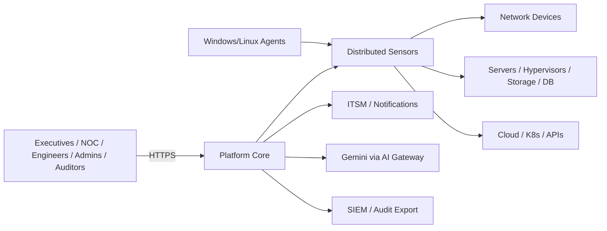
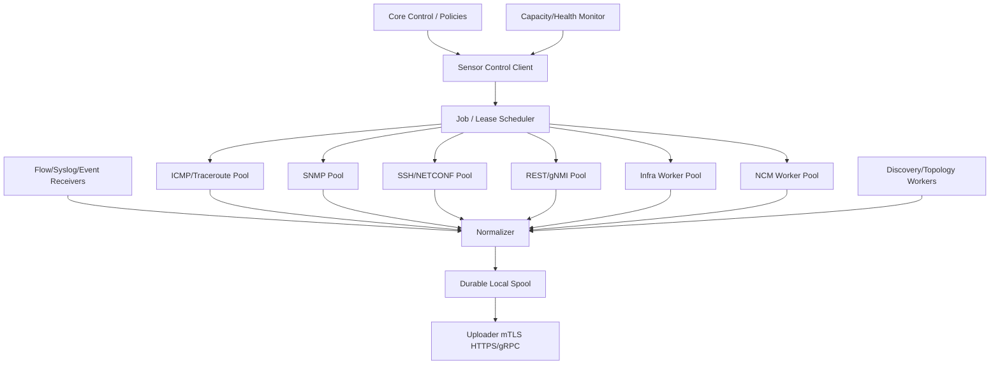
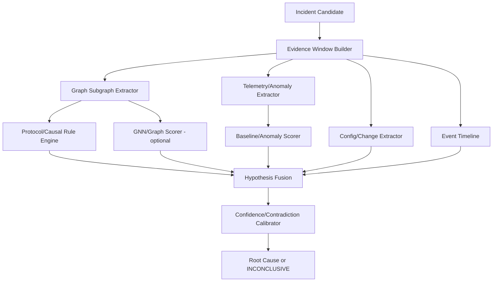
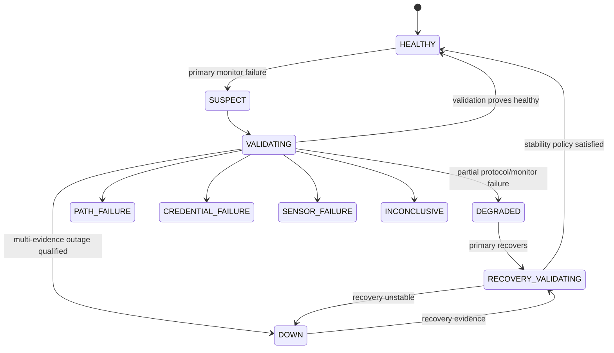

# Platform — High-Level Design (HLD)

**Document ID:** PLATFORM-HLD-001
**Version:** 3.2.2
**Status:** Authoritative Mother Reference — High-Level Design Authority (**A2.2 NORMALIZED_V1**)
**Product name:** Platform
**Governing documents:** `Platform_01_BRD.md`, `Platform_02_PRD.md`, `Platform_03_Architecture.md`
**Companions:** `Platform_05_LLD.md`, `Platform_06_Dataflow.md`, `Platform_07_OSS_Catalog.md`, `Platform_08_Requirements_Traceability.md`, `Platform_12_Decision_Source_Register.md`
**Normalization state:** NORMALIZED_V1
**Last reconciliation:** 2026-09-23 — A2.2 HLD/LLD/Dataflow normalization (Issue #102)

**Maturity:** `SPECIFIED != IMPLEMENTED != TESTED != BENCHMARKED != CERTIFIED != DEPLOYED`. Logical design here is not physical implementation evidence.

---

## 1. HLD purpose

This HLD converts the Platform architecture into implementable subsystems, deployment units, responsibilities, interfaces, failure boundaries and major data ownership rules. It intentionally stays above method/class/table-level detail; those belong in `Platform_05_LLD.md`.

---

## 2. System context

---

## 3. Deployment units

### 3.1 Core package

The Core package installs the following logical units on each Core node:

- Web/UI static application delivery and HTTPS endpoint.
- Core API/control-plane application.
- Ingestion Gateway.
- Query Service.
- Policy/Provisioning/Scheduler modules.
- Alert/Incident/RCA modules.
- NCM/IPAM/Reporting/Integration modules.
- AI Gateway.
- HA Manager.
- Certificate/Secret services.
- PostgreSQL.
- ClickHouse.
- Apache Kafka.
- Valkey.
- Core health/housekeeping/storage protection agents.

Not every logical unit must be a separate OS process on smaller deployments; deployment packaging must preserve modularity while meeting the 8C/16G target.

### 3.2 Sensor package

The Sensor package installs:

- Sensor Runtime.
- Enrollment/identity manager.
- Scheduler/job lease client.
- Protocol workers.
- Device Pack runtime.
- Local spool.
- Uploader.
- Sensor health/capacity monitor.
- Sensor storage protection.
- Update/rollback agent.

### 3.3 Agent packages

Separate Windows and Linux builds install:

- Agent identity/enrollment.
- Host metrics collector.
- Process/service collector.
- selected log/event adapters;
- Edge Test engine;
- local queue;
- Sensor connectivity manager;
- secure update client.

---

## 4. Core service decomposition

### 4.1 Core API / Domain Application

Owns:

- tenant/customer administration;
- site/group/tag hierarchy;
- inventory metadata;
- user-visible current state APIs;
- policy definitions;
- provisioning orchestration;
- Device Pack metadata;
- RBAC enforcement hooks;
- maintenance/suppression definitions;
- licensing;
- dashboard/report definitions;
- admin workflows.

### 4.2 Ingestion Gateway

Owns:

- mTLS Sensor/Agent identity validation;
- protocol-neutral canonical batch envelope validation;
- tenant/sensor ownership validation;
- schema/version validation;
- sequence/duplicate/replay metadata;
- rate/quota enforcement;
- Kafka publication;
- ingest health/error metrics;
- backpressure response.

The Gateway does not perform device polling.

### 4.3 Query Service

Owns:

- time-series/flow/event query APIs;
- raw vs rollup resolution selection;
- server-side pagination;
- query resource limits;
- caching hints;
- user/tenant scope enforcement;
- dashboards/report query contracts;
- historical topology/time-window retrieval coordination.

### 4.4 Policy Service

Owns immutable policy versions and computes effective configuration based on inheritance/overrides.

Policy types include:

- monitoring/polling;
- adaptive polling;
- threshold/baseline;
- validation/qualification;
- maintenance/suppression;
- notification/escalation;
- NCM;
- retention/rollup;
- Sensor placement;
- credential assignment;
- discovery;
- SLA/reporting;
- AI/data-boundary.

### 4.5 Provisioning Service

Owns manual/bulk/discovery approval workflows, preflight jobs, identity reconciliation, Device Pack selection, capacity preview and activation.

### 4.6 Sensor Control Service

Owns:

- Sensor inventory/status;
- Sensor pools;
- placement policy;
- workload/capacity model;
- target assignment;
- job lease issuance;
- rebalancing;
- Sensor drain/maintenance;
- update rollout;
- Agent→Sensor assignment.

### 4.7 Credential Service

Owns credential profiles, encryption/reference handling, scope metadata, last validation, rotation metadata and authorization to USE/EDIT/REVEAL.

Actual secret values are never returned to normal browser clients.

### 4.8 Alert Qualification Service

Consumes normalized state/metric/event evidence and drives suspicious conditions through validation workflows before producing a qualified alert state.

### 4.9 Incident Correlation Service

Groups qualified alerts/events using temporal, dependency, topological, protocol and policy context while preserving child evidence.

### 4.10 Graph Service

Owns the canonical relationship graph and temporal relationship history. It provides:

- entity/edge query;
- neighborhood/subgraph query;
- layer-specific views;
- dependency traversal;
- topology history;
- path/impact traversal;
- graph features for RCA/GNN.

The physical persistence implementation may combine PostgreSQL/ClickHouse structures and in-memory projections initially rather than adding a separate graph database before benchmarks justify it.

### 4.11 RCA Service

Coordinates:

- evidence-window selection;
- protocol/causal rules;
- graph traversal;
- anomaly evidence;
- config/change correlation;
- GNN/learned scoring when enabled;
- hypothesis fusion;
- confidence calibration;
- blast radius;
- evidence/contradiction/missing-data output;
- recommendation/runbook lookup;
- `INCONCLUSIVE` result.

### 4.12 AI Gateway

Provides provider abstraction, tool/function access, redaction, tenant authorization, policy, logging/audit and Gemini connectivity.

### 4.13 NCM Service

Owns configuration metadata, job orchestration, approval, schedules, Device Pack command semantics, backup/version/diff/compliance and result/audit ingestion. Execution occurs on Sensors.

### 4.14 CLI Session Broker

Owns browser WebSocket terminal session, privilege policy, stored/personal/one-time credential resolution under policy, Sensor routing, command/session audit and optional recording metadata. One-time credentials are ephemeral and reusable credentials never return to normal browser clients.

### 4.15 Operational Diagnostics & Investigation Service

A logical module inside the modular Core owns contextual on-demand diagnostic orchestration and Investigation Session state. It coordinates existing protocol workers, Sensor Control, CLI Broker, Query, NCM, Graph, RCA, Alert Qualification and Platform_22 Active Evidence Acquisition rather than replacing them.

Owns: contextual action authorization and typed diagnostic-job lifecycle; source/vantage selection; bounded Ping/traceroute/SNMP/TCP/DNS/SSH/API/domain-test orchestration; multi-vantage fan-out; `Verify Now` diagnostic packs; Live Evidence aggregation; Investigation Session/evidence references; `Why?`, `What Changed?` and `Compare` orchestration; cancellation/timeouts/rate/concurrency limits; and audit/correlation IDs.

Sensors/Agents execute interactive diagnostics under bounded worker budgets so operator activity cannot starve routine monitoring. Results are normalized evidence, not free-form claims.

### 4.16 IPAM Service

Owns address spaces, prefixes, VRF/VLAN context, address assignments/reservations, DNS/DHCP integration metadata, conflicts, discovery reconciliation and forecast APIs.

### 4.17 Integration Service

Owns ITSM/notification connector definitions, field mappings, outbound queues, retries, idempotency, health and bidirectional state synchronization.

### 4.18 Reporting / Service Assurance Service

Owns report definitions, obligations, schedules, execution, bounded formula evaluation, document rendering, SLA/OLA/Provider-SLA/SLO policy calculation, measurement-period close/restatement and long-term aggregates.

The service owns logical contracts for:
- versioned Service Assurance policies and editable out-of-box template catalogue;
- reusable service-time profiles/calendars, shifts and effective ownership intervals;
- safe typed formula evaluation; arbitrary customer SQL/Python/JavaScript/eval is prohibited;
- target/expected plus minimum thresholds, measurement basis/window, inclusion/exclusion and degraded-condition rules;
- policy simulation/backtest against retained historical evidence before activation;
- immutable scope snapshots and reproducible measurement ledgers;
- explicit measurement-quality/completeness and conflict/insufficient-evidence state;
- OLA dependency chains, provider relationships and multi-vantage measurement;
- report obligations, business-day-aware due rules, generated runs, review/attestation, delivery and audit;
- PDF/CSV-only report artifacts. API data access is a separate interface, not a report format.

Heavy report execution uses bounded worker/concurrency/query budgets and yields to ingestion, current-state, alert and incident workloads.

### 4.19 Audit Service

Creates/ingests structured audit records, protects scope/access, exports to SIEM and supports audit search.

### 4.20 Storage Lifecycle Service

Owns retention policies, rollup status, archive, storage forecasting, 80% watermark actions, legal holds and audit of deletion/reclamation.

### 4.21 Platform Operations Service

Owns Core/Sensor/data-service health, support bundle orchestration, backup/restore status, upgrades, certificates, licence warnings and internal housekeeping dashboards.

---

## 5. Sensor service decomposition

**Maturity / Issue #92:** Sensor production entrypoint/governed-runtime gap remains. This HLD describes target runtime/worker isolation, not production certification.

### 5.1 Worker isolation

Each worker class has bounded concurrency/queues. High-rate event receivers and NCM have independent limits so they cannot exhaust polling resources.

### 5.1.1 SNMP polling and event subsystems

The SNMP worker family contains logical components, not necessarily separate processes:

- **SNMP Job Adapter** — accepts fenced Core/Sensor scheduler jobs containing tenant/entity/assignment context and Credential Profile reference/authorized secret delivery context;
- **Poll Planner** — converts Capability Pack monitor definitions into bounded GET/GETNEXT/GETBULK/WALK operations with compatibility-aware bulk sizing and controlled fallback;
- **GoSNMP Adapter** — protocol/session/security implementation with cancellation, timeout, retry and stable error classification;
- **Typed Normalizer** — converts varbinds to numeric/state/counter/inventory/topology/quality observations without losing BER/value semantics;
- **Counter Processor** — exact counter storage identity plus wrap/reset/discontinuity/rate derivation;
- **SNMP Health Reporter** — per-device/profile poll success, latency, retries, exception/auth/timeout/tooBig counts, freshness and worker/backlog state;
- **Trap/Inform Receiver** — source/security validation, bounded pre-ACK storm admission/accounting, durable local acceptance (accepted raw event or durable storm-aggregation/accounting record), Inform acknowledgement, then post-ACK MIB/Pack semantic enrichment, entity resolution and semantic dedup/correlation.

Routine polling executes in the NETWORK_POLL class. Trap/Inform reception executes in the STREAMING class/role where separated. Neither may consume unbounded workers/queues or starve the other.

Credential values are not part of customer-visible job/history contracts. Core supplies or authorizes least-privilege Credential Profile use; the Sensor materializes only the minimum secret required for execution and never exposes it through telemetry, logs or support output. `USE` does not mean `REVEAL`.

Normal scheduled SNMP operational metrics default to a **5-minute** interval unless a more specific inherited policy/monitor definition overrides it. That default does not require every available OID every five minutes. Deterministic spreading distributes eligible work across the interval so fleet polls do not align at minute boundaries; restart/reassignment must not intentionally create a boundary storm. Availability/liveness remains a separate plane.

### 5.2 Device Pack runtime

Device Pack runtime resolves:

- identification;
- protocol mappings and SNMP poll definitions;
- scalar/table/index strategy and GET/GETBULK compatibility hints;
- normalized metric/state/inventory/topology keys;
- enum/bit mappings, units and counter/rate semantics;
- trap/inform notification rules;
- topology relationships;
- diagnostics and MIB/OID metadata;
- CLI prompts/parsers;
- NCM commands;
- alert/RCA semantics;
- compatibility version.

### 5.3 Local spool

Spool responsibilities:

- append batches with sequence IDs;
- retain until accepted according to ingest acknowledgment contract;
- retry with exponential/backoff policy;
- preserve ordering per source/entity where required;
- compact/delete acknowledged segments;
- enforce 80% disk-protection policy.

---

## 6. Agent HLD

### 6.1 Enrollment

Agent installer receives Core endpoint and one-time enrollment token/authorization. Core identifies tenant/site and returns certificate plus assigned Sensor endpoints.

### 6.2 Runtime

Agent maintains:

- secure identity;
- active Sensor target and fallback list;
- host metric schedule;
- process/service monitors;
- Edge Test profiles;
- local buffer;
- update channel.

### 6.3 Core-directed placement

Agent does not permanently select a Sensor independently. Core decides placement based on site/network reachability/capacity; Agent follows signed assignment changes.

---

## 7. Core HA HLD

**Maturity / Issue #92:** Exactly-two-Core Active/Standby topology remains USER-FIXED. Stateful fencing, failover, rejoin and production certification remain **OPEN P0 / NOT PRODUCTION CERTIFIED**. Do not treat this HLD section as HA production certification.

### 7.1 States

Each Core HA Manager has logical state:

- `STANDALONE`;
- `INITIALIZING`;
- `WAITING_FOR_PEER`;
- `ACTIVE`;
- `STANDBY_SYNCING`;
- `STANDBY_READY`;
- `FAILOVER_EVALUATING`;
- `PROMOTING`;
- `DEGRADED`;
- `SPLIT_BRAIN_PREVENTED`;
- `MAINTENANCE`.

### 7.2 Stable endpoint

In HA mode all external clients use a stable Core HA endpoint/VIP. Node IPs exist for pairing/management but are not the long-term Sensor/Agent dependency.

### 7.3 Failover sequence

1. Standby detects loss of Active health/endpoint.
2. HA Manager determines whether failure is positively confirmed under supported fencing rules.
3. If safe, Standby promotes Core-local services in dependency order.
4. Stable endpoint moves/resolves to new Active.
5. Sensors/Agents reconnect automatically.
6. Buffered Sensor data replays.
7. Platform logs failover and component recovery.
8. Returning former Active rejoins only as Standby after resynchronization.

### 7.4 Ambiguous partition

If nodes lose peer communication but the system cannot safely prove the Active is down, Standby does not automatically become a second writable Active. UI may remain unavailable longer while Sensors continue local collection; this is preferred to split-brain corruption.

---

## 8. PostgreSQL HLD

### 8.1 Data domains

Primary schemas/domains:

- `iam`
- `tenant`
- `inventory`
- `policy`
- `provisioning`
- `sensor_control`
- `alerts`
- `incidents`
- `graph_meta`
- `ncm`
- `ipam`
- `integration`
- `reporting`
- `licensing`
- `platform_ops`
- `ai_meta`

### 8.2 HA

Active Core hosts PostgreSQL primary. Standby Core maintains streaming replica. Promotion is controlled by Platform HA and must not occur independently from Core authority transition.

Synchronous vs asynchronous commit policy is an engineering benchmark/availability decision. The chosen policy must document expected data-loss window and fit final DR/HA requirements.

---

## 9. ClickHouse HLD

**Maturity / Issue #92:** ClickHouse retention/rollup/lifecycle implementation remains incomplete; do not treat this HLD as certified lifecycle evidence.

### 9.1 Table families

- `metric_numeric`
- `metric_counter` (exact unsigned raw counters + counter provenance/discontinuity metadata; logical family)
- `metric_state`
- `network_flow`
- `event_raw`
- `syslog_event`
- `trap_event`
- `alert_history`
- `incident_history`
- `audit_event`
- `telemetry_quality`
- `topology_fact`
- `change_fact`
- rollup/materialized aggregate tables.

### 9.2 Partition/order principles

Prefer time-oriented partitions with tenant/entity/metric ordering suitable for common queries. Avoid extreme partition cardinality. Use dictionary IDs where repeatedly storing long strings would waste space.

### 9.3 HA/synchronization

Because the product requires two Core nodes and no mandatory third quorum node, ClickHouse synchronization must be engineered as a certified two-node active/passive pattern rather than blindly deploying a three-member Keeper dependency. Exact implementation is an engineering spike; requirements are:

- Standby must be recoverable to current-enough state for certified failover objective.
- No accepted telemetry may be silently lost without replay path.
- Duplicate replay must be safely handled.
- Failed standby sync is visible and alertable.
- Resync after long outage is supported.

---

## 10. Kafka HLD

### 10.1 Topic families

Logical topics include:

- `telemetry.numeric.v1`
- `telemetry.counter.v1` (optional dedicated topic realizing the exact-counter family when needed; equivalently typed payloads are acceptable when precision/ordering/schema evolution remain proven)
- `telemetry.state.v1`
- `network.flow.v1`
- `event.syslog.v1`
- `event.trap.v1`
- `event.generic.v1`
- `inventory.observation.v1`
- `topology.observation.v1`
- `config.change.v1`
- `alert.lifecycle.v1`
- `incident.lifecycle.v1`
- `audit.v1`
- `integration.outbound.v1`
- `telemetry.quality.v1`

Exact partition counts are sizing-dependent.

### 10.2 Message schema

All canonical messages include:

- schema version;
- tenant ID;
- sensor/agent/source ID;
- entity ID where resolved;
- observation/event time;
- ingestion time;
- sequence/event ID;
- quality;
- payload typed by topic.

### 10.3 Two-Core behavior

Kafka is internal transport. Sensor local spools are required specifically so the product does not rely on an unsafe claim that a two-voter Kafka quorum remains fully available after one Core failure. The final active/passive Kafka arrangement and replay contract is a P0 LLD/benchmark item.

---

## 11. Valkey HLD

**Maturity / Issue #92:** Valkey is reconstructable/ephemeral only and is not authoritative control state.

Use for bounded ephemeral/cached data such as:

- hot entity status cache;
- query cache keys;
- short-lived sessions/nonce/rate limits;
- temporary UI progress/status;
- selected scheduler caches.

Loss of Valkey must degrade performance temporarily, not destroy authoritative inventory/policies/incidents.

---

## 12. Canonical entity HLD

### 12.1 Core fields

All entities share:

- `entity_id` UUID/ULID-like stable identifier;
- `tenant_id`;
- `entity_type`;
- `display_name`;
- `description`;
- `discovered_name`/hostname where applicable;
- lifecycle state;
- site/group/tag metadata;
- ownership/criticality;
- first_seen/last_seen;
- current monitoring assignment;
- Device Pack/monitor profile references.

### 12.2 Entity extensions

Type-specific attributes are normalized into dedicated typed tables/JSON with schema validation. Do not create an unbounded key/value junk store as the sole model.

---

## 13. Relationship/graph HLD

### 13.1 Edge record

An edge contains:

- source entity;
- destination entity;
- relationship type;
- directionality;
- layer;
- source evidence/protocol;
- confidence;
- first/last observed;
- valid-from/valid-to;
- manual/discovered flag;
- Device Pack/rule version.

### 13.2 Graph projections

Graph Service materializes/query-optimizes views for:

- physical neighbors;
- L2;
- L3;
- routing;
- MPLS/VRF;
- overlay;
- service dependency;
- Sensor monitoring dependency;
- causal incident graph.

---

## 14. RCA HLD

### 14.1 Rule layer

Examples of rule families:

- upstream interface/link failure preceding downstream unreachable cascade;
- routing adjacency loss associated with interface/path state;
- power/hardware fault preceding multiple subsystem failures;
- config change preceding route/availability change;
- Sensor failure causing multi-target monitoring gaps;
- credential failure affecting a protocol without device reachability loss.

Rules must be versioned and explainable.

### 14.2 GNN layer

Input is a bounded temporal subgraph and derived features, not raw arbitrary database dump. GNN produces scored hypotheses/edge relevance/impact estimates. It never directly executes remediation.

### 14.3 Confidence

Confidence reduces when:

- topology is stale;
- telemetry completeness is low;
- clocks are unsynchronized;
- contradictory evidence exists;
- required protocol signal is missing;
- model score is outside calibrated range.

---

## 15. AI Gateway HLD

Components:

- Provider Adapter (Gemini initial).
- Tool Router.
- Authorization Context.
- Redaction/Masking.
- Prompt/Template Registry.
- Context Builder.
- Response Safety/Source Validator.
- Audit Logger.
- Usage Meter.
- Future Local Model Adapter.

AI tools call Platform APIs using delegated user/service authorization. The LLM does not get raw database credentials.

---

## 16. Provisioning HLD

### 16.1 Job model

Provisioning is asynchronous and job-based. Each row/entity receives status:

`STAGED`, `NORMALIZED`, `VALIDATING`, `PREFLIGHT`, `READY`, `WARNING`, `FAILED`, `PROVISIONING`, `VERIFIED`, `COMPLETED`.

### 16.2 Preflight work

Preflight tasks are dispatched to one or more candidate Sensors and return typed evidence:

- route/reachability;
- protocol-port result;
- auth response;
- device identity;
- Sensor RTT/load;
- Device Pack compatibility;
- required firewall/ACL hints.

### 16.3 Failure taxonomy

Canonical codes include:

- `INPUT_INVALID`
- `DEVICE_UNREACHABLE`
- `DNS_FAILURE`
- `ROUTE_UNAVAILABLE`
- `PROTOCOL_TIMEOUT`
- `PROTOCOL_DISABLED_SUSPECTED`
- `AUTHENTICATION_FAILED`
- `AUTHORIZATION_FAILED`
- `ACL_FIREWALL_SUSPECTED`
- `PORT_UNREACHABLE`
- `CREDENTIAL_PROFILE_INVALID`
- `DEVICE_ALREADY_EXISTS`
- `IDENTITY_CONFLICT`
- `MIB_REQUIRED`
- `API_SCHEMA_INVALID`
- `TLS_CERTIFICATE_FAILURE`
- `SENSOR_CAPACITY_EXCEEDED`
- `NO_ELIGIBLE_SENSOR`
- `MONITORING_PROFILE_INCOMPATIBLE`

---

## 17. Alert qualification HLD

### 17.1 State machine

### 17.2 Secondary evidence

Validation can launch ICMP/TCP/API/secondary Sensor/traceroute/neighbor checks according to policy and capacity.

---

## 18. Incident correlation HLD

Correlation dimensions:

- temporal window;
- shared root/upstream dependency;
- graph distance;
- same routing/session/service/path;
- same configuration change;
- same Sensor failure;
- common power/site event;
- repeated/flapping signature.

Correlation output preserves references to all child evidence and raw events.

---

## 19. Data retention HLD

### 19.1 Retention policy resolution

Policy Service computes effective retention by tenant/site/group/device/data class.

### 19.2 Rollup pipeline

Kafka/ClickHouse materialized/aggregation pipeline produces configured resolutions continuously. Raw TTL deletion occurs only after required aggregate generation under normal conditions.

### 19.3 Archive

Archive adapters support local filesystem/NFS/S3-compatible destinations subject to customer environment. Air-gapped deployments must not require cloud archive.

---

## 20. Storage Protection HLD

Core/Sensor volume monitors emit storage state. At ≥80%:

1. Freeze nonessential local growth where safe (e.g. debug retention, temporary files).
2. Trigger oldest eligible data reclamation by policy priority.
3. Prefer removing high-resolution raw partitions before long-term rollups.
4. Preserve minimum recent window if possible.
5. Respect protected/legal hold rules until safety cannot be maintained; then raise critical conflict requiring admin action rather than silently violating policy.
6. Continue ingestion/monitoring.
7. Audit every deletion range/class/bytes.
8. Target safe post-purge headroom.

---

## 21. NCM HLD

### 21.1 OSS execution layer

Candidate approved libraries/tools provide transport/parsing; Platform owns policy/approval/audit:

- scrapli/scrapli_cfg;
- Nornir;
- NAPALM where driver quality is adequate;
- TextFSM/NTC Templates;
- Jinja2;
- NETCONF/REST/gNMI adapters.

Transitive licence review is mandatory.

### 21.2 Safety

NCM jobs require:

- authorization;
- target scope;
- change window;
- concurrency/rate limit;
- dry run where possible;
- optional approval;
- pre/post validation;
- rollback support metadata;
- immutable audit.

---

## 22. IPAM HLD

Core model:

- address spaces/VRFs;
- IPv4/IPv6 prefix tree;
- subnet/VLAN/site;
- address assignment/reservation;
- DNS/DHCP records/leases;
- discovered endpoint mapping;
- conflict/duplicate cases;
- utilization facts;
- forecast facts.

Discovery may propose changes; it does not silently overwrite authoritative reservations/ownership.

---

## 23. Reporting HLD

Report execution is asynchronous for expensive reports. Query Service returns bounded datasets/aggregates; rendering generates PDF and/or CSV report artifacts only. API payloads remain separate integration/query interfaces. Report schedule/history, obligations, review/attestation and delivery status are persisted. Large reports/exports are bounded background jobs, not synchronous browser queries, and yield to live monitoring/alert workloads.

---

## 24. Integration HLD

Each connector follows a standard adapter contract:

- `testConnection`
- `create`
- `update`
- `resolve/close`
- `addComment/workNote`
- `readStatus`
- `health`
- mapping capabilities.

Outbound actions use durable queue and idempotency key such as `tenant + incident + connector + operation-version`.

---

## 25. Dashboard/UI HLD

### 25.1 React application domains

- Shell/navigation/search.
- Dashboard runtime/studio.
- Inventory/provisioning.
- Topology/maps.
- Alerts/incidents/RCA.
- NCM/IPAM.
- Reports.
- Integrations.
- Administration.
- Audit/platform operations.

### 25.2 Data handling

- no direct database calls from browser;
- server-side filtering/pagination;
- virtualized grids;
- scoped query APIs;
- streaming progress for long jobs;
- stable deep links/breadcrumbs;
- contextual entity side panel.

---

## 26. Security HLD

**Maturity / Issue #92:** Persistent IAM/RBAC production authority remains unimplemented; Discovery authorization integration remains incomplete/fail-closed; secret-startup hardening and certificate rotation/concurrency gaps remain open where applicable.

### 26.1 Identity

Authentication providers: local, AD/LDAP, SAML, OIDC, Entra. MFA policy. Session controls.

### 26.2 Authorization

RBAC + resource scope + conditions. Effective permissions calculated server-side for every privileged endpoint.

### 26.3 PKI

Core establishes deployment CA/trust model or integrates customer PKI. Sensor/Agent certs have unique identity and rotation/revocation support.

### 26.4 Data masking

Sensitive fields can be classified Drop/Mask/Hash/Store. AI Gateway always applies AI data-boundary rules.

---

## 27. Platform observability HLD

Platform monitors itself:

- Core CPU/RAM/disk;
- Core application latency/errors;
- PostgreSQL health/replication;
- ClickHouse inserts/queries/merges/disk/sync;
- Kafka topic/consumer lag/errors;
- Sensor CPU/RAM/disk/queue/poll duration/backlog;
- Agent heartbeat;
- telemetry freshness/completeness;
- integration queue health;
- certificate/license state;
- storage forecast.

No silent internal failure is permitted.

---

## 28. Sizing HLD

### 28.1 Core target profiles

Planning targets pending certification:

| Devices | Standalone Core | HA Core pair |
|---:|---|---|
| 1,000 | 1 × 8C/16G | 2 × 8C/16G |
| 2,000–2,500 | 1 × 8C/16G | 2 × 8C/16G |
| 5,000 | 1 × 12C/24G | 2 × 12C/24G |
| 10,000 | 1 × 16C/32G | 2 × 16C/32G |
| 15,000 | 1 × 24C/48G | 2 × 24C/48G |

The ≤2,500 profile is the mandatory optimization target under SNWP-2500-v1. Higher profiles are planning baselines until benchmarked.

### 28.2 Sensor baseline

Network Sensor safe planning baseline: 4C/16G/150GB ~800 normal devices. Engineering target: 8C/16G ~2,000–2,500 normal devices where workload permits.

Infrastructure initial planning targets from prior design:

- ~800 SSH/WMI/WinRM agentless endpoints per 4C/16G reference Sensor.
- ~2,200 Agent-push endpoints per 4C/16G reference Sensor.

These are engineering starting targets, not contractual limits.

---

## 29. DR HLD

**Maturity / Issue #92:** Backup/restore/DR implementation evidence remains incomplete; exact RPO/RTO remain TBD where already recorded.

DR must be possible in v1.0. Required architecture hooks:

- signed/exportable Platform configuration and policy backups;
- PostgreSQL backup/restore and DR replication option;
- ClickHouse backup/archive/restore and DR replication option;
- Device Pack/dashboard/report/MIB/API Studio artifact backup;
- certificate/key backup under secure key-handling rules;
- NCM/IPAM state backup;
- deployment identity/licensing recovery;
- DR readiness test and restoration runbook;
- ability for Sensors/Agents to be redirected to DR Core endpoint according to approved DR activation procedure.

Exact primary/DR node count, synchronous/asynchronous replication, RPO/RTO and automatic vs manual failover remain TBD until commercial/technical targets are fixed.

---

## 30. Upgrade HLD

Core upgrade:

1. Readiness/preflight.
2. Backup/restore point.
3. Compatibility matrix check.
4. Standby-first or controlled sequence depending release type.
5. Schema/data migration.
6. Health validation.
7. Active/standby switch if required.
8. Upgrade other node.
9. Final HA/data sync validation.

Sensor upgrade uses pool drain → transfer jobs → upgrade → validation → return to pool.

Agent/Device Pack updates support canary cohorts.

---

## 31. Major external interfaces

| Interface | Protocol | Auth/security | Direction |
|---|---|---|---|
| Browser/UI | HTTPS/WebSocket | OIDC/SAML/local + MFA | User→Core |
| Public API | HTTPS REST | OAuth/token/mTLS optional | Client→Core |
| Sensor control/ingest | HTTPS/gRPC | mTLS | Sensor↔Core |
| Agent bootstrap | HTTPS | enrollment + mTLS issuance | Agent↔Core |
| Agent telemetry | HTTPS/gRPC or approved secure stream | mTLS | Agent↔Sensor |
| SNMP | UDP/TCP as protocol defines | v1/v2c/v3 | Sensor↔Device |
| SSH/NETCONF | TCP | password/key/KBI | Sensor↔Device |
| REST/gNMI | HTTPS/TLS | API/OAuth/mTLS/etc. | Sensor↔Device/API |
| ITSM/notifications | HTTPS/SMTP/etc. | connector-specific | Core↔External |
| Gemini | HTTPS API | provider credential from AI Gateway | Core→Gemini |
| SIEM export | syslog/TLS/HTTPS | connector-specific | Core→SIEM |

---

## 32. HLD acceptance criteria

Engineering design review shall not approve HLD implementation plans unless they demonstrate:

- clear ownership of each persistent state domain;
- no direct Sensor database coupling across WAN;
- safe Core failover path;
- Sensor spool/replay contract;
- typed canonical telemetry/events;
- centralized policy with Sensor config version tracking;
- resource isolation between polling/Flow/NCM;
- storage protection on Core/Sensor;
- graph provenance/history;
- RCA evidence/quality model;
- GNN and LLM guardrails;
- secure enrollment/certificate lifecycle;
- clean upgrade/DR paths;
- measurable self-observability.

---

## 33. HLD open implementation decisions

1. Certified two-Core Kafka topology/failover mechanism.
2. Certified two-Core ClickHouse synchronization mechanism.
3. HA fencing implementation with no third full Core.
4. PostgreSQL sync mode after benchmark/RPO definition.
5. Exact GNN framework and runtime profile.
6. DR topology/RPO/RTO.
7. Numeric thresholds for dedicated Streaming Sensor recommendation.
8. Final SNWP-2500-v1 workload constants.

---

## 34. Additional mandatory service designs

### 34.1 Reconciliation / Desired State Service

Consumes desired policy/assignment/version state and observed Sensor/Agent/entity acknowledgements. Produces drift records, severity, remediation action and audit. It shall not auto-correct privileged changes unless policy explicitly authorizes reconciliation.

### 34.2 Migration Service

Components:

- Source Adapter Registry.
- File/API Ingest.
- Staging Store.
- Canonical Mapper.
- Semantic Compatibility Validator.
- Review/Conflict Queue.
- Commit Orchestrator.
- Migration Job History.

Vendor-specific adapters are optional modules. Generic CSV/XLSX/CMDB import is baseline.

### 34.3 Technology Lifecycle Service

Stores lifecycle enrichment keyed to vendor/model/software identifiers, with source, effective/retrieved dates, confidence and legal/provenance metadata. It generates risk facts but does not alter discovered firmware/model values.

### 34.4 Knowledge/Runbook Service

Stores versioned customer-approved runbooks and known-issue records with scope, owner, tags, approval state and linked incident/device classes. RCA queries the service for relevant guidance.

### 34.5 PIR Service

Builds a draft PIR from incident state, RCA, unified timeline, ITSM, change/config evidence and actions. Final CAPA/lessons require human edit/approval and are audited.

### 34.6 Intelligence Quality Service

Aggregates RCA feedback, ground-truth benchmark results, qualification outcomes, alert compression, no-answer/false-root rates and model versions. It separates model confidence from validated correctness.

### 34.7 Pipeline Integrity Service

Reconciles sequence/watermark counters across Sensor spool, Ingestion Gateway, Kafka consumer groups and ClickHouse insert acknowledgements. It creates internal alerts when unexplained gaps exceed configured tolerance.

---

## 35. Cross-cutting capability completeness (absorbed)

The following cross-cutting capabilities remain mandatory where applicable and must be represented in design, UI, APIs, security, audit and QA. Canonical requirement IDs remain in `Platform_08_Requirements_Traceability.md`; OSS decisions remain in `Platform_07_OSS_Catalog.md` (Platform_07 stays TRANSITIONAL_LEGACY until A2.3).

- asset lifecycle/reconciliation, stale/disappeared/replaced device handling and decommission workflow;
- technology lifecycle/EOL/EOS/firmware risk visibility without pretending to be a vulnerability scanner;
- backup, restore verification, v1.0 DR, low-downtime upgrade, rollback, canary and feature-flag controls;
- desired-vs-actual monitoring state, drift detection, change impact preview and dry-run;
- path analysis, device/time comparison, circuit inventory, business/service ownership and shift handover;
- learned baselines/seasonality, alert storm protection, flapping detection, event compression and alert-policy effectiveness;
- unified Operations Timeline combining telemetry, events, topology, NCM, audit, user action, sensor activity, ITSM and RCA;
- data provenance/quality/confidence, topology relationship provenance/confidence and historical topology;
- global search, command palette, contextual troubleshooting actions, support bundle and customer-visible Platform Health;
- licensing/usage dashboard, data-growth forecast and entitlement-aware UI;
- sensitive-field classification, masking/drop/hash/store policy, AI data boundaries and AI audit;
- Device Pack certification/test simulator, import/export, template library, onboarding wizard and contextual help;
- API-first implementation, webhooks/outbound events, API governance, rate limits and query protection;
- integration test sandbox, timezone/site timezone handling, internationalization foundations and accessibility;
- telemetry/cardinality explosion protection, tenant/noisy-neighbor quotas, ingestion dedupe, late/out-of-order/replay handling and legal hold;
- Migration Studio and Environment Readiness Scanner;
- change-freeze/business calendars, runbook/knowledge library and post-incident review/problem management;
- RCA accuracy/feedback metrics, monitoring optimization recommendations and Sensor placement learning;
- certificate/PKI lifecycle, proxy/no-proxy and data-sovereignty/regional-placement readiness;
- IPv6/dual-stack first-class behavior;
- scheduled housekeeping and end-to-end pipeline-integrity visibility;
- stable customer-facing error codes/correlation IDs and **No Silent Failure**.

## 36. Supporting mother-reference ownership

Exact detail owned elsewhere must not be re-litigated here:

- `Platform_03_Architecture.md` — architecture/topology/invariants.
- `Platform_05_LLD.md` — detailed logical schemas/algorithms.
- `Platform_06_Dataflow.md` — end-to-end sequences.
- `Platform_07_OSS_Catalog.md` — approved/candidate OSS (not normalized in A2.2).
- `Platform_08_Requirements_Traceability.md` — global REQ/PRD index.
- `Platform_09_UI_UX_Master.md` — UI shell/Studios/screen contracts.
- `Platform_10_Protocol_Security_Connector_Master.md` — protocol/security/connectivity.
- `Platform_11_Sizing_Capacity_Storage_Master.md` — capacity/sizing/storage constants.
- `Platform_12_Decision_Source_Register.md` — decision classes.
- `Platform_14_Test_Performance_and_Release_Quality.md` — quality/certification.
- `Platform_17_API_Event_and_Data_Model_Contracts.md` — exact API/event/data contracts.

**OSS rule:** implementation teams may not add a runtime/build dependency merely because it is open source. It must be admitted to the Platform OSS Catalogue by exact version, transitive license/CVE scan and release policy.

## 37. OSS placement by deployment unit

### Core node

| Logical subsystem | OSS/runtime | HLD boundary |
|---|---|---|
| Core application | Java 21 + Spring Boot | Modular Core process(es); avoid microservice sprawl at small sizes |
| AuthN federation | Keycloak | Separate logical authentication service; Platform authorization remains in Core |
| Policy expressions | CEL Java | compiled/validated expressions, cost-bounded |
| Ingestion/event bus | Kafka + Apicurio + Avro/Protobuf | internal only; Core Ingestion is WAN-facing mTLS boundary |
| Control state | PostgreSQL | authoritative transactional state |
| Telemetry | ClickHouse | high-volume analytical state |
| Cache | Valkey | reconstructable/ephemeral state only |
| Reports | PDFBox/POI/Commons CSV | report/export worker |
| Analytics/RCA workers | Python + Polars/NumPy/scikit-learn; GNN candidate PyTorch/PyG | isolated worker boundary with resource quotas and no direct secret access |
| OSS compliance | ORT/Syft/Trivy/ScanCode | CI/release, not runtime customer workflow |

### Network/Streaming Sensor

| Worker family | OSS foundation | Platform worker responsibilities |
|---|---|---|
| SNMP | GoSNMP | scheduling, governed credential ref/use, capability-aware bulk planning, typed numeric/state/counter/inventory/topology normalization, retry/error classification, poll quality and qualification evidence |
| MIB | gosmi | compiled Device Pack metadata; runtime avoids reparsing MIB for every poll |
| Flow | GoFlow2 | parser + canonical flow publication |
| ICMP/path | x/net/icmp | probe scheduling and measurements |
| DNS | miekg/dns | synthetic DNS worker |
| SSH | x/crypto/ssh / scrapligo | discovery/diagnostics/CLI/NCM execution |
| gNMI | OpenConfig gNMI | subscription lifecycle/backpressure |
| YANG | goyang/ygot | model validation/mapping |
| REST/OpenAPI | Go HTTP + kin-openapi | auth/pagination/rate-limit/chained endpoint execution |
| Syslog/log | native receiver and/or Fluent Bit integration | parse, normalize, cardinality and upload |

### Infrastructure Sensor / Agent

| Capability | OSS foundation | Platform boundary |
|---|---|---|
| Windows agentless | masterzen/winrm | monitoring profile/metric model and diagnostics |
| Host primitives | gopsutil/native OS APIs | normalized metrics and policy |
| Hardware | Gofish | hardware entity model |
| VMware | govmomi | topology/metrics/inventory |
| Kubernetes | client-go | entity graph/events/metrics |
| OTel | Collector/libraries | OTLP ingest to canonical schema |
| Cloud | official provider SDKs | entity normalization and policy |

### NCM Worker

Python NCM worker can use Nornir, scrapli, scrapli_cfg, approved NAPALM drivers, NTC Templates/TextFSM and Jinja2. NCM executes through Platform job/approval/audit APIs; OSS libraries never bypass RBAC or write directly to authoritative Platform tables.

### Browser

React/TypeScript, ECharts, TanStack Table/Query, react-grid-layout, Cytoscape.js, MapLibre and xterm.js are visualization primitives. They must never become sources of authorization truth. All sensitive decisions are server-side.

## 38. Mandatory Platform adapter boundary

Each OSS protocol/client library is wrapped behind a Platform interface so that:

- library version changes do not leak into domain APIs;
- telemetry/error types normalize into Platform canonical forms;
- security/tenant/audit requirements are enforced consistently;
- a library can be replaced if maintenance/license posture changes;
- Device Packs can select adapters by capability rather than importing third-party types.

Minimum adapter families: `SnmpAdapter`, `MibCompiler`, `FlowDecoder`, `ProbeAdapter`, `SshAdapter`, `NetconfAdapter`, `GnmiAdapter`, `RestAdapter`, `WinrmAdapter`, `RedfishAdapter`, `VsphereAdapter`, `KubernetesAdapter`, `CloudProviderAdapter`, `NcmDriver`.

## 39. Storage lifecycle behavior

Storage Lifecycle Service runs continuously rather than only at 80%. It evaluates per-volume utilization, growth and data class. At 70/75% it warns/optimizes; at 80% it enters mandatory reclamation. Exact warning thresholds may be configurable, but the 80% safety action cannot be disabled.

Sensor local-spool protection uses the same principle but prioritizes unshipped recent/critical telemetry and drops oldest eligible low-priority buffered samples only when necessary. Every drop/reclaim is counted and reported to Core once connectivity exists.

## 40. Licensing expiry state machine

`VALID -> EXPIRING_30D -> EXPIRING_7D_BANNER -> EXPIRED_GRACE (FOUNDER-LIC-GRACE duration UNRESOLVED) -> POLLING_SUSPENDED`.

**FOUNDER-LIC-GRACE (UNRESOLVED):** post-expiry grace duration is Founder-reserved. Historical/source values are 7 days and 15 days; neither is normative commercial truth. Engineering must not choose a compromise day-count. Polling continues during the Founder-approved grace duration; polling stops when that approved grace expires unless the licence is renewed/extended.

Normative non-grace continuity (unchanged):

- T-30 licence-expiry warning remains.
- T-7 pre-expiry persistent dashboard banner remains (`Licence expires in X days`).
- Historical query/UI/admin/licence-management/audit remain available in `POLLING_SUSPENDED`.
- Manual administrative license extension can move the deployment back to `VALID` without reinstalling Core/Sensors.

## 41. Disaster-recovery design requirement

A DR deployment shall be installable from the same signed Core/Sensor builds. The HLD requires backup/replication of authoritative configuration, licensing, Device Packs, secrets/cert material per recovery procedure, and recoverable telemetry according to the eventual RPO. Exact RPO/RTO are TBD, but the software must provide preflight, backup, restore, integrity verification and DR activation/runbook hooks from V1.

## 42. Data Pipeline Integrity Service

The Core exposes a Pipeline Integrity service/dashboard that reconciles producer sequence/counters, ingestion acknowledgements, Kafka offsets/consumer progress, normalization rejects and ClickHouse insert counts. It emits health alerts when gaps exceed certified tolerances, attributes the affected tenant/Sensor/topic/data class and provides an investigation path.

## 43. Data placement metadata

Tenant, site, entity, data class and archive policies carry data-placement metadata so a future regional-Core deployment can route/store data according to customer sovereignty requirements. The initial deployment does not claim multi-region sovereignty until implemented/certified.

## 44. Engineering-runtime and package HLD

**Maturity / Issue #92:** Native production packaging remains incomplete; Docker Compose development profiles are not production packaging certification.

### 44.1 Development deployment units

The repository shall provide Docker Compose profiles for at minimum:

- `dev`: normal interactive engineering stack;
- `test`: deterministic integration-test stack with isolated/disposable data;
- `ha`: two-Core Active/Standby test topology plus supporting dependencies/mocks;
- `scale`: generated device/metric/flow/log load profile;
- `security`: security scanning and negative protocol/authentication tests;
- `dr`: backup/restore and disaster-recovery exercises.

### 44.2 Compose service groups

A complete local stack shall be decomposable into logical groups: Core application, UI, ingestion, data services, Sensors, mock devices/exporters, integration mocks and test runners. Developers should be able to start a minimal profile rather than always consuming resources for the full scale stack.

### 44.3 Linux package service layout

Each installable component has a dedicated package, OS service and data boundary. Standard paths shall follow Linux conventions, with exact final paths governed by `Platform_15_CI_CD_Packaging_and_Distribution.md`.

### 44.4 Runtime health/logging subsystem

Each deployment unit shall implement a common health/logging contract. Logs flow to journald/stdout plus bounded application log files where required by support policy. Platform Health ingests service status and relevant metrics without creating a monitoring dependency loop that can destabilize the monitored service.

### 44.5 Windows Agent deployment unit

The Windows Agent is one compiled service executable plus configuration/certificate state and an installer. BAT wrappers are convenience automation; they are not the Agent runtime itself. GA packaging uses MSI and code signing.

---

## 45. Endpoint Diagnostic Evidence subsystem

EDS is a specialized Diagnostic Job profile (`ENDPOINT_DIAGNOSTIC_SNAPSHOT`) within the existing Troubleshoot / Live Evidence / Investigation architecture. It does not create a second diagnostic registry, scheduler, investigation state machine or evidence store.

### 45.1 Agent responsibilities

Windows/Linux Agent adds logical responsibilities within the existing Agent runtime:

- effective diagnostic-policy cache/version and Core-issued authority/generation acknowledgment;
- deterministic capture-eligibility evaluator (`INELIGIBLE|QUALIFYING|CAPTURE_ELIGIBLE|COOLDOWN`) that is not host-health authority;
- bounded OS-specific EDS collector set;
- evidence normalization;
- local resource guard/cancellation with monitoring durability priority;
- durable queueing through the existing Agent -> Sensor transport (no second EDS transport).

These responsibilities do not require a second endpoint daemon, Python runtime or model service.

### 45.2 Infrastructure Sensor responsibilities

Infrastructure Sensor owns:

- Agent EDS receive/forward behavior with source/sequence provenance;
- Linux SSH and Windows WinRM/WMI/CIM agentless query-pack execution as fixed operations with structured parameters (no generic remote shell/PowerShell facility);
- per-target/per-tenant concurrency and storm budgets;
- credential/security-profile binding;
- timeout/output limits and cancellation;
- normalization of remote evidence into the same Diagnostic Job / Live Evidence EDS profile;
- explicit collection-health/partial/suppressed-evidence reporting.

Sensor does not perform authoritative cross-domain RCA and does not host the local LLM for this capability.

### 45.3 Core responsibilities

Core owns:

- authoritative effective policy, trigger/eligibility definitions and generation fencing;
- manual/incident-driven EDS Diagnostic Jobs;
- global/site/tenant evidence-acquisition budgets;
- dedup/coalescing of repeated evidence requests;
- evidence storage/index/reference policy via existing Live Evidence / Investigation contracts;
- alert/incident/graph/change correlation;
- deterministic RCA and confidence/contradiction handling;
- optional ML/GNN/LLM assistance under `Platform_22`;
- UI/API exposure of eligibility, evidence, gaps and diagnostic status, visually distinct from Core RCA conclusions.

### 45.4 Local/private inference provider boundary

**If** AI Gateway targets a separate local/private inference provider, that mode is an optional/conditional inference boundary only: no scheduling authority, no HA quorum role, no direct telemetry ingestion authority and no durable control-plane ownership. It is not required for EDS or base monitoring. All-AI-disabled remains supported.

## 46. Display timezone / scheduling / role ownership

- **UI shell / preferences:** owns interactive timezone indicator, IANA picker, Local/Tenant Default/UTC shortcuts, saved `display_timezone`, session/view override and report timezone disclosure (`Platform_09`).
- **Core control plane:** owns schedule/policy desired-state, placement, assignment generation/fencing, tenant timezone fallback and user preference persistence APIs.
- **Sensor runtime/scheduler:** owns execution of authorized recurring work, durable local desired-state, deterministic due-time evaluation, admission/backoff/recovery behavior and role-capability gating (`NETWORK`/`INFRASTRUCTURE`/`FLOW`/`LOG` product direction; runtime `STREAMING_EVENT` reconciliation required).
- **Capability Pack:** owns monitor cadence/freshness/cost declarations consumed by the scheduler.
- **Integrations:** own ITSM/webhook delivery queues separately from API Studio monitoring collection.
- **HA/fencing:** Active/Standby ownership remains P0 uncertified; no third coordination service selected here.
