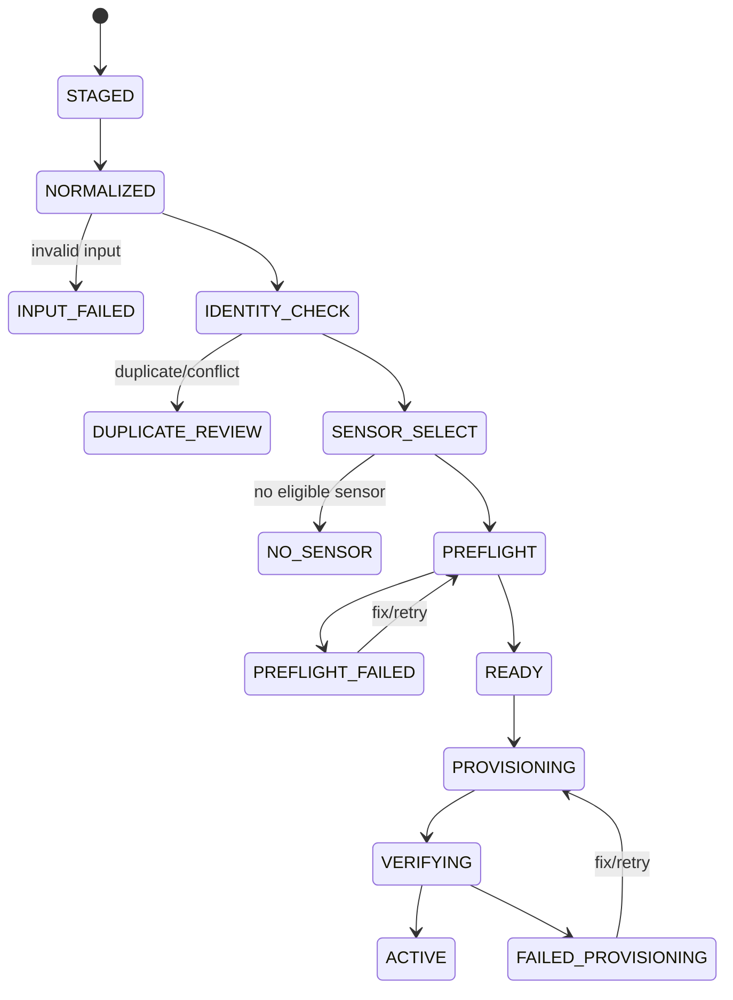
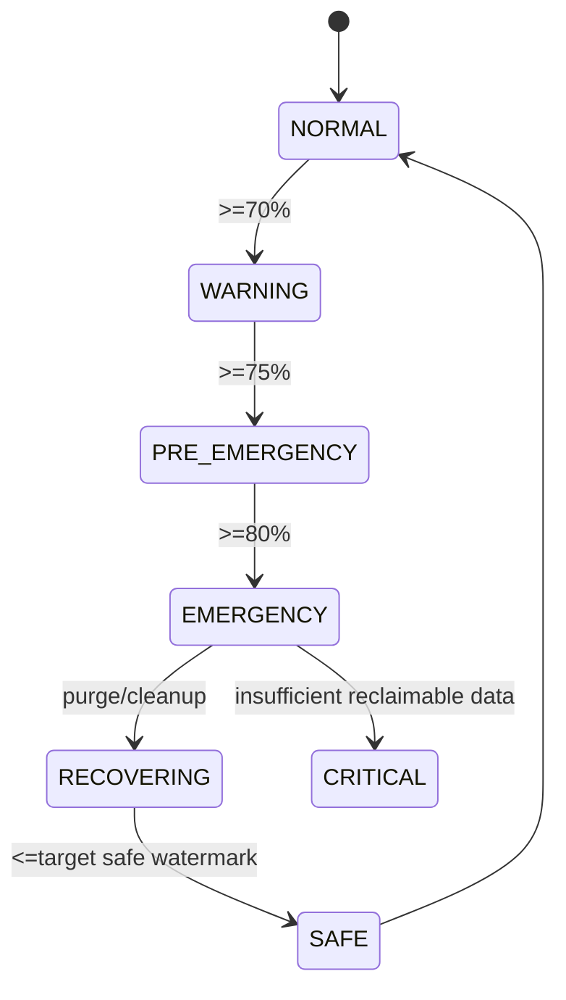

# Platform — Low-Level Design (LLD)

**Document ID:** PLATFORM-LLD-001  
**Version:** 3.2.2
**Status:** Authoritative Mother Reference — Engineering Source of Truth
**Governing documents:** BRD → PRD → Architecture → HLD  

---

## 1. LLD conventions

This document defines concrete implementation contracts, schemas, state machines, topic families, API resources, sequencing rules, persistence ownership, worker behavior, error taxonomies and failure-handling expectations.

Where implementation has not been safely resolved, this document marks `TBD/P0 SPIKE`; engineers may prototype alternatives but may not silently select a design that contradicts the two-Core HA, resource, security or Sensor/Core **80% storage-protection** requirements. Absolute zero telemetry/data loss is not a Platform guarantee; Sensors continue polling/buffering while capacity permits and may shed oldest eligible lower-priority buffered data under prolonged outage/storage pressure while exposing data-loss risk.

All identifiers shown are examples of canonical names, not mandates for package/class naming unless explicitly stated.

---

## 2. Repository and build boundaries

Recommended top-level logical repositories/modules:

```text
platform/
  core/
    api/
    domain/
    ingest/
    query/
    alerting/
    incident/
    graph/
    rca/
    ai-gateway/
    ncm/
    ipam/
    reporting/
    integrations/
    audit/
    ha/
    storage-lifecycle/
  sensor/
    runtime/
    scheduler/
    protocol-snmp/
    protocol-icmp/
    protocol-flow/
    protocol-ssh/
    protocol-netconf/
    protocol-gnmi/
    protocol-rest/
    infra/
    discovery/
    ncm-executor/
    spool/
    uploader/
  agent/
    common/
    windows/
    linux/
  ui/
  schemas/
  device-packs/
  installers/
  qa/
  performance/
  docs/
```

Core, Sensor and Agent produce separate signed installation artifacts.

---

## 3. Canonical identifiers

### 3.1 Required IDs

- `tenant_id`
- `entity_id`
- `sensor_id`
- `agent_id`
- `site_id`
- `group_id`
- `policy_id` + `policy_version`
- `device_pack_id` + `device_pack_version`
- `monitor_definition_id`
- `credential_profile_id`
- `alert_id`
- `incident_id`
- `job_id`
- `session_id`
- `audit_event_id`
- `observation_id` / `event_id`

Use globally unique stable identifiers such as UUIDv7/ULID-like ordered IDs after final language/library review. Never use IP address as primary entity identity.

---

## 4. PostgreSQL logical schema

### 4.1 Tenant/identity tables

```text
tenant
  tenant_id PK
  name
  mode SINGLE|MSP_CHILD|MSP_MASTER
  status
  timezone
  created_at
  updated_at

user_account
  user_id PK
  tenant_id
  identity_provider
  external_subject
  display_name
  email
  status
  last_login_at

role
  role_id PK
  tenant_id nullable for system template
  name
  template_key nullable
  version

permission_binding
  binding_id PK
  principal_type USER|GROUP|SERVICE_ACCOUNT
  principal_id
  role_id
  resource_scope_id
  condition_json
  effect ALLOW|DENY
```

### 4.2 Inventory tables

```text
entity
  entity_id PK
  tenant_id
  entity_type
  display_name
  description
  discovered_name
  lifecycle_state
  site_id nullable
  criticality
  owner_team_id nullable
  device_pack_id nullable
  device_pack_version nullable
  first_seen_at
  last_seen_at
  created_by
  updated_at

entity_identifier
  id PK
  entity_id
  identifier_type  # IP, MAC, SERIAL, SNMP_ENGINE_ID, UUID, CLOUD_ID, K8S_UID, HOSTNAME...
  namespace
  identifier_value
  confidence
  first_seen_at
  last_seen_at
  UNIQUE(tenant_id/namespace/type/value as appropriate)

entity_attribute
  entity_id
  schema_key
  typed_value/json
  source
  observed_at
```

### 4.3 Graph metadata

```text
relationship
  relationship_id PK
  tenant_id
  source_entity_id
  target_entity_id
  relationship_type
  layer
  direction
  source_type DISCOVERED|USER|DEVICE_PACK|INFERRED
  source_reference
  confidence
  valid_from
  valid_to nullable
  last_verified_at
  evidence_ref
```

Current edges may live in PostgreSQL while history/facts are mirrored to ClickHouse.

### 4.4 Policy tables

```text
policy_definition
  policy_id
  tenant_id nullable
  policy_type
  name
  status
  current_version

policy_version
  policy_id
  version
  immutable_payload_json
  created_by
  created_at
  reason
  ticket_ref nullable

policy_assignment
  assignment_id
  policy_id/version
  scope_type TENANT|REGION|SITE|GROUP|ENTITY|METRIC
  scope_id
  precedence
  effective_from
  effective_to nullable
```

### 4.5 Sensor control

```text
sensor
  sensor_id
  tenant_id
  name
  role
  site_id
  pool_id
  version
  os
  state
  last_heartbeat
  certificate_thumbprint
  capacity_profile
  maintenance_state

sensor_pool
  pool_id
  tenant_id
  name
  region/site affinity
  redundancy_mode
  preferred/allowed/forbidden metadata

sensor_assignment
  entity_id
  primary_sensor_id
  pool_id
  failover_candidates_json
  assignment_version
  assigned_at
  assignment_reason
  pinned bool
```

### 4.6 Alert/incident state

```text
alert_current
  alert_id
  tenant_id
  entity_id
  policy_id/version
  alert_key
  severity
  state
  qualified_state
  confidence
  opened_at
  updated_at
  incident_id nullable
  ack_user nullable
  owner_team nullable

incident
  incident_id
  tenant_id
  severity
  state
  root_entity_id nullable
  root_cause_status DETERMINED|PROBABLE|INCONCLUSIVE|PENDING
  confidence nullable
  started_at
  resolved_at nullable
  owner_user/team
  itsm_ref nullable
  reopen_until nullable
```

### 4.7 NCM/IPAM/integration/report/licence

Each is a dedicated schema/module. Avoid storing opaque application state only as JSON when typed relational constraints are valuable.

---

## 5. ClickHouse logical tables

### 5.1 `metric_numeric`

Suggested columns:

```text
tenant_id       UUID/String
entity_id       UUID/String
metric_id       UInt64/String dictionary ID
sensor_id       UUID/String
ts              DateTime64
value           Float64
quality         UInt8/Enum
flags           UInt32
sequence_id     UInt64/String
source_protocol LowCardinality(String)
```

Common ORDER BY candidate: `(tenant_id, entity_id, metric_id, ts)` subject to benchmark. Partition primarily by time with controlled tenant considerations; avoid one partition per device.

### 5.2 `metric_state`

```text
tenant_id
entity_id
metric_id
ts
state_code
state_text_id/dictionary
quality
sequence_id
source_protocol
```

### 5.3 `network_flow`

```text
tenant_id
exporter_entity_id
sensor_id
start_ts
end_ts
src_ip
dst_ip
src_port
dst_port
protocol
bytes
packets
ingress_if_id
egress_if_id
src_site_id/dst_site_id nullable
src_subnet_id/dst_subnet_id nullable
vrf_id nullable
src_asn/dst_asn nullable
app_id nullable if exporter supplied
flow_type
sequence/template metadata
```

### 5.4 `event_raw`

```text
tenant_id
event_id
entity_id nullable
sensor_id
event_type
event_ts
ingest_ts
severity_hint
source_protocol
source_key
payload_ref/structured payload
quality
```

Separate `syslog_event` and `trap_event` may be used for optimized fields.

### 5.5 `telemetry_quality`

```text
tenant_id
entity_id/sensor_id
window_start
window_end
expected_samples
received_samples
late_samples
duplicate_samples
failed_collections
freshness_ms
clock_offset_ms nullable
quality_score
```

### 5.6 Historical lifecycle tables

- `alert_history`
- `incident_history`
- `audit_event`
- `topology_fact`
- `change_fact`
- `sla_fact`
- configured rollup tables.

---

## 6. Kafka topic contract

### 6.1 Naming/versioning

Topic names are versioned by major schema compatibility. Example:

```text
telemetry.numeric.v1
telemetry.state.v1
network.flow.v1
event.syslog.v1
event.trap.v1
event.generic.v1
inventory.observation.v1
topology.observation.v1
config.change.v1
alert.lifecycle.v1
incident.lifecycle.v1
audit.v1
telemetry.quality.v1
integration.outbound.v1
```

### 6.2 Canonical envelope

```json
{
  "schemaVersion": 1,
  "tenantId": "...",
  "sourceType": "SENSOR|AGENT|CORE",
  "sourceId": "...",
  "entityId": "...",
  "observationId": "...",
  "sequence": 123456,
  "eventTime": "...",
  "ingestTime": "...",
  "quality": "GOOD|DEGRADED|LATE|UNKNOWN",
  "payload": {}
}
```

This is illustrative JSON; production may use Avro/Protobuf.

### 6.3 Partition keys

Choose keys that preserve required ordering without creating hot partitions. Examples:

- metric/state: tenant + entity;
- flow: tenant + exporter or hash of conversation/exporter depending load;
- alert/incident: tenant + entity/incident;
- audit: tenant + actor/resource hash.

Exact topic/partition counts are deployment-sized.

---

## 7. Ingestion acknowledgment and replay contract

This contract is critical.

### 7.1 Sensor spool segment

Each local batch contains:

```text
sensor_id
boot_epoch
batch_sequence
first_observation_id
last_observation_id
created_at
payload_checksum
compression
priority
```

### 7.2 Ack semantics

Under normal acknowledgement-driven compaction, a Sensor deletes a local segment only after Core returns a durable acceptance acknowledgment consistent with the certified HA design. Receipt of that acknowledgement is permission to advance the local acknowledged watermark and eventually reclaim the covered spool records. The mandatory 80% emergency storage-protection path is a separate loss path: when unavoidable it may shed only eligible oldest lower-priority unacknowledged buffered data according to policy, but it must not advance the acknowledged watermark or represent those records as delivered; the resulting sequence/data gap is counted, audited and reported when connectivity permits. If emergency shedding creates a non-contiguous sequence gap, the Sensor must not infer acknowledgement across that gap. The exact representation/reconciliation of terminally lost ranges and the rule for later accepted observations to resume safe replay/reclamation are part of the existing `ACK_DURABLE` P0 spike; until certified, acknowledgement-driven reclamation across such a gap fails closed.

Because Kafka is internal and the exact two-Core Kafka/ClickHouse/PostgreSQL recovery/fencing mechanism is still a P0 spike, `ACK_DURABLE` must be defined only after failure testing proves where the recoverable boundary is. The contract does **not** require waiting for every downstream analytical consumer/ClickHouse insert unless the P0 spike proves that is necessary for recoverability; downstream persistence gaps remain subject to Pipeline Integrity reconciliation.

Until then, design target:

1. Sensor writes batch durably to local spool.
2. Core validates identity/schema.
3. Core writes to durable Core ingestion path.
4. Core returns `accepted_through_sequence`.
5. Sensor marks/deletes acknowledged segments.
6. Duplicate replay is tolerated using observation/batch IDs.

No component may acknowledge and then silently lose data without a documented replay source. Crash-window certification must include at least: Kafka commit before PostgreSQL watermark commit, PostgreSQL commit before ACK transmission, ACK response loss, Active-Core loss immediately after ACK, Standby takeover and duplicate replay.

### 7.3 Duplicate handling

Consumers must be idempotent where practical. ClickHouse ingestion may use replay-aware deduplication keys or replacement semantics. Alert/RCA logic must not generate duplicate incidents from replayed event IDs.

### 7.4 Late data

Late observations retain original `eventTime`. Query/RCA pipelines distinguish event time from ingest time. Late data can amend historical facts but must not incorrectly reopen old incidents unless policy explicitly permits.

### 7.5 Uploader priority and batching

Logical priority is required even when one HTTPS/gRPC transport is used:

1. identity/PKI/fencing/control;
2. heartbeat/assignment/lease;
3. current critical state/events;
4. current normal telemetry;
5. replay backlog.

Implementations may use weighted queues, stream scheduling or uploader budgets, but must prove that backlog recovery cannot starve control/current monitoring and that replay cannot starve forever.

Telemetry batches are bounded by record count, encoded bytes/request bytes and maximum batch age. Fixed certified defaults are preferred initially; adaptive batching/compression is added only when benchmarks prove a material benefit without violating latency/resource limits.

---

## 8. Sensor control protocol

### 8.1 Heartbeat

Sensor sends at configured interval:

```json
{
  "sensorId": "...",
  "version": "...",
  "role": "NETWORK",
  "state": "HEALTHY",
  "cpuPct": 43.1,
  "memoryPct": 51.0,
  "diskPct": 62.4,
  "queueBytes": 1234567,
  "oldestQueuedAgeSec": 12,
  "pollOpsPerSec": 380,
  "metricsPerSec": 8400,
  "failedPollPct": 1.2,
  "assignmentVersion": 99,
  "policyVersionWatermark": 212
}
```

### 8.2 Desired state response

Core returns:

- config/policy versions available;
- job/assignment lease changes;
- drain/maintenance instruction;
- update instruction;
- Core active endpoint/session state.

### 8.3 Fencing tokens for jobs

Every poll/NCM job lease includes monotonically increasing assignment/fencing version. A Sensor must refuse a superseded lease once it has observed a newer version. This reduces duplicate polling during reassignment.

### 8.4 Disconnected ownership and reconciliation — P0 engineering spike

The existing assignment version + lease model remains the baseline; additional metadata is introduced only if the spike proves it necessary.

Required behavior:

- loss of Core connectivity does not immediately stop safe polling while certified local capacity remains;
- disconnected autonomy is bounded and visible;
- Core does not reassign solely on a short heartbeat miss when that would predictably create duplicate authority;
- when failover/reassignment is justified, a newer authoritative assignment/fencing version prevents stale work once observed;
- a reconnecting Sensor reconciles assignment state before resuming superseded jobs;
- exact disconnected-grace, reassignment hold-off, takeover evidence and any extra epoch/token fields remain **TBD/P0-SPIKE** until partition tests prove the simplest safe contract.

### 8.5 Failover readiness evidence

For an HA-enabled target, candidate readiness is a typed record derived from capacity plus target/network/protocol/TLS/credential/security-zone/role/version compatibility evidence. Critical-target readiness may be refreshed by lightweight staggered probes and change-triggered validation. Full duplicate monitoring is prohibited as the default readiness mechanism.

### 8.6 Poll distribution and retry-domain control

Recurring polling is deterministically phase-distributed across its configured interval, with bounded jitter where appropriate, so common intervals do not synchronize large estates into bursts while preserving the requested cadence.

Retries remain bounded/exponential/jittered. When strong evidence identifies a shared failure domain (for example site/WAN, credential profile, protocol service or Sensor interface), Platform may suppress per-target retry amplification and retain bounded recovery probes. Weak/speculative topology evidence must not suppress independent failures.

---

## 9. Monitoring Work Units (MWU)

Device count alone is insufficient. LLD defines a normalized cost model.

Example conceptual formula:

```text
MWU =
  snmp_request_cost
+ interface_metric_cost
+ icmp_cost
+ rest_call_cost
+ ssh_command_cost
+ gnmi_subscription_cost
+ discovery_cost
+ ncm_reserved_cost
+ event_receiver_cost
+ rtt_timeout_penalty
```

Weights are benchmark-derived and versioned. They are not hard-coded forever.

### 9.1 Capacity state

Sensor exposes:

- current MWU utilization;
- projected utilization with proposed assignment;
- protocol pool saturation;
- CPU/RAM/disk/queue safety state;
- failover reserve.

### 9.2 Placement eligibility

A Sensor is ineligible if any hard condition fails:

- forbidden policy/security zone;
- no protocol reachability;
- maintenance/draining;
- projected hard capacity breach;
- wrong tenant/site restrictions;
- incompatible role/version.

Eligible Sensors receive a suitability score using RTT, projected load, locality, HA and quality.

---

## 10. Device provisioning state machine



### 10.1 Input normalization rules

Safe automatic normalization:

- Unicode/BOM handling;
- CRLF/LF;
- trim non-secret string fields;
- standardize known enumerations case-insensitively;
- normalize IP/CIDR textual form;
- ignore blank rows.

Do not silently normalize credential secret values.

### 10.2 Error object

```json
{
  "code": "AUTHENTICATION_FAILED",
  "summary": "SNMPv3 authentication failed",
  "evidence": [
    "ICMP reachable from MUM-NET-02",
    "UDP/161 response received",
    "SNMPv3 authentication report indicates failure"
  ],
  "uncertainty": null,
  "recommendedActions": [
    "Verify SNMPv3 username/authentication algorithm/key",
    "Retest the selected Credential Profile"
  ],
  "sensorId": "...",
  "correlationId": "..."
}
```

### 10.3 Suspected firewall example

Only use `ACL_FIREWALL_SUSPECTED` when evidence supports suspicion; do not state firewall as fact if only a timeout exists.

---

## 11. Credential profile model

```text
credential_profile
  id
  tenant
  type SNMP|SSH|WINRM|REST|GNMI|DB|CLOUD|REDFISH|...
  display_name
  encrypted_secret_ref
  nonsecret_parameters
  scope_policy
  allowed_sensor_pools
  created_by
  last_verified_at
  rotation_metadata
```

Secret store interface:

```text
putSecret(profileId, plaintext, actor)
resolveForUse(profileId, sensorId, operationContext)
rotateSecret(...)
revoke(...)
```

Browser API never returns plaintext to a user lacking explicit `REVEAL`; normal monitoring requires only `USE`.

---

## 12. SNMP LLD

### 12.1 Session profile

Parameters:

- version;
- timeout/retries;
- v2 community ref;
- v3 security name;
- auth protocol/key ref;
- privacy protocol/key ref;
- context engine/context name;
- max repetitions/bulk tuning;
- transport/address/port;
- source/interface binding if needed.

### 12.2 Collection plan

Device Pack compiles Monitor Definitions into optimized GET/GETBULK groups based on OID table/scalar and device compatibility.

### 12.3 SNMP error mapping

Map library/device errors to stable diagnostics:

- timeout/no response;
- unknown user;
- auth failure;
- privacy/decryption failure;
- unsupported security level;
- authorization/no access;
- noSuchObject/noSuchInstance;
- tooBig;
- malformed response.

### 12.4 SNMP trap receiver

Trap/inform packet → decode security/community → MIB resolve → canonical event → entity identity correlation → Kafka/event pipeline.

---

## 13. ICMP/traceroute LLD

Probe results include:

- sent/received;
- RTT min/max/avg;
- loss;
- source Sensor;
- protocol version IPv4/IPv6;
- route/path hops for traceroute;
- per-hop RTT/timeouts;
- change signature vs prior path.

Raw sockets/capabilities should use minimal Linux capabilities rather than running the entire Sensor as root.

---

## 14. Flow LLD

### 14.1 Receiver

Streaming Sensor/Network Sensor receives datagrams/streams and tracks exporter/template state.

### 14.2 Enrichment pipeline

```text
raw flow
→ exporter identity
→ interface identity
→ IPAM/subnet
→ site/region
→ VRF/VLAN where known
→ ASN/BGP
→ cloud context
→ exporter-provided app/QoS metadata
→ canonical network_flow
```

### 14.3 High-rate safeguards

- bounded decode queues;
- drop counters by reason;
- per-exporter rate metrics;
- template-miss counters;
- backpressure metrics;
- cardinality detection;
- dedicated Streaming Sensor recommendation.

No silent drop: every intentional/forced drop must be counted and surfaced.

---

## 15. Syslog/event LLD

Parse transport metadata, PRI/facility/severity, timestamp, hostname/source, message and structured data. Apply Device Pack/parser rules, sensitive-field policy and entity correlation.

Support UDP/TCP/TLS according to deployment. TLS is recommended; unencrypted transports are labeled legacy/insecure.

---

## 16. gNMI/NETCONF/REST LLD

### 16.1 gNMI

Maintain subscription state, target paths, sample/on-change modes, TLS/auth and normalized path-to-metric/entity mapping.

### 16.2 NETCONF

Support session establishment, capability discovery, `<get>`, `<get-config>` and controlled edit operations for NCM where approved. Never assume candidate/confirmed-commit support without Device Pack capability declaration.

### 16.3 REST/API connector runtime

Connector execution object includes:

- base URL;
- auth profile;
- method/path;
- headers/params/body template;
- pagination model;
- retry/timeouts;
- rate limit;
- response schema/mapping version;
- chained request dependencies;
- normalized entity/metric mapping.

---

## 17. MIB Studio compile pipeline

```text
Upload MIB(s)
→ hash/provenance capture
→ dependency resolver
→ parse/compile
→ OID symbol tree
→ classify scalar/table/enum/trap
→ sample-device validation
→ semantic suggestions
→ admin confirmation
→ Monitor Definitions / Trap Rules
→ Device Pack version
→ sign/publish
```

Compiler errors must identify missing imports and exact source locations where possible.

---

## 18. API Studio publish pipeline

```text
OpenAPI/manual connector
→ connection/auth test
→ sample response capture
→ schema inference
→ entity/collection mapping
→ metric mapping
→ type/unit/time normalization
→ rate/pagination test
→ preview expected cardinality/MWU
→ admin approval
→ Device Pack/Connector version
→ publish
```

Cardinality preview is mandatory when mappings include unbounded IDs/labels.

---

## 19. Device Pack manifest

Illustrative YAML/JSON model:

```yaml
id: vendor.model.family
version: 1.2.0
publisher: platform|partner|customer
certification: OFFICIAL_CERTIFIED
compatibility:
  vendor: ...
  models: [...]
  firmware: ...
identityRules: [...]
protocols:
  snmp: ...
  rest: ...
  gnmi: ...
  ssh: ...
metrics: [...]
inventory: [...]
topologyRules: [...]
alertSemantics: [...]
rcaSemantics: [...]
ncm:
  prompts: ...
  backupCommands: ...
  rollbackSupport: ...
dashboards: [...]
provenance: [...]
signature: ...
```

No secret is stored inside a Device Pack.

---

## 20. Policy evaluation LLD

### 20.1 Effective policy algorithm

For `(tenant, entity, metric, policyType)`:

1. load applicable active assignments;
2. sort by specificity/precedence;
3. merge override-capable fields using defined schema rules;
4. validate hard platform safety constraints;
5. compute immutable effective config hash;
6. cache effective result;
7. send version/hash to assigned Sensor;
8. Sensor acknowledges applied version.

UI explains inherited values and override source.

### 20.2 Policy simulation

Simulation evaluates a proposed policy against historical ClickHouse data and returns estimated alert count, affected entities, Sensor workload/storage impact where computable.

---

## 21. Alert engine LLD

### 21.1 Condition types

- threshold compare;
- duration;
- consecutive N/M;
- rate of change;
- missing data;
- baseline deviation;
- composite CEL expression;
- dependency/group condition;
- business calendar.

### 21.2 Alert key

Stable key should include tenant + entity + policy/condition semantic key so duplicate event replay updates existing alert rather than creating a new one.

### 21.3 Hysteresis

Policies define open and recovery/stability conditions independently.

---

## 22. Device-down validation LLD

Validation workflow object:

```json
{
  "primary": "SNMP",
  "steps": [
    {"type":"SNMP_RETRY","attempts":3},
    {"type":"ICMP","attempts":5,"intervalSec":5},
    {"type":"TCP","port":22},
    {"type":"SECONDARY_SENSOR"},
    {"type":"TRACEROUTE"}
  ],
  "decision": {"type":"EXPRESSION","expr":"..."},
  "recovery": {"stableForSec":300}
}
```

Values are customer-configurable; example only.

### 22.1 Outcome rules

- SNMP fail + ICMP/SSH/API pass → monitoring/protocol degradation.
- all relevant independent checks fail from multiple Sensors → stronger device/path outage confidence.
- many targets fail from one Sensor only → Sensor/path issue candidate.
- auth-specific protocol response → credential/auth issue, not outage.

---

## 23. Incident correlation LLD

### 23.1 Candidate window

On qualified alert, retrieve events/alerts in configured temporal window and graph neighborhood.

### 23.2 Correlation features

- graph hop distance;
- ancestor/dependency relation;
- shared site/power/circuit;
- route/peer relation;
- configuration-change proximity;
- Sensor source correlation;
- timestamp order;
- symptom-class compatibility.

### 23.3 Correlation action

Attach child alert to incident, preserve original alert, update incident impact and trigger/retrigger RCA subject to debounce/cost policy.

---

## 24. RCA evidence model

```text
rca_run
  rca_run_id
  incident_id
  engine_version
  graph_snapshot_id/window
  started_at/completed_at
  result_status ROOT_CAUSE|PROBABLE|INCONCLUSIVE|ERROR
  root_entity_id nullable
  confidence nullable
  model_versions

rca_evidence
  evidence_id
  rca_run_id
  evidence_type METRIC|EVENT|CHANGE|TOPOLOGY|FLOW|AUDIT|PROBE|MODEL
  entity_id
  ts/window
  source_ref
  support_weight
  contradiction_weight
  quality
  explanation_code

rca_edge
  rca_run_id
  from_entity
  to_entity
  relation
  score
  evidence_refs
```

---

## 25. Hybrid RCA algorithm

High-level implementation stages:

1. **Evidence window build** — incident start ± configured context.
2. **Subgraph extraction** — affected entities, ancestors, neighbors, path/service dependencies.
3. **Telemetry quality gating** — calculate missing/stale/clock issues.
4. **Protocol rule evaluation** — deterministic candidate causes and contradictions.
5. **Temporal ordering** — earliest causal-compatible events.
6. **Change correlation** — NCM/user/maintenance/software changes.
7. **Anomaly scoring** — baseline deviations.
8. **GNN/graph scorer** — optional candidate/edge/impact scoring.
9. **Hypothesis fusion** — combine evidence with rule precedence and calibrated learned scores.
10. **Contradiction check** — remove/downgrade inconsistent hypotheses.
11. **Confidence calibration** — account for data quality/model/rule agreement.
12. **Result threshold** — if no hypothesis exceeds confidence/evidence requirements, return `INCONCLUSIVE`.
13. **Blast radius traversal** — impacted downstream/service nodes.
14. **Recommendation lookup** — Device Pack/runbook based, never arbitrary execution.
15. **Persist explainable output**.

### 25.1 No GNN-only truth

A GNN score cannot override definitive protocol evidence such as authenticated device response proving the device is up, nor can it create nonexistent topology edges without provenance.

---

## 26. GNN feature contract

Potential node features:

- entity type/vendor/role embeddings;
- health state;
- normalized metric anomaly scores;
- alert/event counts;
- recent config-change flags;
- protocol-session state;
- topology centrality/role features;
- Sensor/telemetry-quality features.

Potential edge features:

- relationship type/layer;
- discovered/manual/inferred provenance;
- confidence/freshness;
- link utilization/error/latency state;
- temporal propagation indicators.

Temporal windows must avoid leakage from events occurring after the ground-truth root cause when training/evaluating causal ranking.

### 26.1 Model registry

Model metadata in PostgreSQL/object artifact store includes hash/signature, schema compatibility, training dataset ID, benchmark results, calibration and enabled scopes.

### 26.2 Rollout

`DISABLED → SHADOW → PILOT → ENABLED`.

Shadow mode compares GNN result with deterministic/manual ground truth without affecting production incident conclusion.

---

## 27. Baseline/anomaly LLD

Per metric/metric-class baseline model stores:

- seasonality dimensions;
- training window;
- expected band/statistics;
- confidence;
- last trained;
- minimum sample quality.

Anomaly events include expected range, observed value, deviation score, model version and can hand off directly to RCA.

---

## 28. AI Gateway tool contract

Example safe tools:

- `searchEntities(query, scope)`
- `getEntityHealth(entityId)`
- `queryMetrics(entityIds, metricKeys, timeRange)`
- `getIncident(incidentId)`
- `getRcaEvidence(incidentId)`
- `getTopology(entityId, depth, layers)`
- `getRecentChanges(scope, timeRange)`
- `getRunbook(key)`
- `explainProvisioningFailure(jobId,rowId)`

Tools enforce authorization before execution. LLM cannot invent a hidden unrestricted SQL query endpoint.

### 28.1 Prompt/context protection

- redact secrets;
- restrict logs/config snippets according to tenant AI policy;
- include source/evidence IDs;
- enforce maximum context size;
- record provider/model/tool calls;
- reject action execution beyond allowed assisted scope.

---

## 29. NCM job model

```text
ncm_job
  job_id
  tenant_id
  type BACKUP|DIFF|COMPLIANCE|PUSH|ROLLBACK|COMMAND
  targets
  requested_by
  reason/ticket
  approval_state
  change_window
  dry_run
  concurrency_limit
  status

ncm_job_target
  job_id/entity_id
  sensor_id
  adapter_version
  precheck
  execution_result
  postcheck
  rollback_result
```

NCM executor receives a short-lived signed job token referencing credentials, never long-lived plaintext secrets.

---

## 30. CLI session LLD

1. User requests CLI on entity.
2. Authorization evaluates role/scope/conditions/MFA/reason/ticket.
3. Core selects assigned eligible Network Sensor.
4. Session Broker creates session ID and short-lived authorization token.
5. Sensor resolves credential for USE through secure Core channel or receives ephemeral sealed credential material according to secret architecture.
6. Sensor opens SSH.
7. Browser connects to Core WebSocket/xterm stream.
8. Commands/results stream through Broker/Sensor.
9. Commands are audited; config-mode/high-risk patterns may trigger approval/block.
10. Session end writes summary and config-change evidence.

---

## 30A. Operational diagnostics and investigation LLD

Use existing PostgreSQL transactional state for bounded job/session metadata and existing ClickHouse/event/audit paths for historical result facts where appropriate. Do not add a diagnostics database.

```text
diagnostic_job
  diagnostic_job_id
  tenant_id
  actor_id
  origin_type ENTITY|INTERFACE|ALERT|INCIDENT|INVESTIGATION
  origin_id
  target_entity_id nullable
  diagnostic_type PING|TRACEROUTE|SNMP|TCP|DNS|SSH_TEST|API_TEST|PATH|PACK|DOMAIN_SPECIFIC
  requested_vantage_mode ASSIGNED|SELECTED|MULTI
  requested_vantage_ids[]
  parameters_json
  state QUEUED|RUNNING|PARTIAL|SUCCEEDED|FAILED|CANCELLED|TIMED_OUT|DENIED
  started_at
  completed_at nullable
  correlation_id
  investigation_session_id nullable
  incident_id nullable
```

Per-vantage result facts retain source identity, measured values, stable result/error code, quality, timestamps, evidence reference and provenance distinguishing `MONITORED` from `ON_DEMAND`.

Execution sequence: normalize tenant-scoped canonical target → authorize action/target/parameters → enforce hard/policy bounds → select eligible Sensor/Agent → acquire bounded interactive worker budget → execute with timeout/cancellation → normalize per-vantage results without hiding contradictions → persist/audit evidence references → publish result to originating UI/investigation/incident → release capacity and emit self-observability.

```text
investigation_session
  investigation_session_id
  tenant_id
  title
  origin_type
  origin_id
  state OPEN|CLOSED
  owner_user_id
  incident_id nullable
  started_at
  closed_at nullable
  reason nullable

investigation_evidence_ref
  investigation_session_id
  evidence_type DIAGNOSTIC|CLI_SESSION|QUERY_SNAPSHOT|CONFIG_DIFF|TOPOLOGY|FLOW|LOG_EVENT|NOTE|RCA|CHANGE
  evidence_id_or_ref
  observed_at
  attached_at
  actor_id nullable
  provenance
```

Evidence references point to authoritative existing records/artifacts where possible; do not duplicate full telemetry/config/packet payloads merely to populate an investigation.

A diagnostic pack is a versioned deterministic definition of permitted checks, dependencies, bounds and result presentation. Packs may branch on typed results but may not execute arbitrary user/LLM code. AI may rank/explain next checks from the permitted catalogue; execution still passes normal authorization and bounds.

Live Evidence returns monitored state and latest applicable on-demand verification separately with timestamps, vantage/source, quality and correlation reference. `Why?` returns evidence/policy inputs used to derive displayed state and must not fabricate causality.

## 31. IPAM LLD

### 31.1 Prefix model

Use canonical binary/network types capable of IPv4 and IPv6. Address uniqueness is scoped by tenant + address space/VRF.

### 31.2 Conflict detection

Conflicts combine authoritative reservations and discovered observations. A conflict record includes addresses, MAC/entity IDs, sources, first/last seen, site and remediation status.

### 31.3 Forecast

Historical utilization facts in ClickHouse feed simple trend/forecast models; report confidence and never present a precise exhaustion date when historical variability makes it unreliable.

---

## 32. Reporting formula LLD

Use safe expression engine such as CEL for formulas. Supported aggregate primitives may include SUM, AVG, MIN, MAX, COUNT, percentile, rate, difference, IF/CASE-like expressions and time/group aggregation.

No arbitrary Python/JavaScript execution from report users.

---

## 33. ITSM connector LLD

### 33.1 Mapping object

```text
connector
field_map
  platform_field
  target_field
  transform
  required
priority_map
state_map
assignment_rules
recovery_policy
reopen_policy
```

### 33.2 Idempotency

`idempotency_key = tenant + connector + incident + operation_type + lifecycle_version`

Retries must not create duplicate tickets.

### 33.3 Inbound sync

Webhook/polling adapter maps external ack/assignment/state/work notes/change reference back to Platform when enabled.

---

## 34. Dashboard query LLD

### 34.1 Request

```json
{
  "scope": {...},
  "timeRange": {...},
  "metrics": [...],
  "groupBy": [...],
  "resolution": "AUTO",
  "filters": [...],
  "limit": 1000
}
```

### 34.2 Resolution planner

`AUTO` selects highest resolution that fits available retention and query-cost limits. Response includes `effectiveResolution` and source table/rollup metadata for transparency.

### 34.3 Query limits

- per-request timeout;
- max scanned time/rows/bytes;
- per-user/tenant concurrency;
- background export for oversized queries;
- cancellation token.

---

## 35. Storage retention LLD

### 35.1 Policy object

```json
{
  "dataClass": "NETWORK_METRIC",
  "scope": {...},
  "rawRetention": "P30D",
  "rollups": [
    {"resolution":"PT1M","retention":"P90D"},
    {"resolution":"PT5M","retention":"P365D"},
    {"resolution":"PT1H","retention":"P5Y"}
  ],
  "archive": {...},
  "emergencyPriority": 20,
  "minimumRecentWindow": "TBD/customer policy"
}
```

Durations shown are examples, not defaults.

### 35.2 Numeric rollup

Fields depending on metric semantics:

- min;
- max;
- average;
- sum;
- count;
- first/last;
- percentile(s).

### 35.3 Counter rollup

- delta;
- rate average/max;
- reset detection;
- total where meaningful.

### 35.4 State rollup

- availability percent;
- duration by state;
- transition count;
- longest outage;
- last state.

---

## 36. Storage Protection LLD

### 36.1 Volume state machine



Percentages except the 80% hard watermark can be product-tuned; customer can adjust warnings within safe limits.

### 36.2 Purge planner

Inputs:

- volume usage;
- projected growth;
- data-class sizes;
- retention priority;
- protected/legal hold;
- rollup availability;
- minimum recent window;
- target safe utilization.

Outputs ordered purge actions by oldest eligible partitions/segments.

### 36.3 Core purge candidates

Normal priority examples:

1. obsolete temp/debug/cache files;
2. oldest raw high-frequency metrics;
3. oldest raw Flow;
4. oldest raw syslog/log data;
5. eligible raw event payloads;
6. other explicitly purgeable history.

Protected control data is excluded.

### 36.4 Sensor purge candidates

- acknowledged spool segments first;
- old local logs/diagnostics;
- obsolete installer/update artifacts;
- if disconnected and emergency persists, oldest low-priority unacknowledged telemetry may be dropped only under explicit emergency algorithm, with counters/audit/critical alert and continued current monitoring. Higher priority/recent data is retained preferentially.

### 36.5 Audit record

Every emergency deletion records volume, usage before/after, bytes freed, data class, time range, reason, policy version and monitoring impact.

---

## 37. Legal hold LLD

`retention_hold` fields:

- hold_id;
- tenant;
- scope/entity/incident;
- from/to time;
- data classes;
- reason/ticket/legal reference;
- actor/approver;
- start/end;
- priority/protection level.

Purge planner checks hold index before deletion.

---

## 38. Asset lifecycle LLD

Lifecycle transition rules are explicit. Example:

```text
DISCOVERED -> PENDING_APPROVAL -> PROVISIONING -> ACTIVE
ACTIVE -> MONITORING_DEGRADED
ACTIVE -> MAINTENANCE
ACTIVE -> DECOMMISSION_REQUESTED -> DECOMMISSIONED -> ARCHIVED
```

Discovery absence does not automatically transition to DECOMMISSIONED. Reconciliation creates review cases.

---

## 39. Licence engine LLD

### 39.1 States

- `VALID`;
- `EXPIRING_30D`;
- `EXPIRING_7D`;
- `EXPIRED_GRACE`;
- `EXPIRED_POLLING_STOPPED`;
- `MANUAL_EXTENSION`;
- `INVALID`.

### 39.2 Behavior

- 30d notification job.
- 7d dashboard banner globally.
- expiry + 7d grace: polling remains enabled.
- grace elapsed: scheduler stops new polling jobs; Sensors receive signed polling-disabled policy while remaining manageable.
- historical queries remain available.
- licence admin endpoint remains available.
- licence extension re-enables polling through normal assignment/policy synchronization.

Do not delete telemetry due to licence state.

---

## 40. Core installer LLD

### 40.1 Standalone inputs

- node hostname/IP;
- HTTPS endpoint/cert mode;
- install paths/data paths;
- admin bootstrap/auth mode;
- optional proxy/NTP/DNS checks.

### 40.2 HA inputs

- node identity;
- peer IP/hostname;
- stable HA endpoint/VIP;
- pairing token/secret;
- data path/storage validation;
- certificate mode.

### 40.3 Pairing

First Core creates deployment ID and one-time peer enrollment token. Second presents token, mutual node identity is established, cluster/deployment certificates exchanged, state baseline synchronized, active/standby roles committed and token invalidated.

### 40.4 Health checks

Installer must not report success until required local services are healthy and, in HA, synchronization reaches certified ready state.

---

## 41. Sensor installer LLD

Inputs:

- Core endpoint;
- tenant/site if not encoded by enrollment;
- Sensor role/profile;
- one-time enrollment token;
- local data/spool path;
- optional Sensor Pool hint.

Flow:

1. local prerequisite check;
2. outbound TLS connectivity to Core;
3. enrollment/token validation;
4. unique certificate issuance;
5. Sensor ID assignment;
6. Core assigns pool/site/config;
7. download Device Packs/policies needed;
8. self-test;
9. heartbeat ready.

No normal inbound management port from Core is required if outbound/control connection can support commands, improving firewall simplicity.

---

## 42. Agent installer LLD

Inputs:

- stable Core endpoint;
- enrollment token/site hint.

Core authenticates Agent and returns current Sensor assignment/failover endpoints. Agent never embeds permanent Core admin credentials.

---

## 43. HA Manager LLD

### 43.1 Heartbeats

Core nodes exchange signed heartbeats over dedicated secure peer channel and independently check stable endpoint/data-service health.

### 43.2 Promotion rule

Automatic standby promotion only when supported failure-detection/fencing policy determines former Active cannot remain authoritative. If peer communication alone is lost and Active status is ambiguous, remain fail-safe (`SPLIT_BRAIN_PREVENTED`) rather than dual-active.

### 43.3 Fencing

**TBD/P0 SPIKE:** determine supported fencing mechanisms for VM/bare-metal environments without a mandatory third full node. Candidates may include VM/hypervisor power fencing, network/VIP ownership arbitration, storage lease mechanisms or fail-safe manual promotion for ambiguous partitions. Commercial HA claim requires certification of supported modes.

---

## 44. PostgreSQL HA LLD

Primary on Active, streaming replica on Standby.

Promotion transaction must coordinate:

1. confirm/fence old primary;
2. verify replay position;
3. promote standby DB;
4. promote Core app;
5. publish stable endpoint;
6. mark new cluster epoch;
7. reject stale old-Core writes based on epoch/fencing metadata.

Cluster epoch is included in internal write authorization where useful.

---

## 45. ClickHouse two-Core LLD spike requirements

The final design must choose and certify a mechanism meeting:

- two full Core nodes only;
- continuous or bounded-lag synchronization;
- replay from Sensor/Core durable sources;
- duplicate-safe backfill;
- failure detection visible;
- no requirement for an unadvertised third full Core.

Candidate patterns to benchmark:

A. Application/ingestion dual-write to both ClickHouse instances with per-node acceptance watermarks and catch-up.

B. Active ClickHouse + asynchronous partition replication/backfill to standby using an externalized replication mechanism that does not require a third quorum service.

C. A supported two-node ClickHouse feature set if available at implementation time and license/performance validated.

No option is accepted until chaos/failover testing proves data correctness and recovery time.

---

## 46. Kafka two-Core LLD spike requirements

Requirements:

- Kafka remains mandatory internal bus.
- Sensor does not connect directly to Kafka.
- A single Core loss must not force Sensor polling to stop.
- Any telemetry not durably committed across failover must remain replayable from Sensor spool or another certified durable layer.
- Event IDs prevent duplicate incident effects.
- Controller/broker recovery must fit <60s Core service restoration where feasible, or Ingestion Gateway must remain able to accept/buffer safely while Kafka recovers.

Candidate active/passive approaches must be benchmarked; do not deploy a two-voter KRaft quorum and call it one-failure tolerant.

---

## 47. Backup/restore LLD

Backup manifest contains:

- Platform version;
- schema versions;
- PostgreSQL backup reference/hash;
- ClickHouse backup/partition references;
- Device Packs/MIB/API connectors;
- dashboards/reports;
- policy exports;
- certificates/keys references according to secure backup policy;
- NCM/IPAM metadata;
- licence/deployment metadata;
- checksums;
- encryption metadata.

Restore validates integrity/compatibility before destructive changes.

---

## 48. DR LLD contract

DR v1.0 must implement configuration/state export/replication hooks and a tested activation runbook. Exact topology is TBD, therefore all endpoint assignments must support controlled redirection to an alternate Core endpoint without reinstalling every Sensor/Agent.

Sensor stores at least current Core endpoint set/DR redirection capability signed by authorized Platform configuration.

---

## 49. Upgrade LLD

Version compatibility matrix includes:

- Core version;
- Sensor version;
- Agent version;
- Device Pack API level;
- database schema version;
- Kafka schema versions;
- AI/GNN model schema compatibility.

Sensor/Agent reject incompatible assignments/packs with actionable error rather than crashing.

---

## 50. Support error model

All major errors use stable namespace:

```text
PLT-CORE-xxxx
PLT-SENSOR-xxxx
PLT-SNMP-xxxx
PLT-FLOW-xxxx
PLT-PROV-xxxx
PLT-HA-xxxx
PLT-STORAGE-xxxx
PLT-RCA-xxxx
PLT-AI-xxxx
PLT-ITSM-xxxx
PLT-NCM-xxxx
```

Error payload:

- code;
- human summary;
- severity;
- component;
- tenant/resource;
- correlation ID;
- technical detail safe for role;
- evidence;
- recommended action;
- docs/help key.

---

## 51. Audit event schema

```json
{
  "auditEventId": "...",
  "tenantId": "...",
  "actorType": "USER|SERVICE|POLICY_ENGINE|AI|SYSTEM",
  "actorId": "...",
  "action": "DEVICE_SENSOR_CHANGED",
  "resourceType": "ENTITY",
  "resourceId": "...",
  "source": "UI|API|SYSTEM",
  "sourceIp": "...",
  "sessionId": "...",
  "requestId": "...",
  "before": {},
  "after": {},
  "result": "SUCCESS|FAIL",
  "reason": "...",
  "ticketRef": "...",
  "timestamp": "..."
}
```

Secrets must be redacted before audit persistence.

---

## 52. Telemetry quality scoring

Quality score factors may include:

- expected/received ratio;
- freshness;
- failed poll rate;
- late/out-of-order rate;
- clock drift;
- schema/mapping errors;
- Sensor health.

RCA receives both evidence and quality. Confidence must decrease if evidence is incomplete.

---

## 53. Topology history LLD

Relationship changes emit immutable `topology.observation` facts. Current relationship table represents latest valid state; ClickHouse/history stores intervals/facts so Graph Service can reconstruct `asOf` topology.

Manual relationships are versioned/audited and never silently converted to discovered physical truth.

---

## 54. Unified Operations Timeline LLD

Timeline query merges normalized records from:

- alerts/incidents;
- config changes;
- topology changes;
- audit;
- Sensor assignment/health;
- maintenance;
- selected metric threshold/anomaly facts;
- ITSM lifecycle;
- RCA runs.

Return a typed ordered stream with source links rather than flattening everything into unstructured text.

---

## 55. Platform self-monitoring alerts

Required internal alert families:

- Core service unhealthy;
- Core HA sync lag;
- PostgreSQL replication lag/failure;
- ClickHouse sync/insert/merge/disk issue;
- Kafka unavailable/lag/schema error;
- Sensor offline/degraded/high load;
- Sensor spool aging/storage high;
- telemetry freshness/completeness failure;
- integration queue stuck;
- certificate expiry;
- licence expiry;
- backup failure;
- storage watermark;
- purge insufficient;
- clock/NTP drift.

Internal monitoring failures must not be conflated with monitored-device failures.

---

## 56. UI route design

Illustrative stable routes:

```text
/home
/dashboards/:id
/inventory/devices
/inventory/entities/:entityId
/provisioning
/topology
/alerts
/incidents/:incidentId
/rca/:incidentId
/ncm
/ipam
/reports
/integrations
/studios/mib
/studios/api
/studios/device-packs
/admin/...
/audit
/platform/operations
```

Deep links include tenant/scope safely and validate authorization on load.

---

## 57. RBAC permission namespace

Examples:

```text
DEVICE_VIEW
DEVICE_CREATE
DEVICE_EDIT
DEVICE_BULK_CREATE
DEVICE_DECOMMISSION
DISCOVERY_EXECUTE
DISCOVERY_APPROVE
SENSOR_VIEW
SENSOR_ASSIGN
SENSOR_ADMIN
CAPACITY_OVERRIDE
MONITORING_ASSIGN
POLICY_EDIT
ALERT_ACK
INCIDENT_ASSIGN
RCA_VIEW
CLI_OPEN
CLI_CONFIGURE
NCM_BACKUP
NCM_PUSH
NCM_APPROVE
IPAM_EDIT
CREDENTIAL_USE
CREDENTIAL_EDIT
CREDENTIAL_REVEAL
AUDIT_VIEW
AUDIT_EXPORT
AI_USE
AI_ADMIN
LICENSE_ADMIN
```

Permission checks always include resource scope and conditions.

---

## 58. Security protocol defaults

Recommended default posture:

- prefer SNMPv3 AuthPriv;
- allow SNMPv2c/v1 only explicitly when needed;
- SSHv2 only;
- disable Telnet by default;
- HTTPS/TLS for REST/Redfish/WinRM where supported;
- TLS 1.2 minimum, 1.3 preferred;
- no TLS1.0/1.1;
- Syslog TLS recommended;
- mTLS Sensor/Agent;
- certificate validation on by default;
- insecure skip-verify requires explicit privileged override and audit if offered at all.

---

## 59. API versioning

External APIs use versioned prefix such as `/api/v1`. Backward compatibility policy must be defined before GA. Breaking changes require new major API version or explicit migration strategy.

OpenAPI documentation is generated from source contracts and exposed according to role/security policy.

---

## 60. Release engineering LLD

Every build pipeline must produce:

- signed Core/Sensor/Agent packages;
- exact dependency lock;
- SPDX/CycloneDX SBOM;
- third-party notices/licences;
- vulnerability report;
- checksum manifest;
- provenance/build metadata;
- migration manifest;
- rollback metadata;
- test/performance results for certified profiles.

Green licences are permissive catalogue entries; yellow dependencies require legal/architecture review; red/unknown block proprietary distribution by default.

---

## 61. Performance test matrix

At minimum benchmark:

- SNWP-2500-v1 on 8C/16G Core;
- Sensor 4C/16G normal workload baseline;
- Sensor 8C/16G density target;
- SNMPv3 CPU cost;
- high-interface devices;
- high RTT/timeouts;
- adaptive polling burst;
- flow records/sec;
- syslog EPS;
- dashboard concurrent users;
- large table filtering;
- ClickHouse insert/query/rollup;
- Kafka consumer lag;
- RCA graph size/time;
- GNN inference overhead in shadow/pilot;
- storage purge while ingestion continues;
- Core HA failover;
- Sensor failover/reassignment;
- WAN outage/replay.

---

## 62. Chaos/failure tests

Required cases:

- kill Active Core process/node;
- lose HA peer link only;
- lose stable VIP path;
- PostgreSQL primary failure;
- ClickHouse local failure;
- Kafka unavailable;
- disk reaches 80%;
- Sensor Core connectivity loss for hours;
- Sensor disk pressure;
- Sensor crash during polling;
- duplicate replay;
- stale policy version;
- credential rotation causing failures;
- ITSM outage;
- Gemini outage;
- corrupted/invalid Device Pack;
- bad GNN model disabled mid-run;
- NCM job interruption;
- certificate expiry/revocation.

Expected behavior must be deterministic and auditable.

---

## 63. LLD P0 spikes / unresolved implementation items

1. Two-Core Kafka failover topology and durable ack boundary.
2. Two-Core ClickHouse synchronization/failover.
3. HA fencing without mandatory third full Core.
4. Exact PostgreSQL synchronous/asynchronous replication policy after HA/DR RPO decision.
5. GNN framework/model architecture and optional GPU acceleration.
6. Final MWU weights and Sensor density after lab benchmark.
7. Exact default storage warning target-after-purge values and minimum recent window.
8. Final DR topology and RPO/RTO.

These items are explicitly open; implementation is not complete until design review resolves them.

---

## 64. Desired-state reconciliation LLD

```text
desired_state
  tenant_id
  resource_type
  resource_id
  domain ASSIGNMENT|POLICY|DEVICE_PACK|CREDENTIAL|VERSION|MONITORING
  desired_version/hash
  effective_at

observed_state
  resource_type/resource_id/domain
  observed_version/hash
  observed_at
  source_sensor/agent
  status

drift_case
  drift_id
  desired_ref
  observed_ref
  drift_type
  severity
  first_seen/last_seen
  remediation_state
```

Reconciler compares desired vs latest observed state and emits `DRIFT_DETECTED`, `DRIFT_RESOLVED` audit/timeline facts.

## 65. Migration Studio LLD

### 65.1 Staging model

```text
migration_job
migration_source
staged_entity
staged_group
staged_site
staged_monitoring_setting
staged_relationship
mapping_issue
```

Each staged object records source tool/version/export reference and transformation status.

### 65.2 Commit safety

Migration commit performs duplicate/identity checks, capacity simulation, credential reference validation and policy semantic validation. Unsupported proprietary semantics remain `NEEDS_REVIEW` rather than guessed.

## 66. Technology lifecycle LLD

```text
lifecycle_catalog_entry
  vendor
  product_family/model
  software/firmware selector
  eos_date nullable
  eol_date nullable
  support_end nullable
  source_uri/reference
  source_retrieved_at
  provenance/licence metadata
  confidence
```

Entity-to-lifecycle matching is explainable and reversible.

## 67. Intelligence Quality LLD

```text
rca_feedback
  incident_id/rca_run_id
  rating CORRECT|PARTIAL|INCORRECT
  actual_root_entity nullable
  comment
  actor
  timestamp

rca_quality_fact
  engine/model version
  benchmark/production cohort
  precision
  false_root_rate
  inconclusive_rate
  tt_rca
  explanation_score
  blast_radius_score
```

Production statistics must label whether values are validated ground truth, user feedback or inferred proxy.

## 68. Alert policy effectiveness LLD

Per policy/window calculate:

- alerts opened;
- unique entities;
- incident conversion rate;
- average repeat count;
- acknowledgement/closure distribution;
- suppression/dependency grouping count;
- flapping count;
- operator feedback if available.

Recommendations are advisory and require review before changing policy.

## 69. Pipeline integrity LLD

Maintain compact watermarks/counters sufficient to reconcile the certified path:

```text
sensor_produced_seq
sensor_durable_seq
sensor_acked_seq
ingestion_accepted_seq
kafka_produced_count_or_offset
consumer_processed_count_or_offset
clickhouse_inserted_count_or_watermark
rejected_count_with_reason
duplicate_count
late_count
dropped_count_with_reason
```

Perfect one-to-one counts may not exist for transformed/aggregated streams, so reconciliation is defined per stream stage/schema and transformation contract. The reconciler must be able to classify the observed difference as accepted/persisted, duplicate, rejected, late or intentionally dropped. Any remaining unexplained discrepancy outside certified tolerance creates `PIPELINE_INTEGRITY_GAP` with tenant/Sensor/topic/data-class scope and audit evidence.

Do not persist per-stage copies of every observation solely for integrity accounting. Sequence ranges, offsets, compact watermarks and counters are preferred unless a specific stream proves that stronger evidence is required.

## 70. Shift handover / PIR / Runbook records

Shift handover is a snapshot/report over current incident, maintenance, change, platform-health and approval state plus operator notes.

Runbooks are immutable-versioned content records with approval/owner/scope and optional future executable-step metadata.

PIR records reference incident/timeline/RCA source IDs and store human-approved final cause/CAPA separately from machine-generated draft text.


---

# Version 3.0 Reconciliation — Requirements That Must Not Be Lost

This section is part of the authoritative document. It was added after a complete reconciliation of the Platform design discussions because the earlier split-document version compressed or omitted details. The canonical requirement IDs are in `Platform_08_Requirements_Traceability.md`; OSS decisions are in `Platform_07_OSS_Catalog.md`.

The following cross-cutting capabilities are mandatory where applicable and must be represented in design, UI, APIs, security, audit and QA:

- asset lifecycle/reconciliation, stale/disappeared/replaced device handling and decommission workflow;
- technology lifecycle/EOL/EOS/firmware risk visibility without pretending to be a vulnerability scanner;
- backup, restore verification, v1.0 DR, low-downtime upgrade, rollback, canary and feature-flag controls;
- desired-vs-actual monitoring state, drift detection, change impact preview and dry-run;
- path analysis, device/time comparison, circuit inventory, business/service ownership and shift handover;
- learned baselines/seasonality, alert storm protection, flapping detection, event compression and alert-policy effectiveness;
- unified Operations Timeline combining telemetry, events, topology, NCM, audit, user action, sensor activity, ITSM and RCA;
- data provenance/quality/confidence, topology relationship provenance/confidence and historical topology;
- global search, command palette, contextual troubleshooting actions, support bundle and customer-visible Platform Health;
- licensing/usage dashboard, data-growth forecast and entitlement-aware UI;
- sensitive-field classification, masking/drop/hash/store policy, AI data boundaries and AI audit;
- Device Pack certification/test simulator, import/export, template library, onboarding wizard and contextual help;
- API-first implementation, webhooks/outbound events, API governance, rate limits and query protection;
- integration test sandbox, timezone/site timezone handling, internationalization foundations and accessibility;
- telemetry/cardinality explosion protection, tenant/noisy-neighbor quotas, ingestion dedupe, late/out-of-order/replay handling and legal hold;
- Migration Studio and Environment Readiness Scanner;
- change-freeze/business calendars, runbook/knowledge library and post-incident review/problem management;
- RCA accuracy/feedback metrics, monitoring optimization recommendations and Sensor placement learning;
- certificate/PKI lifecycle, proxy/no-proxy and data-sovereignty/regional-placement readiness;
- IPv6/dual-stack first-class behavior;
- scheduled housekeeping and end-to-end pipeline-integrity visibility;
- stable customer-facing error codes/correlation IDs and **No Silent Failure**.


## LLD-OSS — Dependency and wrapper contracts

No domain package may import an OSS protocol/client library directly except its designated adapter module. This is an implementation rule, not a suggestion.

| Adapter | Approved/candidate library | Canonical outputs |
|---|---|---|
| `SnmpAdapter` | GoSNMP | `MetricObservation`, `InventoryObservation`, `TrapEvent`, normalized error reason |
| `MibCompiler` | gosmi | `MibModule`, `OidDefinition`, `TableDefinition`, `NotificationDefinition`, provenance |
| `FlowDecoder` | GoFlow2 | `FlowRecord` with exporter/interface/5-tuple/bytes/packets/time/template metadata |
| `IcmpProbe` | x/net/icmp | `ProbeResult` RTT/loss/status/error |
| `DnsProbe` | miekg/dns | DNS timings/rcode/answer validation |
| `SshAdapter` | x/crypto/ssh / scrapligo | command/session result with prompt/mode/error metadata |
| `GnmiAdapter` | OpenConfig gNMI | normalized subscription/sample/update/delete events |
| `YangAdapter` | goyang/ygot | validated path/model metadata |
| `RestAdapter` | Go HTTP + kin-openapi | normalized response/schema/error/pagination state |
| `WinrmAdapter` | masterzen/winrm | command/query result + normalized auth/connectivity errors |
| `RedfishAdapter` | Gofish | canonical chassis/component health/inventory |
| `VsphereAdapter` | govmomi | canonical vCenter/cluster/host/VM/datastore/network observations |
| `K8sAdapter` | client-go | canonical K8s entities, relationships, events/metrics references |
| `NcmDriver` | scrapli/scrapli_cfg/Nornir + approved drivers | config snapshot/diff/commit/rollback/job evidence |

### LLD rule: third-party errors never escape directly to users

Every adapter maps failures into the Platform provisioning/collection taxonomy. Raw vendor/library error is retained as diagnostic evidence for authorized support users, while customer UI receives a stable reason code and remediation guidance.

## LLD-SNMP — SNMP security/configuration contract

Credential profile fields must support:

- SNMPv1/v2c community; stored encrypted and masked;
- SNMPv3 security name;
- security level: noAuthNoPriv / authNoPriv / authPriv;
- authentication algorithm: legacy MD5/SHA-1 only where required plus supported SHA-2 variants based on library/device compatibility;
- privacy algorithm: legacy DES only when explicitly enabled plus AES variants supported by the approved library/device;
- context name/context engine ID where required;
- timeout/retry policy, transport/address family, source Sensor scope;
- trap/inform security profile separately from polling profile where required.

Legacy algorithms/protocols are disabled or visibly marked legacy/not recommended. The exact algorithm compatibility matrix is stored in Device Pack/credential capability metadata rather than assumed globally.

## LLD-BULK — Bulk import normalization rules

Safe text fields can be trimmed and Unicode/line-ending/BOM normalized with a `NORMALIZED` warning record. Secrets are never silently trimmed. Invalid IP/CIDR/port/version/enums produce row errors. Unknown site/group/credential/profile references are resolvable inline. Staging rows maintain original value, normalized value, reason code and operator disposition.

## LLD-KAFKA — Topic/schema baseline

Topic families remain internal and tenant-aware in payload/partition strategy. Minimum families:

```text
telemetry.metric.numeric.v1
telemetry.metric.state.v1
telemetry.flow.v1
telemetry.event.v1
telemetry.syslog.v1
telemetry.inventory.v1
telemetry.topology.v1
control.sensor.desired.v1
control.sensor.reported.v1
alert.qualified.v1
incident.lifecycle.v1
rca.evidence.v1
rca.hypothesis.v1
audit.event.v1
integration.outbound.v1
```

Schemas are registered in Apicurio and compatibility-tested in CI. Avro or Protobuf is selected per topic family and then frozen by schema contract; producers may not publish unregistered incompatible payloads.

## LLD-CLICKHOUSE — Data-class tables

At minimum keep physically/logically separate high-volume classes:

- `metric_numeric`
- `metric_state`
- `network_flow`
- `event`
- `syslog`
- `alert_history`
- `incident_history`
- `audit_event`
- rollup tables/materialized aggregates by configured resolution

Common telemetry keys include tenant, entity, metric, timestamp, value/state, quality, Sensor/source and schema/version metadata. Repeated strings should be dictionary/ID normalized where benchmark proves value. Partitioning is time-oriented and designed for efficient TTL/drop without uncontrolled partition cardinality.

## LLD-RETENTION — Rollup semantics

For each metric definition store `metric_kind = GAUGE | COUNTER | STATE | HISTOGRAM | EVENT` and allowed aggregations. Rollup jobs/materialized views must be complete before normal raw TTL deletion. Emergency 80% protection may reclaim eligible raw data earlier and records any lost target retention as a platform event/audit record.

## LLD-GNN — GNN implementation contract

Candidate runtime: PyTorch + PyTorch Geometric, isolated behind `GraphScoringService`. It consumes a versioned feature snapshot and returns only scored hypotheses/features; it cannot mutate graph truth or incidents.

Required request fields:

```text
tenant_id
incident_id / investigation_id
graph_snapshot_id
time_window
candidate_entities[]
node_features_version
edge_features_version
model_id/model_version
```

Required response fields:

```text
candidate_entity_id
root_score
propagation_score
impact_score
model_confidence
feature_attribution/reference
model_version
inference_latency_ms
```

RCA Fusion Service records the GNN scores as evidence of type `LEARNED_SCORE`, applies deterministic/protocol/topology/change evidence and may still return `INCONCLUSIVE`.

## LLD-OSS-CI — Dependency admission/release gate

```text
propose dependency
 -> check Platform_07_OSS_Catalog
 -> pin exact version/hash
 -> resolve transitive graph
 -> ORT policy
 -> Syft SPDX/CycloneDX
 -> Trivy vuln/license/secret
 -> ScanCode if source/license ambiguity
 -> fail build on RED/unknown or unapproved YELLOW
 -> archive SBOM/notices/licenses/checksums/provenance
```

## LLD-HA — Two-Core invariants

The exact internal replication technology is P0 spike, but code must satisfy these invariants:

- a single logical `deployment_id`;
- a single `active_epoch`/fencing generation for state-changing operations;
- Standby rejects active-only mutations unless promoted;
- Sensors know stable Core endpoint plus active epoch/session and can reconnect without losing local schedule state;
- Sensor telemetry carries monotonic source sequence/observation IDs sufficient for idempotent replay/dedup;
- every Core state mutation is durable at the authoritative persistence boundary before acknowledged where required;
- split-brain test must prove that network partition cannot create two externally authoritative control planes;
- failover certification measures UI/API recovery, ingestion recovery and backlog replay separately.

## LLD-LICENSE — License timer implementation

Use absolute signed license expiry timestamp, deployment timezone-independent UTC evaluation and auditable state transitions. Dashboard banner derives remaining days from Core UTC and user display timezone. A manually signed extension/renewal must be accepted without Core/Sensor reinstall. At post-grace suspension, Scheduler stops issuing/renewing monitoring jobs; historical query, admin, license import and audit remain available.

## LLD-QUERY — Query safety

Interactive queries enforce tenant scope, maximum scan/time/rows/concurrency and cancellation. Large exports run asynchronously and write authorized artifacts. UI tables use server-side page/filter/sort and virtualization. No API may permit an unbounded five-year raw Flow scan by default.


## Mother-reference cross-document contract (v3.1)

The following supporting mother references are normative and must be read together with this document:

- `Platform_07_OSS_Catalog.md` — approved/candidate OSS by module, license class, usage, rationale and restrictions.
- `Platform_08_Requirements_Traceability.md` — completeness control; a missing mapped requirement is a documentation defect.
- `Platform_09_UI_UX_Master.md` — detailed global shell, Studios, 98 out-of-box dashboard/workspace screen contracts, filters/actions/states/RBAC behavior.
- `Platform_10_Protocol_Security_Connector_Master.md` — protocol/security/authentication/credential/connectivity matrix and provisioning diagnostics.
- `Platform_11_Sizing_Capacity_Storage_Master.md` — Core/Sensor compute targets, MWU, placement, retention/storage and 80% protection.
- `Platform_12_Decision_Source_Register.md` — USER-FIXED vs ARCH-DELEGATED vs REFERENCE-LEARNING vs TBD/P0 decisions.

**OSS rule:** implementation teams may not add a runtime/build dependency merely because it is open source. It must be admitted to the Platform OSS Catalogue by exact version, transitive license/CVE scan and release policy.

## 71. Docker, service supervision, logging and packaging LLD — v3.1

### 71.1 Compose contract

Every Compose service shall declare where applicable:

- pinned image/build context;
- explicit network(s);
- named volumes for durable state;
- read-only configuration mounts where possible;
- health check;
- resource limits or documented development defaults;
- restart policy appropriate to `dev` versus `test` profile;
- secret injection through files/environment indirection without committing secrets;
- no `latest` image tags in reproducible test/CI profiles.

`depends_on` shall not be treated as readiness. Services requiring another service must wait on health/readiness or implement retry/backoff.

### 71.2 Docker reboot behavior

For the interactive development profile, long-lived stateful and Platform services shall use `restart: unless-stopped` unless a service has a documented reason not to. Docker daemon auto-start at host boot is required. Named volumes preserve state. Engineers must have explicit documented commands for clean stop, clean restart and destructive reset.

### 71.3 Linux systemd unit contract

Core, Sensor and Linux Agent packages shall install systemd units with at least:

```ini
[Service]
User=<dedicated-service-user>
Group=<dedicated-service-group>
Restart=on-failure
RestartSec=<bounded-backoff>
TimeoutStartSec=<explicit>
TimeoutStopSec=<explicit>
NoNewPrivileges=true
```

Units shall be enabled at package installation unless an explicit package option requests staging without startup. Exact hardening directives are component-specific and must be validated against required network/file capabilities.

### 71.4 Windows Service contract

Windows Agent shall:

- register with Service Control Manager;
- use Automatic or Automatic (Delayed Start) according to final benchmark;
- define recovery actions for first/second/subsequent failures;
- run under a least-privilege service identity appropriate to required collection capabilities;
- log service lifecycle and recovery events;
- preserve enrollment identity/configuration across reboot and upgrade;
- support silent install/uninstall for enterprise software distribution.

### 71.5 Structured log schema

Mandatory fields where applicable:

```text
ts
level
component
version
node_id | sensor_id | agent_id
service_instance_id
tenant_id (only where valid)
event_code
message
correlation_id
request_id
job_id
entity_id
protocol
result
retry_count
safe_context
```

Forbidden fields include clear-text password/community/private key/API token/bearer token/session cookie and unredacted authorization headers.

### 71.6 Log retention/rotation

Logs shall be bounded. Linux packages integrate with journald/logrotate policy; Windows integrates with Windows Event Log and bounded Agent log files as specified. Local logs participate in storage forecasting and 80% disk protection. Debug logging is time-bound and must not remain enabled indefinitely without explicit operator choice.

### 71.7 Package scripts

`.deb`/`.rpm` install/upgrade/uninstall scripts must be idempotent, must not destroy customer data on package removal unless an explicit purge operation is requested, and must preserve configuration/state across in-place upgrade. Package scripts must record failures with actionable error codes.

---

## v3.2.2 UI interaction LLD supplement (2026-09-19 amendment)

### Dashboard definition contract

A dashboard is a schema-versioned declarative document. At minimum it contains:

```json
{
  "schemaVersion": "1.x",
  "dashboardId": "<stable-id>",
  "title": "...",
  "layout": {"columns": 24, "breakpoints": {}},
  "variables": [],
  "panels": [],
  "links": [],
  "permissions": {},
  "contextDefaults": {}
}
```

Each panel carries a stable panel ID, approved panel type, grid coordinates `x/y/w/h`, min/max constraints, query references/AST, visual options, thresholds/policy bindings, overrides and drill-down links. Definitions contain data/source references, never plaintext credentials or executable customer code.

Published versions are immutable. Rollback creates a new version based on a previous definition rather than mutating history in place.

### Query AST

The visual builder emits a versioned AST rather than privileged SQL text. The logical model includes:
- source/data-domain;
- namespace;
- entity/resource selector;
- metric/field;
- aggregation/function;
- group-by dimensions;
- time bucket/resolution;
- bounded filters/order/limit;
- optional approved transformation references.

Variable substitution is typed and parameterized. Server compilation is responsible for tenant/resource predicates and source-specific syntax.

Raw-query mode, when enabled for a source, is a separately authorized expert contract with read-only grammar/policy enforcement, maximum range/rows/scan/concurrency and audit.

### Shared context

`DashboardContext`/workspace context carries authenticated tenant, resource scope, time range, timezone, refresh/pause state, comparison window, entity/service/site/tag selections and typed dashboard variables. Non-applicable dimensions are preserved as inactive context where practical; they are not silently reinterpreted.

### Panel runtime

Every panel owns an AbortController/cancellation scope, stale-response fence, independent loading/error/freshness state, bounded client data and an error boundary. Bounded expensive client work may use a worker.

### Security

Dashboard import and connector response inspection must reject executable HTML/script, unsafe raw payload rendering and unknown schema content where required. SQL/JSON/log text is rendered escaped. Mutable actions require click/select/confirmation surfaces and server authorization; hover is informational only.

---

## v3.2.2 Operational-domain UI LLD supplement (2026-09-19 amendment)

### Faceplate metadata

A physical faceplate representation may use tenant-scoped entity/device metadata describing chassis/module/port relationships and optional stable display coordinates/order. The UI must treat this metadata as optional. Missing/incomplete evidence falls back to logical interface rows/tiles.

### Synthetic timing evidence

A synthetic result may expose an ordered array of supported timing phases, each with phase type, start/duration or duration, location/probe identity and freshness/provenance. Response-body/header inspection is a separate bounded/redacted field set and is never the source of credentials.

### Database evidence

Database operational views use normalized query identity where available. Query samples, explain plans, lock/wait/session evidence and pool metrics are bounded. Explain-plan normalized tree nodes retain source provenance; raw fallback text is escaped and size limited.

### Threshold typing

Panel configuration distinguishes:
- `visualThresholds` — display-only styling bands/markers;
- `monitoringPolicyRef` / effective-policy projection — authoritative alert/monitoring semantics.

Saving `visualThresholds` cannot update policy state.

### Dashboard save concurrency

Dashboard draft/save/publish operations use server-authoritative version/revision concurrency. Client optimistic updates may improve responsiveness, but every save carries the expected authoritative revision/version; a stale write fails with a stable conflict response and the UI preserves the unsaved draft for merge/retry. Browser cache/localStorage is never the conflict-resolution authority.

### Accessibility commands

Drag, resize, reorder, topology select/focus and equivalent pointer actions must have keyboard-command or menu equivalents where the action is operationally material.
