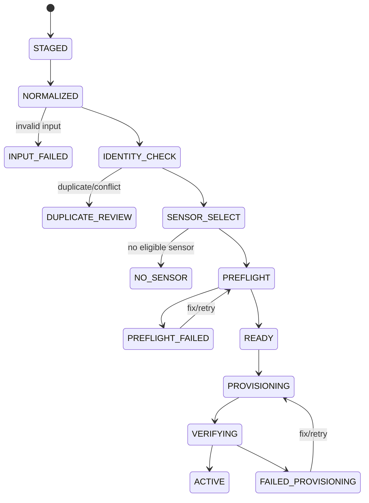
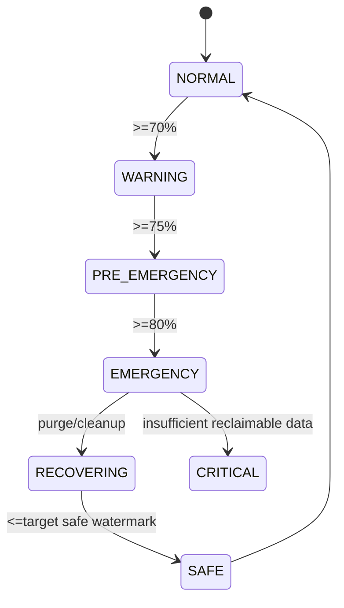

# Platform — Low-Level Design (LLD)

**Document ID:** PLATFORM-LLD-001
**Version:** 3.3.0
**Status:** Authoritative Mother Reference — Low-Level Design Authority (**A2.2 NORMALIZED_V1**)
**Product name:** Platform (internal engineering/build identifier) / AmrudAi (commercial/customer-facing product name)
**Governing documents:** `Platform_01_BRD.md`, `Platform_02_PRD.md`, `Platform_03_Architecture.md`
**Companions:** `Platform_04_HLD.md`, `Platform_06_Dataflow.md`, `Platform_07_OSS_Catalog.md`, `Platform_08_Requirements_Traceability.md`, `Platform_17_API_Event_and_Data_Model_Contracts.md`
**Normalization state:** NORMALIZED_V1
**Last reconciliation:** 2026-10-12 — Issue #200/#203 Tranche B Phase 1/1.5 certification-envelope reconciliation (LLD/ACK/ICMP/NCM/HA); prior Issue #142 Phase-1 observability closure retained

**Maturity:** `SPECIFIED != IMPLEMENTED != TESTED != BENCHMARKED != CERTIFIED != DEPLOYED`. Logical design here is not physical implementation evidence.

---

## 1. LLD conventions

**Maturity boundary (mandatory):** `SPECIFIED != IMPLEMENTED != TESTED != BENCHMARKED != CERTIFIED != DEPLOYED`. Logical schemas, topics, APIs and algorithms in this LLD are target design contracts. Presence here does **not** imply physical tables, APIs, events or production certification exist. Issue #92 implementation gaps remain binding truth until remediated with evidence.

This document defines concrete implementation contracts, schemas, state machines, topic families, API resources, sequencing rules, persistence ownership, worker behavior, error taxonomies and failure-handling expectations.

Where implementation has not been safely resolved, this document marks `TBD/P0 SPIKE`; engineers may prototype alternatives but may not silently select a design that contradicts the two-Core HA, resource, security or Sensor/Core **80% storage-protection** requirements. Absolute zero telemetry/data loss is not a Platform guarantee; Sensors continue polling/buffering while capacity permits and may shed oldest eligible lower-priority buffered data under prolonged outage/storage pressure while exposing data-loss risk.

All identifiers shown are examples of canonical names, not mandates for package/class naming unless explicitly stated.

---

## 2. Repository and build boundaries

Recommended top-level logical repositories/modules:

```text
platform/
  core/
    api/
    domain/
    ingest/
    query/
    alerting/
    incident/
    graph/
    rca/
    ai-gateway/
    ncm/
    ipam/
    reporting/
    integrations/
    audit/
    ha/
    storage-lifecycle/
  sensor/
    runtime/
    scheduler/
    protocol-snmp/
    protocol-icmp/
    protocol-flow/
    protocol-ssh/
    protocol-netconf/
    protocol-gnmi/
    protocol-rest/
    infra/
    discovery/
    ncm-executor/
    spool/
    uploader/
  agent/
    common/
    windows/
    linux/
  ui/
  schemas/
  device-packs/
  installers/
  qa/
  performance/
  docs/
```

Core, Sensor and Agent produce separate signed installation artifacts.

---

## 3. Canonical identifiers

### 3.1 Required IDs

- `tenant_id`
- `entity_id`
- `sensor_id`
- `agent_id`
- `site_id`
- `group_id`
- `policy_id` + `policy_version`
- `device_pack_id` + `device_pack_version`
- `monitor_definition_id`
- `credential_profile_id`
- `alert_id`
- `incident_id`
- `job_id`
- `session_id`
- `audit_event_id`
- `observation_id` / `event_id`

Use globally unique stable identifiers such as UUIDv7/ULID-like ordered IDs after final language/library review. Never use IP address as primary entity identity.

---

## 4. PostgreSQL logical schema

**Maturity / Issue #92:** Logical schema is SPECIFIED. Runtime-vs-migration privilege separation remains uncertified; Region/Sensor Pool logical design is not equivalent to physical implementation.


### 4.1 Tenant/identity tables

```text
tenant
  tenant_id PK
  name
  mode SINGLE|MSP_CHILD|MSP_MASTER
  status
  timezone
  created_at
  updated_at

user_account
  user_id PK
  tenant_id
  identity_provider
  external_subject
  display_name
  email
  status
  last_login_at

role
  role_id PK
  tenant_id nullable for system template
  name
  template_key nullable
  version

permission_binding
  binding_id PK
  principal_type USER|GROUP|SERVICE_ACCOUNT
  principal_id
  role_id
  resource_scope_id
  condition_json
  effect ALLOW|DENY
```

### 4.2 Inventory tables

```text
entity
  entity_id PK
  tenant_id
  entity_type
  display_name
  description
  discovered_name
  lifecycle_state
  site_id nullable
  criticality
  owner_team_id nullable
  device_pack_id nullable
  device_pack_version nullable
  first_seen_at
  last_seen_at
  created_by
  updated_at

entity_identifier
  id PK
  entity_id
  identifier_type  # IP, MAC, SERIAL, SNMP_ENGINE_ID, UUID, CLOUD_ID, K8S_UID, HOSTNAME...
  namespace
  identifier_value
  confidence
  first_seen_at
  last_seen_at
  UNIQUE(tenant_id/namespace/type/value as appropriate)

entity_attribute
  entity_id
  schema_key
  typed_value/json
  source
  observed_at
```

### 4.3 Graph metadata

```text
relationship
  relationship_id PK
  tenant_id
  source_entity_id
  target_entity_id
  relationship_type
  layer
  direction
  source_type DISCOVERED|USER|DEVICE_PACK|INFERRED
  source_reference
  confidence
  valid_from
  valid_to nullable
  last_verified_at
  evidence_ref
```

Current edges may live in PostgreSQL while history/facts are mirrored to ClickHouse.

### 4.4 Policy tables

```text
policy_definition
  policy_id
  tenant_id nullable
  policy_type
  name
  status
  current_version

policy_version
  policy_id
  version
  immutable_payload_json
  created_by
  created_at
  reason
  ticket_ref nullable

policy_assignment
  assignment_id
  policy_id/version
  scope_type TENANT|REGION|SITE|GROUP|ENTITY|METRIC
  scope_id
  precedence
  effective_from
  effective_to nullable
```

### 4.5 Sensor control

```text
sensor
  sensor_id
  tenant_id
  name
  role
  site_id
  pool_id
  version
  os
  state
  last_heartbeat
  certificate_thumbprint
  capacity_profile
  maintenance_state

sensor_pool
  pool_id
  tenant_id
  name
  region/site affinity
  redundancy_mode
  preferred/allowed/forbidden metadata

sensor_assignment
  entity_id
  primary_sensor_id
  pool_id
  failover_candidates_json
  assignment_version
  assigned_at
  assignment_reason
  pinned bool
```

### 4.6 Alert/incident state

```text
alert_current
  alert_id
  tenant_id
  entity_id
  policy_id/version
  alert_key
  severity
  state
  qualified_state
  confidence
  opened_at
  updated_at
  incident_id nullable
  ack_user nullable
  owner_team nullable

incident
  incident_id
  tenant_id
  severity
  state
  root_entity_id nullable
  root_cause_status DETERMINED|PROBABLE|INCONCLUSIVE|PENDING
  confidence nullable
  started_at
  resolved_at nullable
  owner_user/team
  itsm_ref nullable
  reopen_until nullable
```

### 4.7 NCM/IPAM/integration/report/licence

Each is a dedicated schema/module. Avoid storing opaque application state only as JSON when typed relational constraints are valuable.

---

## 5. ClickHouse logical tables

**Maturity / Issue #92:** Logical tables/lifecycle are SPECIFIED. Retention/rollup/lifecycle implementation remains incomplete.


### 5.1 `metric_numeric`

Suggested columns:

```text
tenant_id       UUID/String
entity_id       UUID/String
metric_id       UInt64/String dictionary ID
sensor_id       UUID/String
ts              DateTime64
value           Float64
quality         UInt8/Enum
flags           UInt32
sequence_id     UInt64/String
source_protocol LowCardinality(String)
```

Common ORDER BY candidate: `(tenant_id, entity_id, metric_id, ts)` subject to benchmark. Partition primarily by time with controlled tenant considerations; avoid one partition per device.

### 5.2 `metric_counter`

Logical schema for exact monotonic counters where floating-point storage would lose source truth:

```text
tenant_id
entity_id
metric_id
sensor_id
ts
raw_value_uint64
counter_bits  # 32|64 where known
source_oid/source_key
sequence_id
source_protocol
quality
reset_epoch/discontinuity_marker nullable
derived_delta nullable
derived_rate nullable
derived_quality
```

The authoritative raw counter is exact. `derived_delta`/`derived_rate` are recomputable outputs and may be null when reset/wrap/discontinuity cannot be resolved safely. Physical ClickHouse layout may optimize columns/types, but shall preserve the above semantics and support UInt64-range Counter64 without precision loss. A dedicated Kafka topic is an implementation option; an equivalently typed payload contract is acceptable when precision, ordering, consumer isolation and schema evolution remain proven.

### 5.3 `metric_state`

```text
tenant_id
entity_id
metric_id
ts
state_code
state_text_id/dictionary
quality
sequence_id
source_protocol
```

### 5.4 `network_flow`

Logical ClickHouse/analytics fact shape for authorized **per-flow / sampled-frame Flow** evidence. Field semantics are reconciled with `Platform_17` §13.9. This is not a breaking physical schema migration and does not introduce a new database, storage dependency or mandatory physical column set.

**sFlow evidence-class separation (mandatory):** An sFlow **interface/device Counter sample** is **not** an ordinary per-flow `network_flow` fact. Counter samples map to existing typed metric / device-counter evidence paths already owned by SNMP/metric contracts (no new database). Only IPFIX/NetFlow flow records and sFlow **sampled-frame** (flow-sample) evidence that carry qualified flow-tuple semantics may populate this fact shape. Never interpret cumulative sFlow interface counters as per-flow `bytes`/`packets`, and never scale those cumulative counters by the packet sample rate.

```text
tenant_id
exporter_entity_id
sensor_id
trusted_ingress_id          # independently verified listener/interface/VRF/routing-domain/authorization context
exporter_observation_domain_id  # Observation Domain / Source ID where protocol supplies it
exporter_authority_id        # resolved authorized exporter; never bare UDP source alone
start_ts
end_ts
src_ip
dst_ip
src_port
dst_port
protocol
bytes                       # immutable raw exported octet evidence (IPFIX/NetFlow) OR sFlow original/reported frame length ONLY where the protocol supplies a qualified original frame length; sampled header capture length MUST NOT be treated as original frame octets; never silently replaced by an estimate
packets                     # immutable raw exported packet evidence (IPFIX/NetFlow) OR sFlow sampled-frame packet evidence where protocol-qualified; never silently replaced by an estimate; never derived by treating sFlow interface counters as per-flow packets
bytes_estimated nullable    # separately identified estimate only when sampling/selection provenance justifies scaling of a qualified flow/sampled-frame observation; never by scaling sFlow interface counters by packet sample rate
packets_estimated nullable  # separately identified estimate; distinct from raw bytes/packets
estimation_method nullable  # method/indicator for any estimate; absent when no estimate is emitted
sampling_selector           # selector/algorithm/interval/probability/scope/validity where available
flow_evidence_class         # IPFIX_COUNTER | NETFLOW_COUNTER | SFLOW_SAMPLED_FRAME | OTHER_QUALIFIED — SFLOW_COUNTER interface/device samples are out of this fact shape
ingress_if_id
egress_if_id
src_site_id/dst_site_id nullable
src_subnet_id/dst_subnet_id nullable
vrf_id nullable
src_asn/dst_asn nullable
app_id nullable if exporter supplied
flow_type
sequence/template metadata  # protocol/version, template/options identity, refresh/epoch, gap/duplicate/unknown-template accounting
quality                     # existing quality vocabulary; quarantined/unmapped traffic MUST NOT become canonical analytics rows
```

Quarantined, unauthorized or ambiguously mapped Flow datagrams may produce loss/quality/collector-health evidence only. They must not populate canonical `network_flow` analytics as if tenant/exporter authority were proven. sFlow Counter-sample metrics remain separately qualified typed evidence and must preserve immutable raw source counter values distinct from any separately identified estimates.

### 5.5 `event_raw`

```text
tenant_id
event_id
entity_id nullable
sensor_id
event_type
event_ts
ingest_ts
severity_hint
source_protocol
source_key
payload_ref/structured payload
quality
```

Separate `syslog_event` and `trap_event` may be used for optimized fields.

### 5.6 `telemetry_quality`

```text
tenant_id
entity_id/sensor_id
window_start
window_end
expected_samples
received_samples
late_samples
duplicate_samples
failed_collections
freshness_ms
clock_offset_ms nullable
quality_score
```

### 5.7 Historical lifecycle tables

- `alert_history`
- `incident_history`
- `audit_event`
- `topology_fact`
- `change_fact`
- `sla_fact`
- configured rollup tables.

---

## 6. Kafka topic contract

### 6.1 Naming/versioning

Topic names are versioned by major schema compatibility. The names below and §77 are **logical family examples**, not two competing physical topic manifests. Current physical configuration/serialization is bound in `Platform_17` §4.7; BUILD-063 MUST freeze the approved name, key, schema, serializer and compatibility policy before any new family is implemented. Examples:

```text
telemetry.numeric.v1
telemetry.counter.v1   # optional dedicated exact-counter topic; equivalently typed payloads permitted when proven
telemetry.state.v1
network.flow.v1
event.syslog.v1
event.trap.v1
event.generic.v1
inventory.observation.v1
topology.observation.v1
config.change.v1
alert.lifecycle.v1
incident.lifecycle.v1
audit.v1
telemetry.quality.v1
integration.outbound.v1
```

### 6.2 Canonical envelope

```json
{
  "schemaVersion": 1,
  "tenantId": "...",
  "sourceType": "SENSOR|AGENT|CORE",
  "sourceId": "...",
  "entityId": "...",
  "observationId": "...",
  "sequence": 123456,
  "eventTime": "...",
  "ingestTime": "...",
  "quality": "GOOD|DEGRADED|LATE|UNKNOWN",
  "payload": {}
}
```

This is illustrative JSON; production may use Avro/Protobuf.

### 6.3 Partition keys

Choose keys that preserve required ordering without creating hot partitions. Examples:

- metric/state: tenant + entity;
- flow: tenant + exporter or hash of conversation/exporter depending load;
- alert/incident: tenant + entity/incident;
- audit: tenant + actor/resource hash.

Exact topic/partition counts are deployment-sized.

---

## 7. Ingestion acknowledgment and replay contract

**Maturity / Issue #92:** Replay relational-integrity gap remains an implementation defect class; durable ACK is required design.

**BUILD-000 freeze (Issue #110):** machine-readable edge contracts live under `schemas/edge/`. `SPECIFIED != IMPLEMENTED != TESTED != CERTIFIED`.

This contract is critical.

### 7.0 BUILD-000 frozen edge invariants

| Decision | Frozen rule |
|---|---|
| Sequence domain (B000-D001) | JSON-carried delivery/replay sequences are integers in `[1, 9007199254740991]` (`2^53-1` / `MAX_SAFE_SEQUENCE`). Zero is prohibited on wire. Sequences MUST NOT wrap; exhaustion fails closed; fresh lineage requires explicit new stream/generation. |
| Counter64 (B000-D002) | SNMP Counter64 metric values are **not** delivery sequences and retain the full unsigned 64-bit exact-counter / decimal-string model. |
| Start at 1 (B000-D006) | Every new durable delivery lineage begins at sequence 1 (Agent queue, Agent→Sensor, Sensor spool, Sensor→Core telemetry, Agent-ingress spool/path). Core Agent-ingress first-batch=1 enforcement is a **BUILD-003** conformance item. |
| Field names (B000-D003) | Exact current v1 JSON names are frozen; dual camelCase/snake_case ACK conventions are intentional compatibility. |
| bootEpoch (B000-D005) | Wire field `bootEpoch` remains; canonical meaning is durable Sensor spool stream/generation id matching `^stream-[0-9a-f]{32}$` (not OS boot time). |
| ACK durability (B000-D004/D007) | Application ACK only after durable accept boundaries below; HTTP 2xx alone is insufficient; ClickHouse is not the Sensor ACK gate. |
| Entity authority (B000-D009) | Agent `hostId` is evidence; Agent-supplied `entityId` is not authoritative; Core owns canonical entity mapping. |
| Monitoring correctness (B000-D012) | Collection/transport/credential/Agent/Sensor/Core/queue/ingestion failure, no telemetry, or stale telemetry MUST NOT automatically assert monitored target DOWN. `No Data != Device Down`. |
| Agent stream generation (B000-D015) | **BUILD-002 target:** durable `agentStreamId` (working name) on versioned Agent→Sensor contract; v1 is keyed by `tenantId+agentId` and fails closed on lineage restart. |
| Control counters (B000-D016) | JSON-carried assignment/config/policy/generation counters MUST NOT exceed `MAX_SAFE_SEQUENCE`. |
| Time (B000-D017) | Cross-boundary evidence timestamps are UTC RFC3339/ISO-8601 with `Z`; monotonic time is internal-only. |

### 7.1 Sensor spool segment

Each local batch contains:

```text
sensor_id
bootEpoch   # durable stream/generation id (historical name; not OS boot time)
batch_sequence / firstSequence..lastSequence
observation/record identities
created_at (UTC Z)
payload_checksum
compression
priority
```

Illustrative historical `boot_epoch` prose aliases the v1 wire field `bootEpoch`.

### 7.2 Ack semantics

A Sensor deletes a local segment only after Core returns a durable acceptance acknowledgment consistent with the **active certification envelope** (Phase 1 standalone matrix or Phase 1.5 HA matrix). Architecture target ≠ implementation ≠ certified.

**Deletion-authorizing ACK durability (Issue #200 / Platform_03):**

1. **Phase 1 standalone:** if Core issues an ACK authorizing Sensor durable-spool deletion, that telemetry must survive the certified standalone failure matrix (application/process/service crash/restart, governed host reboot and other explicitly certified recoverable failures). Catastrophic destruction/loss of the single Core/storage is **not** Phase-1 zero-RPO HA; recovery uses backup/restore and the declared Phase-1 DR profile.
2. **Phase 1.5 HA:** if Core issues an ACK authorizing Sensor durable-spool deletion, that telemetry must survive every failure in the certified permanent single-Core HA failure matrix (`ACKED-FOR-DELETION TELEMETRY RPO = 0` for those HA scenarios; distinct from site/DR RPO).

Physical HA durability mechanisms remain unselected (`HA_DURABILITY_DESIGN_GATE` / BUILD-120–124).

**Current source (`36e1513f`), Sensor→Core telemetry ACK boundary:**

1. Sensor writes batch durably to local spool.
2. Core validates identity/schema.
3. Core reserves exact range/checksum in PostgreSQL (`pending` reservation).
4. Core claims the bounded publisher lease and owner/epoch fence for that reservation.
5. Core commits the Kafka transaction.
6. Core finalizes the PostgreSQL watermark only for the matching reservation/owner/epoch.
7. Core returns `accepted_through_sequence` (+ `sensor_identity`).
8. Sensor marks/deletes acknowledged segments only after validating that ACK.

ClickHouse insertion is asynchronous and **must not** gate the Sensor ACK. CURRENT_IMPLEMENTED_V1 does not by itself certify Phase 1 standalone durability-matrix evidence or Phase 1.5 HA ACK RPO=0.

**Current source (`36e1513f`), Sensor→Core agent-ingress:** `AgentIngestionService` and `PostgresAgentIngressWatermarkStore` implement pending reservation → bounded publisher lease with owner/epoch → Kafka transaction commit → fenced PostgreSQL finalize → `acceptedThroughIngressSequence` ACK. V012 supplies the Agent-ingress reservation/stream and publisher-lease schema. Both Core ingest paths remain **at-least-once**: PostgreSQL/Kafka are not one XA transaction, and a Kafka-commit/PG-finalize crash can require replay. This source correction does not certify structured Agent evidence, physical ClickHouse deduplication or HA durability. Exact wire and version bounds remain `Platform_17` §10 and `schemas/edge/`.

**CURRENT_IMPLEMENTED_V1 Agent→Sensor:** ACK means authz + contract validation + durable Sensor Agent spool accept + durable replay accounting. Agent advances/deletes only after batch-bound application ACK.

Duplicate replay is tolerated using exact range+checksum identity. No component may acknowledge and then silently lose data without a documented replay source.

### 7.3 Duplicate handling

Consumers must be idempotent where practical. ClickHouse ingestion may use replay-aware deduplication keys or replacement semantics. Alert/RCA logic must not generate duplicate incidents from replayed event IDs.

### 7.4 Late data

Late observations retain original `eventTime`. Query/RCA pipelines distinguish event time from ingest time. Late data can amend historical facts but must not incorrectly reopen old incidents unless policy explicitly permits.

---

## 8. Sensor control protocol

**Maturity / Issue #92:** Sensor production entrypoint/governed-runtime gap remains; this section is logical design, not production certification.


### 8.1 Heartbeat

**BUILD-000 heartbeat v1 (B000-D008):** authenticated Sensor liveness/connectivity only.

Sensor may send informational fields (examples):

```json
{
  "sensorId": "...",
  "version": "...",
  "role": "NETWORK",
  "state": "HEALTHY",
  "capabilities": ["SNMP"],
  "queueBytes": 1234567,
  "oldestQueuedAgeSec": 12,
  "assignmentVersion": 99,
  "policyVersionWatermark": 212
}
```

`assignmentVersion` / `policyVersionWatermark` on the request are **non-authoritative compatibility fields** today; Core heartbeat ignores the body for desired/applied-state authority.

**CURRENT_IMPLEMENTED_V1 Core heartbeat response authority:**

```json
{
  "status": "ACCEPTED",
  "authenticated": true,
  "sensor_identity": "...",
  "tenant_id": "...",
  "received_at": "2026-09-24T10:00:00.000Z"
}
```

Do **not** treat `desiredConfigVersion`, `assignmentVersion`, or `policyVersionWatermark` as authoritative Core desired/applied-state values on heartbeat v1. **BUILD-004** owns desired/received/applied/rejected/stale/fenced reconciliation.

### 8.2 Desired state response

**BUILD-004 target:** Core returns desired/received/applied control:

- config/policy versions available;
- job/assignment lease changes;
- drain/maintenance instruction;
- update instruction;
- Core active endpoint/session state.

These are **not** authoritative on heartbeat v1 response (B000-D008).

### 8.3 Fencing tokens for jobs

Every poll/NCM job lease includes monotonically increasing assignment/fencing version. A Sensor must refuse a superseded lease once it has observed a newer version. This reduces duplicate polling during reassignment.

---

## 9. Monitoring Work Units (MWU)

Device count alone is insufficient. LLD defines a normalized cost model.

Example conceptual formula:

```text
MWU =
  snmp_request_cost
+ interface_metric_cost
+ icmp_cost
+ rest_call_cost
+ ssh_command_cost
+ gnmi_subscription_cost
+ discovery_cost
+ ncm_reserved_cost
+ event_receiver_cost
+ rtt_timeout_penalty
```

Weights are benchmark-derived and versioned. They are not hard-coded forever.

### 9.1 Capacity state

Sensor exposes:

- current MWU utilization;
- projected utilization with proposed assignment;
- protocol pool saturation;
- CPU/RAM/disk/queue safety state;
- failover reserve.

### 9.2 Placement eligibility

A Sensor is ineligible if any hard condition fails:

- forbidden policy/security zone;
- no protocol reachability;
- maintenance/draining;
- projected hard capacity breach;
- wrong tenant/site restrictions;
- incompatible role/version.

Eligible Sensors receive a suitability score using RTT, projected load, locality, HA and quality.

---

## 10. Device provisioning state machine



### 10.1 Input normalization rules

Safe automatic normalization:

- Unicode/BOM handling;
- CRLF/LF;
- trim non-secret string fields;
- standardize known enumerations case-insensitively;
- normalize IP/CIDR textual form;
- ignore blank rows.

Do not silently normalize credential secret values.

### 10.2 Error object

```json
{
  "code": "AUTHENTICATION_FAILED",
  "summary": "SNMPv3 authentication failed",
  "evidence": [
    "ICMP reachable from MUM-NET-02",
    "UDP/161 response received",
    "SNMPv3 authentication report indicates failure"
  ],
  "uncertainty": null,
  "recommendedActions": [
    "Verify SNMPv3 username/authentication algorithm/key",
    "Retest the selected Credential Profile"
  ],
  "sensorId": "...",
  "correlationId": "..."
}
```

### 10.3 Suspected firewall example

Only use `ACL_FIREWALL_SUSPECTED` when evidence supports suspicion; do not state firewall as fact if only a timeout exists.

---

## 11. Credential profile model

```text
credential_profile
  id
  tenant
  type SNMP|SSH|WINRM|REST|GNMI|DB|CLOUD|REDFISH|...
  display_name
  encrypted_secret_ref
  nonsecret_parameters
  scope_policy
  allowed_sensor_pools
  created_by
  last_verified_at
  rotation_metadata
```

Secret store interface:

```text
putSecret(profileId, plaintext, actor)
resolveForUse(profileId, sensorId, operationContext)
rotateSecret(...)
revoke(...)
```

Browser API never returns plaintext to a user lacking explicit `REVEAL`; normal monitoring requires only `USE`.

---

## 12. SNMP LLD

**Maturity / Issue #92:** Raw Counter64 acquisition path is IMPLEMENTED + TESTED only. Derived counter delta/rate/reset/wrap/discontinuity semantics remain unimplemented/uncertified.


### 12.1 Session profile

Parameters:

- version;
- timeout/retries;
- v2 community ref;
- v3 security name;
- auth protocol/key ref;
- privacy protocol/key ref;
- context engine/context name;
- max repetitions/bulk tuning;
- transport/address/port;
- source/interface binding if needed.

### 12.2 Collection plan and Poll Planner

Capability/Device Packs compile Monitor Definitions into bounded poll groups. The Poll Planner decides per device/profile:

- GET versus GETNEXT/GETBULK/WALK;
- scalar versus table grouping;
- OID count/PDU size;
- GETBULK non-repeaters/max-repetitions;
- timeout and retry policy;
- deterministic schedule offset across the configured interval;
- per-device concurrency and no uncontrolled self-overlap of the same scheduled collection;
- controlled fallback when a device returns `tooBig`, times out, or is certified as GETBULK-incompatible.

The planner consumes Device Pack compatibility metadata, observed response size/RTT/error history and current Sensor capacity. It may reduce bulk repetitions after `tooBig`/fragmentation-risk evidence and may fall back from GETBULK only according to bounded certified policy. It may not create an unbounded retry or adaptive-poll loop.

**Adaptive PDU / GETBULK safety clarification (2026-10-30 Network Sensor audit remediation):** Learn bounded GETBULK/PDU limits per effective device, protocol/security context and relevant table/subtree/poll-plan compatibility profile. Per RFC 3416, a shorter-than-requested, ragged or empty **well-formed** `noError` GETBULK Response-PDU can be a valid completed response when end-of-view (`endOfMibView`) and lexicographic progress / subtree rules remain coherent; do not force such responses into a generic failure class solely because fewer varbinds were returned than requested. Preserve **per-column cursor progress** and subtree/OID-group boundaries across repetitions so one finished column cannot erase sibling progress or walk outside the intended MIB subtree. Detect non-advancing lexicographic loops (repeated OID/value without progress) and terminate that column/group with explicit quality/error evidence rather than spinning. **Do not silently accept as valid completed responses:** malformed ASN.1/BER, wire-truncated or oversize datagrams that fail bounded decode, or lexicographic non-progress / subtree violations—these are protocol/decode failures with typed quality/error evidence. The phrase **inconsistent varbind counts/layouts** applies only to structurally corrupt responses that are **not** well-formed under the RFC 3416 rules above; it must **not** classify RFC 3416-permitted well-formed shorter-than-requested, ragged or empty `noError` GETBULK Response-PDUs as protocol corruption. Provide bounded GETNEXT and/or narrower OID-group fallback only under certified policy. Use differential response-size / `tooBig` / fragmentation evidence when adapting repetitions; a generic timeout caused by reachability, authentication, rate limiting, device load or CoPP must **not** be labelled automatically as PMTU/MTU/PDU-size failure. Any reduction, cautiously governed upward probe, GETNEXT fallback, cache expiry or invalidation must preserve table traversal/progress, OID coverage, worker budgets, freshness and measured error classification. Device firmware/Pack/profile changes must invalidate incompatible learned state. No universal max-repetitions ladder, fixed 24-hour lock, hardcoded timeout/EPS/IOPS/per-class quota claim or unbounded adaptive retry is selected without representative-device certification.

The normal scheduled SNMP operational-metric default is **5 minutes**. That default does **not** require polling every available OID every five minutes; Cap Pack/monitor definitions drive which objects are collected and how often. Availability/liveness remains a separate plane. Configured intervals are durations under the existing policy hierarchy, not a rigid database enum. Exact generic scheduler hash/algorithm details are out of scope here; SNMP spreading must remain deterministic/stable and compatible with later scheduler reconciliation.

### 12.3 Typed observation contract

SNMP varbinds retain BER/source semantics before canonical mapping. A collection batch can produce multiple typed facts:

```text
NumericObservation
ExactCounterObservation
StateObservation
InventoryObservation
TopologyObservation
TrapEvent
CollectionQualityObservation
```

At minimum retain: source OID, resolved MIB object when available, raw BER/value kind, collection timestamp, tenant/entity/Sensor/job provenance, quality/status and stable error/exception code.

`NoSuchObject`, `NoSuchInstance` and `EndOfMibView` are explicit collection-quality/exception outcomes. They are not converted into arbitrary numeric values and must not poison an otherwise valid poll merely because an optional OID is unsupported. Pack policy determines whether an unsupported mandatory OID degrades the monitor/profile.

### 12.4 Exact counter and rate contract

Raw counters are authoritative exact integers:

- Counter32 → unsigned 32-bit;
- Counter64 → unsigned 64-bit;
- TimeTicks → typed source value;
- derived delta/rate → separate derived numeric metric.

Counter64 shall never be coerced through IEEE-754 `Float64` / Java `double` / JSON unsafe-number semantics before exact delta/reset processing. ClickHouse may use `UInt64`/appropriate exact representation for raw counters; derived rates/utilization may use floating-point only after exact delta/reset/discontinuity processing.

For each rate derivation:

1. order samples by authoritative source/entity/metric time;
2. calculate actual elapsed time;
3. detect device reboot/reset using `sysUpTime` or equivalent evidence where available;
4. detect interface-specific discontinuity using `ifCounterDiscontinuityTime` or equivalent where available;
5. distinguish Counter32 wrap from reset when evidence permits;
6. reject/mark `UNKNOWN` or `DEGRADED` when a valid delta cannot be proven;
7. derive rate from exact delta / actual elapsed time;
8. retain raw samples/provenance required to explain the result.

High-capacity interface packs prefer `ifHCInOctets`/`ifHCOutOctets` and other appropriate 64-bit objects when certified.

### 12.5 Interface identity reconciliation

`ifIndex` is a temporal protocol index, not the sole canonical interface key. Interface reconciliation uses available evidence such as:

- ifName;
- ifDescr;
- ifAlias;
- MAC;
- entPhysical/slot/port;
- chassis/module relationship;
- vendor stable identifier;
- administrator reconciliation.

A legitimate ifIndex change after reboot, upgrade or hardware change shall not automatically create a new interface entity or lose historical SLA/alert/capacity continuity. Ambiguous identity creates a reconciliation/quality condition rather than a silent merge.

### 12.6 SNMP error mapping

Map library/device errors to stable diagnostics:

- timeout/no response;
- network/route/transport failure;
- unknown user/engine ID/time window;
- auth failure;
- privacy/decryption failure;
- unsupported security level/algorithm;
- authorization/no access;
- noSuchObject/noSuchInstance/endOfMibView;
- tooBig;
- malformed/unsupported response;
- resource/payload bound;
- cancellation/deadline;
- storage/durability failure.

Authentication failure is not a device-down assertion. `tooBig` may feed bounded Poll Planner fallback; permanent auth/security failures do not retry indefinitely.

### 12.7 Credential execution

Scheduled jobs carry Credential Profile identity/reference and authorization context, not reusable secret material in customer-visible or generic durable job history. The Sensor resolves/materializes only the minimum required community/auth/privacy material for the execution lifetime, keeps it in memory only where practical, disables unsafe shared credential caches, redacts diagnostics and destroys/forgets ephemeral material after use. Credential Profile `USE` does not grant `REVEAL`.

No default `public` community fallback is permitted.

**Secret materialization/crash-safety clarification:** Use the shortest practicable execution lifetime and avoid long-lived, cross-job or cross-tenant plaintext caches. Go strings, garbage collection and best-effort buffer clearing cannot be represented as guaranteed zeroization. Community/auth/privacy material must not reach structured logs, panic/error output, telemetry, support bundles, audit payloads or durable scheduler desired-state / assignment files (Credential Profile references and authorization context only). Production Sensor service policies must reconcile crash-dump and diagnostics policy with **OS-specific dumpability controls** that are validated on the certified Linux packaging/runtime profile (for example process dumpability, ulimit/core-pattern and package/unit hardening where applicable); do not force untested global directives that the target OS/service manager does not honour. Limit filesystem access to any crash/support artifacts and prove negative leakage tests. A safer mutable secret buffer may be used where the approved protocol library permits it; no claim of guaranteed in-memory erasure is made.

### 12.8 SNMP trap/inform receiver

Authoritative successful Inform path:

```text
receive Inform
→ bounded BER/protocol parse
→ configured security validation
→ source/tenant authorization and attribution
→ bounded pre-ACK storm admission/accounting decision
→ durable local accepted event
   OR durable local bounded storm-aggregation/accounting record
→ successful Inform ACK
→ MIB/Capability Pack semantic enrichment
→ final entity resolution
→ semantic dedup/correlation
→ Core/Kafka/ClickHouse/Alert Evidence downstream
```

Trap path is the same through parse/security/attribution and durable acceptance/accounting, but Trap remains unacknowledged protocol behavior.

Distinguish:

1. **pre-ACK bounded storm admission/accounting** — the admission/accounting decision that determines whether the notification is durably accepted (accepted raw event **or** durable bounded storm-aggregation/accounting record) and therefore whether a successful Inform ACK may be sent;
2. **post-ACK semantic dedup/correlation** — MIB/Capability Pack enrichment, final entity resolution and semantic fingerprinting/correlation that may proceed after ACK from the durably preserved source record.

For v1/v2c UDP traps and SNMPv2c Informs, source IP/community/enterprise OID are **weak attribution evidence only** and MUST NOT be described as cryptographically authenticated identity. SNMPv3 notifications validate USM/security configuration where enabled.

**Trap** is unacknowledged protocol behavior.

**Inform** acknowledgement requires durable local receiver acceptance/accounting. Before a successful Inform ACK, the receiver must:

1. perform bounded BER/protocol parsing;
2. validate configured SNMP security;
3. establish sufficient source/tenant authorization and attribution to determine acceptance;
4. perform the bounded pre-ACK storm admission/accounting decision that affects durable acceptance;
5. preserve the raw typed notification including OIDs, raw/typed values, protocol/security metadata, source, timestamp and provenance;
6. perform durable local acceptance/accounting (durable accepted event **or** durable bounded storm-aggregation/accounting record).

Only after durable local acceptance/accounting succeeds may Platform send a successful Inform ACK. MIB/Capability Pack semantic enrichment, final entity resolution, semantic dedup/correlation, alert correlation, Core delivery, Kafka persistence, ClickHouse persistence and incident creation are **not** prerequisites for protocol ACK. Semantic enrichment and semantic dedup/correlation may proceed after ACK from the durably preserved source event. If Platform cannot durably accept/account the Inform, it must **not** falsely return successful acceptance.

Inform ACK means `LOCAL RECEIVER ACCEPTED/ACCOUNTED`. It does **not** mean Core completed, Kafka completed, ClickHouse completed, alert generated or incident generated. This boundary is distinct from the Sensor→Core telemetry ACK model.

**SNMPv3 Inform engine and idempotency clarification (RFC 3414 §2.2.2-aligned):** The Inform receiver maintains a **persistent, unique, authoritative local `snmpEngineID`**. Distinguish **normal restart** from **loss / corruption / rollback** of nonvolatile engine state:

1. **Normal restart with a known, valid persisted `snmpEngineBoots` value:** the authoritative receiver MUST retrieve that value, **monotonically advance** `snmpEngineBoots` by one, **persist** the advanced value to nonvolatile storage, and reinitialize `snmpEngineTime` (reset to zero and resume incrementing) consistent with RFC 3414 §2.2.2 so discovery and authenticated peers observe a coherent engine lifecycle. Never decrement, roll back or invent a boots value when the prior persisted value is known and valid.
2. **Latest `snmpEngineBoots` cannot be determined** (nonvolatile loss, corruption, rollback or other inability to establish the latest value): per RFC 3414 §2.2.2 the receiver MUST set `snmpEngineBoots` to **2147483647**. That value **latches** and is a **fail-closed** condition: every authenticated message causes a `notInTimeWindow` authentication failure. While latched, the receiver MUST **not** return successful authenticated Inform ACKs. Recovery requires **controlled manual reconfiguration** using either a **new unique `snmpEngineID`**, or **new authentication and privacy protocol secrets** (for protocols actually configured) for **all users known to that authoritative SNMP engine**; never permit partial user rotation. Never recover by guessing, inventing or “advancing past” an unknown engine boot count.

The receiver's local `snmpEngineID` identifies the Platform Inform listener only; it is **not** a unique sender/notifier identifier for received Inform messages. USM discovery / engine-time exchange responses are **distinct** from Inform acknowledgement: discovery traffic must not be treated as durable event acceptance, and Inform ACK must not be returned before qualifying durable local acceptance/accounting. Bounded durable **retry idempotency** for SNMPv3 Informs uses the **ScopedPDU `request-id`**, authenticated securityName / security-level / context identity, and canonical notification payload evidence as the business-notification fingerprint—not the outer SNMPv3 `msgID`, and not USM discovery traffic—but that fingerprint alone does **not** uniquely identify a notifier when multiple devices share the same USM security principal. Durable deduplication MUST be scoped to an **independently qualified tenant/notifier identity** established through governed authentication, admission and source binding. A shared USM `securityName` or an unverified UDP source address MUST NOT be equated with cryptographically unique device identity. Two separately admitted notifiers that produce identical request-id, security context and notification payloads MUST retain **independent durable event evidence**.

**Retransmission versus separately occurring notifications (same qualified notifier):** A **genuine retransmission** of the same Inform occurrence from the same qualified notifier MAY be deduplicated under the bounded durable policy while preserving durable occurrence accounting, source evidence and critical-transition evidence. Separately occurring notifications from the same qualified notifier after **request-id reuse** (or other non-unique occurrence identity) MUST NOT be collapsed solely because the fingerprint matches a prior durable record when available evidence indicates a distinct occurrence, timing window, source observation or critical transition; preserve durable occurrence accounting, source evidence, ambiguity state and distinct critical-transition evidence. Do **not** promise impossible cryptographic differentiation when two **wire-identical** notifications contain no unique occurrence identity beyond the fingerprint already used; in that undecidable case retain fail-closed ambiguity/accounting behaviour rather than inventing an occurrence discriminator the wire does not provide. If notifier identity is ambiguous, never collapse distinct sources into one event and never acknowledge a silently discarded notification; enforce the existing fail-closed attribution and durable-acceptance boundary. For SNMPv2c Informs, retry/dedup may use weak source/community/context plus request-id and payload evidence where configured, but that attribution remains non-cryptographic and remains subject to the same fail-closed ambiguous-identity rule. Distinct critical events must remain distinguishable before semantic enrichment. Never silently discard Informs that have already received a successful durable-acceptance ACK; post-ACK shedding may delay enrichment/forwarding under resource pressure but must retain recoverable durable evidence or surface explicit durable-loss diagnostics. No ACK before qualifying durable local acceptance. Negative acceptance evidence is required for **same-notifier retransmission**, **same-notifier request-id reuse / distinct-occurrence ambiguity**, **wire-identical undecidable duplicate**, and **two-notifier collision** under existing `Platform_14` SNMP Inform ownership (`Protocol/security` engineID/boots/time and `notInTimeWindow` recovery; `Trap/Inform` retransmission/duplicate/durable-acceptance cases—SPECIFIED; no new Platform_14 section or certification-status claim by this clarification).

A bounded group-commit/WAL acceptance mechanism may amortize disk synchronization, but the individual successful Inform ACK must wait until that Inform's accepted event or qualifying bounded aggregation/accounting record is durably committed. An in-memory channel, queued-but-unflushed record, asynchronous best-effort counter or pre-ACK fingerprint drop alone does not satisfy acceptance. When parsing, attribution, spool admission, commit or storage-pressure protection fails, return no false successful Inform ACK; bound and measure outstanding requests, duplicate/retransmitted Inform identities, queue occupancy, admission latency and socket loss. Pre-ACK aggregation must durably account for source, time window, first/last occurrence, count and the evidence needed to avoid hiding distinct critical transitions; post-ACK semantic dedup remains separate. Batch interval, record count, fsync characteristics and sustainable EPS/IOPS are benchmark-selected for the certified Sensor storage profile, not fixed to illustrative auditor numeric claims.

**Workload-class admission and shedding:** Protect authority/control, liveness/availability polling, durable Inform/trap acceptance and critical-event budgets ahead of high-volume Flow/Log enrichment. Shedding and backpressure are class-aware and measured; they must not invent hardcoded EPS, IOPS, timeout or per-class quota guarantees in Mother References. Certification must cover receiver restart, disk/storage pressure, retransmission, duplicate Inform, pre-ACK storm admission/aggregation, failed durable acceptance, enrichment unavailable after durable acceptance, and self-induced polling / path-RTT measurement degradation under concurrent Flow/Inform/SNMP load.

Pre-ACK admission/accounting and post-ACK semantic dedup controls retain first/last seen, occurrence counts and measurable drop/rate-limit interventions so link-flap/event storms cannot create alert floods.

### 12.9 SNMP SET separation

The routine monitoring executor is read-only and does not expose arbitrary SET.

When a Capability Pack later declares a supported SNMP SET action, execution belongs to the NCM/remediation path and requires:

- explicit action/OID/value schema;
- tenant/resource RBAC;
- compatible credential/authorization;
- reason/ticket and approval where policy requires;
- pre-read/current-value evidence;
- bounded scope/blast radius;
- SET execution;
- post-read verification;
- audit and rollback/fail-safe behavior where feasible.

SET is never an implicit fallback of monitoring or discovery.

### 12.10 LLDP/CDP neighbor fact collector — REQ-NET-007

1. Validate enrolled tenant/device identity, authorized read-only SNMP credential, eligible Sensor and bounded execution assignment; do not default to community public or pivot to unapproved targets.
2. Walk LLDP local/remote systems and Cisco cdpCacheTable with device-capability checks and row/byte/deadline/attempt limits; distinguish absent, disabled, unsupported, partial, stale and permission-denied results.
3. Normalize immutable per-row facts with tenant, reporting Sensor/vantage, local canonical device/interface, raw LLDP chassis/port ID+subtype or CDP Device-ID/Port-ID/cdpCacheIfIndex, optional neighbor capabilities/address, observed/received time, TTL/freshness, evidence fingerprint, protocol and quality. Advertised identity is a claim.
4. Reconcile local LLDP port IDs or CDP interface indices through canonical port identity/ifName/ifAlias/MAC/physical slot rules; never persist ifIndex as permanent identity. Bind remote identity only after tenant-scoped corroboration.
5. Store source facts and derived **L2 adjacency** in the existing temporal graph; create directional upstream/dependent relationships only with independent routing/path/service/topology evidence. Keep one-sided/conflicting/expired facts for as-of investigation and conflict review; missing neighbor data is not a LINK_DOWN signal.
6. Test mixed-vendor LLDP+CDP, one-sided and stale observations, conflicting neighbors, port renumber, LAG/STP/ECMP, unauthorized identity, bounded walks, replay, graph revisions and false parent inference.

---

## 13. ICMP/traceroute LLD

Probe results include:

- sent/received;
- RTT min/max/avg;
- loss;
- source Sensor;
- protocol version IPv4/IPv6;
- route/path hops for traceroute;
- per-hop RTT/timeouts;
- change signature vs prior path.

Raw sockets/capabilities should use minimal Linux capabilities rather than running the entire Sensor as root.

**Typed ICMP observation architecture (Phase 1 mandatory contract):** ICMP evidence is a protocol-aware typed observation (not a free-form log line). Required semantic outcomes include reachable/unreachable, packet-loss versus hard-unreachable, RTT sample provenance, source/vantage identity and quality states such as `GOOD` / `PARTIAL` / `UNKNOWN`. Missing, stale or degraded ICMP evidence must not collapse into DEVICE_DOWN when corroborating SNMP/path/Agent evidence remains credible (`No Data != Device Down`). Intermediate hop unresponsiveness remains path quality evidence, not sole target-down proof.

**Implementation gap — Issue #218 (SOURCE_FACT / NOT CLOSED):** BUILD-020 Sensor `icmp_observation_v1` envelopes are currently rejected by Core `IngestionValidator` numeric-only acceptance (`protocolPayload.observations` or `metric_id`+numeric `value`). Architecture still requires a governed Core protocol-aware ICMP acceptance path (or an approved lossless numeric projection plus separately governed raw evidence) before recurring ICMP may be treated as end-to-end ingested. Do not describe unresolved Core acceptance as implemented, benchmarked or certified.

---

## 14. Flow LLD

**Maturity / Issue #92:** Flow/NTA production receiver remains not implemented/certified.


Flow LLD must cover NetFlow v5/v9, IPFIX, sFlow and vendor/J-Flow where applicable; configured exporter/source/tenant authority (packet source IP alone is insufficient); template lifecycle; sampling provenance; sequence/gap/reset; UDP pre-acceptance loss; observation point; direction; duplicate/exporter-HA; raw-before-enrichment; temporal IP/entity mapping; enrichment confidence/provenance; privacy/RBAC for user-attributed Flow. ClickHouse remains analytics authority. Production high-volume path uses FLOW role.


### 14.1 Receiver

Streaming Sensor/Network Sensor receives datagrams/streams and tracks exporter/template state.

**Ingress authority and overlapping addresses:** A bare UDP port/listener is not a trusted isolation boundary. Resolve exporter identity from independently verified ingress context, routing domain and authorization (for example tenant-dedicated Sensor placement or a genuinely segregated listener/interface/VRF/network namespace plus approved exporter mapping). Capture the actual receiving network context and bind it to the authorized exporter, profile and source; a packet's RFC1918 source IP, self-declared attributes or single global UDP socket alone are not authentication. Reject/quarantine ambiguous or unauthorized exporters before canonical tenant attribution or cross-tenant enrichment. Quarantined/unmapped traffic must not produce canonical Flow analytics. **Phase 1** must cover intra-tenant overlapping RFC1918/VRF/routing-domain spaces on independently verified ingress contexts without collision or silent merge. MSP/shared-customer isolation certification of overlapping exporters across tenants remains **Phase 1.5**.

**Template lifecycle:** NetFlow v9/IPFIX template/options state is scoped by trusted ingress and exporter identity, protocol, applicable source/collector transport endpoints, Observation Domain/Source ID and Template ID, with source lifecycle/epoch and last-refresh/expiry evidence where available. Data Templates and Options Templates share one Template ID namespace per Observation Domain/exporter scope; a colliding ID replaces prior meaning only under protocol-valid redefinition rules. Expired, incompatible or exporter-restart-invalid templates must not decode new records. Under UDP, enforce protocol-specific refresh/lifetime and template-redefinition semantics; **ignore UDP Template Withdrawal messages** (do not treat withdrawal as authoritative deletion of live decode state solely because a UDP withdrawal was observed). Cache miss, sequence gap and invalidation are explicit quality/loss events. After collector restart, do **not** decode UDP Data Sets using an unvalidated persisted template: a persistent snapshot may at most be an untrusted restart hint until appropriate **live template validation** / exporter-session continuity is established. A disk cache must never be accepted solely by exporter IP + Template ID or silently turn unknown bytes into plausible flow facts. No BoltDB, SQLite, separate template database or breaking schema migration is selected by this clarification.

**Sampling correctness:** Preserve raw exported packet/octet values and the source's sampling selector/algorithm, interval or probability, option-template scope, observation point, Observation Domain identity and validity window. Distinguish **sFlow sampled-frame** evidence, **sFlow interface/device Counter samples**, and IPFIX/NetFlow flow counters. sFlow Counter samples are typed metric/device-counter evidence—not ordinary per-flow `network_flow` facts—and must not be written into `network_flow.bytes`/`packets` or scaled by packet sample rate as if they were per-flow counts. For sFlow sampled frames, sampled header **capture length** is not automatically original packet/frame octet length; preserve original/reported frame length only where provided and qualified. Do not overload `bytes`/`packets` with estimated values. Emit estimated traffic rates/volumes in separately identified fields only when semantics justify scaling a qualified flow/sampled-frame observation; never multiply every received record by an assumed global rate or scale a value already normalized by the exporter. Missing, changed, conflicting or unverified sampling metadata yields explicit unknown/incomplete source quality and coverage limits. Where an estimate is permitted, record its method and a separate estimation indicator; do not invent a new source-quality enum or exact utilization.

### 14.2 Enrichment pipeline

```text
raw flow
→ exporter identity
→ interface identity
→ IPAM/subnet
→ site/region
→ VRF/VLAN where known
→ ASN/BGP
→ cloud context
→ exporter-provided app/QoS metadata
→ canonical network_flow
```

### 14.3 High-rate safeguards

- bounded decode queues;
- drop counters by reason;
- per-exporter rate metrics;
- template-miss counters;
- backpressure metrics;
- cardinality detection;
- capacity-driven explicit FLOW/LOG role separation or dedicated Sensor placement when required to protect polling and critical-event budgets; the one Universal Sensor runtime is retained.

No silent drop: every intentional/forced drop must be counted and surfaced.

---

## 15. Syslog/event LLD

Log/SIEM contracts cover Syslog, OTLP logs, application/OS/container/cloud and custom governed log ingestion with multiline boundaries, parser provenance, malformed/partial quality, secret/PII minimization/redaction, tenant/source attribution, durable routing, per-destination independent forwarding queues where required, bounded retry/backoff, dead-letter/quarantine, replay and forwarding health. SIEM destination outage must not block base monitoring. Platform is not a full SIEM replacement; Elasticsearch/OpenSearch/Loki are not mandatory. High-volume production Log uses LOG role.


Parse transport metadata, PRI/facility/severity, timestamp, hostname/source, message and structured data. Apply Device Pack/parser rules, sensitive-field policy and entity correlation.

Support UDP/TCP/TLS according to deployment. TLS is recommended; unencrypted transports are labeled legacy/insecure.

---

### 15.1 Runtime invariants for mixed Log/Syslog workloads — 2026-10-30 audit reconciliation

1. Resolve source and tenant through the configured, trusted ingress profile **before** entity correlation or durable spool. For Phase-1.5 MSP overlap, ambiguous UDP/TCP source identities fail closed; bounded metadata-only quarantine or counted rejection is permitted, never a default-tenant event or shared raw sensitive DLQ.
2. Respect UDP datagram and TCP/TLS Syslog transport framing. Multiline assembly is **opt-in** only for trusted identified application/file or certified stream sources with known framing; it must not join unrelated Syslog messages or tenants. Bound message bytes, line/part count, per-source state, aggregate active streams/bytes, idle lifetime and compression/decompression allocation. On limits/timeout, emit an explicit partial/truncated/segmented/rejected result and count loss; reject unsafe patterns and prefer linear-time Go `regexp` for user-configurable expressions.
3. Secret/PII minimization/redaction and parser safety occur **before local durable spool, downstream Kafka/ClickHouse, raw diagnostics, or SIEM export**. A redaction/parser error fails closed for protected fields (drop/redact body with reason and metadata-only audit), never saves the unsanitized payload as a debugging fallback. Encryption at rest remains required where profile/governance says so; declaring automatic PCI/GDPR compliance from redaction alone is prohibited.
4. TCP transport controls cannot guarantee simultaneous finite-resource operation, zero receiver window avoidance, zero source blocking and zero event loss. Bound read/processing and spool queues; communicate overload where feasible, expose gaps and prefer source-side durable/asynchronous log shipping for production applications. A policy demanding lossless regulated audit must define upstream durability/alternate sink or fail visibly rather than silently shed `protected` records or claim infinite quarantine.
5. Forwarding is a separately authorized and capacity-governed downstream consumer; destination outage never overrides Core alert/ingest authority. Isolate queues and retry/disk quotas per destination without introducing a compulsory secondary datastore; under shared resource exhaustion, measured primary-work protection and explicit degraded/loss state are required, not an unqualified `100% unaffected` claim.

## 16. gNMI/NETCONF/REST LLD

### 16.1 gNMI

Maintain subscription state, target paths, sample/on-change modes, TLS/auth and normalized path-to-metric/entity mapping.

### 16.2 NETCONF

Support session establishment, capability discovery, `<get>`, `<get-config>` and controlled edit operations for NCM where approved. Never assume candidate/confirmed-commit support without Device Pack capability declaration.

### 16.3 REST/API connector runtime

Connector execution object includes:

- base URL;
- auth profile;
- method/path;
- headers/params/body template;
- pagination model;
- retry/timeouts;
- rate limit;
- response schema/mapping version;
- chained request dependencies;
- normalized entity/metric mapping.

---

## 17. MIB Studio compile pipeline

```text
Upload MIB(s)
→ hash/provenance capture
→ dependency resolver
→ parse/compile
→ OID symbol tree
→ classify scalar/table/enum/trap
→ sample-device validation
→ semantic suggestions
→ admin confirmation
→ Monitor Definitions / Trap Rules
→ Device Pack version
→ sign/publish
```

Compiler errors must identify missing imports and exact source locations where possible.

MIB Studio additionally preserves module/version/hash/source/licence/redistribution provenance; resolves SMIv1/v2 imports; exposes textual conventions, enums, tables/indexes and notifications; distinguishes resolved symbols from unresolved numeric OIDs; and allows bounded test GET/WALK/BULKWALK against an authorized sample device from the selected Sensor. MIB absence shall not prevent authorized numeric-OID monitoring when the administrator supplies an explicit semantic mapping. Approved OSS status for gosmi does not by itself mean MIB Studio/runtime wiring is implemented or certified.

Generated SNMP Pack mappings may include transforms such as `ENUM_MAP`, `BIT_MAP`, `COUNTER_DELTA`, `COUNTER_RATE`, `TABLE_INDEX`, bounded `JOIN/LOOKUP`, `FALLBACK`, `CONDITIONAL`, `SCALE`, `OFFSET` and unit conversion. Transform execution is deterministic, schema-validated and cost-bounded; arbitrary code is not a mapping transform.

---

## 18. API Studio publish pipeline

```text
OpenAPI/manual connector
→ connection/auth test
→ sample response capture
→ schema inference
→ entity/collection mapping
→ metric mapping
→ type/unit/time normalization
→ rate/pagination test
→ preview expected cardinality/MWU
→ admin approval
→ Device Pack/Connector version
→ publish
```

Cardinality preview is mandatory when mappings include unbounded IDs/labels.

---

## 19. Device Pack manifest

Illustrative YAML/JSON model:

```yaml
id: vendor.model.family
version: 1.2.0
publisher: platform|partner|customer
certification: OFFICIAL_CERTIFIED
compatibility:
  vendor: ...
  models: [...]
  firmware: ...
identityRules: [...]
protocols:
  snmp: ...
  rest: ...
  gnmi: ...
  ssh: ...
metrics: [...]
inventory: [...]
topologyRules: [...]
alertSemantics: [...]
rcaSemantics: [...]
ncm:
  prompts: ...
  backupCommands: ...
  rollbackSupport: ...
dashboards: [...]
provenance: [...]
signature: ...
```

No secret is stored inside a Device Pack.

---

## 20. Policy evaluation LLD

### 20.1 Effective policy algorithm

For `(tenant, entity, metric, policyType)`:

1. load applicable active assignments;
2. sort by specificity/precedence;
3. merge override-capable fields using defined schema rules;
4. validate hard platform safety constraints;
5. compute immutable effective config hash;
6. cache effective result;
7. send version/hash to assigned Sensor;
8. Sensor acknowledges applied version.

UI explains inherited values and override source.

### 20.2 Policy simulation

Simulation evaluates a proposed policy against historical ClickHouse data and returns estimated alert count, affected entities, Sensor workload/storage impact where computable.

---

## 21. Alert engine LLD

### 21.1 Condition types

- threshold compare;
- duration;
- consecutive N/M;
- rate of change;
- missing data;
- baseline deviation;
- composite CEL expression;
- dependency/group condition;
- business calendar.

### 21.2 Alert key

Stable key should include tenant + entity + policy/condition semantic key so duplicate event replay updates existing alert rather than creating a new one.

### 21.3 Hysteresis

Policies define open and recovery/stability conditions independently.

---

## 22. Device-down validation LLD

Validation workflow object:

```json
{
  "primary": "SNMP",
  "steps": [
    {"type":"SNMP_RETRY","attempts":3},
    {"type":"ICMP","attempts":5,"intervalSec":5},
    {"type":"TCP","port":22},
    {"type":"SECONDARY_SENSOR"},
    {"type":"TRACEROUTE"}
  ],
  "decision": {"type":"EXPRESSION","expr":"..."},
  "recovery": {"stableForSec":300}
}
```

Values are customer-configurable; example only.

### 22.1 Outcome rules

- SNMP fail + ICMP/SSH/API pass → monitoring/protocol degradation.
- all relevant independent checks fail from multiple Sensors → stronger device/path outage confidence.
- many targets fail from one Sensor only → Sensor/path issue candidate.
- auth-specific protocol response → credential/auth issue, not outage.

---

## 23. Incident correlation LLD

### 23.1 Candidate window

On qualified alert, retrieve events/alerts in configured temporal window and graph neighborhood.

### 23.2 Correlation features

- graph hop distance;
- ancestor/dependency relation;
- shared site/power/circuit;
- route/peer relation;
- configuration-change proximity;
- Sensor source correlation;
- timestamp order;
- symptom-class compatibility.

### 23.3 Correlation action

Attach child alert to incident, preserve original alert, update incident impact and trigger/retrigger RCA subject to debounce/cost policy.

### 23.4 Topology incident grouping and downstream-notification gate

On each qualified alert, select a governed event-time window and historical graph neighborhood with typed provenance, edge direction, freshness and redundancy. Deduplicate stable event/alert IDs independently of grouping. Compare a corroborated parent/link/path/device outage against ordered child UNREACHABLE symptoms, independent Sensor/path checks, maintenance and competing hypotheses. Do not infer a parent failure from LLDP/CDP adjacency alone, a Sensor-only outage or missing telemetry.

If the hypothesis meets evidence/confidence policy with no blocking contradiction, attach original child alert IDs to one root incident and suppress only repeated child notification/ITSM fan-out. Persist reason, rule/version, graph snapshot, first/last occurrence, operator override, expiry and auditable reversible decision. Retain child event/alert/health/SLA states. On path redundancy, changed topology, parent recovery, independent child fault or new contrary evidence, recompute and unsuppress with revision. Otherwise return INCONCLUSIVE without fabricating a root alert.

---

## 24. RCA evidence model

```text
rca_run
  rca_run_id
  incident_id
  engine_version
  graph_snapshot_id/window
  started_at/completed_at
  result_status ROOT_CAUSE|PROBABLE|INCONCLUSIVE|ERROR
  root_entity_id nullable
  confidence nullable
  model_versions

rca_evidence
  evidence_id
  rca_run_id
  evidence_type METRIC|EVENT|CHANGE|TOPOLOGY|FLOW|AUDIT|PROBE|MODEL
  entity_id
  ts/window
  source_ref
  support_weight
  contradiction_weight
  quality
  explanation_code

rca_edge
  rca_run_id
  from_entity
  to_entity
  relation
  score
  evidence_refs
```

---

## 25. Hybrid RCA algorithm

High-level implementation stages:

1. **Evidence window build** — incident start ± configured context.
2. **Subgraph extraction** — affected entities, ancestors, neighbors, path/service dependencies.
3. **Telemetry quality gating** — calculate missing/stale/clock issues.
4. **Protocol rule evaluation** — deterministic candidate causes and contradictions.
5. **Temporal ordering** — earliest causal-compatible events.
6. **Change correlation** — NCM/user/maintenance/software changes.
7. **Anomaly scoring** — baseline deviations.
8. **GNN/graph scorer** — optional candidate/edge/impact scoring.
9. **Hypothesis fusion** — combine evidence with rule precedence and calibrated learned scores.
10. **Contradiction check** — remove/downgrade inconsistent hypotheses.
11. **Confidence calibration** — account for data quality/model/rule agreement.
12. **Result threshold** — if no hypothesis exceeds confidence/evidence requirements, return `INCONCLUSIVE`.
13. **Blast radius traversal** — impacted downstream/service nodes.
14. **Recommendation lookup** — Device Pack/runbook based, never arbitrary execution.
15. **Persist explainable output**.

### 25.1 No GNN-only truth

A GNN score cannot override definitive protocol evidence such as authenticated device response proving the device is up, nor can it create nonexistent topology edges without provenance.

### 25.2 Deterministic fault-signature and diagnostics evaluator

Within BUILD-100, a versioned codebook maps candidate failures to required, supporting, contradictory and irrelevant symptoms. A bounded real-time vector assigns TRUE/FALSE/UNKNOWN based on quality-gated link, route, latency/loss, CPU, hardware and service evidence. UNKNOWN does not count as FALSE and missing data does not falsely improve ranking. Score with deterministic configured weights, explicit coverage, contradictions, time order and qualified graph applicability; the highest score alone cannot make a confirmed root cause.

Complement codebook with static thresholds/hysteresis, expert if/then rules, attributed traps/syslogs, and a bounded diagnostic decision tree: local Sensor health and local gateway check, independent reachability, then authorized traceroute and target/protocol tests. A traceroute hop omitting ICMP replies does not by itself locate a fiber cut. Persist rejected alternatives, causal chain, evidence IDs, signature version and as-of graph revision in existing revisioned RCA output. Required negatives include redundant uplink survival, stale CDP, spurious traps, independent child failure, inconsistent codebook, unknown data, late events and persistent child failure after parent recovery.

---

## 26. GNN feature contract

Potential node features:

- entity type/vendor/role embeddings;
- health state;
- normalized metric anomaly scores;
- alert/event counts;
- recent config-change flags;
- protocol-session state;
- topology centrality/role features;
- Sensor/telemetry-quality features.

Potential edge features:

- relationship type/layer;
- discovered/manual/inferred provenance;
- confidence/freshness;
- link utilization/error/latency state;
- temporal propagation indicators.

Temporal windows must avoid leakage from events occurring after the ground-truth root cause when training/evaluating causal ranking.

### 26.1 Model registry

Model metadata in PostgreSQL/object artifact store includes hash/signature, schema compatibility, training dataset ID, benchmark results, calibration and enabled scopes.

### 26.2 Rollout

`DISABLED → SHADOW → PILOT → ENABLED`.

Shadow mode compares GNN result with deterministic/manual ground truth without affecting production incident conclusion.

---

## 27. Baseline/anomaly LLD

Per metric/metric-class baseline model stores:

- seasonality dimensions;
- training window;
- expected band/statistics;
- confidence;
- last trained;
- minimum sample quality.

Anomaly events include expected range, observed value, deviation score, model version and can hand off directly to RCA.

---

## 28. AI Gateway tool contract

Example safe tools:

- `searchEntities(query, scope)`
- `getEntityHealth(entityId)`
- `queryMetrics(entityIds, metricKeys, timeRange)`
- `getIncident(incidentId)`
- `getRcaEvidence(incidentId)`
- `getTopology(entityId, depth, layers)`
- `getRecentChanges(scope, timeRange)`
- `getRunbook(key)`
- `explainProvisioningFailure(jobId,rowId)`

Tools enforce authorization before execution. LLM cannot invent a hidden unrestricted SQL query endpoint.

### 28.1 Prompt/context protection

- redact secrets;
- restrict logs/config snippets according to tenant AI policy;
- include source/evidence IDs;
- enforce maximum context size;
- record provider/model/tool calls;
- reject action execution beyond allowed assisted scope.

---

## 29. NCM job model

```text
ncm_job
  job_id
  tenant_id
  type BACKUP|DIFF|COMPLIANCE|PUSH|ROLLBACK|COMMAND
  targets
  requested_by
  reason/ticket
  approval_state
  change_window
  dry_run
  concurrency_limit
  status

ncm_job_target
  job_id/entity_id
  sensor_id
  adapter_version
  precheck
  execution_result
  postcheck
  rollback_result
```

NCM executor receives a short-lived signed job token referencing credentials, never long-lived plaintext secrets.

**Phase 1 / Phase 1.5 NCM envelope (Issue #200):** Phase 1 independently certifiable NCM subset remains config backup/version/diff/compliance/golden-state (job types `BACKUP|DIFF|COMPLIANCE`, and controlled manual `COMMAND`/CLI when RBAC/credential brokering/audit are certified). Golden-state/desired-configuration comparison is a Phase 1 requirement contract and is not depicted by DF-025. Mass `PUSH`, canary/staged automated privileged execution, maker-checker automation defaults and automated remediation belong to **Phase 1.5** unless Founder change control promotes them. Schema presence of PUSH/ROLLBACK types does not imply Phase 1 certification or physical implementation.

---

## 30. CLI session LLD

1. User requests CLI on entity.
2. Authorization evaluates role/scope/conditions/MFA/reason/ticket.
3. Core selects assigned eligible Network Sensor.
4. Session Broker creates session ID and short-lived authorization token.
5. Sensor resolves credential for USE through secure Core channel or receives ephemeral sealed credential material according to secret architecture.
6. Sensor opens SSH.
7. Browser connects to Core WebSocket/xterm stream.
8. Commands/results stream through Broker/Sensor.
9. Commands are audited; config-mode/high-risk patterns may trigger approval/block.
10. Session end writes summary and config-change evidence.

---

## 31. Operational diagnostics and investigation LLD

Use existing PostgreSQL transactional state for bounded job/session metadata and existing ClickHouse/event/audit paths for historical result facts where appropriate. Do not add a diagnostics database.

```text
diagnostic_job
  diagnostic_job_id
  tenant_id
  actor_id
  origin_type ENTITY|INTERFACE|ALERT|INCIDENT|INVESTIGATION
  origin_id
  target_entity_id nullable
  diagnostic_type PING|TRACEROUTE|SNMP|TCP|DNS|SSH_TEST|API_TEST|PATH|PACK|DOMAIN_SPECIFIC
  requested_vantage_mode ASSIGNED|SELECTED|MULTI
  requested_vantage_ids[]
  parameters_json
  state QUEUED|RUNNING|PARTIAL|SUCCEEDED|FAILED|CANCELLED|TIMED_OUT|DENIED
  started_at
  completed_at nullable
  correlation_id
  investigation_session_id nullable
  incident_id nullable
```

Per-vantage result facts retain source identity, measured values, stable result/error code, quality, timestamps, evidence reference and provenance distinguishing `MONITORED` from `ON_DEMAND`.

Execution sequence: normalize tenant-scoped canonical target → authorize action/target/parameters → enforce hard/policy bounds → select eligible Sensor/Agent → acquire bounded interactive worker budget → execute with timeout/cancellation → normalize per-vantage results without hiding contradictions → persist/audit evidence references → publish result to originating UI/investigation/incident → release capacity and emit self-observability.

```text
investigation_session
  investigation_session_id
  tenant_id
  title
  origin_type
  origin_id
  state OPEN|CLOSED
  owner_user_id
  incident_id nullable
  started_at
  closed_at nullable
  reason nullable

investigation_evidence_ref
  investigation_session_id
  evidence_type DIAGNOSTIC|CLI_SESSION|QUERY_SNAPSHOT|CONFIG_DIFF|TOPOLOGY|FLOW|LOG_EVENT|NOTE|RCA|CHANGE
  evidence_id_or_ref
  observed_at
  attached_at
  actor_id nullable
  provenance
```

Evidence references point to authoritative existing records/artifacts where possible; do not duplicate full telemetry/config/packet payloads merely to populate an investigation.

A diagnostic pack is a versioned deterministic definition of permitted checks, dependencies, bounds and result presentation. Packs may branch on typed results but may not execute arbitrary user/LLM code. AI may rank/explain next checks from the permitted catalogue; execution still passes normal authorization and bounds.

Live Evidence returns monitored state and latest applicable on-demand verification separately with timestamps, vantage/source, quality and correlation reference. `Why?` returns evidence/policy inputs used to derive displayed state and must not fabricate causality.

## 32. IPAM LLD

### 32.1 Prefix model

Use canonical binary/network types capable of IPv4 and IPv6. Address uniqueness is scoped by tenant + address space/VRF.

### 32.2 Conflict detection

Conflicts combine authoritative reservations and discovered observations. A conflict record includes addresses, MAC/entity IDs, sources, first/last seen, site and remediation status.

### 32.3 Forecast

Historical utilization facts in ClickHouse feed simple trend/forecast models; report confidence and never present a precise exhaustion date when historical variability makes it unreliable.

---

## 33. Reporting and Service Assurance LLD

Use a safe typed expression engine such as CEL for governed formulas. Supported primitives may include arithmetic, ratios/percentages, SUM, AVG, MIN, MAX, COUNT, percentile, rate, difference, duration, IF/CASE-like expressions, threshold-compliance duration, rolling/time-window aggregation and weighted aggregation.

No arbitrary Python, JavaScript, SQL or executable customer code is permitted from Report/SLA/OLA authoring.

Logical objects:

```text
tenant_branding_config
  id, tenant_id
  internal_product_id: "platform"
  default_commercial_product_name: "AmrudAi"
  default_light_background_logo_ref: "/brand/amrud_blk.png"
  default_dark_background_logo_ref: "/brand/amrud_whi.png"
  favicon_ref: null # optional; no default favicon asset is shipped
  browser_title_template: "{page_title} | {effective_commercial_product_name}"
  report_header_footer_identity
  white_label_override_enabled: boolean
  updated_at, updated_by

service_time_profile
  id, tenant_id, name, timezone
  business_days, business_hours, holiday_calendar_ref
  shift_rules, country_site_overrides, effective_from, effective_to
  version

service_assurance_policy
  id, tenant_id, type SLA|OLA|PROVIDER_SLA|SLO
  external_ref?, name, owner_ref
  scope_expression, measurement_basis
  target_expected, minimum_threshold?
  measurement_window, per_ticket
  service_time_profile_ref
  formula_ref/version
  inclusion_rule_ref?, exclusion_rule_ref?
  degraded_treatment
  provider_ref?, dependency_policy_refs[]
  effective_from, effective_to
  lifecycle_state, version

measurement_period
  id, policy_id, period_start, period_end
  state OPEN|PRELIMINARY|REVIEW|FINAL|RESTATED
  policy_version, formula_version, calendar_version
  scope_snapshot_ref
  raw_result, adjusted_result, final_result
  quality_state, completeness
  finalized_at?, restates_period_id?

measurement_ledger_entry
  period_id, interval_or_item_ref
  source/evidence_refs[]
  classification
  raw_contribution
  excluded_or_adjusted_contribution
  reason/ref?, quality, provenance

report_obligation
  id, tenant_id, report_key
  report_definition_ref
  owner_ref, recipient_refs[]
  schedule_due_rule, timezone/calendar_ref
  allowed_formats [PDF|CSV]
  approver_refs[], delivery_policy, version

report_run
  id, obligation_id?, definition_version
  period/context, started_at, completed_at
  artifact_refs[], status, error_code?, correlation_id

report_attestation
  report_run_id, actor_ref, state UNDER_REVIEW|ACCEPTED|REJECTED|DISPUTED
  comment?, created_at
```

A finalized measurement period never silently recomputes using a later topology, inventory, holiday calendar, policy or formula version. Corrections create an audited restatement/revision.

Scope snapshots preserve the eligible denominator/population and relevant service/dependency ownership for the measured interval. Dynamic inventory changes may affect future intervals but must not rewrite past finalized periods.

Monitoring/data quality is separate from SLA result. `PARTIAL` or `INSUFFICIENT_EVIDENCE` cannot be rendered as unqualified compliance. A monitoring-path failure is not automatically service downtime.

Multi-vantage measurement rules are policy-driven and deterministic. Contradictory evidence is retained and can yield provisional/inconclusive measurement instead of guessed availability.

For shift/team OLA, ownership intervals and handoffs are timestamped; measurement is segmented by effective interval. Authoritative Team attribution requires the governed tenant-scoped Team identity contract.

Policy Simulator executes read-only against retained evidence and returns impact/delta/explainability; it must not mutate production policy or historical measurements.

Report artifacts are only PDF and/or CSV. PDF carries human/governance presentation and evidence summary, and prominently displays the effective commercial product logo (defaulting to the governed AmrudAi logo: selecting light-background `amrud_blk.png` or dark-background `amrud_whi.png` appropriate to template/page contrast, preserving aspect ratio, or the tenant/MSP logo where a governed white-label configuration is active) and effective customer-facing commercial product branding. CSV carries bounded detailed machine-readable tabular evidence without image embedding. APIs are separate integration/query interfaces.

Report execution must be cancellable, resource-bounded, authorization-rechecked and lower priority than live monitoring/ingestion/alert correctness.

## 34. ITSM connector LLD

### 34.1 Mapping object

```text
connector
field_map
  platform_field
  target_field
  transform
  required
priority_map
state_map
assignment_rules
recovery_policy
reopen_policy
```

### 34.2 Idempotency

`idempotency_key = tenant + connector + incident + operation_type + lifecycle_version`

Retries must not create duplicate tickets.

### 34.3 Inbound sync

Webhook/polling adapter maps external ack/assignment/state/work notes/change reference back to Platform when enabled.

---

## 35. Dashboard query LLD

### 35.1 Request

```json
{
  "scope": {...},
  "timeRange": {...},
  "metrics": [...],
  "groupBy": [...],
  "resolution": "AUTO",
  "filters": [...],
  "limit": 1000
}
```

### 35.2 Resolution planner

`AUTO` selects highest resolution that fits available retention and query-cost limits. Response includes `effectiveResolution` and source table/rollup metadata for transparency.

### 35.3 Query limits

- per-request timeout;
- max scanned time/rows/bytes;
- per-user/tenant concurrency;
- background export for oversized queries;
- cancellation token.

---

## 36. Storage retention LLD

### 36.1 Policy object

```json
{
  "dataClass": "NETWORK_METRIC",
  "scope": {...},
  "rawRetention": "P30D",
  "rollups": [
    {"resolution":"PT1M","retention":"P90D"},
    {"resolution":"PT5M","retention":"P365D"},
    {"resolution":"PT1H","retention":"P5Y"}
  ],
  "archive": {...},
  "emergencyPriority": 20,
  "minimumRecentWindow": "TBD/customer policy"
}
```

Durations shown are examples, not defaults.

### 36.2 Numeric rollup

Fields depending on metric semantics:

- min;
- max;
- average;
- sum;
- count;
- first/last;
- percentile(s).

### 36.3 Counter rollup

- preserve exact raw counter semantics before aggregation;
- delta;
- rate average/max based on actual elapsed sample time;
- Counter32 wrap detection;
- Counter64 exactness;
- device reboot/reset detection;
- interface/source discontinuity detection;
- invalid/ambiguous delta → explicit degraded/unknown quality, never fabricated rate;
- total where meaningful.

### 36.4 State rollup

- availability percent;
- duration by state;
- transition count;
- longest outage;
- last state.

---

## 37. Storage Protection LLD

### 37.1 Volume state machine



Percentages except the 80% hard watermark can be product-tuned; customer can adjust warnings within safe limits.

### 37.2 Purge planner

Inputs:

- volume usage;
- projected growth;
- data-class sizes;
- retention priority;
- protected/legal hold;
- rollup availability;
- minimum recent window;
- target safe utilization.

Outputs ordered purge actions by oldest eligible partitions/segments.

### 37.3 Core purge candidates

Normal priority examples:

1. obsolete temp/debug/cache files;
2. oldest raw high-frequency metrics;
3. oldest raw Flow;
4. oldest raw syslog/log data;
5. eligible raw event payloads;
6. other explicitly purgeable history.

Protected control data is excluded.

### 37.4 Sensor purge candidates

- acknowledged spool segments first;
- old local logs/diagnostics;
- obsolete installer/update artifacts;
- if disconnected and emergency persists, oldest low-priority unacknowledged telemetry may be dropped only under explicit emergency algorithm, with counters/audit/critical alert and continued current monitoring. Higher priority/recent data is retained preferentially.

### 37.5 Audit record

Every emergency deletion records volume, usage before/after, bytes freed, data class, time range, reason, policy version and monitoring impact.

### 37.6 Capacity assessment and simulation — accepted Issue #292

This is a logical contract within existing BUILD-061/064/074/086/094/097/130 owners, not new DDL, API route or service. `Platform_11` §9 owns the arithmetic and units. Each assessment MUST identify physical volume and owning node/deployment, observation time/source, policy/model versions, capacity/used/free bytes, attributed workload/storage components, protected versus safely reclaimable bytes, growth basis and uncertainty. A replica, archive or backup is attributed to the volume actually holding that copy; shared-volume components are not double-counted.

The calculator MUST use overflow-safe byte arithmetic, a justified uncertainty multiplier of at least 1.20 and an explicitly selected planning utilization below 0.80 (initial recommendation 0.70). It returns conservative demand, rounded required provisioned capacity, shortfall/headroom and the 80% boundary separately. Missing/stale/contradictory measurements remain `UNKNOWN` with reasons; a timestamp is returned only when growth and forecast confidence support it. The same rule applies to data-age, shortage/exhaustion forecasts and the expansion deadline derived from procurement lead time.

Retention, topology and capacity policy changes MUST be simulated against the affected physical volumes before activation. An infeasible proposal cannot receive a positive capacity/sufficiency result. It requires correction or an explicitly authorized, audited exception that preserves non-disableable safety and protected-retention obligations. Forecast calculations do not mutate retention, holds or volumes. Hysteresis, recovery and bounded work budgets prevent repeated purge/alert oscillation or starvation of monitoring.

Acceptance evidence MUST cover 1000→1200 GB uncertainty arithmetic and 70%/80% separation, provisioning-unit upward rounding/overflow, mixed-volume/copy accounting, missing measurements, burst/compression drift exceeding 20%, impossible retention/capacity proposals, 70/75/80 transition/recovery behavior, policy simulation/rollback and protected retention across partitions and backup copies. These are required cases, not tests claimed executed.

### 37.7 Capacity escalation and notification contract

Existing Platform Operations, Notification Center and ITSM/email connectors project the assessment. One tenant-scoped capacity case MUST retain stable correlation/deduplication identity, affected volume/policy, evidence/uncertainty, severity, recommended action and forecast deadline where known. Authorized recipient profiles, configurable procurement lead time, retry/dead-letter custody, actual delivery result, acknowledgement, reopen/close and maintenance behavior are explicit. Example lead times are not fixed product defaults. Notification creation or a successful socket write is not proof of external delivery.

If protected/legal-held data leaves insufficient reclaimable capacity, the volume enters `CRITICAL` with a named operational owner and escalation. No notification or calculator authorizes deletion of protected data, unlimited quarantine or an unbounded durability promise. Sensor emergency shedding remains governed by §37.4, with explicit irreversible-loss accounting. Notification integration is gated on its existing RBAC/audit owners; tenant, unauthorized-recipient, retry/poison-message, delivery-failure and recovery cases require evidence.


---

## 38. Legal hold LLD

`retention_hold` fields:

- hold_id;
- tenant;
- scope/entity/incident;
- from/to time;
- data classes;
- reason/ticket/legal reference;
- actor/approver;
- start/end;
- priority/protection level.

Purge planner checks hold index before deletion. Hold evaluation MUST cover the affected data classes/time ranges and their retained partitions, archives and backup copies according to the protected-retention policy; a new policy or emergency state cannot silently invalidate a hold. When no eligible reclamation can restore safe headroom, §37.7 requires `CRITICAL` ownership/escalation and authorized resolution. Audit must retain the decision, protected/reclaimable accounting and deletion outcomes; restore/replay must preserve hold and retention authority.

---

## 39. Asset lifecycle LLD

Lifecycle transition rules are explicit. Example:

```text
DISCOVERED -> PENDING_APPROVAL -> PROVISIONING -> ACTIVE
ACTIVE -> MONITORING_DEGRADED
ACTIVE -> MAINTENANCE
ACTIVE -> DECOMMISSION_REQUESTED -> DECOMMISSIONED -> ARCHIVED
```

Discovery absence does not automatically transition to DECOMMISSIONED. Reconciliation creates review cases.

---

## 40. Licence engine LLD

### 40.1 States

- `VALID`;
- `EXPIRING_30D`;
- `EXPIRING_7D`;
- `EXPIRED_GRACE` / `EXPIRED_GRACE_15D` (duration = **15 days** per Founder decision 2026-09-30; supersedes historical seven-day post-expiry and `FOUNDER-LIC-GRACE UNRESOLVED`);
- `EXPIRED_POLLING_STOPPED`;
- `MANUAL_EXTENSION`;
- `INVALID`.

### 40.2 Behavior

- 30d notification job.
- 7d dashboard banner globally (T-7 **pre-expiry** warning; distinct from post-expiry grace).
- post-expiry: polling remains enabled for **15 days** (`EXPIRED_GRACE_15D`).
- grace elapsed: scheduler stops new polling jobs; Sensors receive signed polling-disabled policy while remaining manageable.
- historical queries remain available.
- licence admin endpoint remains available.
- licence extension re-enables polling through normal assignment/policy synchronization.

Do not delete telemetry due to licence state.

---

## 41. Core installer LLD

### 41.1 Standalone inputs

- node hostname/IP;
- HTTPS endpoint/cert mode;
- install paths/data paths;
- admin bootstrap/auth mode;
- optional proxy/NTP/DNS checks.

### 41.2 HA inputs

- node identity;
- peer IP/hostname;
- stable HA endpoint/VIP;
- pairing token/secret;
- data path/storage validation;
- certificate mode.

### 41.3 Pairing

First Core creates deployment ID and one-time peer enrollment token. Second presents token, mutual node identity is established, cluster/deployment certificates exchanged, state baseline synchronized, active/standby roles committed and token invalidated.

### 41.4 Health checks

Installer must not report success until required local services are healthy and, in HA, synchronization reaches certified ready state.

---

## 42. Sensor installer LLD

Inputs:

- Core endpoint;
- tenant/site if not encoded by enrollment;
- Sensor role/profile;
- one-time enrollment token;
- local data/spool path;
- optional Sensor Pool hint.

Flow:

1. local prerequisite check;
2. outbound TLS connectivity to Core;
3. enrollment/token validation;
4. unique certificate issuance;
5. Sensor ID assignment;
6. Core assigns pool/site/config;
7. download Device Packs/policies needed;
8. self-test;
9. heartbeat ready.

No normal inbound management port from Core is required if outbound/control connection can support commands, improving firewall simplicity.

---

## 43. Agent installer LLD

Inputs:

- stable Core endpoint;
- enrollment token/site hint.

Core authenticates Agent and returns current Sensor assignment/failover endpoints. Agent never embeds permanent Core admin credentials.

---

## 44. HA Manager LLD

**Certification envelope / Issue #200:** Exactly-two-Core Active/Standby is the **Phase 1.5** HA certification envelope. Phase 1 uses one authoritative standalone Core and makes no Core-HA availability claim. HA ≠ DR.

**Maturity / Issue #92:** Exactly-two-Core Active/Standby required; active authority/fencing/stateful failover/rejoin remains OPEN P0 / NOT PRODUCTION CERTIFIED. No mandatory third Core, witness, replicated ingress journal or new coordinator service is selected here.


### 44.1 Heartbeats

Core nodes exchange signed heartbeats over dedicated secure peer channel and independently check stable endpoint/data-service health.

### 44.2 Promotion rule

Automatic standby promotion only when supported failure-detection/fencing policy determines former Active cannot remain authoritative. If peer communication alone is lost and Active status is ambiguous, remain fail-safe (`SPLIT_BRAIN_PREVENTED`) rather than dual-active.

### 44.3 Fencing

**TBD/P0 SPIKE:** determine supported fencing mechanisms for VM/bare-metal environments without a mandatory third full node. Candidates may include VM/hypervisor power fencing, network/VIP ownership arbitration, storage lease mechanisms or fail-safe manual promotion for ambiguous partitions. Commercial HA claim requires certification of supported modes.

---

## 45. PostgreSQL HA LLD

Primary on Active, streaming replica on Standby.

Promotion transaction must coordinate:

1. confirm/fence old primary;
2. verify replay position;
3. promote standby DB;
4. promote Core app;
5. publish stable endpoint;
6. mark new cluster epoch;
7. reject stale old-Core writes based on epoch/fencing metadata.

Cluster epoch is included in internal write authorization where useful.

---

## 46. ClickHouse two-Core LLD spike requirements

The final design must choose and certify a mechanism meeting:

- two full Core nodes only;
- continuous or bounded-lag synchronization;
- replay from Sensor/Core durable sources;
- duplicate-safe backfill;
- failure detection visible;
- no requirement for an unadvertised third full Core.

Candidate patterns to benchmark:

A. Application/ingestion dual-write to both ClickHouse instances with per-node acceptance watermarks and catch-up.

B. Active ClickHouse + asynchronous partition replication/backfill to standby using an externalized replication mechanism that does not require a third quorum service.

C. A supported two-node ClickHouse feature set if available at implementation time and license/performance validated.

No option is accepted until chaos/failover testing proves data correctness and recovery time.

---

## 47. Kafka two-Core LLD spike requirements

Requirements:

- Kafka remains mandatory internal bus.
- Sensor does not connect directly to Kafka.
- A single Core loss must not force Sensor polling to stop.
- Any telemetry not durably committed across failover must remain replayable from Sensor spool or another certified durable layer.
- Event IDs prevent duplicate incident effects.
- Controller/broker recovery must fit <60s Core service restoration where feasible, or Ingestion Gateway must remain able to accept/buffer safely while Kafka recovers.

Candidate active/passive approaches must be benchmarked; do not deploy a two-voter KRaft quorum and call it one-failure tolerant.

---

## 48. Backup/restore LLD

**Maturity / Issue #92:** Backup/restore/DR implementation evidence remains incomplete.


Backup manifest contains:

- Platform version;
- schema versions;
- PostgreSQL backup reference/hash;
- ClickHouse backup/partition references;
- Device Packs/MIB/API connectors;
- dashboards/reports;
- policy exports;
- certificates/keys references according to secure backup policy;
- NCM/IPAM metadata;
- licence/deployment metadata;
- checksums;
- encryption metadata.

Restore validates integrity/compatibility before destructive changes.

---

## 49. DR LLD contract

DR v1.0 must implement configuration/state export/replication hooks and a tested activation runbook. Exact topology is TBD, therefore all endpoint assignments must support controlled redirection to an alternate Core endpoint without reinstalling every Sensor/Agent.

Sensor stores at least current Core endpoint set/DR redirection capability signed by authorized Platform configuration.

---

## 50. Upgrade LLD

Version compatibility matrix includes:

- Core version;
- Sensor version;
- Agent version;
- Device Pack API level;
- database schema version;
- Kafka schema versions;
- AI/GNN model schema compatibility.

Sensor/Agent reject incompatible assignments/packs with actionable error rather than crashing.

---

## 51. Support error model

All major errors use stable namespace:

```text
PLT-CORE-xxxx
PLT-SENSOR-xxxx
PLT-SNMP-xxxx
PLT-FLOW-xxxx
PLT-PROV-xxxx
PLT-HA-xxxx
PLT-STORAGE-xxxx
PLT-RCA-xxxx
PLT-AI-xxxx
PLT-ITSM-xxxx
PLT-NCM-xxxx
```

Error payload:

- code;
- human summary;
- severity;
- component;
- tenant/resource;
- correlation ID;
- technical detail safe for role;
- evidence;
- recommended action;
- docs/help key.

---

## 52. Audit event schema

**Maturity / Issue #92:** Durable audit/common emitter/actor attribution gaps remain where applicable.


```json
{
  "auditEventId": "...",
  "tenantId": "...",
  "actorType": "USER|SERVICE|POLICY_ENGINE|AI|SYSTEM",
  "actorId": "...",
  "action": "DEVICE_SENSOR_CHANGED",
  "resourceType": "ENTITY",
  "resourceId": "...",
  "source": "UI|API|SYSTEM",
  "sourceIp": "...",
  "sessionId": "...",
  "requestId": "...",
  "before": {},
  "after": {},
  "result": "SUCCESS|FAIL",
  "reason": "...",
  "ticketRef": "...",
  "timestamp": "..."
}
```

Secrets must be redacted before audit persistence.

---

## 53. Telemetry quality scoring

Quality score factors may include:

- expected/received ratio;
- freshness;
- failed poll rate;
- late/out-of-order rate;
- clock drift;
- schema/mapping errors;
- Sensor health.

RCA receives both evidence and quality. Confidence must decrease if evidence is incomplete.

---

## 54. Topology history LLD

Relationship changes emit immutable `topology.observation` facts. Current relationship table represents latest valid state; ClickHouse/history stores intervals/facts so Graph Service can reconstruct `asOf` topology.

Manual relationships are versioned/audited and never silently converted to discovered physical truth.

### 54.1 Neighbor-adjacency and historical failure-dependency separation

Immutable topology.observation records retain reporting Sensor/device, LLDP/CDP raw neighbor/port identifiers, time, quality and source reference. Reconciled current edges are projections; manual dependencies and conflicting observations must retain separate authority. As-of queries enforce valid-time intervals, identity mapping confidence and expiry. No absent advertisement can itself mark a link or target DOWN. Downstream-suppression reasoning uses only separately verified directionally dependent edges and preserves historical graph revisions.

---

## 55. Unified Operations Timeline LLD

Timeline query merges normalized records from:

- alerts/incidents;
- config changes;
- topology changes;
- audit;
- Sensor assignment/health;
- maintenance;
- selected metric threshold/anomaly facts;
- ITSM lifecycle;
- RCA runs.

Return a typed ordered stream with source links rather than flattening everything into unstructured text.

---

## 56. Platform self-monitoring alerts

Required internal alert families:

- Core service unhealthy;
- Core HA sync lag;
- PostgreSQL replication lag/failure;
- ClickHouse sync/insert/merge/disk issue;
- Kafka unavailable/lag/schema error;
- Sensor offline/degraded/high load;
- Sensor spool aging/storage high;
- telemetry freshness/completeness failure;
- integration queue stuck;
- certificate expiry;
- licence expiry;
- backup failure;
- storage watermark;
- purge insufficient;
- clock/NTP drift.

Internal monitoring failures must not be conflated with monitored-device failures.

---

## 57. UI route design

Illustrative stable routes:

```text
/home
/dashboards/:id
/inventory/devices
/inventory/entities/:entityId
/provisioning
/topology
/alerts
/incidents/:incidentId
/rca/:incidentId
/ncm
/ipam
/reports
/integrations
/studios/mib
/studios/api
/studios/device-packs
/admin/...
/audit
/platform/operations
```

Deep links include tenant/scope safely and validate authorization on load.

---

## 58. RBAC permission namespace

**Implementation truth (`36e1513f`):** V016 and opt-in JDBC identity/permission directories are implemented behind `platform.security.directories.persistence-enabled` (default `false`). Source authority is `core/src/main/java/com/platform/core/security/http/SecurityDirectoryConfiguration.java`; disabled/unavailable or unauthorized paths remain fail-closed. This does not establish deployed activation, complete IAM/SSO or certification; see `Platform_03` §29.


Examples:

```text
DEVICE_VIEW
DEVICE_CREATE
DEVICE_EDIT
DEVICE_BULK_CREATE
DEVICE_DECOMMISSION
DISCOVERY_EXECUTE
DISCOVERY_APPROVE
SENSOR_VIEW
SENSOR_ASSIGN
SENSOR_ADMIN
CAPACITY_OVERRIDE
MONITORING_ASSIGN
POLICY_EDIT
ALERT_ACK
INCIDENT_ASSIGN
RCA_VIEW
CLI_OPEN
CLI_CONFIGURE
NCM_BACKUP
NCM_PUSH
NCM_APPROVE
IPAM_EDIT
CREDENTIAL_USE
CREDENTIAL_EDIT
CREDENTIAL_REVEAL
AUDIT_VIEW
AUDIT_EXPORT
AI_USE
AI_ADMIN
LICENSE_ADMIN
```

Permission checks always include resource scope and conditions.

---

## 59. Security protocol defaults

Recommended default posture:

- prefer SNMPv3 AuthPriv;
- allow SNMPv2c/v1 only explicitly when needed;
- SSHv2 only;
- disable Telnet by default;
- HTTPS/TLS for REST/Redfish/WinRM where supported;
- TLS 1.2 minimum, 1.3 preferred;
- no TLS1.0/1.1;
- Syslog TLS recommended;
- mTLS Sensor/Agent;
- certificate validation on by default;
- insecure skip-verify requires explicit privileged override and audit if offered at all.

---

## 60. API versioning

External APIs use versioned prefix such as `/api/v1`. Backward compatibility policy must be defined before GA. Breaking changes require new major API version or explicit migration strategy.

OpenAPI documentation is generated from source contracts and exposed according to role/security policy.

---

## 61. Release engineering LLD

Every build pipeline must produce:

- signed Core/Sensor/Agent packages;
- exact dependency lock;
- SPDX/CycloneDX SBOM;
- third-party notices/licences;
- vulnerability report;
- checksum manifest;
- provenance/build metadata;
- migration manifest;
- rollback metadata;
- test/performance results for certified profiles.

Green licences are permissive catalogue entries; yellow dependencies require legal/architecture review; red/unknown block proprietary distribution by default.

---

## 62. Performance test matrix

At minimum benchmark:

- SNWP-2500-v1 on 8C/32G Core;
- Sensor 4C/16G normal workload baseline;
- Sensor 8C/32G density target (internal recommended 4 GB/vCPU planning ratio; not a customer-install rejection gate, and not a certified device count);
- SNMPv3 CPU cost;
- high-interface devices;
- high RTT/timeouts;
- adaptive polling burst;
- flow records/sec;
- syslog EPS;
- dashboard concurrent users;
- large table filtering;
- ClickHouse insert/query/rollup;
- Kafka consumer lag;
- RCA graph size/time;
- GNN inference overhead in shadow/pilot;
- storage purge while ingestion continues;
- Core HA failover;
- Sensor failover/reassignment;
- WAN outage/replay.

---

## 63. Chaos/failure tests

Required cases:

- kill Active Core process/node;
- lose HA peer link only;
- lose stable VIP path;
- PostgreSQL primary failure;
- ClickHouse local failure;
- Kafka unavailable;
- disk reaches 80%;
- Sensor Core connectivity loss for hours;
- Sensor disk pressure;
- Sensor crash during polling;
- duplicate replay;
- stale policy version;
- credential rotation causing failures;
- ITSM outage;
- Gemini outage;
- corrupted/invalid Device Pack;
- bad GNN model disabled mid-run;
- NCM job interruption;
- certificate expiry/revocation.

Expected behavior must be deterministic and auditable.

---

## 64. LLD P0 spikes / unresolved implementation items

1. Two-Core Kafka failover topology and durable ack boundary.
2. Two-Core ClickHouse synchronization/failover.
3. HA fencing without mandatory third full Core.
4. Exact PostgreSQL synchronous/asynchronous replication policy after HA/DR RPO decision.
5. GNN framework/model architecture and optional GPU acceleration.
6. Final MWU weights and Sensor density after lab benchmark.
7. Exact default storage warning target-after-purge values and minimum recent window.
8. Final DR topology and RPO/RTO.

These items are explicitly open; implementation is not complete until design review resolves them.

---

## 65. Desired-state reconciliation LLD

```text
desired_state
  tenant_id
  resource_type
  resource_id
  domain ASSIGNMENT|POLICY|DEVICE_PACK|CREDENTIAL|VERSION|MONITORING
  desired_version/hash
  effective_at

observed_state
  resource_type/resource_id/domain
  observed_version/hash
  observed_at
  source_sensor/agent
  status

drift_case
  drift_id
  desired_ref
  observed_ref
  drift_type
  severity
  first_seen/last_seen
  remediation_state
```

Reconciler compares desired vs latest observed state and emits `DRIFT_DETECTED`, `DRIFT_RESOLVED` audit/timeline facts.

## 66. Migration Studio LLD

### 66.1 Staging model

```text
migration_job
migration_source
staged_entity
staged_group
staged_site
staged_monitoring_setting
staged_relationship
mapping_issue
```

Each staged object records source tool/version/export reference and transformation status.

### 66.2 Commit safety

Migration commit performs duplicate/identity checks, capacity simulation, credential reference validation and policy semantic validation. Unsupported proprietary semantics remain `NEEDS_REVIEW` rather than guessed.

## 67. Technology lifecycle LLD

```text
lifecycle_catalog_entry
  vendor
  product_family/model
  software/firmware selector
  eos_date nullable
  eol_date nullable
  support_end nullable
  source_uri/reference
  source_retrieved_at
  provenance/licence metadata
  confidence
```

Entity-to-lifecycle matching is explainable and reversible.

## 68. Intelligence Quality LLD

```text
rca_feedback
  incident_id/rca_run_id
  rating CORRECT|PARTIAL|INCORRECT
  actual_root_entity nullable
  comment
  actor
  timestamp

rca_quality_fact
  engine/model version
  benchmark/production cohort
  precision
  false_root_rate
  inconclusive_rate
  tt_rca
  explanation_score
  blast_radius_score
```

Production statistics must label whether values are validated ground truth, user feedback or inferred proxy.

## 69. Alert policy effectiveness LLD

Per policy/window calculate:

- alerts opened;
- unique entities;
- incident conversion rate;
- average repeat count;
- acknowledgement/closure distribution;
- suppression/dependency grouping count;
- flapping count;
- operator feedback if available.

Recommendations are advisory and require review before changing policy.

## 70. Pipeline integrity LLD

Maintain watermarks/counters:

```text
sensor_produced_seq
sensor_acked_seq
ingestion_accepted_seq
kafka_produced_count
consumer_processed_count
clickhouse_inserted_count
rejected_count
duplicate_count
late_count
dropped_count_with_reason
```

Perfect one-to-one counts may not exist for transformed/aggregated streams, so reconciliation is defined per stream stage/schema. Any unexplained loss must create a data-quality/internal Platform event.

## 71. Shift handover / PIR / Runbook records

Shift handover is a snapshot/report over current incident, maintenance, change, platform-health and approval state plus operator notes.

Runbooks are immutable-versioned content records with approval/owner/scope and optional future executable-step metadata.

PIR records reference incident/timeline/RCA source IDs and store human-approved final cause/CAPA separately from machine-generated draft text.


---

## 72. Cross-cutting LLD capability completeness (absorbed)

The following cross-cutting capabilities remain mandatory where applicable. Canonical IDs remain in `Platform_08_Requirements_Traceability.md`. OSS catalogue detail remains in `Platform_07_OSS_Catalog.md` (TRANSITIONAL_LEGACY until A2.3).

- asset lifecycle/reconciliation, stale/disappeared/replaced device handling and decommission workflow;
- technology lifecycle/EOL/EOS/firmware risk visibility without pretending to be a vulnerability scanner;
- backup, restore verification, v1.0 DR, low-downtime upgrade, rollback, canary and feature-flag controls;
- desired-vs-actual monitoring state, drift detection, change impact preview and dry-run;
- path analysis, device/time comparison, circuit inventory, business/service ownership and shift handover;
- learned baselines/seasonality, alert storm protection, flapping detection, event compression and alert-policy effectiveness;
- unified Operations Timeline combining telemetry, events, topology, NCM, audit, user action, sensor activity, ITSM and RCA;
- data provenance/quality/confidence, topology relationship provenance/confidence and historical topology;
- global search, command palette, contextual troubleshooting actions, support bundle and customer-visible Platform Health;
- licensing/usage dashboard, data-growth forecast and entitlement-aware UI;
- sensitive-field classification, masking/drop/hash/store policy, AI data boundaries and AI audit;
- Device Pack certification/test simulator, import/export, template library, onboarding wizard and contextual help;
- API-first implementation, webhooks/outbound events, API governance, rate limits and query protection;
- integration test sandbox, timezone/site timezone handling, internationalization foundations and accessibility;
- telemetry/cardinality explosion protection, tenant/noisy-neighbor quotas, ingestion dedupe, late/out-of-order/replay handling and legal hold;
- Migration Studio and Environment Readiness Scanner;
- change-freeze/business calendars, runbook/knowledge library and post-incident review/problem management;
- RCA accuracy/feedback metrics, monitoring optimization recommendations and Sensor placement learning;
- certificate/PKI lifecycle, proxy/no-proxy and data-sovereignty/regional-placement readiness;
- IPv6/dual-stack first-class behavior;
- scheduled housekeeping and end-to-end pipeline-integrity visibility;
- stable customer-facing error codes/correlation IDs and **No Silent Failure**.

## 73. Supporting mother-reference ownership

- `Platform_03_Architecture.md` — architecture invariants.
- `Platform_04_HLD.md` — high-level component/service design.
- `Platform_06_Dataflow.md` — end-to-end sequences.
- `Platform_07_OSS_Catalog.md` — OSS catalogue (not normalized in A2.2).
- `Platform_10_Protocol_Security_Connector_Master.md` — protocol/security mechanics.
- `Platform_11_Sizing_Capacity_Storage_Master.md` — capacity/sizing constants.
- `Platform_14_Test_Performance_and_Release_Quality.md` — certification evidence.
- `Platform_17_API_Event_and_Data_Model_Contracts.md` — exact API/event/data contracts.

**OSS rule:** no runtime/build dependency may be added unless admitted to the Platform OSS Catalogue by exact version, transitive license/CVE scan and release policy.

## 74. Dependency and wrapper contracts

No domain package may import an OSS protocol/client library directly except its designated adapter module. This is an implementation rule, not a suggestion.

| Adapter | Approved/candidate library | Canonical outputs |
|---|---|---|
| `SnmpAdapter` | GoSNMP | `NumericObservation`, `ExactCounterObservation`, `StateObservation`, `InventoryObservation`, `TopologyObservation`, `TrapEvent`, `CollectionQualityObservation`, normalized error reason |
| `MibCompiler` | gosmi | `MibModule`, `OidDefinition`, `TableDefinition`, `NotificationDefinition`, provenance |
| `FlowDecoder` | GoFlow2 | `FlowRecord` with exporter/interface/5-tuple/bytes/packets/time/template metadata |
| `IcmpProbe` | x/net/icmp | `ProbeResult` RTT/loss/status/error |
| `DnsProbe` | miekg/dns | DNS timings/rcode/answer validation |
| `SshAdapter` | x/crypto/ssh / scrapligo | command/session result with prompt/mode/error metadata |
| `GnmiAdapter` | OpenConfig gNMI | normalized subscription/sample/update/delete events |
| `YangAdapter` | goyang/ygot | validated path/model metadata |
| `RestAdapter` | Go HTTP + kin-openapi | normalized response/schema/error/pagination state |
| `WinrmAdapter` | masterzen/winrm | command/query result + normalized auth/connectivity errors |
| `RedfishAdapter` | Gofish | canonical chassis/component health/inventory |
| `VsphereAdapter` | govmomi | canonical vCenter/cluster/host/VM/datastore/network observations |
| `K8sAdapter` | client-go | canonical K8s entities, relationships, events/metrics references |
| `NcmDriver` | scrapli/scrapli_cfg/Nornir + approved drivers | config snapshot/diff/commit/rollback/job evidence |

### 74.1 Bounded agentless and provider-API adapter lifecycles — 2026-10-30 audit reconciliation

The approved adapter modules (no new runtime or library) own per-target active/queued concurrency, connection/session cleanup, credential rotation and invalidation, request deadlines, vendor error mapping and source-health telemetry. Optional SSH multiplexing must bound authenticated client lifetime and number of channels. WinRM may use structured WMI/CIM/WS-Man where certified; never assume `masterzen/winrm` implements a raw CIM/StdRegProv API or require permanent WinRS shells. Constrained, versioned PowerShell fallback stays allowed by Platform_10. Failure of an individual privileged Linux query or OS/vendor source produces missing-evidence/partial quality, not target DOWN.

`VsphereAdapter` separates inventory/change retrieval via bounded PropertyCollector from `PerformanceManager` metrics. It checkpoints and resynchronizes after version/session invalidity under MWU budgets. Cloud adapters pace per provider/account/region/service/operation and retain SDK retry/credential-expiry semantics; database/storage adapters enforce target-side privilege/connection/query budgets. Physical pool/cache/schema selection and benchmark limits are BUILD-owned, not architectural claims of current implementation.

### LLD rule: third-party errors never escape directly to users

Every adapter maps failures into the Platform provisioning/collection taxonomy. Raw vendor/library error is retained as diagnostic evidence for authorized support users, while customer UI receives a stable reason code and remediation guidance.

## 75. SNMP security/configuration contract

Credential profile fields must support:

- SNMPv1/v2c community; stored encrypted and masked;
- SNMPv3 security name;
- security level: noAuthNoPriv / authNoPriv / authPriv;
- authentication algorithm: legacy MD5/SHA-1 only where required plus supported SHA-2 variants based on library/device compatibility;
- privacy algorithm: legacy DES only when explicitly enabled plus AES variants supported by the approved library/device;
- context name/context engine ID where required;
- timeout/retry policy, transport/address family, source Sensor scope;
- trap/inform security profile separately from polling profile where required.

Legacy algorithms/protocols are disabled or visibly marked legacy/not recommended. The exact algorithm compatibility matrix is stored in Device Pack/credential capability metadata rather than assumed globally.

SNMPv3 `authPriv` with supported SHA-2/AES is the preferred default posture where device compatibility permits. MD5, SHA-1, DES, v1 and v2c require explicit legacy/compatibility selection and audit/warning. Engine-ID discovery, boots/time-window synchronization, `unknownEngineID`, `notInTimeWindow`, reboot and HA-peer changes are certification cases, not assumed library behavior.

Credential Profile `USE` authorization allows monitoring execution but does not grant `REVEAL`. Reusable SNMP secret values are prohibited from general telemetry, Kafka events, ClickHouse rows, audit records, support bundles and ordinary scheduler-history payloads.

## 76. Bulk import normalization rules

Safe text fields can be trimmed and Unicode/line-ending/BOM normalized with a `NORMALIZED` warning record. Secrets are never silently trimmed. Invalid IP/CIDR/port/version/enums produce row errors. Unknown site/group/credential/profile references are resolvable inline. Staging rows maintain original value, normalized value, reason code and operator disposition.

## 77. Kafka topic/schema baseline

Topic families remain internal and tenant-aware in payload/partition strategy. The following is a logical coverage checklist with illustrative names, consistent with §6; it does not declare these topics deployed or override the physical manifest owned by BUILD-063:

```text
telemetry.metric.numeric.v1
telemetry.metric.state.v1
telemetry.flow.v1
telemetry.event.v1
telemetry.syslog.v1
telemetry.inventory.v1
telemetry.topology.v1
control.sensor.desired.v1
control.sensor.reported.v1
alert.qualified.v1
incident.lifecycle.v1
rca.evidence.v1
rca.hypothesis.v1
audit.event.v1
integration.outbound.v1
```

Apicurio, Avro and Protobuf remain approved targets (`Platform_07`, OSS-004/005/006: `APPROVED_NOT_IMPLEMENTED`), not an assertion of current registry deployment. Current telemetry uses the JSON serialization/configuration in `Platform_17` §4.7. BUILD-063 MUST bind each admitted physical family to its exact schema, serialization, partition/ordering, retention and compatibility-test artifacts before deployment. If a registry-based family is admitted, producers MUST obey its registered compatibility policy; this paragraph does not silently migrate existing JSON wire or introduce a new mandatory runtime service.

## 78. ClickHouse data-class tables

**Maturity / Issue #92:** ClickHouse retention/rollup/lifecycle implementation remains incomplete; logical tables here are SPECIFIED, not certified deployed lifecycle.

At minimum keep physically/logically separate high-volume classes:

- `metric_numeric`
- `metric_state`
- `network_flow`
- `event`
- `syslog`
- `alert_history`
- `incident_history`
- `audit_event`
- rollup tables/materialized aggregates by configured resolution

Common telemetry keys include tenant, entity, metric, timestamp, value/state, quality, Sensor/source and schema/version metadata. Repeated strings should be dictionary/ID normalized where benchmark proves value. Partitioning is time-oriented and designed for efficient TTL/drop without uncontrolled partition cardinality.

## 79. Retention rollup semantics

For each metric definition store `metric_kind = GAUGE | COUNTER | STATE | HISTOGRAM | EVENT` and allowed aggregations. Rollup jobs/materialized views must be complete before normal raw TTL deletion. Emergency 80% protection may reclaim eligible raw data earlier and records any lost target retention as a platform event/audit record.

## 80. GNN implementation contract

Candidate runtime: PyTorch + PyTorch Geometric, isolated behind `GraphScoringService`. It consumes a versioned feature snapshot and returns only scored hypotheses/features; it cannot mutate graph truth or incidents.

Required request fields:

```text
tenant_id
incident_id / investigation_id
graph_snapshot_id
time_window
candidate_entities[]
node_features_version
edge_features_version
model_id/model_version
```

Required response fields:

```text
candidate_entity_id
root_score
propagation_score
impact_score
model_confidence
feature_attribution/reference
model_version
inference_latency_ms
```

RCA Fusion Service records the GNN scores as evidence of type `LEARNED_SCORE`, applies deterministic/protocol/topology/change evidence and may still return `INCONCLUSIVE`.

## 81. Dependency admission/release gate

```text
propose dependency
 -> check Platform_07_OSS_Catalog
 -> pin exact version/hash
 -> resolve transitive graph
 -> ORT policy
 -> Syft SPDX/CycloneDX
 -> Trivy vuln/license/secret
 -> ScanCode if source/license ambiguity
 -> fail build on RED/unknown or unapproved YELLOW
 -> archive SBOM/notices/licenses/checksums/provenance
```

## 82. Two-Core HA invariants

**Certification envelope / Issue #200:** These invariants govern the **Phase 1.5** exactly-two-Core Active/Standby envelope. Phase 1 multi-Sensor assignment generation/fencing/stale-work rejection remains mandatory under standalone Core and must not be deferred solely because Core HA is Phase 1.5.

**Maturity / Issue #92:** HA fencing/failover/rejoin remains OPEN P0 / NOT PRODUCTION CERTIFIED.

The exact internal replication technology is P0 spike, but code must satisfy these invariants:

- a single logical `deployment_id`;
- a single `active_epoch`/fencing generation for state-changing operations;
- Standby rejects active-only mutations unless promoted;
- Sensors know stable Core endpoint plus active epoch/session and can reconnect without losing local schedule state;
- Sensor telemetry carries monotonic source sequence/observation IDs sufficient for idempotent replay/dedup;
- every Core state mutation is durable at the authoritative persistence boundary before acknowledged where required;
- split-brain test must prove that network partition cannot create two externally authoritative control planes;
- failover certification measures UI/API recovery, ingestion recovery and backlog replay separately;
- Phase 1.5 deletion-ACK certified matrix target remains `ACKED-FOR-DELETION TELEMETRY RPO = 0` (distinct from Phase 1 standalone deletion-ACK durability and from site/DR RPO).

## 83. License timer implementation

Use absolute signed license expiry timestamp, deployment timezone-independent UTC evaluation and auditable state transitions. Dashboard banner derives remaining days from Core UTC and user display timezone. A manually signed extension/renewal must be accepted without Core/Sensor reinstall. Post-expiry grace duration is **15 days** (`EXPIRED_GRACE_15D`; Founder decision 2026-09-30; supersedes historical seven-day post-expiry and `FOUNDER-LIC-GRACE UNRESOLVED`). T-7 pre-expiry banner remains distinct. At post-grace suspension, Scheduler stops issuing/renewing monitoring jobs; historical query, admin, license import and audit remain available.

## 84. Query safety

**Maturity / Issue #92:** Cardinality/noisy-neighbour protection is not certified.


Interactive queries enforce tenant scope, maximum scan/time/rows/concurrency and cancellation. Large exports run asynchronously and write authorized artifacts. UI tables use server-side page/filter/sort and virtualization. No API may permit an unbounded five-year raw Flow scan by default.


## 85. Docker, service supervision, logging and packaging LLD

### 85.1 Compose contract

Every Compose service shall declare where applicable:

- pinned image/build context;
- explicit network(s);
- named volumes for durable state;
- read-only configuration mounts where possible;
- health check;
- resource limits or documented development defaults;
- restart policy appropriate to `dev` versus `test` profile;
- secret injection through files/environment indirection without committing secrets;
- no `latest` image tags in reproducible test/CI profiles.

`depends_on` shall not be treated as readiness. Services requiring another service must wait on health/readiness or implement retry/backoff.

### 85.2 Docker reboot behavior

For the interactive development profile, long-lived stateful and Platform services shall use `restart: unless-stopped` unless a service has a documented reason not to. Docker daemon auto-start at host boot is required. Named volumes preserve state. Engineers must have explicit documented commands for clean stop, clean restart and destructive reset.

### 85.3 Linux systemd unit contract

Every separately managed mandatory Linux runtime process delivered by the enabled Core, Sensor or Linux Agent profile shall have an explicit `systemd` unit (or an approved equivalent supervisor owned by that package). For Core this includes PostgreSQL, ClickHouse, Kafka and Valkey when they run as separate mandatory services, plus the Platform application/ingest/query services required by the selected profile.

Units shall define dependency ordering/readiness without treating process existence as service readiness, and shall use at least:

```ini
[Service]
User=<dedicated-service-user>
Group=<dedicated-service-group>
Restart=on-failure
RestartSec=<bounded-backoff>
TimeoutStartSec=<explicit>
TimeoutStopSec=<explicit>
NoNewPrivileges=true
```

Mandatory units shall be enabled at package installation/profile activation unless an explicit staging option intentionally prevents startup. Recoverable unexpected exits shall restart automatically with bounded delay/backoff, while preserving the component's existing authority, role, fencing, replication, durability and rejoin contracts. Automatic restart must not self-promote Standby, bypass Core Active/Standby fencing, bypass PostgreSQL/Kafka/ClickHouse replication/durability/safe-rejoin rules, create dual-active authority, repeatedly force-start known-unsafe/corrupt/incompatible local state, or treat process existence as recovery success. If safe automatic recovery cannot be established, the unit/component remains FAILED/DEGRADED/RECOVERING with actionable health/diagnostic evidence and a governed operator/runbook path; standalone/non-HA bounded supervised restart remains mandatory. Exactly-two-Core HA authority/fencing and stateful failover/rejoin remain owned by BUILD-120–124 and are not selected by this systemd contract. Optional, scheduled or on-demand workers shall not be forced permanently resident when no enabled workload requires them. Persistent crash loops shall transition to visible diagnosable health failure rather than restart silently forever. Exact hardening directives are component-specific and must be validated against required network/file capabilities.

### 85.4 Windows Service contract

Windows Agent shall:

- register with Service Control Manager;
- use Automatic or Automatic (Delayed Start) according to final benchmark;
- define recovery actions for first/second/subsequent failures;
- run under a least-privilege service identity appropriate to required collection capabilities;
- log service lifecycle and recovery events;
- preserve enrollment identity/configuration across reboot and upgrade;
- support silent install/uninstall for enterprise software distribution.

**Windows identity/access admission (BUILD-014/015/018/019).** Choose and certify the actual SCM service identity by a versioned operation-by-operation least-privilege matrix on representative Windows Server builds, domains, Group Policy and EDR baselines; do not assume that `LocalService` and a virtual service account have interchangeable network credentials. A virtual account can authenticate to remote resources as the domain computer account; the default monitoring Agent must not depend on such network access. `LocalSystem`, `SeDebugPrivilege`, blanket local-administrator privilege, unconditional Performance Monitor Users/Event Log Readers membership and unconditional SCM DACL modification are **not** approved defaults. First probe the actual operation under the service token, then use the narrowest approved per-counter/channel/SCM read access where required, with tenant/customer-admin consent, GPO compatibility, rollback and audit. Ordinary SCM enumeration rights must be tested before considering any additional ACE; denied protected channels (especially Security), processes and counters remain explicitly `PRIVILEGE_DENIED`/`UNAVAILABLE`, never silently empty or host-down evidence.

For executable-path selectors, first use `OpenProcess(PROCESS_QUERY_LIMITED_INFORMATION)` with `QueryFullProcessImageNameW` when supported, without process-memory reads or debug privilege. Protected Process Light, security products and ACLs can still deny access; preserve stable service/executable identity when independently available, and report selector/source quality rather than inventing a process path.

**Windows SCM lifecycle and durable-stop contract.** The Agent SCM handler must acknowledge stop/shutdown promptly, stop admission of new bounded collections, drain/close owned spool and log handles as permitted by the existing deletion-ACK durability contract, and report progress using Windows SCM service status/wait-hint/checkpoints where applicable. Linux `systemd TimeoutStopSec` is not a Windows SCM setting. Win32 calls that cannot be safely cancelled must not block the SCM control handler; no repeated unlimited worker creation under a hung provider. Upgrades shall disclose and handle a genuine reboot-required/file-in-use condition, not claim that an unattended MSI can *guarantee* zero reboots. Normal uninstall/upgrade preserves enrollment, pending telemetry and customer state.


### 85.5 Structured log schema

Mandatory fields where applicable:

```text
ts
level
component
version
node_id | sensor_id | agent_id
service_instance_id
tenant_id (only where valid)
event_code
message
correlation_id
request_id
job_id
entity_id
protocol
result
retry_count
safe_context
```

Forbidden fields include clear-text password/community/private key/API token/bearer token/session cookie and unredacted authorization headers.

### 85.6 Log retention/rotation

Logs shall be bounded. Linux packages integrate with journald/logrotate policy; Windows integrates with Windows Event Log and bounded Agent log files as specified. Local logs participate in storage forecasting and 80% disk protection. Debug logging is time-bound and must not remain enabled indefinitely without explicit operator choice.

### 85.7 Package scripts

`.deb`/`.rpm` install/upgrade/uninstall scripts must be idempotent, must not destroy customer data on package removal unless an explicit purge operation is requested, and must preserve configuration/state across in-place upgrade. Package scripts must record failures with actionable error codes.

---

## 86. Endpoint Diagnostic Snapshot implementation contract

EDS is implemented as Diagnostic Job profile `ENDPOINT_DIAGNOSTIC_SNAPSHOT` on the existing diagnostic/Live Evidence architecture. It does not add a second scheduler, registry, evidence database or transport.

### 86.1 Capture-eligibility state

For each effective diagnostic trigger, the Agent or agentless monitoring authority retains bounded **capture-eligibility** state sufficient to evaluate whether an automatic EDS Diagnostic Job may be created. This state is **not** authoritative host/operational health:

```text
policy_id
policy_version
authority_generation      Core-issued assignment/policy/control generation
entity_id
metric_or_state_key
INELIGIBLE | QUALIFYING | CAPTURE_ELIGIBLE | COOLDOWN
eligibility_started_at
last_observed_at
last_capture_at
cooldown_until
recovery_candidate_since
```

Evaluation uses the same normalized monitoring observations already collected wherever possible. One sample crossing a threshold does not by itself require EDS when the effective policy specifies duration/qualification. Hysteresis/recovery semantics prevent rapid capture oscillation. Eligibility must never replace Alert Engine/Core semantic monitoring state or assert device/service DOWN.

Automatic capture executes only under currently valid Core-issued authority/generation. Stale, revoked, expired, reassigned or replayed authority fails closed.

### 86.2 Linux Agent evidence collectors

Linux EDS shall prefer bounded native reads/APIs such as `/proc`, `/sys`, stat/statfs and narrowly filtered journal/kernel evidence. Collector implementation shall be dependency-minimal and must not require spawning an unrestricted shell, `sh -c`, `bash -c` or arbitrary command strings from users/API/model output.

Supported evidence families should include where available:

- CPU user/system/iowait/steal, load/run queue and PSI;
- memory/swap/page faults/pressure/OOM;
- filesystem capacity/inodes;
- block-device read/write/IOPS/queue/latency/error counters;
- NIC throughput/errors/drops and bounded TCP/retransmission/socket state;
- bounded Top-N process CPU/memory/I/O/state/start/restart information;
- systemd service state/restart/failure information;
- bounded kernel/filesystem/MCE/AER/thermal/fan evidence where exposed safely.

### 86.3 Windows Agent evidence collectors

Windows EDS shall use supported native Windows interfaces/APIs appropriate to the metric, including performance-counter/PDH, Service Control Manager, Event Log, IP Helper/network, storage and WHEA/system evidence where required. Recurring collection shall not depend on continuously spawning PowerShell or on arbitrary PowerShell from users/API/model output.

Evidence families normalize to the same Platform concepts as Linux while preserving Windows-specific provenance.

**Native API selection and isolation (BUILD-014/015).**
- Prefer stable supported Win32/PDH APIs with measured source overhead. `GlobalMemoryStatusEx` and `GetPerformanceInfo` can supply physical-memory and system commit/commit-limit/pagefile/paged/nonpaged-pool facts; distinguish committed virtual memory from physical use. `GetSystemTimes` aggregate interpretation must account for systems with multiple Windows processor groups (including >64 logical processors) or use a certified group-aware source; do not claim whole-host CPU from one processor group.
- Where PDH is needed, use `PdhAddEnglishCounterW` for *English-named* counter paths on localized installations or correctly resolved localized `PdhAddCounterW` paths. Do not prohibit the latter API globally. Interpret PDH error/status codes by their documented meanings; `PDH_CSTATUS_NO_MACHINE` is not evidence of inadequate local group membership. Unsupported, corrupt, inaccessible or stalled providers yield bounded `PARTIAL`/`UNAVAILABLE` and a source-health reason, not Agent crash or fabricated zero metrics. Single-flight limits duplicate work but is not by itself a hard timeout for an uncancellable native/vendor call.
- Use documented passive disk/volume sources for routine collection. `IOCTL_DISK_PERFORMANCE` is **not** the default read-only source because querying it can enable counters or otherwise change device state; any use requires an explicit side-effect and permission review. Default capacity polling to eligible local fixed volumes (including supported mounted volumes), excluding remote UNC/mapped drives, CD-ROM and removable paths unless explicitly authorized. `DRIVE_FIXED` is an eligibility hint, **not** proof that a SAN-backed volume cannot hang. Enforce per-volume single-flight, a global hung-call budget, source-specific backoff and SCM-stop isolation; show stale/partial quality when a native call cannot be cancelled.
- Evaluate monitored Windows services against explicit expected-state/profile, startup grace, delayed-auto-start and service-trigger configuration, observed SCM state/restart history and applicable exit/error evidence. A stopped trigger-start service, a configured stop or a zero exit code is neither automatically healthy nor automatically failed; no stop event alone asserts host/service DOWN without qualified policy evidence.
- EDS memory-pressure evidence may add system commit usage/limit, paged/nonpaged pools and bounded Resource-Exhaustion-Detector events. Block-I/O EDS may include provider/channel-qualified Disk, StorPort, NTFS and related events such as 7/11/51/55/129/153, when available. Event IDs are provider/channel/version scoped; none proves physical SAN/disk causality by itself.
- Time-quality facts may use supported Windows Time service/provider state, source, last successful sync, age, offset and Event Log provenance where accessible. Do not hardcode a universal Kerberos skew threshold or spawn `w32tm`/PowerShell on every poll. Report `UNKNOWN`/stale when the source does not provide a trustworthy measurement.
- For networking use bounded aggregate TCP/NIC counters where available, and permit `GetExtendedTcpTable` IPv4/IPv6 owner-PID snapshots only for governed triggered/on-demand diagnostics with cardinality, privacy and CPU budgets. PID is ephemeral and not a persistent service/network identity. Port-exhaustion hints (including Windows TCP/IP Event Log evidence) need actual current ephemeral-port configuration and source/time provenance; do not assume a universal port range. Per-connection EStats enablement or mutation is not authorized by routine monitoring, and Windows process-network evidence must not be marketed as Linux eBPF parity.


### 86.4 Agentless query packs

Agentless EDS executes only versioned Platform-controlled diagnostic query definitions as Diagnostic Job parameters.

Each query definition declares:

- OS/family/version compatibility;
- operation identifier and normalized output schema;
- required credential/privilege class;
- preferred execution form: fixed approved executable/operation + structured argv / typed CIM/WMI/WinRM operation;
- parameter schema and escaping rules (no unchecked interpolation; no generic `sh -c`/`bash -c`/arbitrary command string);
- timeout and maximum output;
- expected sensitive fields/redaction;
- resource/safety classification;
- parser/schema version;
- failure/error mapping.

Linux query packs execute through the approved SSH transport as fixed operations with structured parameters. Windows query packs execute through approved WinRM HTTPS/WMI/CIM structured operations. Where a certified PowerShell fallback is unavoidable, the exact Platform-owned versioned template is read-only, typed-parameter constrained, output/timeout bounded, audited and separately security-certified. Neither path provides unrestricted generic remote command execution to normal monitoring/EDS workflows. Controlled sudo may exist only for explicitly certified read-only operations.

### 86.5 Resource guard

EDS runtime enforces:

- bounded concurrent capture per endpoint/vantage;
- bounded duration and cancellation;
- bounded evidence bytes and Top-N/cardinality;
- bounded log/Event Log lookback;
- policy cooldown and duplicate coalescing;
- tenant/site/estate storm budgets;
- local pressure checks before and during capture;
- logical priority that keeps routine monitoring/telemetry durability ahead of diagnostic evidence.

If collection would materially worsen endpoint or monitoring-path pressure, the capture is shortened, suppressed or returned `PARTIAL`/`SUPPRESSED` with an explicit reason. Incomplete diagnostic evidence must be observable; routine telemetry durability must not be silently destroyed to protect EDS.

### 86.6 Endpoint classification boundary

Endpoint code may emit deterministic observations/indicators such as `CPU_PRESSURE`, `MEMORY_PRESSURE`, `OOM_EVENT`, `FILESYSTEM_READ_ONLY`, `BLOCK_IO_PRESSURE`, `SERVICE_FAILED`, `PCIE_AER_EVENT` or `WHEA_HARDWARE_ERROR` only when directly supported by evidence.

It must not convert an indicator into unsupported causal prose such as declaring hardware damage, thermal-paste failure, radio interference or a guaranteed repair. Causal fusion belongs to Core and may result in `INCONCLUSIVE`.

### 86.7 Local intelligence runtime boundary

No LLM/GNN/foundation-model runtime is packaged into normal Agent or Sensor EDS. Tier-0 endpoint intelligence is deterministic/bounded statistical capture-eligibility and evidence logic in the existing runtime. Tier-1/2 intelligence follows `Platform_22` and `Platform_11` resource governance and remains optional; a dedicated inference provider is not an EDS release prerequisite.


## 87. Display timezone logical preference

Logical user preference field:

```text
display_timezone  NULL | IANA TZDB identifier
```

Persisted on the existing user preference/profile architecture. Nullable means “no saved preference → resolve browser/device local, then tenant.timezone, then UTC”. This documentation baseline allocates **no** PostgreSQL migration number. Existing `tenant.timezone` remains the tenant fallback. Invalid IANA identifiers are rejected.

## 88. Scheduler logical contracts

Recurring desired-state records carry at minimum: tenant, assignment identity, target entity, monitor definition, scheduling class, execution class, nominal cadence, freshness deadline, deterministic phase inputs/version, generation/fence, and quality/overrun counters. Phase calculation is a versionable deterministic 64-bit function. Exact hash library is not frozen here.

## 89. Redundant identifier index — P2 hygiene note

V001 unique constraint `uq_identifier_resolution (tenant_id, namespace, identifier_type, identifier_value)` already creates a unique btree. Secondary index `idx_identifier_lookup` on the same columns is redundant unless current query evidence proves otherwise. Future **P2** forward-only DB hygiene only. **No migration number is reserved** by this baseline. Every applied migration is immutable; corrections use a new forward-only migration with supported-origin, rollback/restore and compatibility evidence. Current migration authority is `core/src/main/resources/db/migrations/manifest.txt` (V001–V018 at `36e1513f`), not a permanent upper bound of V009.

---

## 90. Active path probing Low-Level Design (REQ-NET-016)

> **Reconciliation reference:** Issue #142 (Master Chat comments `5909076167` and `5909787672`). Governed by `REQ-NET-016` and `DEC-ARCH-037`. Target Phase-1 capabilities are subject to applicable implementation, benchmark, and certification gates.

### 90.1 Subsystem placement and execution

Active path probing is implemented within the Network Sensor runtime. It executes scheduled or on-demand hop-by-hop path discovery and latency/loss measurement toward monitored network targets, SD-WAN gateways, and cloud endpoints. Bounded dynamic targets, rate limits, and scheduling prevent $O(N^2)$ probing floods.

### 90.2 Flow-stable probing technique and path preservation

Traditional traceroute that varies flow-significant fields can cause ECMP hashing to send probes along different physical paths, creating apparent path-change artifacts. A varying fingerprint alone does not distinguish ECMP, real route change or unqualified observation; the comparison-quality rules below govern any change assertion.
1. **Flow-Preserving Technique (evaluation, not identical-path guarantee):** Sensor active path probing shall evaluate ECMP/multipath-aware flow-stable techniques (such as Paris-traceroute-style methods with pinned flow identifiers) under BUILD-040. Flow-stable probes do **not** guarantee identical physical paths. Per-packet balancing, NAT/middleboxes, MPLS, IPv6 Flow Label behaviour, ICMP CoPP/rate-limiting and return-path asymmetry can still produce incomplete, unpinned or ambiguous observations. Exact packet crafting, protocol modes (ICMP/TCP/UDP), probe counts, timing intervals and TTL limits belong to BUILD-040 design and certification. Preserve schema compatibility with existing `ActivePathObservation` / `PathChangeEvidence` contracts; BUILD-040 retains ownership.
2. **Path Discovery & Metrics Requirements:**
   - Source/vantage identity, target endpoint, and protocol/port where applicable.
   - Hop sequence acquisition discovering intermediate hops, latencies (min/mean/max where reliable), packet loss, and jitter.
   - Intermediate state classification: explicit recording of unresponsive hops, hidden hops (routers suppressing TTL expiry), incomplete hop uncertainty and **ambiguous/unpinned** path quality when flow identity cannot be proven stable.
   - Extension parsing: parsing of ICMP extensions / MPLS labels where present; account for MPLS visibility limits.
   - Protocol support: dual-stack IPv4 and IPv6 (including Flow Label effects where relevant), NAT traversal awareness, ICMP CoPP/rate-limit effects and return-path asymmetry as quality/uncertainty evidence.

### 90.3 Path Fingerprinting and Change Detection

1. **Fingerprint Hash:** An opaque, versioned, deterministic path fingerprint (carrying `fingerprint_version` with algorithm selected and implemented by BUILD-040) is computed over the ordered sequence of responsive hop IP addresses and resolved ASNs and may describe an observed **candidate** path. Fingerprint presence alone does **not** assert comparison eligibility. Unresponsive, fluctuating, ambiguous, unpinned, insufficient or unqualified observations must not trigger spurious divergence.
2. **Identity quality and comparison eligibility:** Each `ActivePathObservation` carries machine-readable `path_identity_quality` (`PINNED` | `AMBIGUOUS` | `UNPINNED` | `INSUFFICIENT` | `UNQUALIFIED`) and `comparison_eligible` as optional additive fields under existing `schema_version` `"1.0"` (`Platform_17` §11.3.1). Absent optional metadata MUST be treated as not comparison-eligible. A fingerprint MUST NOT be used to assert topology or latency/loss change when the observation is ambiguous, unpinned, insufficient or unqualified.
3. **Divergence Evaluation:** Emit internal `PathChangeEvidence` **only** when **both** baseline and current observations are qualified and comparable (`comparison_eligible = true` and `path_identity_quality = PINNED`) and a qualified topology or latency/loss delta is observed. Capture previous/current fingerprints and optional divergence hop index (null for RTT_SHIFT or LOSS_ANOMALY without topology change). Uncertain multipath / ambiguous / unpinned / insufficient / unqualified observations, or fingerprint deltas without dual qualification, MUST NOT cause false `PATH_DIVERGENCE`, `RTT_SHIFT`, `LOSS_ANOMALY` or `DEVICE_DOWN`; emit quality/uncertainty evidence instead. Do not claim mixed-version change-emission safety for consumers that still create events from fingerprint-only logic.
4. **Causal Boundary:** Intermediate packet loss or incomplete traceroutes (e.g. intermediate ICMP suppression, CoPP or timeouts) MUST NOT assert target entity DOWN when corroborating ICMP echo, TCP port check, or SNMP liveness proves reachability. Multi-vantage contradictions and return-path asymmetry must be preserved as evidence, not collapsed into target failure.

---

## 91. Linux Agent eBPF process-to-network telemetry Low-Level Design (REQ-INF-013)

> **Reconciliation reference:** Issue #142 (Master Chat comments `5909076167` and `5909787672`). Governed by `REQ-INF-013` and `DEC-ARCH-036`. Target Phase-1 capabilities are subject to applicable implementation, benchmark, and certification gates.

### 91.1 Kernel probe architecture

The Linux Agent integrates eBPF collection within its existing Go runtime:
1. **Compatibility Matrix & Attach Points:**
   - Relies on BTF/CO-RE where the selected implementation requires/supports it across certified Ubuntu 24.x and RHEL 9.x kernels.
   - Observes socket lifecycle, connection establishment/failures, and TCP retransmissions through bounded, low-overhead kernel attach points. Specific probe attachments and map structures are determined and benchmarked under BUILD-011 and BUILD-019.
2. **Kernel-to-Userspace Transfer:** Streams connection events or aggregated summary deltas to userspace via bounded ring/perf buffers without lock contention.

### 91.2 Userspace local aggregation engine

To prevent telemetry floods, the Linux Agent does NOT stream individual socket events over the network:
1. **Time Bucketing:** Events are aggregated locally in memory into bounded, configurable time intervals around `process/service + remote endpoint + protocol/port`.
2. **Workload Aggregation Identity & Key:**
   - Instead of naively collapsing distinct workloads or arbitrarily attaching single-valued metadata, local aggregation evaluates a bounded **workload aggregation identity**.
   - **Workload Aggregation Invariant:** Every single-valued workload/local identity attribute emitted on an aggregated `ProcessNetworkEvidence` record must be common to every event represented by that record.
   - If multiple processes or workloads are deliberately merged (e.g. across worker PIDs under a common service or container scope):
     - Workload-specific fields (such as `pid` or specific local socket ports) must not pretend to identify one member; such fields must be omitted, null, or represented through explicitly aggregated dimensions.
     - The record must expose aggregate scope and quality indicators appropriately.
   - Applicable identity dimensions for workload aggregation keys may include, depending on workload type and execution context:
     - Executable / process identity (e.g. `process_name`, `executable_path`);
     - Service identity (e.g. `service_name`);
     - Container identity (e.g. `container_id`);
     - Cgroup identity (e.g. `cgroup_path`);
     - Network namespace (`network_namespace`);
     - Local endpoint scope / port binding;
     - Remote endpoint (`remote_ip`, `remote_port`) and `protocol`.
   - `pid` remains an ephemeral runtime observation only and must NEVER become durable entity authority.
   - The exact implementation key structure and cardinality balance are owned by **BUILD-011** and certified by **BUILD-019 / BUILD-130** benchmarks without freezing premature cardinality constants.
3. **Cardinality Budget & Heavy-Hitter Overflow:**
   - Enforces bounded active-key/cardinality ceilings per aggregation interval.
   - When distinct remote endpoint keys exceed the configured ceiling, excess keys are shed into an aggregate summary key (e.g., `__overflow_other__`).
   - Telemetry carries explicit drop and shed counters (`dropped_records_count`, `shed_records_count`).
4. **Resource Governance & Capability States:**
   - Enforces bounded Agent memory and CPU resource budgets derived from BUILD-019 / BUILD-130 benchmark certification.
   - If resource thresholds are approached or kernel buffers drop events, the collector transitions to `RESOURCE_GUARDED` capability state, increases sampling or sheds records, and emits `PARTIAL` quality status.
   - Complete capability state vocabulary: `ACTIVE | UNSUPPORTED | UNAVAILABLE | PRIVILEGE_DENIED | KERNEL_INCOMPATIBLE | RESOURCE_GUARDED`.

---

## 92. Logical ingestion and storage contracts for Observability Phase 1

> **Reconciliation reference:** Issue #142 (Master Chat comments `5909076167` and `5909787672`). Logical contracts define required fields, types, and semantics. Physical Kafka topic naming, partition keys, serialization (JSON vs Avro), ClickHouse table DDL, ordering keys, and TTL policies are owned, implemented, and certified by BUILD-062, BUILD-063, and BUILD-064.

### 92.1 Logical message contracts

Ingestion and streaming pipelines transport typed logical evidence:
- **`ProcessNetworkEvidence`:** Carries tenant ID, agent ID, host ID, entity ID, process and service attribution, remote endpoint (IP/port/entity), protocol, connection counters (active, new, closed, failures; applicable to stateful protocols), traffic metrics (bytes TX/RX, mean RTT, retransmissions when technically available and certified; protocol-dependent fields nullable/optional without fabricated zero values), quality/capability state, and drop/shed counters.
- **`ActivePathObservation`:** Carries tenant ID, path ID, source vantage / canonical sensor ID (bounded string), target entity ID / IP, protocol/port, opaque versioned candidate path fingerprint, hop sequence (bounded hop index, nullable hop IP, explicit hop state `RESPONSIVE | UNRESPONSIVE | HIDDEN | UNKNOWN`, hostname, ASN, optional/nullable RTT min/mean/max, loss percentage, jitter, and MPLS labels when observable from supported protocol extensions), probe-completion `status`, and optional additive `path_identity_quality` / `comparison_eligible` metadata (`Platform_17` §11.3.1). Absent quality metadata is not comparison-eligible.
- **`PathChangeEvidence`:** Carries tenant ID, path ID, source sensor ID (bounded canonical string), previous fingerprint, new fingerprint, optional divergence hop index (nullable when not applicable), timestamp, and corroborating telemetry links. Emission requires dual baseline/current qualification and comparability; fingerprint deltas alone are insufficient.

### 92.2 Physical storage responsibilities

Physical storage and streaming schemas are decoupled from logical contracts:
1. **Ingestion Gateway (BUILD-062):** Owns ingestion authority, batch validation, accepted logical envelope verification, reserve/finalize/ACK transaction semantics, and handoff to the streaming backbone.
2. **Kafka Streaming Backbone (BUILD-063):** Owns physical topic naming, partition strategies, schema serialization formats (JSON / Avro / Protobuf), retry/rebalance behavior, and retention configurations for process-network and active-path event streams.
3. **ClickHouse Fact Storage (BUILD-064):** Owns physical ClickHouse table DDL, storage layout, engine choice (selected and certified according to idempotency, retention, rollups, and query performance without preselection at documentation stage), partitioning schemes, primary sorting keys (`ORDER BY`), codec compression, and lifecycle TTL policies for historical process-network and path-hop facts.
4. **No Standalone Datastores:** Existing roles remain PostgreSQL transactional/control authority, ClickHouse historical fact storage, Kafka internal durable transport and Valkey reconstructable cache/ephemeral state. No separate eBPF or path probing database is introduced; Kafka retains committed-event custody under the ingestion/replay durability contract; Valkey cannot hold sole durable authority, and neither replaces control or historical fact authority.

### 92.3 Structured Agent evidence is an additive gated transport, not scalar-label packing

The existing `software_inventory_snapshot`, `ProcessNetworkEvidence` and EDS logical contracts **do not** imply a working physical Agent→Sensor→Core transport. BUILD-016 must evolve versioned typed evidence payloads with bounded item/byte/fragment envelopes and replay-safe per-capture identity while keeping currently implemented scalar metrics wire-compatible. BUILD-062/063/064/098 own ingress validation, physical streaming/storage and authoritative reconciliation; no compulsory Valkey/PG whole-snapshot staging table or new service is selected here. If fragmentation is used, no fragment/partial/truncated capture can assert a complete authoritative FULL inventory or removals; assembly state, missing pieces and terminal outcome must be bounded, explicitly accounted and replay-idempotent.

**Durability distinction:** Agent→Sensor ACK = durable local Sensor spool. At `36e1513f`, both Sensor→Core telemetry and Agent-ingress use pending reservation, fenced publisher lease, Kafka transaction commit and PostgreSQL finalization before ACK (`Platform_17` §10.3); both remain at-least-once. The implemented Agent-ingress extracts supported scalar numeric observations. Reservation parity does **not** make software-inventory/process-network/EDS structured payloads accepted, persisted or certified; those remain the separately gated BUILD-016/062/063/064/098 path.

---

## Phase-1 endpoint inventory, selector and Triggered Fast RCA LLD — Issues #169/#170

### Software inventory evidence

Logical source evidence is a versioned bounded authoritative snapshot/envelope. Item-level rows alone cannot safely authorize absence/removal.

```text
software_inventory_snapshot
  schema_version
  snapshot_id
  source_mode AGENT|SSH|WINRM_WMI_CIM
  source_type DPKG|RPM|MSI|WINDOWS_PRODUCT_SOURCE|PACKAGE_MANAGER|OTHER_CERTIFIED
  # authoritative endpoint/Agent/host context inherited from transport/Core authority
  inventory_scope
  snapshot_mode FULL|TARGETED
  started_at
  completed_at
  capture_status COMPLETE|PARTIAL|FAILED
  item_count
  truncated
  incomplete_or_loss_reason nullable
  source_provenance
  quality
  items[]
    native_package_id
    product_name
    version
    vendor_publisher nullable
    architecture nullable
    installation_scope MACHINE|USER|UNKNOWN
    authoritative_install_or_update_time nullable
    normalized_product_id nullable
    normalization_version nullable
    normalization_confidence nullable
```

`snapshot_id` identifies one capture and remains stable across retries/replay of that capture; a new capture receives a new `snapshot_id`. Core reconciliation is idempotent on authoritative snapshot identity. Duplicate replay must not create duplicate authoritative state, duplicate `SOFTWARE_*` events or false lifecycle history.

`inventory_scope` is the stable/versioned canonical comparison-scope identity for the certified collector/source definition. Absence/removal compares only same endpoint authority + same native source + same `inventory_scope`. Distinct certified collector/source-definition versions that change enumerated authority must use distinct `inventory_scope` values so a scope/source-definition change cannot masquerade as mass uninstall/install.

Ordering / stale protection: prefer enclosing Agent stream/durable-envelope sequence, assignment generation and Sensor ingress/delivery provenance (BUILD-016/062) on the Agent path, or authoritative Diagnostic/collection job + Sensor/vantage execution identity/order on the agentless path. Wall-clock timestamps alone are not sole ordering authority when stronger transport/job ordering exists. An older FULL snapshot arriving after a newer authoritative FULL snapshot may be retained as historical/late evidence but MUST NOT roll current-state authority backwards or generate reverse change events. Later Core arrival alone does not confer authority. Late/out-of-order evidence retains original capture time/provenance.

Core derives current-state `first_seen_at` / `last_seen_at` and change events from reconciled evidence; Agents do not invent historical first/last-seen truth. Replay, stale delivery or normalization-resolver changes must not fabricate lifecycle changes.

Native source/package identity is always preserved and remains authoritative for reconciliation. A normalized product identity is optional and versioned. Name similarity alone may not merge packages from different sources. Normalization-resolver changes must not masquerade as `SOFTWARE_INSTALLED` / `SOFTWARE_REMOVED` / `SOFTWARE_VERSION_CHANGED`.

Removal/absence inference is permitted only from a `COMPLETE`, non-truncated, authoritative `FULL` snapshot for the same endpoint authority + native source + `inventory_scope`, compared against the prior authoritative FULL for that same key. `PARTIAL`, `FAILED`, truncated and `TARGETED` captures must not generate mass or unrelated removals. Source permission/access failure is monitoring-quality evidence, not uninstall evidence.

Default authoritative reconciliation is approximately 24 hours with deterministic spreading/jitter. A reliable OS/package-manager change signal may request earlier coalesced reconciliation. Inventory refresh is lower priority than live monitoring and durable telemetry.

Current Agent scalar collection (`HostCollector → Sample → Observation → CollectionBatch`) cannot truthfully carry this structured snapshot. BUILD-011/014 own typed source-side snapshot/evidence boundaries without claiming persistence; BUILD-016 owns physical Agent structured-envelope/delivery evolution; BUILD-062 owns Core acceptance/authority; BUILD-063/064 own streaming/history realization as required; BUILD-098 owns reconciliation/current-state/change/query integration.

### Process/service monitoring selector

```text
process_service_monitor_definition
  monitor_definition_id
  tenant_id
  entity_scope
  selector_kind SERVICE_ID|EXECUTABLE_IDENTITY|EXECUTABLE_PATH|PROCESS_NAME
  selector_value
  selector_constraints optional
  expected_instance_min optional
  expected_instance_max optional
  condition_set
  monitoring_profile_id
  policy_version
  enabled
  created_by / updated_by / audit_ref
```

Selector preference is OS service/unit identity → executable identity/path → bounded exact process-name fallback. Regex/shell expressions and arbitrary command strings are not the normal selector contract. PID is a runtime observation only and must not survive as durable authority across restart/PID reuse.

### Criticality/Profile binding

```text
monitoring_profile_assignment
  tenant_id
  entity_or_scope_id
  criticality
  assignment_mode AUTO_FROM_CRITICALITY|EXPLICIT_PROFILE
  suggested_profile_id
  effective_profile_id
  effective_profile_version
  source_policy_ref
  capacity_preview_ref
  updated_at
  audit_ref
```

When `EXPLICIT_PROFILE` is active, changing Criticality updates business metadata/suggestion but does not silently replace the effective profile.

### Built-in EDS definitions

All definitions use canonical `diagnostic_type=ENDPOINT_DIAGNOSTIC_SNAPSHOT` and existing `definition_id/definition_version` fields:

`EDS_CPU_PRESSURE`, `EDS_MEMORY_PRESSURE`, `EDS_FILESYSTEM_CAPACITY`, `EDS_BLOCK_IO_PRESSURE`, `EDS_PROCESS_FAILURE`, `EDS_PROCESS_RESTART_LOOP`, `EDS_PROCESS_UNRESPONSIVE`, `EDS_NETWORK_DEGRADATION`.

No definition performs an unbounded complete-machine audit. In particular, unrestricted recursive filesystem walks such as `du /` are prohibited.

Factual indicator vocabulary may include, only with direct evidence and versioned provenance:

`CPU_PRESSURE`, `RUN_QUEUE_PRESSURE`, `IO_WAIT_PRESSURE`, `CPU_THROTTLING`, `MEMORY_PRESSURE`, `SWAP_PRESSURE`, `OOM_EVENT`, `FILESYSTEM_CAPACITY_PRESSURE`, `INODE_PRESSURE`, `FILESYSTEM_READ_ONLY`, `BLOCK_IO_PRESSURE`, `BLOCK_DEVICE_ERROR`, `FILESYSTEM_ERROR`, `PROCESS_EXITED`, `SERVICE_FAILED`, `RESTART_LOOP`, `SUSPECTED_UNRESPONSIVE`, `THERMAL_PRESSURE`, `MCE_EVENT`, `PCIE_AER_EVENT`, `WHEA_HARDWARE_ERROR`, `NIC_ERROR_PRESSURE`, `NIC_DROP_PRESSURE`.

`PROCESS_HUNG` is not asserted merely because a PID exists and CPU is low. When responsiveness cannot be established, use `SUSPECTED_UNRESPONSIVE` or `INCONCLUSIVE`.

Historical growth, software/configuration change, hypervisor/datastore state and chassis/OOB state remain Core/other-vantage evidence rather than being fabricated inside endpoint EDS.

### Windows installed-software inventory side-effect prohibition

Windows installed-software inventory is observational. Certified Agent/WinRM/WMI/CIM implementations must not use an enumeration mechanism known to trigger installer consistency checks, repair/reconfiguration, installation or other target mutation as a side effect merely to discover software. In particular, `Win32_Product`-style MSI inventory is not an approved default discovery mechanism. Prefer read-only supported registry/package/MSIX/AppX/OS inventory sources appropriate to the certified Windows version, with explicit provenance and partial-source behavior.

**Windows registry-view and scope rules (BUILD-014/098).** The Phase-1 Windows service-owned default is a *declared machine-installation inventory scope*: query the supported `HKLM` Uninstall registry source in both native 64-bit and 32-bit WOW64 views (where applicable) using `KEY_WOW64_64KEY`/`KEY_WOW64_32KEY` semantics, with source/view-qualified native record identity. The exact supported registry/package/MSIX/AppX sources and collection scope must be versioned; not every MSI/AppX product necessarily has an Uninstall key. Raw duplicate-view or bundle/MSI records remain distinct native evidence until a versioned, demonstrated normalization rule can correlate products; product-level deduplication must not erase distinct native sources or create false `SOFTWARE_*` lifecycle events. A failed or unreadable declared view makes that comparison scope `PARTIAL`, not an authoritative `FULL` absence report.

Do not interpret the Windows service token's `HKEY_CURRENT_USER` as all interactive users. Unloaded/offline user hives, per-user MSI/MSIX/AppX registrations and inaccessible `HKEY_USERS` data are **not** silently included in machine scope; do not load offline `NTUSER.DAT` for routine inventory. User-scope inventory, if separately authorized/certified later, must carry a distinct scoped identity and explicit `UNAVAILABLE`/partial-source semantics.


---

## 94. v3.3.0 low-level integration and Change Assurance contracts

The following are logical contracts; exact physical table/field names may differ if schema review preserves the semantics.

### 94.1 Change Plan and Change Assurance

```text
change_plan
  plan_id
  tenant_id
  version
  target_set[]
  target_set_hash
  rendered_change_hash
  intended_window
  status
  created_by
  created_at

change_assurance_record
  assurance_id
  tenant_id
  plan_id
  plan_version
  target_set_hash
  rendered_change_hash
  proposed_diff_ref
  risk_snapshot_ref
  blast_radius_snapshot_ref
  evidence_confidence_freshness
  external_change_binding_ref
  approval_evidence_ref
  approved_window
  precheck_manifest_ref
  canary_batch_manifest_ref
  postcheck_manifest_ref
  stabilization_manifest_ref
  incident_anomaly_refs[]
  rollback_escalation_ref
  outcome
  evidence_manifest_ref
  audit_ref
```

A material change to target-set, rendered privileged semantics/configuration hash or approved window after external approval transitions approval validity to `STALE_REAPPROVAL_REQUIRED`. Execution-time health/risk deterioration may independently block execution without mutating the approved plan.

### 94.2 Integration durable state

```text
integration_outbox
  tenant_id
  operation_id
  connector_id
  connector_version
  canonical_object_type/id
  external_binding_ref
  operation_hash
  payload_version
  attempt/retry_class/not_before
  status
  correlation_id
  lineage_ref

integration_inbox
  tenant_id              # server-derived from authenticated connector binding
  connector_id
  external_event_id
  external_object_id
  external_version_etag
  event_type
  received_at
  payload_hash
  normalized_event_ref
  status

external_binding
  tenant_id
  connector_id
  internal_entity_or_domain_id
  external_system
  external_object_type
  external_object_id
  external_class
  match_evidence
  match_confidence
  mapping_version
  authority_profile
  external_version_etag
  sync_state
  last_sync_at

sync_conflict
  conflict_id
  binding_ref
  field_or_relationship
  internal_value_ref
  external_value_ref
  authority_rule
  detected_at
  state
  resolution/audit_ref
```

Outbox/inbox writes are transactional with authoritative local domain state where required. Retry is at-least-once with deterministic idempotency; exactly-once is not claimed.

### 94.3 Canonical external objects

Connector adapters normalize to: `Incident`, `Problem`, `Change`, `ChangeTask`, `Approval`, `ExternalActivity{PUBLIC_COMMENT|INTERNAL_WORK_NOTE}`, `MaintenanceWindow`, `AssignmentRef`, `ExternalPrincipalRef`, `BusinessServiceRef`, `CIRef`, `CIRelationshipRef`, `AttachmentRef`, `ExternalBinding`, `SyncConflict`. Major Incident is normally an Incident classification; Service Request is adapter-visible but service-catalog-initiated privileged operations remain Phase 2.

### 94.4 Loop prevention

Inbound processing checks a bounded combination of external event/object identity, external version/ETag where present, Platform correlation/operation ID, operation hash, origin/source and prior outbound mutation lineage. One mutable custom `source` field is never the sole loop-prevention control.

### 94.5 OTel control/data boundary

Phase-1 metrics/log records preserve Resource and Instrumentation Scope identity plus signal-appropriate semantics; logs preserve trace/span correlation IDs where present. Authenticated ingress identity supplies tenant/source authority. Resource/service attributes feed canonical entity resolution as evidence with provenance; unresolved/ambiguous identity produces explicit quality/reconciliation state rather than a duplicate authoritative entity. Sampled span schemas are reserved for Phase 1.5 after P0 benchmark/schema review and do not alter canonical service/entity identity.


### 94.6 Formal v3.3 LLD requirement anchors

These exact IDs are governed by the concrete v3.3 contracts in §94.

- `REQ-CMDB-002` — ExternalBinding carries tenant/connector/internal entity/external identity plus match evidence/confidence, mapping/authority profile, external version and synchronization state; it must not create duplicate Platform entities.
- `REQ-INT-009` — Echo-loop prevention combines external event/object/version, Platform correlation/operation/hash, origin and prior outbound lineage; one source marker is insufficient.
- `REQ-NCM-007` — Change Assurance Record binds immutable plan/version, exact targets/configuration hashes, approved window, risk/blast evidence and execution/postcheck/stabilization/rollback/outcome evidence; material plan mutation stales approval.

---

## 95. Phase 1 / Phase 1.5 certification envelopes — Issue #200 / #203

Architecture target ≠ implementation ≠ tested ≠ benchmarked ≠ certified ≠ deployed. Mother Reference set version remains **3.3.0** through Tranche B; v3.4.0 is reserved for gated Tranche D.

| Envelope | LLD ownership emphasis | ACK / replay | Security / tenancy | Explicit nonclaims |
|---|---|---|---|---|
| **Phase 1** | Standalone Core; multi-Sensor leases/assignment fencing; SNMP/ICMP typed observations; backup/restore + site-loss DR hooks | Standalone deletion-ACK for certified recoverable failures; ClickHouse not Sensor ACK gate; replay/idempotency retained | Tenant-aware schemas/APIs/events/mTLS/RBAC/audit mandatory; no MSP isolation cert claim | No Core-HA continuity claim; catastrophic single-Core loss is DR/backup, not HA RPO=0; Issue #218 Core ICMP acceptance gap remains open |
| **Phase 1.5** | Exactly-two-Core HA Manager/PG/Kafka/ClickHouse continuity; Sensor reconnect/re-anchor; privileged NCM automation defaults | `ACKED-FOR-DELETION TELEMETRY RPO = 0` for certified permanent one-Core HA failures | MSP/shared-tenant adversarial isolation + noisy-neighbor certification | Physical fencing/replication mechanisms remain P0 unselected; no third Core/witness/journal preselected |

## 96. Phase 1.5 Serverless / FaaS monitoring LLD contracts — Issue #268

**Status:** SPECIFIED / NOT IMPLEMENTED / NOT CERTIFIED.

### 96.1 Canonical serverless entity types (`REQ-SLS-003`)

Logical entity classes (names illustrative; physical schema owned by BUILD-036/061 when implemented):

- `cloud_account` / `cloud_subscription` / `cloud_project`
- `cloud_region`
- `serverless_service` (provider service plane, e.g. Lambda service, Functions app/plan, Cloud Functions, Cloud Run)
- `serverless_function` / `serverless_run_service`
- `serverless_version` / `serverless_revision` / `serverless_alias`
- `serverless_trigger` / `serverless_event_source`
- `serverless_dependency` (normalized downstream/upstream dependency edge target)

Every entity carries `tenant_id`, Platform `entity_id`, provider identity attributes, provenance, first/last observed, lifecycle state and connector quality. Provider resource ARNs/IDs/names NEVER replace Platform identity.

### 96.2 Relationship types

Temporal provenance-bearing edges SHALL support at least: `CONTAINS`, `LOCATED_IN`, `PUBLISHES_VERSION`, `ALIASES`, `TRIGGERED_BY`, `INVOKES`, `WRITES_TO`, `READS_FROM`, `DEPENDS_ON` where evidence exists (API Gateway/APIM/ingress, EventBridge/Event Grid/Pub/Sub, queues/topics, object storage, databases, caches, schedulers, HTTP endpoints, downstream functions, Kubernetes/cloud services, external APIs).

### 96.3 Normalized observation classes (`REQ-SLS-004`)

Observation classes map only provider-exposed signals into: invocation/request counts & rates; success/error counts & rates; duration/latency percentiles; throttles; concurrency/saturation; provisioned/reserved concurrency; timeouts; retries; async event age/backlog; dead-letter/destination failures; cold-start/init latency; memory/resource limits & use; runtime/language/version metadata; versions/aliases/revisions; triggers; change facts; provider logs/events; provider service health; quota/headroom; cost/usage (policy-gated); connector/API health/throttle/lag/freshness.

### 96.4 Semantic state machine notes (`REQ-SLS-005`)

Distinct states include at least: `ACTIVE`, `DISABLED`, `DELETED`/`RETIRED`, `ZERO_INVOCATION`, `SCALED_TO_ZERO`, `MONITORING_DEGRADED`, `STALE`, `UNKNOWN`/`NO_DATA`, and operational failure states backed by provider/resource or corroborated workload evidence. Mapping rules:

- provider API / auth / collector / quota / throttle failure → connector-health + `MONITORING_DEGRADED`/`UNKNOWN` (not Function DOWN)
- stale telemetry → `STALE` (not Function DOWN)
- no data → `NO_DATA`/`UNKNOWN` (not Function DOWN)
- Function DOWN / service operational failure requires positive failure evidence, not monitoring loss alone

### 96.5 Collection algorithm constraints (`REQ-SLS-007`)

Use paginated/incremental discovery; reconcile create/delete/recreate and version/alias/trigger changes; apply API budgets with backoff on 429; bound tag/dimension cardinality; bound log/event ingestion; never schedule one poll per invocation; prefer provider aggregate metrics/statistics APIs and event streams.

---

## Phase 2 Enterprise RFP Readiness Reconciliation — Issue #269

Phase-2 implementation shall reuse canonical identity, evidence, relationship, telemetry-quality, change, incident and integration contracts. External APM/NPM/DPI/CMDB/SIEM evidence must carry at least tenant, source-system identity, source-object identity, event/ingest time, quality/provenance, correlation identity and bounded raw/reference payload metadata. External source IDs are identifiers/evidence, never tenant/entity authority.

Capability Packs shall declare exact product/version support, collection mode, required privilege, discovery, monitoring dimensions, topology/dependency output, diagnostics, security behavior, rate/cardinality limits, upgrade compatibility and certification state.

No physical schema in Phase 2 may assume full native APM span retention or full packet-payload warehousing. Phase 2.5+ change control owns those physical storage contracts.

---

## Issue #272 LLD constraints for planned deep observability

Phase-2.5 implementation design SHALL explicitly bound per-tenant trace/profile/packet cardinality and ingest rate, sampling/capture policies and backpressure, durable storage classes and retention, PII/secret/payload redaction, raw-packet access and chain-of-custody, TLS-key handling where decryption is enabled, collector/agent failure semantics, service identity reconciliation, replay/idempotency and upgrade compatibility of instrumentation/capture components.

No LLD may assume unlimited full-fidelity traces, unlimited PCAP retention, unrestricted payload visibility, or mandatory TLS decryption.
