# Platform — End-to-End Dataflow & Sequence Documentation

**Document ID:** PLATFORM-DF-001
**Version:** 3.3.0
**Status:** Authoritative Mother Reference — End-to-End Dataflow & Sequence Documentation Authority (**A2.2 NORMALIZED_V1**)
**Product name:** Platform (internal engineering/build identifier) / AmrudAi (commercial/customer-facing product name)
**Governing documents:** `Platform_01_BRD.md`, `Platform_02_PRD.md`, `Platform_03_Architecture.md`
**Companions:** `Platform_03_Architecture.md`, `Platform_04_HLD.md`, `Platform_05_LLD.md`, `Platform_08_Requirements_Traceability.md`
**Normalization state:** NORMALIZED_V1
**Last reconciliation:** 2026-10-12 — Issue #200/#203 Tranche B Phase 1/1.5 certification-envelope reconciliation (dataflow/HA/DR/NCM/ACK); prior Issue #142 Phase-1 observability closure retained

**Maturity:** `SPECIFIED != IMPLEMENTED != TESTED != BENCHMARKED != CERTIFIED != DEPLOYED`. Logical design here is not physical implementation evidence.

---

## 1. Purpose

**Maturity:** `SPECIFIED != IMPLEMENTED != TESTED != BENCHMARKED != CERTIFIED != DEPLOYED`. A documented flow is not runtime certification. Issue #92 gaps (HA, Flow/NTA receiver, Sensor production entrypoint, IAM/RBAC, CH lifecycle, etc.) remain binding where applicable.

This document defines the end-to-end movement of control data, telemetry, events, configuration, identity, alerts, RCA evidence, retention actions and HA/DR state through Platform. It is intended for engineering, QA, security and operations teams validating that no hidden synchronous dependency or unowned state exists.

Every flow must preserve tenant identity, authorization, correlation IDs and audit requirements where applicable.

---

## 2. Flow DF-001 — Standalone Core installation

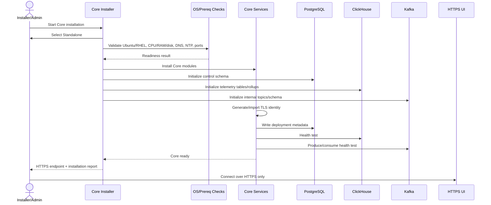

Failure behavior: installer never reports success if required Core data services are unhealthy.

**Certification envelope / Issue #200:** DF-001 is the **Phase 1** standalone Core installation path (one authoritative Core). Tenant-aware identity/contracts remain mandatory even for single-customer enterprise. Completing DF-001 does not certify Core HA, MSP isolation or Phase 1.5 continuity.

---

## 3. Flow DF-002 — Two-Core HA installation and pairing

```mermaid
sequenceDiagram
  actor A as Admin
  participant A1 as Core-A Installer/HA Manager
  participant B1 as Core-B Installer/HA Manager
  participant HA as Stable HA Endpoint/VIP
  participant DB as Core State/Data Services

  A->>A1: Install Core-A; select HA; provide HA endpoint/peer plan
  A1->>A1: Create deployment ID + one-time peer token
  A1->>A1: Enter WAITING_FOR_PEER
  A->>B1: Install Core-B; provide HA endpoint/Core-A + peer token
  B1->>A1: Secure peer handshake
  A1->>B1: Verify token/deployment/certificates
  A1->>B1: Establish mutual node trust
  A1->>DB: Initialize Active state
  B1->>DB: Initialize Standby replica/sync
  A1<->>B1: Synchronize persistent state + HA metadata
  A1->>HA: Claim stable endpoint as ACTIVE
  B1->>B1: Enter STANDBY_READY
  A1-->>A: HA Ready: Active/Standby/sync status
```

The one-time pairing token is invalidated after successful pairing.

**Certification envelope / Issue #200:** DF-002 is the **Phase 1.5** exactly-two-Core Active/Standby installation/pairing path. It is fixed architecture and must not be downgraded, but a Phase 1 standalone certificate must not imply this flow is certified. HA ≠ DR. Physical fencing/replication selections remain OPEN P0.

---

## 4. Flow DF-003 — Sensor installation and enrollment

```mermaid
sequenceDiagram
  actor A as Admin
  participant SI as Sensor Installer
  participant CE as Stable Core Endpoint
  participant EN as Enrollment Service
  participant SC as Sensor Control Service
  participant S as Sensor Runtime

  A->>SI: Install Sensor; Core endpoint; token; role/site/pool hints
  SI->>SI: Validate OS/CPU/RAM/disk/time/DNS
  SI->>CE: HTTPS/mTLS bootstrap request + enrollment token
  CE->>EN: Validate token/tenant/deployment
  EN-->>SI: Sensor ID + unique certificate + trust bundle
  SI->>S: Start runtime
  S->>SC: Authenticated heartbeat/capabilities
  SC->>SC: Resolve Sensor Pool/site/role/policies
  SC-->>S: Signed configuration + Device Packs + assignment version
  S->>S: Self-test protocol workers/spool/uploader
  S->>SC: READY heartbeat
  SC-->>A: Sensor healthy and available for placement
```

Sensor is centrally managed after enrollment; no routine local configuration is required.

---

## 5. Flow DF-004 — Agent installation and Core-directed Sensor assignment

```mermaid
sequenceDiagram
  actor A as Admin/Automation
  participant AG as Agent
  participant CE as Core Endpoint
  participant EN as Agent Enrollment
  participant PS as Placement/Sensor Control
  participant ONB as Onboarding/Policy
  participant S as Assigned Sensor

  A->>AG: Install Agent with Core endpoint + enrollment token
  AG->>CE: Secure bootstrap
  CE->>EN: Validate tenant/token/host metadata
  EN-->>AG: Agent ID + mTLS certificate
  EN->>PS: Request eligible Sensor for provisional enrollment transport
  PS->>PS: Evaluate eligible Sensors + locality + capacity + HA
  PS-->>AG: Primary + fallback Sensor endpoints, provisional assignment version
  AG->>S: Establish authenticated mTLS onboarding/control transport
  S-->>AG: Accept bounded bootstrap/health evidence only
  EN->>ONB: Create/reconcile candidate; PENDING_APPROVAL by default
  Note over AG,S: Provisional transport association is not monitoring/licence activation
  alt Authorized APPROVE or trusted auto-approval
    ONB->>PS: Confirm entitlement/capacity/policy; retain or re-evaluate Sensor
    PS-->>AG: Active monitoring assignment/profile version
    S-->>AG: Activate normal monitoring/test profile
    AG->>S: Normal recurring host metrics / Edge Test results
  else Pending/Unmanaged/Rejected/Excluded
    S-->>AG: No normal monitoring workload/profile
  end
```

The provisional and active phases use the same Sensor Control assignment authority and assignment/versioning contract; approval does not introduce a second Sensor authority mechanism. If Sensor capacity/location changes, Core sends a newer signed assignment; Agent reconnects without reinstall.

---

## 6. Flow DF-005 — Individual network-device provisioning

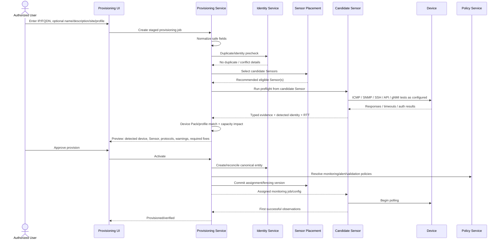

---

## 7. Flow DF-006 — Provisioning failure diagnosis

```mermaid
sequenceDiagram
  participant P as Provisioning Service
  participant S as Candidate Sensor
  participant D as Device
  participant UI as UI
  participant AI as AI Gateway optional

  P->>S: Run SNMP preflight
  S->>D: ICMP
  D-->>S: PASS
  S->>D: UDP/161 SNMP request
  D-->>S: No response / auth report / error
  S-->>P: Structured evidence
  P->>P: Classify exact/suspected failure
  P-->>UI: Error code + evidence + uncertainty + remediation
  opt User requests explanation
    UI->>AI: Explain provisioning failure using typed evidence
    AI-->>UI: Evidence-grounded human explanation; no invented certainty
  end
```

Example outputs distinguish authentication failure, authorization failure, no response, suspected firewall/ACL, protocol disabled suspected and Sensor-path issue.

---

## 8. Flow DF-007 — Bulk CSV/XLSX provisioning

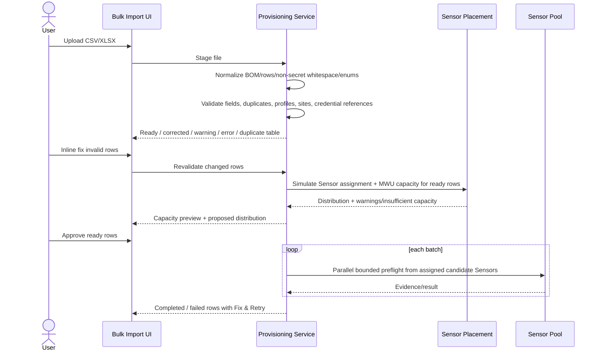

Credentials should normally be references to Credential Profiles, not secrets in the file.

---

## 9. Flow DF-008 — Auto-discovery

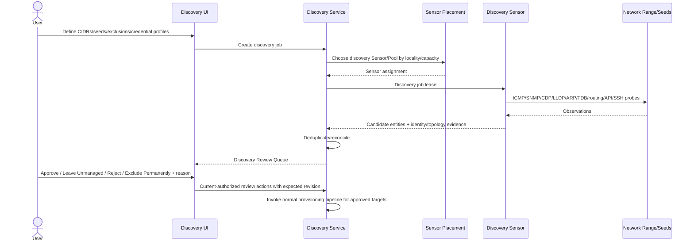

Discovery does not automatically consume monitoring licences unless policy explicitly allows auto-approval.

Review semantics are owned by `Platform_20` §3/§8: Reject is not a permanent exclusion; Exclude Permanently suppresses matching candidate recreation until a separate authorized, audited removal. Bulk review returns a result for each candidate, including conflict, denied and capacity/licence-blocked outcomes; a partial batch is not whole-batch success. Approval invokes provisioning only after current identity, entitlement, capacity and policy checks.

### 9.1 LLDP/CDP evidence to temporal graph and deterministic RCA

Network Sensor authorized SNMP LLDP-MIB/CDP cache observations → typed neighbor facts with tenant/source/time/quality → Core entity/port identity reconciliation → existing temporal graph adjacency and historical conflict state → independently qualified directed service/routing/failure dependencies → Alert Qualification → time-window/dependency correlation → deterministic rule/codebook/diagnostic RCA → root incident or INCONCLUSIVE → reversible downstream notification grouping (original child alerts and audit retained).

A physical/L2 adjacency is not automatic upstream failure parentage. One-sided/missing/stale observations or a monitoring-path outage cannot be converted into link/device down. Correlation uses incident-time graph validity and alternate-path/redundancy checks. No new database or RCA engine; flow spans BUILD-041/043/046, 066/072, 080–084 and 100. This remains specified, not end-to-end certified.


---

## 10. Flow DF-009 — Sensor placement and capacity simulation

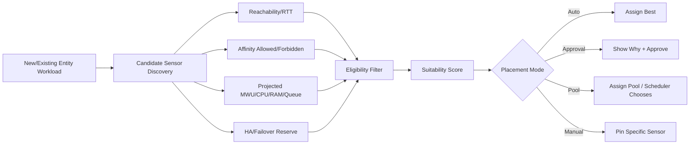

---

## 11. Flow DF-010 — Sensor automatic rebalance

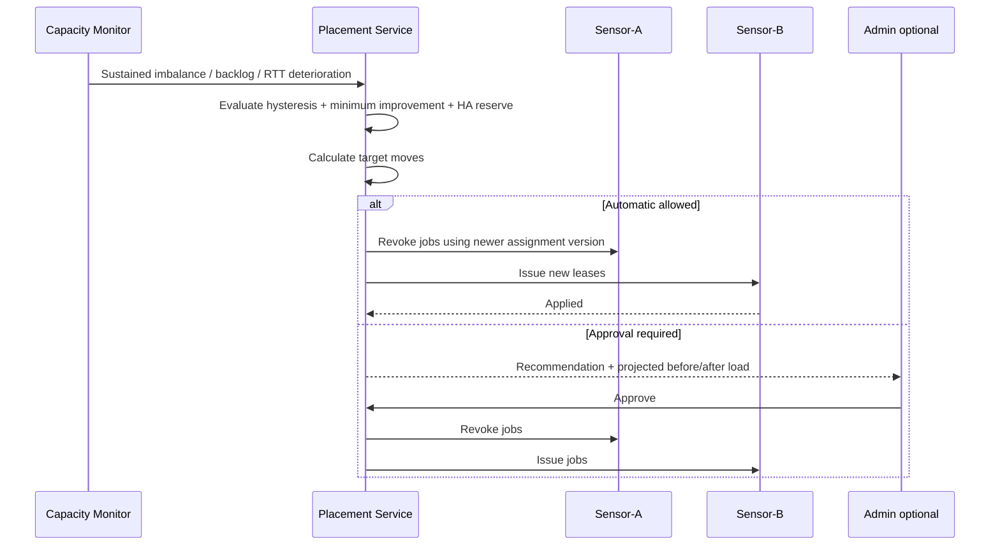

Assignment/fencing version prevents obsolete Sensor from continuing a superseded job after it sees the new epoch.

---

## 12. Flow DF-011 — SNMP polling, typed normalization and exact-counter ingestion

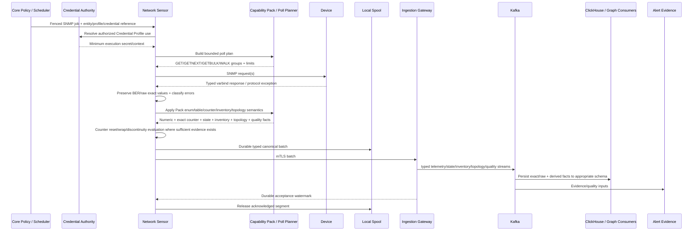

A single unsupported optional OID may produce explicit `NO_SUCH_OBJECT/INSTANCE` quality evidence without forcing unrelated valid observations in the same logical poll to become invalid. Pack policy decides whether a mandatory OID failure degrades the monitor.

Raw Counter64 remains exact through acceptance/persistence; floating-point rate/utilization is derived only after exact delta/reset/discontinuity logic. Normal scheduled SNMP operational metrics default to **5 minutes** unless a more specific inherited policy/monitor definition overrides; that default does not poll every available OID every five minutes.

Typed SNMP/ICMP observations retain quality/provenance. Collection/transport/ingestion failure, missing samples or `UNKNOWN`/`PARTIAL` quality must not automatically assert DEVICE_DOWN (`No Data != Device Down`). **Issue #218:** Core numeric-only ingestion currently rejects Sensor `icmp_observation_v1` shapes before durable Kafka/ACK; architecture still requires governed Core acceptance of typed ICMP evidence. Do not treat unresolved Core acceptance as implemented or certified.

---

## 13. Flow DF-012 — SNMP trap/inform ingestion and storm control

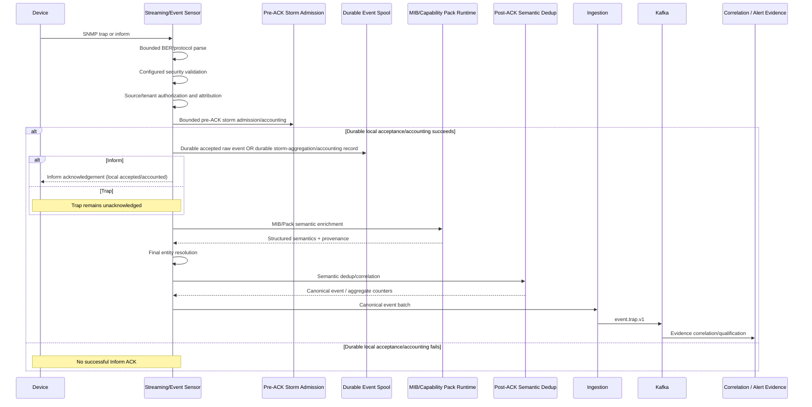

Conceptual Inform path:

```text
Device
→ Sensor parse/security/source validation
→ bounded storm admission/accounting
→ durable raw accepted/aggregate record
→ Inform ACK
→ MIB/Pack semantic enrichment
→ entity resolution / semantic storm-dedup / correlation
→ ingestion
```

v1/v2c trap source identity is weak evidence and never independently proves device/link failure. Pre-ACK admission/accounting and post-ACK semantic dedup retain first/last seen, count and affected-source context. Every rate-limit/drop decision is measurable.

SNMP Trap is unacknowledged. Successful Inform ACK requires durable local receiver acceptance/accounting after bounded BER/protocol parsing, configured SNMP security validation, sufficient source/tenant attribution and the bounded pre-ACK storm admission/accounting decision, while preserving the raw typed notification. MIB/Capability Pack enrichment, final entity resolution, semantic dedup/correlation, alert correlation, Core delivery, Kafka persistence, ClickHouse persistence and incident creation are **not** ACK prerequisites. Inform ACK means `LOCAL RECEIVER ACCEPTED/ACCOUNTED` only. This boundary is distinct from the Sensor→Core telemetry ACK model.

---

## 14. Flow DF-013 — Flow ingestion and enrichment

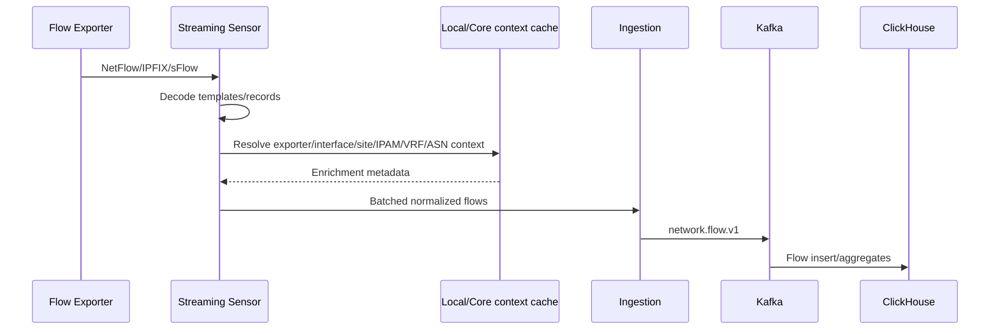

Every forced drop/template miss is counted and exposed through telemetry-quality/platform-health data.

---

## 15. Flow DF-014 — Syslog ingestion

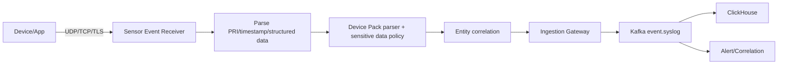

---

## 16. Flow DF-015 — gNMI streaming telemetry

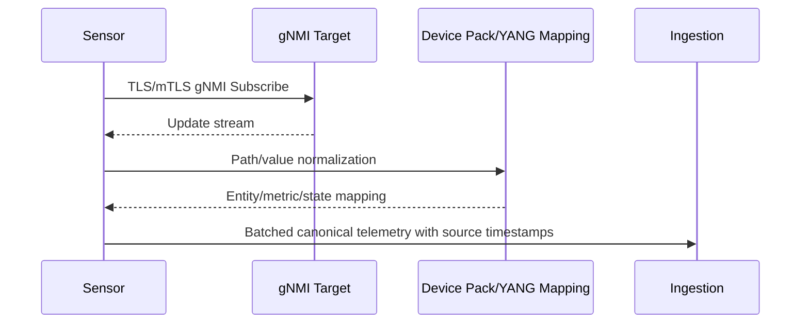

Subscription health is separately monitored so stream failure is not misclassified as device failure.

---

## 17. Flow DF-016 — Infrastructure Agent telemetry

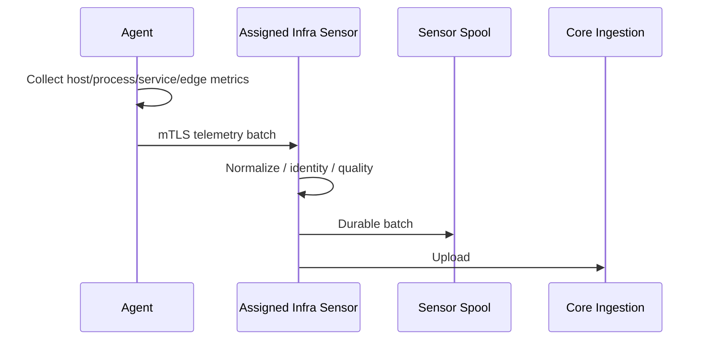

---

## 18. Flow DF-017 — Agentless SSH/WinRM monitoring

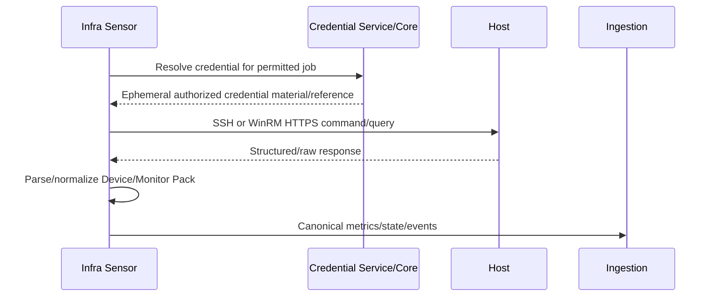

---

## 19. Flow DF-018 — Synthetic test

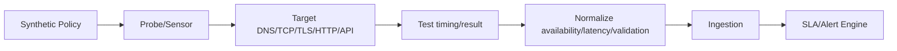

---

## 20. Flow DF-019 — Primary monitor failure → Alert Qualification

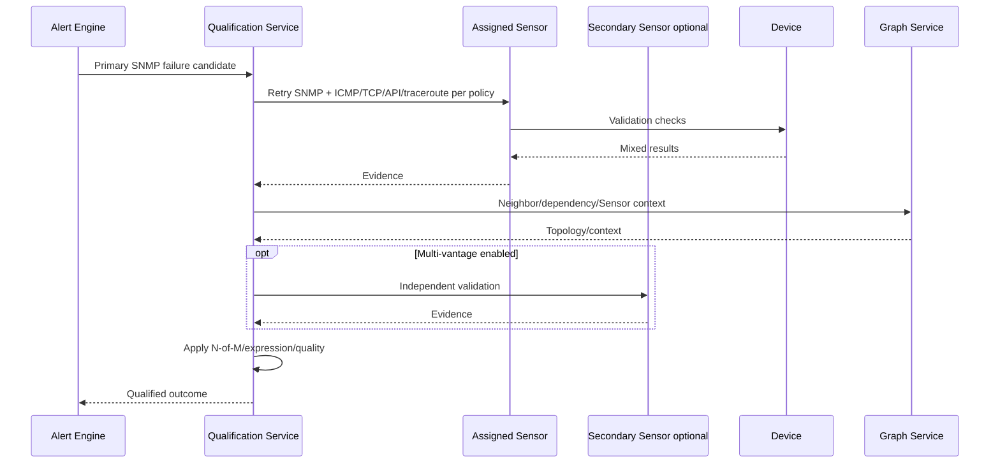

Possible output is Monitoring Degraded, Credential Failure, Path Failure, Device Down, Sensor Failure or Inconclusive.

---

## 21. Flow DF-020 — Alert storm compression

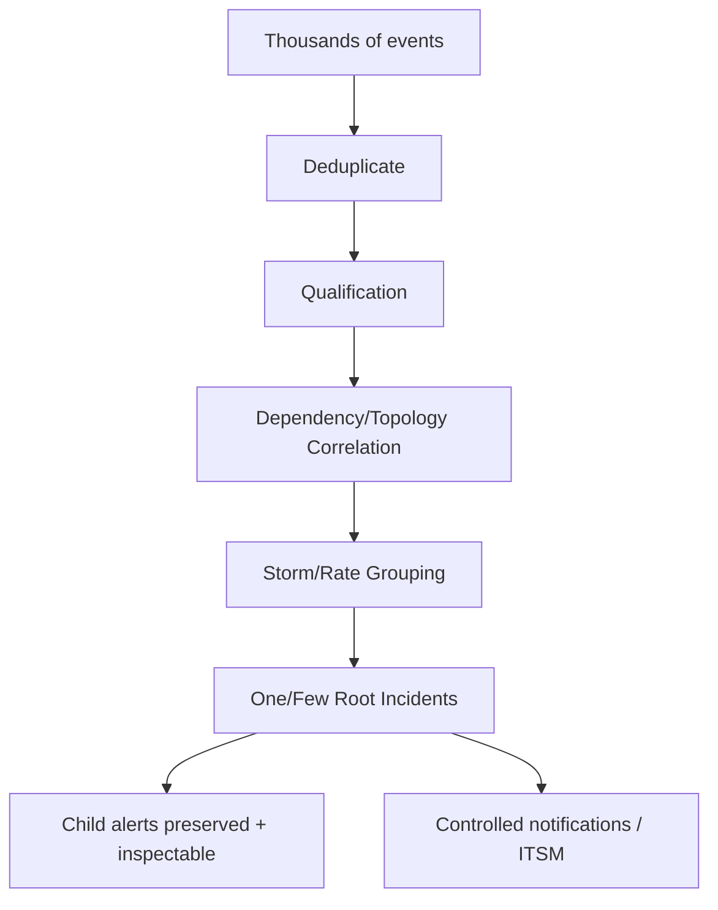

---

## 22. Flow DF-021 — Incident correlation → RCA

```mermaid
sequenceDiagram
  participant C as Correlation Service
  participant R as RCA Service
  participant G as Graph Service
  participant CH as ClickHouse
  participant NCM as Change/Audit Sources
  participant ML as Anomaly/GNN Scorers

  C->>R: Incident candidate + child alerts
  R->>G: Extract temporal subgraph
  G-->>R: Nodes/edges/provenance/history
  R->>CH: Metrics/events/flow/telemetry-quality window
  CH-->>R: Evidence
  R->>NCM: Recent config/audit/maintenance changes
  NCM-->>R: Change evidence
  R->>R: Protocol/causal rules + temporal ordering
  R->>ML: Request anomaly/GNN scores when enabled
  ML-->>R: Learned scores + model/version
  R->>R: Fuse + contradiction check + confidence
  alt Sufficient evidence
    R-->>C: Root cause + causal chain + blast radius + evidence
  else Insufficient evidence
    R-->>C: INCONCLUSIVE + missing evidence + recommended checks
  end
```

---

## 23. Flow DF-022 — GNN shadow-mode evaluation

```mermaid
sequenceDiagram
  participant R as RCA Service
  participant F as Feature Builder
  participant G as GNN Runtime
  participant MR as Model Registry
  participant QA as Evaluation Store

  R->>F: Bounded temporal subgraph + evidence window
  F->>MR: Resolve approved SHADOW model
  MR-->>F: Model/schema/version
  F->>G: Node/edge/time features
  G-->>F: Root/edge/impact scores
  F->>QA: Save score + input snapshot + model version
  Note over R,G: Shadow result does not change production RCA conclusion
```

Promotion to production scoring requires benchmark acceptance.

---

## 24. Flow DF-023 — Conversational AI “Ask the network”

```mermaid
sequenceDiagram
  actor U as User
  participant UI as AI/Investigation UI
  participant AG as AI Gateway
  participant AUTH as Authorization
  participant T as Platform Tools
  participant GM as Gemini

  U->>UI: Natural-language operational question
  UI->>AG: Query + user/tenant context
  AG->>AUTH: Verify scope/tools/data policy
  AUTH-->>AG: Allowed tool set/data boundary
  AG->>T: Search/query graph/metrics/incidents as needed
  T-->>AG: Structured evidence with source IDs
  AG->>AG: Redact/mask sensitive fields
  AG->>GM: Grounded prompt + evidence/tool results
  GM-->>AG: Explanation/structured response
  AG->>AG: Validate referenced evidence/guardrails
  AG-->>UI: Answer + evidence links + uncertainty
```

LLM has no direct credential or unrestricted database access.

---

## 25. Flow DF-024 — RCA feedback

```mermaid
flowchart LR
  RCA[RCA Result] --> U[Operator feedback: Correct / Partial / Incorrect]
  U --> F[Feedback Store]
  F --> E[Evaluation / Model Quality Dashboard]
  F -. controlled offline process .-> TRAIN[Future Model Training]
```

Feedback never auto-retrains production models without governance.

---

## 26. Flow DF-025 — NCM backup

```mermaid
sequenceDiagram
  actor U as User/Schedule
  participant N as Core NCM
  participant P as Policy/RBAC
  participant S as Network Sensor
  participant D as Device
  participant ST as Config Store/Metadata
  participant TL as Timeline

  U->>N: Backup now / scheduled job
  N->>P: Authorization/window/credential check
  P-->>N: Allowed
  N->>S: Signed job lease + adapter + credential ref
  S->>D: SSH/NETCONF/API backup
  D-->>S: Configuration
  S-->>N: Config + hash + execution evidence
  N->>ST: Store version/metadata
  N->>TL: Emit config backup/change fact
```

---

## 27. Flow DF-026 — NCM push with approval and validation

```mermaid
sequenceDiagram
  actor R as Requester
  actor A as Approver
  participant N as NCM Service
  participant S as Sensor
  participant D as Device

  R->>N: Submit change + scope + ticket + dry run
  N->>N: RBAC, impact preview, Device Pack capability, window
  N-->>A: Approval request
  A->>N: Approve
  N->>S: Signed execution job
  S->>D: Pre-check / backup
  D-->>S: Pre-state
  S->>D: Config change
  D-->>S: Result
  S->>D: Post-validation
  alt Validation success
    S-->>N: Success + evidence
  else Validation failure and rollback supported
    S->>D: Rollback
    D-->>S: Rollback result
    S-->>N: Failed/rolled back + evidence
  end
```

**Phase 1 / Phase 1.5 NCM envelope (Issue #200):** Phase 1 independently certifiable NCM subset remains config backup/version/diff/compliance/golden-state; controlled manual CLI remains Phase 1 only when RBAC/credential/audit contracts are certified. DF-025 depicts configuration backup and version storage only—not comparison, compliance or golden-state evaluation. DF-026 depicts one approved configuration push with pre-check, validation and optional rollback—not mass deployment, canary execution or the full controlled-remediation workflow. Mass push / canary / automated privileged remediation defaults to **Phase 1.5** unless Founder change control promotes it. Schema presence of push/rollback paths is not Phase 1 certification.

---

## 28. Flow DF-027 — Browser CLI session

```mermaid
sequenceDiagram
  actor U as Engineer
  participant UI as xterm UI
  participant B as Core CLI Broker
  participant AUTH as RBAC/JIT/MFA Policy
  participant S as Network Sensor
  participant D as Device
  participant AUD as Audit

  U->>B: Request CLI(entity, reason/ticket)
  B->>AUTH: Evaluate role/scope/conditions
  AUTH-->>B: Allowed privilege level
  B->>S: Open short-lived authorized SSH session
  S->>D: SSH with protected credential
  D-->>S: Terminal
  S-->>B: Stream
  B-->>UI: WebSocket stream
  loop commands
    UI->>B: command
    B->>AUTH: command policy check if required
    B->>S: forward
    S->>D: command
    D-->>S: output
    S-->>B: output
    B->>AUD: command/result/session evidence
    B-->>UI: output
  end
```

---

## 29. Flow DF-027A — Contextual on-demand diagnostic / multi-vantage verification

```mermaid
sequenceDiagram
  actor U as NOC User
  participant UI as Entity/Alert/Incident UI
  participant D as Diagnostic Orchestrator
  participant AUTH as RBAC/Scope/Policy
  participant SC as Sensor Control
  participant S1 as Assigned Sensor
  participant S2 as Alternate Sensor/Agent optional
  participant T as Target
  participant E as Evidence/Investigation

  U->>UI: Ping / Trace / SNMP / Verify Now
  UI->>D: diagnostic(origin,target,type,params,vantage mode)
  D->>AUTH: Authorize actor + target + action + parameters
  AUTH-->>D: Allowed/denied + limits
  D->>SC: Resolve eligible vantage(s) + capacity
  SC-->>D: Assigned/eligible bounded execution set
  par Assigned vantage
    D->>S1: Execute bounded typed test
    S1->>T: Protocol/network check
    T-->>S1: Result/timeout/error
    S1-->>D: Typed evidence + quality
  and Optional independent vantage
    D->>S2: Execute same bounded validation
    S2->>T: Protocol/network check
    T-->>S2: Result/timeout/error
    S2-->>D: Typed evidence + quality
  end
  D->>E: Persist/audit result refs + correlation
  D-->>UI: Per-vantage results + monitored-vs-live comparison
```

Contradictory vantage evidence is shown, not averaged into a false definitive state. Operator-triggered verification does not automatically rewrite continuously monitored state; qualification/evidence policy decides any state transition.

---

## 30. Flow DF-027B — Investigation Session evidence capture

```mermaid
sequenceDiagram
  actor U as Engineer
  participant UI as Troubleshoot Workspace
  participant INV as Investigation Service
  participant DIAG as Diagnostics
  participant CLI as CLI Broker
  participant Q as Query/Graph/NCM/Flow
  participant INC as Incident Service

  U->>INV: Start Investigation(origin, reason)
  INV-->>UI: investigation_session_id
  U->>DIAG: Run diagnostic in investigation context
  DIAG-->>INV: Attach typed result reference
  U->>CLI: Open CLI in investigation context
  CLI-->>INV: Attach session/command evidence reference
  U->>Q: View/compare topology, config, flow, changes
  Q-->>INV: Attach selected evidence/snapshot references
  opt Incident exists or user links it
    INV->>INC: Link investigation + evidence index
  end
  U->>INV: Close Investigation
  INV-->>UI: Evidence summary + unresolved items
```

Investigation storage references authoritative evidence instead of copying entire telemetry datasets. Authorization is re-evaluated for each privileged action; being inside an investigation does not grant extra privilege.

---

## 31. Flow DF-028 — ITSM incident creation/update

```mermaid
sequenceDiagram
  participant I as Incident Service
  participant Q as Durable Integration Queue
  participant C as ITSM Connector
  participant T as ServiceNow/BMC/etc.

  I->>Q: Enqueue create/update with idempotency key
  Q->>C: Deliver
  C->>T: API request
  alt Success
    T-->>C: Ticket ID/state
    C-->>Q: Ack
    C->>I: Store correlation/ticket state
  else Failure
    T-->>C: Error/timeout
    C-->>Q: Retryable/non-retryable error
    Q->>Q: Backoff/retry/dead-letter policy
  end
```

Connector health exposes stuck/rejected operations.

---

## 32. Flow DF-029 — Incident recovery → ITSM resolution

```mermaid
sequenceDiagram
  participant AE as Alert/Recovery Engine
  participant I as Incident Service
  participant Q as Integration Queue
  participant T as ITSM

  AE->>AE: Primary recovery evidence
  AE->>AE: Stability/recovery qualification window
  alt Stable recovery
    AE->>I: Resolve Platform incident
    I->>Q: Apply configured ITSM recovery policy
    Q->>T: Update/resolve/close or add work note
  else Flapping/unstable
    AE->>I: Keep incident open / monitoring recovery
  end
```

---

## 33. Flow DF-030 — Policy change with impact preview

```mermaid
sequenceDiagram
  actor A as Admin
  participant UI as Policy UI
  participant P as Policy Service
  participant CH as Historical Analytics
  participant CAP as Capacity Model

  A->>UI: Change polling/threshold/retention policy
  UI->>P: Preview draft
  P->>CH: Simulate historical alert/data impact where applicable
  P->>CAP: Calculate Sensor/Core/storage impact
  CH-->>P: Estimated alerts/affected entities
  CAP-->>P: Capacity/storage projection
  P-->>UI: SAFE/WARNING/UNSAFE + details
  A->>UI: Apply/Cancel
  UI->>P: Create immutable new version
  P->>P: Audit + distribute effective config
```

---

## 34. Flow DF-031 — Adaptive polling

```mermaid
flowchart LR
  T[Trigger: alert/trap/syslog/anomaly/config/manual] --> P[Adaptive Policy]
  P --> C{Capacity/Safety Check}
  C -- Safe --> F[Increase polling temporarily]
  C -- Unsafe --> W[Limit/deny + warning]
  F --> OBS[Collect deeper/faster evidence]
  OBS --> E{Return condition/cooldown}
  E --> BASE[Restore baseline polling]
```

---

## 35. Flow DF-032 — Retention rollup

Default profile and validation: Platform_11 §10 (90d raw metrics, 365d hourly rollups, 7d logs, 7d Flow); preserve complete verified rollups before normal expiry and separate protected retention.

```mermaid
flowchart LR
  RAW[Raw telemetry] --> R1[Configured rollup 1]
  R1 --> R2[Configured rollup 2]
  R2 --> RL[Long-term rollup]
  RAW --> TTL{Raw retention expired?}
  TTL -- yes and required rollup complete --> DEL[Delete raw partition]
  TTL -- no --> KEEP[Keep]
  RL --> ARCH[Optional archive]
```

Rollup interval and retention are customer-configurable; labels here do not imply fixed periods.

---

## 36. Flow DF-033 — Historical dashboard query with automatic resolution

```mermaid
sequenceDiagram
  actor U as User
  participant UI as Dashboard
  participant Q as Query Service
  participant R as Retention/Resolution Catalogue
  participant CH as ClickHouse

  U->>UI: Select 2-year time range
  UI->>Q: Query(resolution=AUTO)
  Q->>R: Find available resolutions/retention
  R-->>Q: e.g. hourly rollup available
  Q->>CH: Query appropriate rollup
  CH-->>Q: Aggregated result
  Q-->>UI: Data + effectiveResolution
  UI-->>U: Chart + "hourly rollup" indicator
```

---

## 37. Flow DF-034 — Core 80% storage protection

```mermaid
sequenceDiagram
  participant M as Storage Monitor
  participant L as Lifecycle Service
  participant P as Purge Planner
  participant CH as ClickHouse/Volumes
  participant A as Audit/Alert

  M->>L: Volume usage >=80%
  L->>P: Build emergency reclaim plan
  P->>P: Respect data class priority, rollups, legal holds, recent window
  P->>CH: Drop/delete oldest eligible partitions/segments
  CH-->>P: Bytes reclaimed
  P->>M: Recheck utilization
  alt Safe headroom reached
    L->>A: Storage protection success + exact deleted ranges/classes
  else Insufficient eligible data
    L->>A: CRITICAL reclamation insufficient + required admin action
  end
```

Monitoring ingestion remains active throughout to the greatest technically safe extent.

---

## 38. Flow DF-035 — Sensor 80% storage protection during WAN outage

```mermaid
sequenceDiagram
  participant S as Sensor
  participant SP as Local Spool
  participant M as Sensor Storage Protector
  participant C as Core unreachable

  S->>SP: Continue polling + append telemetry
  S--xC: Upload fails
  M->>SP: Usage reaches warnings/80%
  M->>SP: Remove acknowledged/temp/old logs first
  alt Still above emergency threshold
    M->>SP: Apply oldest low-priority unacknowledged emergency drop policy
    M->>M: Count exact loss + preserve recent/high-priority data
  end
  M->>S: Continue current monitoring
  Note over S,M: On reconnect, lost-data counters are uploaded; no silent loss
```

---

## 39. Flow DF-036 — Legal/investigation hold

```mermaid
sequenceDiagram
  actor U as Authorized User
  participant H as Retention Hold Service
  participant P as Purge Planner

  U->>H: Hold incident/time range/data classes + reason
  H->>H: Validate privilege/approval and persist hold
  P->>H: Query protected ranges during retention/purge
  H-->>P: Exclusions
  P->>P: Purge other eligible data first
```

---

## 40. Flow DF-037 — Core Active failure and HA failover

```mermaid
sequenceDiagram
  participant A as Core-A Active
  participant B as Core-B Standby
  participant HA as HA Manager/VIP
  participant S as Sensors
  participant DB as Data Services

  A--xB: Heartbeat stops / node failure
  S->>S: Continue polling + local spool
  B->>HA: Evaluate failure/fencing safety
  alt Safe to promote
    B->>DB: Promote required standby data services
    B->>B: Start/promote Active Core modules
    B->>HA: Claim stable endpoint
    HA-->>S: Endpoint available on Core-B
    S->>B: Reconnect and replay buffered data
  else Ambiguous partition
    B->>B: Enter SPLIT_BRAIN_PREVENTED / do not become writable Active
    S->>S: Continue buffering
  end
```

Certified safe failure cases must restore Core service in <60 seconds under the **Phase 1.5** HA envelope. Ambiguous partition remains fail-closed (`SPLIT_BRAIN_PREVENTED`). Sensors continue collecting/buffering while capacity permits; Phase 1.5 deletion-ACK target for permanent one-Core HA failures is `ACKED-FOR-DELETION TELEMETRY RPO = 0` (distinct from Phase 1 standalone deletion-ACK durability and from site/DR RPO). Physical mechanisms remain unselected.

---

## 41. Flow DF-038 — Former Active returns after failover

```mermaid
sequenceDiagram
  participant A as Former Core-A
  participant B as Current Core-B Active
  participant HA as HA Manager

  A->>HA: Rejoin request with old cluster epoch
  HA->>A: Reject active writes; force STANDBY_SYNCING
  A<->>B: Resynchronize PostgreSQL/ClickHouse/Kafka/application state per certified procedures
  B-->>A: Current epoch/config
  A->>HA: Sync complete
  HA->>A: STANDBY_READY
```

Old Core may never independently resume Active because it used to be Active.

---

## 42. Flow DF-039 — Sensor failure and polling reassignment

```mermaid
sequenceDiagram
  participant S1 as Sensor-1
  participant C as Sensor Control
  participant S2 as Sensor-2
  participant D as Devices

  S1--xC: Heartbeats stop
  C->>C: Lease expiry + capacity/locality evaluation
  C->>S2: Issue newer assignment/fencing versions
  S2->>D: Begin polling reassigned targets
  S2-->>C: First observations
  opt S1 returns
    S1->>C: Rejoin with stale assignment versions
    C-->>S1: New state; do not resume superseded jobs
  end
```

---

## 43. Flow DF-040 — Licence expiration lifecycle

DF-040 applies only to finite usage-right expiry, not perpetual maintenance or temporary overage. The 15-day grace remains unchanged.

```mermaid
sequenceDiagram
  participant L as Licence Service
  participant UI as Dashboards
  participant S as Scheduler/Sensor Control
  participant H as Historical Query

  L->>UI: 30-day warning notification
  L->>UI: 7-day global pre-expiry banner (T-7)
  L->>L: Licence expires; enter EXPIRED_GRACE_15D (Founder-approved 15-day post-expiry grace)
  L->>S: Keep polling enabled during 15-day grace
  L->>L: 15-day grace expires
  L->>S: Disable new polling assignments / signed polling-stop state
  L->>H: Historical queries remain enabled
  Note over L,H: Licence admin remains accessible for extension/renewal
```

---

## 44. Flow DF-041 — Licence renewed after polling stop

DF-041 resumes polling after finite usage-right expiry; overage or maintenance expiry does not invoke polling suspension.

```mermaid
sequenceDiagram
  actor A as Licence Admin
  participant L as Licence Service
  participant P as Policy/Scheduler
  participant S as Sensors

  A->>L: Import/activate renewed licence
  L->>L: Validate signature/entitlements
  L->>P: Re-enable polling eligibility
  P->>S: New policy/assignment version
  S->>S: Resume polling
```

---

## 45. Flow DF-042 — Dashboard query and fast UI response

```mermaid
sequenceDiagram
  actor U as User
  participant UI as React UI
  participant API as Query API
  participant AUTH as RBAC
  participant V as Valkey
  participant CH as ClickHouse

  U->>UI: Open dashboard/filter/time range
  UI->>API: Typed query
  API->>AUTH: Scope authorization
  AUTH-->>API: Allowed scope
  API->>V: Cache lookup
  alt Cache hit
    V-->>API: Result
  else Miss
    API->>CH: Bounded optimized query / rollup
    CH-->>API: Result
    API->>V: Cache safe derived result
  end
  API-->>UI: Data + resolution + freshness
```

Large tables use server-side pagination; oversized exports become background jobs.

---

## 46. Flow DF-043 — Report execution

```mermaid
flowchart TD
  DEF[Report Definition + Schedule] --> JOB[Async Report Job]
  JOB --> AUTH[Re-authorize current tenant and resource scope]
  AUTH --> Q[Query Service]
  Q --> DATA[ClickHouse/PostgreSQL Aggregates]
  DATA --> CALC[Safe formula/CEL calculations]
  CALC --> RENDER[PDF or CSV artifact renderer]
  RENDER --> ACCESS[Re-authorize artifact retrieval and permitted delivery]
  ACCESS --> DELIV[Download / Email / Integration]
  DELIV --> HIST[Execution history / audit]
```

Measurement scope/policy snapshots support reproducible periods; they do not preserve revoked access. Execution, artifact download and recipient/delivery access use current authorization. PDF uses the effective licensed commercial logo (default AmrudAi); CSV remains data-only. JSON API responses are not an additional report export format. No rendering library or new dependency is selected by this flow; PRD §27 and DF-SLA-001 remain authoritative.

---

## 47. Flow DF-044 — Device Pack creation from MIB

```mermaid
sequenceDiagram
  actor U as Admin/Engineer
  participant MS as MIB Studio
  participant AI as AI Gateway optional
  participant DP as Device Pack Studio
  participant T as Test Device/Sample

  U->>MS: Upload MIB(s)
  MS->>MS: Provenance/hash/dependency/compile/OID tree
  MS->>T: Optional walk/test
  T-->>MS: Sample values
  opt AI semantic help
    MS->>AI: Ask for metric/enum/visualization suggestions using parsed MIB context
    AI-->>MS: AI Suggested mappings
  end
  U->>MS: Confirm/edit mappings
  MS->>DP: Create Monitor Definitions/traps/topology semantics
  DP->>DP: Version/sign/test/publish
```

---

## 48. Flow DF-045 — API Studio connector creation

```mermaid
sequenceDiagram
  actor U as Admin
  participant AS as API Studio
  participant T as Target API
  participant AI as AI Gateway optional
  participant DP as Device Pack/Connector Store

  U->>AS: OpenAPI URL/file or manual endpoint
  AS->>T: Authenticated test request
  T-->>AS: JSON/XML response
  AS->>AS: Schema/entity/collection inference
  opt AI help
    AS->>AI: Suggest semantic mappings
    AI-->>AS: AI Suggested mappings
  end
  AS->>AS: Cardinality/MWU/rate preview
  U->>AS: Confirm mappings
  AS->>DP: Version/sign/publish connector
```

---

## 49. Flow DF-046 — Data masking before AI

```mermaid
flowchart LR
  SRC[Logs / Config / Inventory / RCA Evidence] --> CLASS[Data Classification]
  CLASS --> POL[AI Data Boundary Policy]
  POL --> DROP[Drop fields]
  POL --> MASK[Mask/hash fields]
  POL --> ALLOW[Allowed evidence]
  MASK --> CTX[AI Context Builder]
  ALLOW --> CTX
  CTX --> GEM[Gemini/Provider]
```

Credentials/private keys never enter the allowed path.

---

## 50. Flow DF-047 — Backup and restore verification

```mermaid
sequenceDiagram
  participant B as Backup Service
  participant PG as PostgreSQL
  participant CH as ClickHouse
  participant FS as Artifact/Object Store
  participant V as Verification

  B->>PG: Snapshot/backup
  PG-->>B: Backup reference/hash
  B->>CH: Backup required partitions/metadata
  CH-->>B: Backup reference/hash
  B->>FS: Save Device Packs/dashboards/policies/certs per secure policy
  B->>V: Build signed manifest + checksums
  V->>V: Verify readability/integrity/compatibility metadata
  V-->>B: VERIFIED or FAILED
```

A backup failure is a Platform alert.

---

## 51. Flow DF-048 — DR activation (architecture-level, exact RPO/RTO TBD)

```mermaid
sequenceDiagram
  actor A as Authorized DR Operator
  participant P as Primary Core/Site
  participant D as DR Core/Site
  participant S as Sensors/Agents
  participant DNS as DR Endpoint/DNS/VIP mechanism

  A->>D: Run DR readiness/restore/replication validation
  D-->>A: Ready / blocking issues
  A->>P: Confirm primary unavailable or planned DR switch
  A->>D: Authorize DR activation
  D->>D: Promote restored/replicated state per certified runbook
  A->>DNS: Activate DR stable Core endpoint
  DNS-->>S: Resolve/reconnect to DR Core
  S->>D: Re-enroll/reconnect using preserved trust/DR policy
  S->>D: Replay buffered telemetry as supported
```

Exact automation, node count and RPO/RTO remain TBD.

**Certification envelope / Issue #200:** DF-048 is **Phase 1 mandatory** site-loss DR / restore activation for the declared Phase-1 DR profile. HA ≠ DR. Completing Phase 1.5 two-Core HA certification does not replace backup/restore or site-loss DR evidence, and a Phase 1 DR certificate does not imply Active/Standby HA continuity.

---

## 52. Flow DF-049 — Core upgrade in HA

```mermaid
sequenceDiagram
  actor A as Admin
  participant U as Upgrade Orchestrator
  participant CA as Core-A Active
  participant CB as Core-B Standby
  participant S as Sensors

  A->>U: Start approved upgrade
  U->>U: Preflight + backup + compatibility
  U->>CB: Upgrade Standby first where release supports
  CB-->>U: Health/schema compatibility ready
  U->>CA: Controlled switchover/drain if required
  S->>S: Continue polling/buffer through switch
  U->>CB: Promote upgraded node Active
  U->>CA: Upgrade former Active
  CA-->>U: Rejoin Standby and sync
  U-->>A: HA healthy / upgrade complete
```

Exact sequence may differ for schema-breaking releases but must remain documented/tested.

---

## 53. Flow DF-050 — Sensor canary upgrade

```mermaid
flowchart LR
  REL[New Sensor Release] --> C1[Canary Sensor/Pool Cohort]
  C1 --> DRN[Drain jobs to peers]
  DRN --> UP[Upgrade]
  UP --> VAL[Self-test + poll/replay validation]
  VAL -->|Pass| NEXT[Expand cohort]
  VAL -->|Fail| RB[Rollback/stop rollout]
  NEXT --> FULL[Full rollout]
```

---

## 54. Flow DF-051 — Cardinality explosion protection

```mermaid
sequenceDiagram
  participant I as Ingestion/Connector Runtime
  participant G as Telemetry Guardrail
  participant A as Admin UI

  I->>G: New labels/entities/metric series rate
  G->>G: Compare with baseline/limits
  alt Explosion detected
    G-->>A: Critical warning + offending connector/field + projected storage
    G->>I: Enforce configured rate/cardinality guardrail if safety policy requires
  end
```

The system reports dropped/rejected records explicitly.

---

## 55. Flow DF-052 — Telemetry quality → RCA confidence

```mermaid
flowchart LR
  EXP[Expected polls/streams] --> Q[Quality Engine]
  GOT[Received/late/duplicate/failed/clock state] --> Q
  Q --> SCORE[Quality score + missing evidence]
  SCORE --> RCA[RCA Confidence Calibrator]
  RCA --> OUT[Result / lower confidence / INCONCLUSIVE]
```

---

## 56. Flow DF-053 — Historical topology during incident investigation

```mermaid
sequenceDiagram
  actor U as Investigator
  participant UI as Incident/Topology UI
  participant G as Graph Service
  participant H as Topology History

  U->>UI: View topology at incident time
  UI->>G: getGraph(asOf=incident timestamp, layers=...)
  G->>H: Reconstruct relationships valid at time
  H-->>G: Historical edges/provenance
  G-->>UI: Time-consistent graph
```

---

## 57. Flow DF-054 — Unified Operations Timeline

```mermaid
flowchart TB
  MET[Metric anomalies/state changes] --> T[Timeline Aggregator]
  EVT[Traps/Syslog/Events] --> T
  AL[Alerts/Incidents] --> T
  CFG[NCM/Config changes] --> T
  TOPO[Topology changes] --> T
  AUD[User/Audit actions] --> T
  SENS[Sensor assignment/health] --> T
  ITSM[ITSM lifecycle] --> T
  RCA[RCA runs] --> T
  T --> UI[Typed chronological timeline with source links]
```

---

## 58. Flow DF-055 — Query-too-large protection

```mermaid
sequenceDiagram
  actor U as User
  participant UI as UI
  participant Q as Query Service

  U->>UI: Request 5 years raw flow export
  UI->>Q: Query
  Q->>Q: Estimate scan/rows/cost exceeds interactive limits
  Q-->>UI: Refuse interactive execution; offer background export / aggregate resolution
  U->>UI: Choose background export
  UI->>Q: Submit async job
```

---

## 59. Flow DF-056 — Integration test sandbox

```mermaid
sequenceDiagram
  actor A as Integration Admin
  participant UI as Integration Studio
  participant C as Connector
  participant T as ITSM/Endpoint

  A->>UI: Test connector
  UI->>C: Connection/auth test
  C->>T: Health/auth
  T-->>C: Success
  C->>T: Create test item
  T-->>C: ID
  C->>T: Update test item
  C->>T: Resolve/delete according to sandbox semantics
  C-->>UI: PASS/FAIL per stage + field mapping evidence
```

---

## 60. Flow DF-057 — Support bundle

```mermaid
flowchart LR
  REQ[Authorized support-bundle request] --> COL[Collect versions/health/logs/config metadata]
  COL --> RED[Redact credentials/tokens/private keys/sensitive fields]
  RED --> MAN[Manifest + correlation IDs + timestamps]
  MAN --> B[Encrypted/signed support bundle]
  B --> AUD[Audit event]
```

---

## 61. Flow DF-058 — Change freeze calendar

```mermaid
sequenceDiagram
  actor U as User
  participant OP as Operational Calendar
  participant N as NCM/Upgrade/Device Pack Job

  U->>N: Request risky change during freeze
  N->>OP: Evaluate freeze/maintenance/business calendar
  OP-->>N: BLOCKED unless emergency override role/approval
  N-->>U: Explain freeze window and allowed override process
```

---

## 62. Flow DF-059 — Post-incident review generation

```mermaid
flowchart LR
  INC[Closed Incident] --> PIR[PIR Generator]
  TL[Unified Timeline] --> PIR
  RCA[RCA/Evidence] --> PIR
  ITSM[Ticket/Notes] --> PIR
  CHG[Config/Changes] --> PIR
  PIR --> DRAFT[Draft PIR: impact, cause, evidence, actions, recovery]
  DRAFT --> HUMAN[Human corrective/preventive actions + approval]
  HUMAN --> PDF[Report/export]
```

---

## 63. Flow DF-060 — Platform self-monitoring

```mermaid
flowchart TB
  CORE[Core health] --> PH[Platform Health Engine]
  PG[PostgreSQL] --> PH
  CH[ClickHouse] --> PH
  K[Kafka] --> PH
  S[Sensor fleet] --> PH
  AG[Agents] --> PH
  INT[Integrations] --> PH
  CERT[Certificates/Licence] --> PH
  ST[Storage] --> PH
  PH --> DASH[Platform Operations Dashboard]
  PH --> ALERT[Internal Platform Alerts]
```

Internal platform failure alerts are classified separately from customer-device alerts.

---

## 64. Flow DF-061 — User access request and authorization

```mermaid
sequenceDiagram
  actor U as User
  participant UI as UI
  participant IDP as IdP/Local Auth
  participant API as Core API
  participant AUTH as Authorization Engine

  U->>UI: Login
  UI->>IDP: OIDC/SAML/local/MFA
  IDP-->>UI: Authenticated subject/session
  UI->>API: Request resource/action
  API->>AUTH: Who + tenant + resource + action + conditions
  AUTH-->>API: Allow/Deny + explanation
  alt Allow
    API-->>UI: Scoped result
  else Deny
    API-->>UI: 403 / policy explanation according to role
  end
```

---

## 65. Flow DF-062 — Credential rotation

```mermaid
sequenceDiagram
  actor A as Credential Admin
  participant C as Credential Service
  participant T as Test Sensor
  participant D as Sample Target
  participant P as Policy/Assignments

  A->>C: Update/rotate credential profile
  C->>C: Store new encrypted version; preserve audit metadata
  C->>T: Test new version from eligible Sensor
  T->>D: Protocol authentication test
  D-->>T: Result
  T-->>C: Verified/failed
  alt Verified
    C->>P: Activate credential version for scoped targets
  else Failed
    C-->>A: Do not activate / provide diagnostic evidence
  end
```

---

## 66. Flow DF-063 — Data deletion due to normal retention vs emergency

```mermaid
flowchart TB
  DATA[Data partition/segment] --> MODE{Deletion reason}
  MODE -->|Normal TTL| ROLL{Required rollup/archive complete?}
  ROLL -- No --> KEEP[Retain / retry rollup]
  ROLL -- Yes --> HOLD{Protected/legal hold?}
  MODE -->|Emergency >=80%| HOLD
  HOLD -- Yes --> ALT[Choose another eligible target / raise conflict if insufficient]
  HOLD -- No --> DEL[Delete oldest eligible]
  DEL --> AUD[Audit exact range/class/bytes/reason]
```

---

## 67. Flow DF-064 — Device comparison

```mermaid
sequenceDiagram
  actor U as Engineer
  participant UI as Compare UI
  participant Q as Query Service
  participant G as Graph/Inventory
  participant N as NCM

  U->>UI: Compare Device A vs Device B / time A vs time B
  UI->>G: Identity/model/profile/topology attributes
  UI->>Q: Metrics/alerts/events same normalized keys/time
  UI->>N: Config versions/diff where authorized
  G-->>UI: Inventory/topology differences
  Q-->>UI: Performance/state differences
  N-->>UI: Config differences
  UI-->>U: Aligned comparison with missing/incompatible fields marked
```

---

## 68. Flow DF-065 — Runbook recommendation

```mermaid
flowchart LR
  RCA[RCA cause + entity/device pack + symptoms] --> KB[Approved Runbook Library]
  KB --> MATCH[Rank relevant approved runbooks]
  MATCH --> UI[Operator recommendation]
  UI --> AI[Optional AI summary of approved runbook]
```

Customer-approved runbook remains authoritative; AI summary cannot modify executable steps.

---

## 69. Flow DF-066 — Controlled remediation within the approved action envelope

This is the shared controlled-action lifecycle, not blanket authority to execute every recommendation. Phase 1 retains its approved low-risk/read-only diagnostics and audited manual actions. Governed privileged NCM automation is Phase 1.5 under PRD §24/§58.4 and DF-ACP-005; broader remediation maturity remains a later, separately accepted capability. Each action must declare its approved phase, target/parameter limits and supported executor before enablement.

```mermaid
flowchart TD
  RCA[Evidence-backed RCA] --> REC[Recommended action]
  REC --> PRE[Preconditions / blast radius]
  PRE --> APP[Approval / policy gate]
  APP --> EX[Execute via Sensor/automation adapter]
  EX --> VAL[Validate service/alert state]
  VAL -->|Pass| CLOSE[Record success]
  VAL -->|Fail| RB[Rollback if supported]
  RB --> AUD[Audit / escalation]
```

No direct LLM-to-device execution. Recheck current authorization, exact action/plan version, target/config hashes and approved window immediately before execution; stale approvals require reapproval. Persist idempotent execution and cancellation state, expose partial/failed validation, and distinguish a requested cancellation from confirmed stop. Rollback is attempted only where the certified action contract supports it; otherwise retain evidence and escalate.

---

## 70. Data ownership matrix

| Data | System of record | Secondary/history |
|---|---|---|
| Tenant/users/roles | PostgreSQL | Audit history |
| Current inventory | PostgreSQL | ClickHouse observation/history |
| Relationships current | Graph metadata/PostgreSQL projection | ClickHouse topology history |
| Monitoring policies | PostgreSQL immutable versions | Audit/export |
| Credentials | Encrypted secret subsystem + PostgreSQL metadata | No plaintext history |
| Metrics | ClickHouse | Optional archive/rollups |
| Flow | ClickHouse | Rollups/archive |
| Raw events/syslog/traps | ClickHouse | Archive/rollups |
| Current alerts/incidents | PostgreSQL | ClickHouse lifecycle history |
| NCM metadata/current versions | PostgreSQL + protected config artifact store | Version history/audit |
| IPAM current | PostgreSQL | ClickHouse utilization/history |
| Dashboards/reports | PostgreSQL | Export/backup |
| Audit | ClickHouse/tamper-evident history + indexes | SIEM/archive |
| Sensor spool | Sensor local disk | Deleted after durable acceptance |
| GNN/model metadata | PostgreSQL/model artifact store | Evaluation history |
| Kafka | Internal transient/durable stream | Not long-term system of record |

---

## 71. Dataflow invariants

1. Tenant context is present from ingestion through storage/query.
2. Sensor/Agent identity is cryptographically verified.
3. No browser gets direct DB credentials or reusable device secrets.
4. No Sensor needs synchronous WAN database access to complete a poll.
5. No local spool segment is silently dropped; emergency loss is counted/audited.
6. Event time and ingest time remain distinct.
7. Duplicate/replay is expected and must be idempotently handled.
8. Correlation never destroys underlying evidence.
9. AI output is not a replacement for source evidence.
10. GNN score is not proof of causality.
11. Historical data may be purged to protect live monitoring at the mandatory storage watermark according to policy.
12. HA ambiguity must not create two writable authoritative Core nodes.

---

## 72. Dataflow acceptance tests

QA must trace correlation IDs end-to-end for at least:

- one SNMP sample;
- one SNMP auth failure provisioning case;
- one trap;
- one NetFlow record;
- one Agent metric;
- one device-down qualification;
- one correlated incident/RCA;
- one ITSM ticket lifecycle;
- one NCM change;
- one storage emergency purge;
- one Core failover/replay;
- one Sensor failure/reassignment;
- one licence stop/resume;
- one AI query with evidence/tool audit;
- one GNN shadow run;
- one historical topology reconstruction.

Each test must prove source → normalized message → persistence → downstream outcome → audit/visibility with no unexplained data loss.

---

## 73. Explicit Dataflow TBDs

- Exact durable ingest acknowledgment boundary under the final two-Core Kafka/ClickHouse design.
- Exact HA fencing mechanism.
- Exact DR activation/endpoint switch automation and RPO/RTO.
- GNN runtime/framework and feature serving transport.
- Exact default Sensor spool size/retention by profile after benchmark.


---

## 74. Flow DF-067 — Desired state reconciliation

```mermaid
sequenceDiagram
  participant P as Policy/Sensor Control
  participant S as Sensor/Agent
  participant R as Reconciliation Service
  participant O as Platform Operations

  P->>S: Desired assignment/policy/version hash
  S-->>P: Applied/observed version hash
  P->>R: Desired state
  S->>R: Observed state
  R->>R: Compare
  alt Mismatch
    R->>O: Drift case + explanation/remediation
  else Match
    R->>O: In sync
  end
```

## 75. Flow DF-068 — Migration Studio import

```mermaid
flowchart LR
  SRC[Existing tool export/API/CSV] --> ADP[Source Adapter]
  ADP --> STG[Staging Canonical Model]
  STG --> MAP[Map entities/sites/groups/settings]
  MAP --> VAL[Identity/capacity/semantic validation]
  VAL --> REV[User Review: mapped / warning / unsupported]
  REV --> COM[Commit approved objects]
  COM --> PROV[Normal Platform provisioning/reconciliation]
```

## 76. Flow DF-069 — Alert policy effectiveness recommendation

```mermaid
flowchart LR
  HIST[Alert/Incident/Suppression History] --> E[Effectiveness Analyzer]
  E --> SCORE[Noise/repeat/incident-conversion metrics]
  SCORE --> REC[Review recommendation]
  REC --> USER[Admin review]
  USER -->|approved change| POL[Normal policy preview/version workflow]
```

## 77. Flow DF-070 — Pipeline integrity reconciliation

```mermaid
flowchart LR
  S[Sensor produced/acked watermarks] --> R[Integrity Reconciler]
  I[Ingestion accepted/rejected] --> R
  K[Kafka produced/consumer counts] --> R
  C[ClickHouse inserted/deduped] --> R
  R --> Q{Explained?}
  Q -- Yes --> DASH[Integrity dashboard]
  Q -- No --> ALERT[Internal data-loss/gap alert]
```


---

## 78. Cross-cutting dataflow capability completeness (absorbed)

The following cross-cutting capabilities remain mandatory where applicable and must appear in relevant flows, failure behavior and acceptance tests. Canonical requirement IDs remain in `Platform_08_Requirements_Traceability.md`.

- asset lifecycle/reconciliation, stale/disappeared/replaced device handling and decommission workflow;
- technology lifecycle/EOL/EOS/firmware risk visibility without pretending to be a vulnerability scanner;
- backup, restore verification, v1.0 DR, low-downtime upgrade, rollback, canary and feature-flag controls;
- desired-vs-actual monitoring state, drift detection, change impact preview and dry-run;
- path analysis, device/time comparison, circuit inventory, business/service ownership and shift handover;
- learned baselines/seasonality, alert storm protection, flapping detection, event compression and alert-policy effectiveness;
- unified Operations Timeline combining telemetry, events, topology, NCM, audit, user action, sensor activity, ITSM and RCA;
- data provenance/quality/confidence, topology relationship provenance/confidence and historical topology;
- global search, command palette, contextual troubleshooting actions, support bundle and customer-visible Platform Health;
- licensing/usage dashboard, data-growth forecast and entitlement-aware UI;
- sensitive-field classification, masking/drop/hash/store policy, AI data boundaries and AI audit;
- Device Pack certification/test simulator, import/export, template library, onboarding wizard and contextual help;
- API-first implementation, webhooks/outbound events, API governance, rate limits and query protection;
- integration test sandbox, timezone/site timezone handling, internationalization foundations and accessibility;
- telemetry/cardinality explosion protection, tenant/noisy-neighbor quotas, ingestion dedupe, late/out-of-order/replay handling and legal hold;
- Migration Studio and Environment Readiness Scanner;
- change-freeze/business calendars, runbook/knowledge library and post-incident review/problem management;
- RCA accuracy/feedback metrics, monitoring optimization recommendations and Sensor placement learning;
- certificate/PKI lifecycle, proxy/no-proxy and data-sovereignty/regional-placement readiness;
- IPv6/dual-stack first-class behavior;
- scheduled housekeeping and end-to-end pipeline-integrity visibility;
- stable customer-facing error codes/correlation IDs and **No Silent Failure**.

## 79. Supporting mother-reference ownership

- `Platform_03_Architecture.md` — architecture/topology/invariants.
- `Platform_04_HLD.md` — high-level component/service design.
- `Platform_05_LLD.md` — detailed logical design.
- `Platform_07_OSS_Catalog.md` — OSS catalogue (TRANSITIONAL_LEGACY until A2.3).
- `Platform_10_Protocol_Security_Connector_Master.md` — protocol/security mechanics.
- `Platform_11_Sizing_Capacity_Storage_Master.md` — capacity/storage constants.
- `Platform_17_API_Event_and_Data_Model_Contracts.md` — exact API/event contracts.

## 80. Flow DF-071 — OSS dependency admission and release

```mermaid
sequenceDiagram
  actor Dev as Engineer
  participant Cat as OSS Catalogue
  participant CI as CI Pipeline
  participant ORT as ORT
  participant Syft as Syft
  participant Trivy as Trivy
  participant SC as ScanCode
  participant Rel as Release Store
  Dev->>Cat: Propose exact component/version
  Cat-->>Dev: Approved / Yellow review / Rejected
  Dev->>CI: Commit dependency lock
  CI->>ORT: License/policy/transitive evaluation
  CI->>Syft: Generate SPDX + CycloneDX SBOM
  CI->>Trivy: Vulnerability/license/secret scan
  alt Ambiguous/source-level review required
    CI->>SC: Deep license/provenance scan
  end
  alt RED or unapproved YELLOW/UNKNOWN
    CI-->>Dev: Build fails with evidence
  else Approved
    CI->>Rel: Package binary + SBOM + notices + licenses + checksums + provenance
  end
```

## 81. Flow DF-072 — SNMP polling through GoSNMP adapter

```mermaid
sequenceDiagram
  participant C as Core Scheduler
  participant S as Network Sensor
  participant A as SnmpAdapter/GoSNMP
  participant D as Device
  participant I as Core Ingestion
  C-->>S: Desired monitoring job/profile
  S->>S: Capacity + credential + Device Pack validation
  S->>A: Execute planned GetBulk/Walk
  A->>D: SNMP request using configured v1/v2c/v3 security
  D-->>A: Response / protocol error / timeout
  A-->>S: Canonical observations + normalized error
  S->>S: Qualification/retry policy
  S->>I: mTLS batch with source sequence IDs
```

## 82. Flow DF-073 — MIB Studio to Device Pack

```mermaid
sequenceDiagram
  actor Admin
  participant UI as MIB Studio
  participant MC as MibCompiler/gosmi
  participant Prov as Provenance Store
  participant Test as Test Device
  participant Pack as Device Pack Registry
  Admin->>UI: Upload MIB(s)
  UI->>Prov: Record source/owner/license/redistribution status
  UI->>MC: Parse + resolve imports + validate
  MC-->>UI: OID tree/tables/enums/traps/errors
  Admin->>UI: Select/confirm metrics and semantics
  UI->>Test: Walk/test selected definitions via eligible Sensor
  Test-->>UI: Sample values/types/errors
  Admin->>UI: Confirm mapping/dashboard/alerts
  UI->>Pack: Build versioned signed Device Pack
```

## 83. Flow DF-074 — Flow ingestion through GoFlow2

```mermaid
sequenceDiagram
  participant E as Exporter
  participant SS as Streaming Sensor
  participant F as FlowDecoder/GoFlow2
  participant I as Core Ingestion
  participant K as Kafka
  participant EN as Enrichment
  participant CH as ClickHouse
  E->>SS: NetFlow/IPFIX/sFlow datagrams
  SS->>F: Decode template/record
  F-->>SS: Canonical raw flow
  SS->>SS: local sequence + buffer/cardinality protection
  SS->>I: mTLS batched Flow records
  I->>K: telemetry.flow.v1
  K->>EN: consume
  EN->>EN: enrich entity/interface/site/IPAM/ASN/VRF/QoS
  EN->>CH: Insert network_flow
```

## 84. Flow DF-075 — gNMI/YANG subscription

Sensor loads Device Pack/YANG mapping, validates subscription paths using goyang/ygot metadata, establishes OpenConfig gNMI subscription, applies backpressure/rate policy, converts updates/deletes to canonical telemetry, and sends batches through Core Ingestion. Subscription failure produces a structured collection-health event rather than a generic `device down` condition.

## 85. Flow DF-076 — API Studio OpenAPI connector

User imports OpenAPI/Swagger or configures endpoint -> kin-openapi validates schema -> authentication/test executes through selected Sensor -> response preview/inference -> user confirms entity/metric mapping -> Device Pack/Connector version is published -> scheduler issues jobs -> Sensor executes paging/token refresh/chained calls -> canonical observations enter ingestion.

## 86. Flow DF-077 — NCM controlled change using OSS worker

Core creates approved NCM job -> NCM Worker uses Nornir/scrapli/scrapli_cfg/approved driver -> retrieves pre-change config -> computes diff -> maker/checker approval where policy requires -> executes -> validates -> captures post-change config -> rollback on policy/validation failure -> emits NCM change evidence to audit and RCA timeline.

## 87. Flow DF-078 — Dashboard query path

Browser React/TanStack Query -> Core Query API -> authorization/resource-scope check -> query planner selects raw or rollup resolution -> ClickHouse/PostgreSQL as appropriate -> result limits/timeout -> response -> ECharts/TanStack/Cytoscape/MapLibre render. Browser never directly queries databases.

## 88. Flow DF-079 — 80% Core storage protection

Per-volume Storage Lifecycle monitor detects managed volume >=80% -> marks emergency protection active -> calculates protected/legal-hold/nonpurgeable data -> selects oldest eligible raw partitions by configured purge priority -> preserves rollups/recent minimum where possible -> drops/TTLs efficient partitions -> continues ingestion -> records reclaimed bytes, effective retention loss and actions -> raises visible Platform event/audit until safe headroom restored.

## 89. Flow DF-080 — Sensor 80% disk protection

Sensor local volume reaches protection watermark -> clean disposable logs/cache/temp first -> evaluate spool age/priority -> preserve recent/critical unsent records first -> discard only oldest eligible lower-priority buffered data when unavoidable -> continue polling -> increment `sensor_data_dropped_due_to_storage` counters -> report exact loss to Core when connectivity resumes.

## 90. Flow DF-081 — License expiry

Finite usage-right expiry only; do not map maintenance/overage expiry onto this lifecycle.

T-30 warning event -> T-7 persistent dashboard banner (pre-expiry) -> expiry enters `EXPIRED_GRACE_15D` (Founder-approved 15-day post-expiry grace; supersedes historical seven-day post-expiry / `FOUNDER-LIC-GRACE UNRESOLVED`) while Scheduler continues -> grace expiry transitions deployment to `POLLING_SUSPENDED` -> Scheduler stops new/renewed poll jobs -> Sensors receive suspension desired state -> historical query/UI/admin/license import remain available -> renewal returns state to VALID and polling resumes.

## 91. Flow DF-082 — GNN evidence scoring and RCA fusion

Incident candidate graph/time window -> Graph Feature Builder -> versioned graph snapshot -> GraphScoringService (candidate PyTorch/PyG) -> root/propagation/impact scores -> RCA Fusion combines protocol/topology/config/anomaly/telemetry-quality evidence -> contradiction/missing-evidence checks -> root hypothesis or INCONCLUSIVE -> evidence/causal chain/blast radius stored -> Gemini may explain/summarize through AI Gateway but cannot alter RCA truth.

## 92. Flow DF-083 — Legal hold

Authorized user selects incident/time/entities -> Legal Hold Service resolves raw/rollup/event/flow/config/audit evidence references -> marks eligible partitions/records as protected -> storage-purge planner excludes held evidence where feasible/required -> hold release requires authorized audited action.

## 93. Flow DF-084 — Integration test sandbox

Admin configures ITSM/notification connector -> Test Sandbox verifies DNS/TLS/auth -> executes safe test create/update/resolve where supported -> validates field mapping and permissions -> connector cannot be marked Production Ready until required checks pass or an authorized exception is recorded.

## 94. Flow DF-085 — Migration Studio

Import source/CSV/API -> parse source inventory/groups/tags/threshold metadata -> normalize -> map to Platform entities/sites/groups/credential/profile placeholders -> classify automatically mapped / review / unsupported -> user approves staging -> run normal Provisioning Preflight/Sensor Placement/Capacity Simulation -> activate only approved entities.

## 95. Flow DF-086 — Support bundle

Authorized admin requests support bundle -> Support Bundle Service gathers versions/health/config metadata/relevant logs/Kafka/ClickHouse/PostgreSQL/Sensor diagnostics -> Secret Redaction Engine removes credentials/tokens/keys -> manifest/checksums generated -> audit records bundle creation/download.

## 96. Flow DF-087 — Certificate rotation

PKI admin imports/generates new certificate/CA -> validation -> staged trust overlap -> Core/Sensor/Agent receives new trust material through secure policy -> endpoints rotate -> health validation -> old certificate removed after overlap -> audit event. Failed rotation retains old trusted path until policy-expiry/safety rule.

## 97. Flow DF-088 — Change impact/dry-run

Admin proposes broad polling/threshold/NCM/retention/Sensor policy change -> Impact Service evaluates affected entities, Sensor workload, storage, expected historical alert rate or NCM targets -> returns SAFE/WARNING/UNSAFE with evidence -> dry-run produces no production mutation -> authorized user applies only after review/approval policy.


## 98. Flow DF-089 — Future regional data-sovereignty routing

**Status:** architecture-ready/future federation, not initial multi-Core scope.

1. Tenant/site policy resolves permitted data region.
2. Regional Core/Sensor placement validates policy before telemetry assignment.
3. Raw telemetry remains in the permitted regional store.
4. Only policy-permitted summaries/incidents/inventory are federated to Master Core.
5. Cross-region drill-down queries are authorized and routed to the owning region rather than copying unrestricted raw data centrally.
6. Audit records the requesting user, region and data class.

No production claim is made until this architecture is implemented and validated.

## 99. Flow DF-090 — Developer laptop reboot / Docker Compose recovery

1. Engineer shuts down/reboots laptop normally.
2. Docker daemon stops containers; named volumes retain durable state.
3. Host boots and Docker daemon starts automatically.
4. `dev` services configured with restart policy restart.
5. Data services perform their own crash/recovery checks.
6. Health checks prevent dependent Platform services from treating process start as readiness.
7. Core/Sensors/UI reconnect using retry/backoff.
8. Developer can verify `docker compose ps`/Platform health and continue without host-runtime repair.
9. If recovery fails, documented reset/rebuild path exists and failure logs are retained.

## 100. Flow DF-091 — Linux mandatory-runtime boot and recovery

1. Linux host boots.
2. `systemd` starts every enabled mandatory service for the selected profile in dependency-aware order. For Core this includes separately managed PostgreSQL, ClickHouse, Kafka and Valkey services where applicable, followed by required Platform Core application/ingest/query services; Sensor and Linux Agent required services follow the same invariant.
3. Each service loads protected configuration/identity/state and emits a STARTING lifecycle event.
4. Readiness/health checks distinguish process start from dependency-ready operation.
5. Dependency connections use bounded retry/backoff.
6. The required profile reaches HEALTHY or an explicit DEGRADED state with reason code; no routine customer process-start command is required after reboot. Automatic start preserves existing authority/role/fencing/replication/durability/rejoin contracts and does not self-promote Standby, create dual-active authority, or treat process existence as readiness/recovery success.
7. If a mandatory process crashes, its supervisor performs bounded automatic restart according to policy only when safe for the component's authority/fencing/durability/rejoin state. Standalone/non-HA deployments retain normal bounded supervised restart.
8. If safe automatic recovery cannot be established (for example known-unsafe/corrupt/incompatible local state, fencing/replication/rejoin constraints, or ambiguous Active/Standby authority), the component remains FAILED/DEGRADED/RECOVERING with actionable evidence and a governed operator/runbook path rather than forcing unsafe restart. BUILD-120–124 own exactly-two-Core HA authority/fencing and stateful failover/rejoin mechanics.
9. If a dependency remains unavailable, dependents remain DEGRADED/RECOVERING and continue safe retries rather than entering tight restart loops.
10. Repeated failure creates a visible crash-loop/health condition and preserves diagnostic logs.
11. Optional, scheduled or on-demand workers remain inactive when not enabled or when no work is due.

## 101. Flow DF-092 — Windows Agent boot and recovery

1. Windows boots.
2. SCM starts PlatformAgent service automatically.
3. Agent loads enrollment identity/certificate/configuration.
4. Agent contacts Core, receives/refreshes Sensor assignment as required.
5. Agent resumes collection and store-and-forward sequence.
6. Failure triggers configured SCM recovery action.
7. Repeated failures are logged to Windows Event Log/Agent diagnostics and surfaced to Core when communication resumes.

## 102. Flow DF-093 — Native package upgrade

1. Preflight validates OS, free disk, compatibility and package signature.
2. Current configuration/state is backed up or checkpointed.
3. Service drains or pauses safely according to component role.
4. Package manager installs signed `.deb`/`.rpm` or MSI update.
5. Migration runs idempotently.
6. Service restarts automatically.
7. Health/compatibility checks execute.
8. On failure, rollback path is invoked where supported and incident/support evidence is retained.

---

## 103. Flow DF-094 — Capture-eligible endpoint condition to EDS Diagnostic Job evidence

```text
normal Agent sample
 -> normalize/persist under existing Agent telemetry flow
 -> local capture-eligibility evaluator (INELIGIBLE|QUALIFYING|CAPTURE_ELIGIBLE|COOLDOWN)
 -> CAPTURE_ELIGIBLE after policy duration/hysteresis
 -> validate current Core-issued assignment/policy/control generation
 -> local resource/storm/cooldown gate (monitoring durability wins over EDS)
 -> create Diagnostic Job profile ENDPOINT_DIAGNOSTIC_SNAPSHOT (diagnostic_job_id)
 -> run bounded OS-specific EDS collectors
 -> normalize typed evidence + missing/partial/suppressed reasons
 -> durable Agent queue (same Agent->Sensor->Core path; no second EDS transport)
 -> assigned Infrastructure Sensor Agent receiver
 -> Sensor durable path / Core ingest
 -> Live Evidence / Investigation association
 -> deterministic Core RCA/correlation
 -> optional bounded ML/GNN/LLM assistance
 -> COOLDOWN / recovery eligibility
```

Capture-eligibility states are not authoritative host-health states. Agent transport/ACK/replay semantics remain the existing authoritative Agent -> Sensor -> Core contract. EDS does not bypass durable delivery. Incomplete/suppressed/shed diagnostic evidence is explicit; routine telemetry durability is never silently sacrificed for EDS.

## 104. Flow DF-095 — Agentless infrastructure EDS

```text
scheduled monitor or authorized investigation Diagnostic Job
 -> Core validates current authority/generation/fencing
 -> Core/Sensor policy decides diagnostic eligibility
 -> eligible Infrastructure Sensor
 -> credential/security-profile resolution
 -> signed/versioned SSH or WinRM/WMI/CIM query pack
    (fixed operation + structured parameters; no arbitrary shell/PowerShell)
 -> timeout/output/resource gate
 -> target execution
 -> parser/normalization
 -> Diagnostic Job state + capture_status COMPLETE/PARTIAL/FAILED/SUPPRESSED
 -> Sensor durable spool
 -> Core ingest
 -> Live Evidence / Investigation / RCA correlation
```

A remote collection/auth/path failure is stored as monitoring-quality evidence and does not by itself become proof that the target host/service failed.

## 105. Flow DF-096 — Local/private AI assistance isolation

```text
Core evidence/RCA context
 -> deterministic authorization + redaction + context builder
 -> AI Gateway (optional; all-AI-disabled remains supported)
 -> certified on-Core inference OR optional dedicated local/private inference provider
 -> bounded model response
 -> schema/evidence/tool-policy validation
 -> assistance result
```

**If** the dedicated inference provider is supported/enabled, it has no direct Agent/Sensor/device credential path and owns no authoritative Platform state. Its outage returns AI unavailable/degraded state while deterministic monitoring/RCA continues. The provider is not required for EDS or base monitoring.


## 106. Flow DF-SCHED-001 — Recurring schedule execution

```text
Core desired policy
→ placement/assignment generation + fencing
→ Sensor durable recurring desired state
→ deterministic due-time (cadence + phase)
→ admission (class → freshness → fairness → cost/capacity)
→ execution
→ durable observation
→ upload (reserve → Kafka → finalize → ACK)
```

Missed cycles coalesce/skip with quality evidence. No fabricated historical samples. No infinite catch-up.

## 107. Flow DF-SCHED-002 — Failure-domain recovery

```text
collection failure
→ qualify target vs dependency vs source/collector health
→ bounded retry / dependency-aware backoff
→ cheap recovery probe
→ staged recovery ramp (liveness → critical → operational → detail → topology → inventory)
```

`No Data != Device Down`. Broad site/controller/API outages must not stampede expensive retries.

## 108. Flow DF-TIME-001 — Display timezone rendering

```text
UTC instant (authoritative)
→ authorized query
→ resolve effective display IANA zone (override → user preference → browser local → tenant.timezone → UTC)
→ render / calendar group
```

Underlying stored instant remains UTC. Display flow must not mutate telemetry, alerts, SLA/maintenance schedules or other operational policy timezones.
---

## 109. Flow DF-SLA-001 — Service Assurance measurement, period close and reporting

```mermaid
flowchart LR
  SRC[Monitoring / Synthetics / Incidents / Governed External Evidence] --> Q[Evidence Quality + Qualification]
  POL[Versioned SLA/OLA/Provider-SLA/SLO Policy] --> CAL[Service Time / Shift / Calendar]
  Q --> MEAS[Deterministic Measurement Engine]
  CAL --> MEAS
  SCOPE[Scope / Dependency Snapshot] --> MEAS
  MEAS --> LEDGER[Measurement Ledger: raw + exclusions + adjustments + quality]
  LEDGER --> PERIOD[OPEN -> PRELIMINARY -> REVIEW -> FINAL]
  PERIOD --> RPT[Report Obligation / Run]
  RPT --> PDF[PDF]
  RPT --> CSV[CSV]
  RPT --> ATT[Review / Attestation / Delivery]
```

Rules:
- policy simulation/backtest is read-only and never mutates authoritative periods;
- finalized periods are immutable; corrections create audited `RESTATED` revisions;
- stale/missing/conflicting monitoring evidence is explicit and cannot silently become downtime or perfect compliance;
- direct monitoring/service evidence remains authoritative where the policy declares it so; tickets remain supporting evidence unless the policy explicitly measures tickets;
- team/shift attribution uses effective ownership intervals and preserves handoffs;
- report scheduling supports governed business-day/calendar due rules;
- only PDF/CSV report artifacts are emitted; generated PDF reports prominently display the effective commercial product logo (defaulting to the governed AmrudAi logo: matching light/dark background, preserving aspect ratio, or licensed tenant/MSP logo where a governed white-label configuration is active) and effective customer-facing commercial product branding; CSV reports contain data only without embedded imagery; APIs remain separate interfaces;
- report queries/workers are bounded and yield to live telemetry, alerting and incident workloads.

---

## 110. Flow DF-INF-003 — Linux Agent eBPF process-to-network telemetry collection and ingestion

> **Reconciliation reference:** Issue #142 (Master Chat comments `5909076167` and `5909787672`). Governed by `REQ-INF-013` and `DEC-ARCH-036`. Target Phase-1 capabilities are subject to applicable implementation, benchmark, and certification gates.

```mermaid
sequenceDiagram
  participant K as Linux Kernel (eBPF Probes / Ring Buffer)
  participant A as Linux Agent Collector & Aggregator
  participant AQ as Agent Durable Queue (Disk Spool)
  participant S as Assigned Sensor Ingestion
  participant SQ as Sensor Durable Spool
  participant C as Core Ingestion Service
  participant KF as Kafka (process-network stream)
  participant CH as ClickHouse (process-network storage)
  participant G as Temporal Operational Graph
  participant RCA as Deterministic RCA Engine

  Note over K,A: Socket lifecycle events (connect, close, retransmit, RTT)
  K->>A: Stream socket event records via BPF ring buffer
  A->>A: Aggregate locally: process/service + remote IP/port + bounded time bucket
  A->>A: Track active/new/closed sockets, bytes TX/RX, RTT, drops/sheds
  A->>AQ: Enqueue bounded ProcessNetworkEvidence (drop/shed flags if overloaded)
  AQ->>S: Deliver over versioned Agent->Sensor mTLS HTTPS/gRPC transport
  S->>SQ: Spool to Sensor durable queue
  SQ->>C: Push batch to Core Ingestion Service (POST /api/v1/sensor/agent-telemetry)
  C->>C: Core reservation & entity resolution (resolve remote canonical entity)
  C->>KF: Transactional produce to Kafka
  C-->>S: Ingestion ACK
  S-->>AQ: Spool ACK & watermark advance
  AQ-->>A: Free queue capacity
  KF->>CH: Async batch insert to ClickHouse
  KF->>G: Update process-to-service communication edges
  KF->>RCA: Corroborate connection failure / timeout evidence
```

Rules:
- Strictly no separate eBPF backend or datastore; all data flows through standard Agent queue → Sensor spool → Core ingestion → ClickHouse.
- Agent delivers aggregated process-network telemetry to its assigned Sensor over versioned mTLS HTTPS/gRPC transport; Sensor buffers in durable spool and delivers batches to Core via canonical route `POST /api/v1/sensor/agent-telemetry` (handled by `SensorAgentIngestionController`). Future extension and versioning of the physical envelope belongs to BUILD-016 / BUILD-062 and must preserve authority, idempotency, ACK, and durability contracts.
- Zero payload capture, zero TLS decryption, zero packet inspection; telemetry is strictly socket-level connection performance and process metadata.
- If kernel buffer capacity or Agent memory budget (derived from BUILD-019 / BUILD-130 benchmark certification) is exceeded, collector enters `RESOURCE_GUARDED`, sheds records to aggregate bucket, and marks records with `shed_records_count > 0`.

---

## 111. Flow DF-NET-007 — Active path hop-by-hop probing, change detection and multi-vantage verification

> **Reconciliation reference:** Issue #142 (Master Chat comments `5909076167` and `5909787672`). Governed by `REQ-NET-016` and `DEC-ARCH-037`. Target Phase-1 capabilities are subject to applicable implementation, benchmark, and certification gates.

```mermaid
sequenceDiagram
  participant SCH as Core Scheduler / Operator / Verify Now
  participant S1 as Network Sensor 1 (Primary Vantage)
  participant S2 as Network Sensor 2 (Secondary Vantage)
  participant NET as Intermediate Network Hops (Routers / Middleboxes)
  participant T as Target Monitored Entity
  participant C as Core Telemetry Ingestion
  participant KF as Kafka (path events)
  participant CH as ClickHouse (path storage)
  participant G as Operational Graph / Topology
  participant RCA as Deterministic RCA Engine

  SCH->>S1: Trigger active path probe (target IP, flow-stable probing)
  SCH->>S2: Trigger multi-vantage verification probe (same target)
  par Sensor 1 probing
    S1->>NET: Send flow-stable traceroute probes
    NET-->>S1: ICMP Time Exceeded per hop (or unresponsive / timeout)
    S1->>T: Final probe packet
    T-->>S1: Port unreachable / TCP SYN-ACK / Echo reply
    S1->>S1: Compute hop RTT min/mean/max, packet loss, jitter
    S1->>S1: Calculate candidate path fingerprint + path_identity_quality / comparison_eligible
    S1->>S1: If BOTH baseline and current are comparison-eligible and qualified delta exists -> emit PathChangeEvidence
  and Sensor 2 probing
    S2->>NET: Send flow-stable traceroute probes from Vantage 2
    NET-->>S2: Hop responses
    S2->>T: Final probe packet
    T-->>S2: Target response
    S2->>S2: Compute Vantage 2 path metrics
  end
  S1->>C: Deliver ActivePathObservation & PathChangeEvidence
  S2->>C: Deliver Vantage 2 ActivePathObservation
  C->>KF: Publish path telemetry & change events
  KF->>CH: Persist hop metrics to ClickHouse
  KF->>G: Update physical/logical path hops on graph
  KF->>RCA: Corroborate path divergence & latency shifts with alert symptoms
```

Rules:
- Flow-stable probing techniques are evaluated in BUILD-040 to reduce false multipath artifacts by preserving protocol-relevant flow identifiers where feasible. They do **not** guarantee identical physical paths under per-packet ECMP, NAT/middleboxes, MPLS, IPv6 Flow Label behaviour, ICMP CoPP or return-path asymmetry.
- Ambiguous/unpinned/insufficient/unqualified path observations are first-class machine-readable quality evidence (`path_identity_quality`, `comparison_eligible` per `Platform_17` §11.3). A path fingerprint may describe an observed candidate path but MUST NOT assert topology or latency/loss change when the observation is not comparison-eligible. Absent optional quality metadata is treated as not comparison-eligible. `PathChangeEvidence` requires **both** baseline and current observations to be qualified and comparable. Fingerprint-only change emitters are not safe. Uncertain multipath MUST NOT produce false `PATH_DIVERGENCE`, `RTT_SHIFT`, `LOSS_ANOMALY` or `DEVICE_DOWN`.
- Unresponsive intermediate hops or middlebox ICMP suppressions set `hop_state = UNRESPONSIVE`/`HIDDEN` as applicable and do NOT assert target DOWN.
- Multi-vantage divergence (e.g. Vantage 1 degraded, Vantage 2 normal) preserves independent results and contradiction evidence. Existing `schema_version` and BUILD-040 ownership are retained; optional quality fields are additive.

---

## 112. Flow DF-OTEL-002 — OpenTelemetry trace references and the bounded Phase-1.5 span extension

> **Reconciliation reference:** Issue #142 (Master Chat comments `5909076167` and `5909787672`). Governed by `REQ-INF-010` and `DEC-ARCH-044`.

```mermaid
flowchart LR
  APP[Application Workloads] -->|OTLP gRPC/HTTP| OIC[Core OTLP Ingestion Collector]
  OIC -->|Metrics / Gauges / Counters| MET[Kafka: telemetry.metrics.v1 -> ClickHouse]
  OIC -->|Structured Logs| LOG[Kafka: telemetry.logs.v1 -> ClickHouse]
  OIC -->|Extract W3C trace_id / span_id| REF[Correlate Reference Attributes on Logs & Events]
  REF -->|Reference Context| INV[Investigation Sessions & RCA Evidence]
  OIC -.->|Phase 1.5: Budgeted sampled spans| DEF[Existing storage: bounded history and waterfall after certification]
```

Rules:
- OpenTelemetry metrics and structured logs are fully ingested and stored in ClickHouse in Phase 1.
- Trace context (`trace_id`, `span_id`) is extracted as reference metadata and attached to corresponding logs, events, and investigation evidence.
- Phase 1 stores trace/span correlation references with metrics/logs/events; it does not retain distributed spans or offer trace search/waterfall.
- Phase 1.5 may add bounded, sampled, short-retention span history, trace search/waterfall and provenance-labelled dependency evidence under PRD §58.3 and DF-ACP-002. Sampling, tenant/source authority, cardinality, privacy, ingestion/query budgets and retention require separate implementation and certification.
- The Phase-1.5 extension uses the approved existing storage architecture; it does not select a dedicated trace database, unlimited retention, bytecode instrumentation or full native APM. The separate Phase-2.5 native deep-observability roadmap remains subject to its own architecture/dependency/certification gates.

---

## Phase-1 endpoint operations dataflows — Issues #169/#170

### DF-ENDPOINT-INV-001 — Installed software reconciliation

Logical target path:

```text
deterministically spread periodic trigger OR trustworthy OS/package change signal
→ local resource/admission check
→ bounded OS-native inventory enumeration
→ versioned software_inventory_snapshot (FULL|TARGETED; COMPLETE|PARTIAL|FAILED; truncation/quality)
→ typed Agent evidence boundary (BUILD-011/014) or governed agentless Sensor producer (BUILD-030/031 when certified)
→ physical Agent structured-envelope/durable delivery (BUILD-016) when Agent path
→ Core envelope acceptance/authority (BUILD-062)
→ physical stream/history realization as required (BUILD-063/064)
→ BUILD-098 software inventory reconciliation / current state / change evidence / query
→ SOFTWARE_INSTALLED | SOFTWARE_REMOVED | SOFTWARE_VERSION_CHANGED (only under removal-safety rules)
→ Timeline / Investigation / deterministic RCA evidence consumers (when available)
```

Current implementation state: production Agent collection remains scalar (`HostCollector → Sample → Observation → CollectionBatch`) and must not fake structured inventory through metric labels. End-to-end persistence is not claimed until BUILD-016/062/063/064/098 foundations exist.

Change-triggered refresh is coalesced; it does not replace periodic authoritative reconciliation. Only a `COMPLETE`, non-truncated, authoritative `FULL` snapshot for the same endpoint authority + native source + stable/versioned `inventory_scope` may infer general absence/removal. `PARTIAL`/`FAILED`/truncated/`TARGETED` captures and permission/access failures yield quality/degraded evidence and must not generate mass or unrelated removals. Same-capture retries keep a stable `snapshot_id` and are idempotent; duplicate replay must not emit duplicate `SOFTWARE_*` events or fabricate first/last-seen. Older/stale FULL snapshots arriving after newer authoritative FULL state may be retained as historical/late evidence but must not roll current authority backwards or create reverse change events; ordering prefers enclosing Agent/Sensor/Diagnostic Job transport/job sequencing over wall-clock-only arrival.

### DF-ENDPOINT-MON-001 — Customer selects process/service to monitor

```text
Server/VM/Endpoint → Processes/Services
→ select discovered stable service/process identity
→ Monitor
→ choose supported conditions
→ effective Monitoring Profile / policy preview
→ RBAC + tenant scope + capacity/MWU admission
→ versioned policy save + audit
→ desired-state reconciliation
→ deterministic spread
→ collectors execute effective selector/policy
```

PID is never durable selector authority. Stop Monitoring updates the governed definition; it does not require local Agent config editing.

### DF-ENDPOINT-PROFILE-001 — Criticality-driven profile

```text
Criticality change
→ resolve AUTO_FROM_CRITICALITY vs EXPLICIT_PROFILE
→ calculate suggested/effective Monitoring Profile
→ preview capacity/MWU/coverage delta
→ admission
→ versioned desired state
→ deterministic spread/reconciliation
```

Under `EXPLICIT_PROFILE`, Criticality changes do not silently replace the effective profile.

### DF-RCA-001 — Triggered Fast RCA

```text
normal monitoring observation
→ capture eligibility
→ trigger-specific EDS definition
→ authority/expiry/resource/cooldown/storm gate
→ bounded endpoint EDS
→ durable evidence
→ Live Evidence / Investigation / Incident Evidence Window
→ relation/capability-aware optional evidence from OOB / VMware / storage / path
→ independent provenance + missing/contradictory evidence
→ deterministic Core RCA
→ immutable RCA revision
→ later evidence may create a new revision; history is preserved
```

No all-source fan-out occurs for every alert. Guest EDS never directly interrogates a hypervisor as causal authority; endpoint OS evidence never fabricates BMC/RAID/power facts.


---

## 114. v3.3.0 cross-domain dataflows

### DF-ACP-001 — Phase-1 OTLP metrics/logs

```text
OTel SDK / customer Collector
 -> certified Sensor OTLP ingress OR controlled Core OTLP ingress
 -> authenticate connector/source; derive tenant server-side
 -> request/decompression bounds + schema checks + sensitive-field/cardinality policy
 -> canonical resource/service/entity reconciliation preview/result
 -> signal-specific normalization
 -> bounded durable path / Kafka
 -> ClickHouse metrics/log history + quality/drop/reject accounting
 -> existing alert/investigation/graph consumers

trace_id/span_id/exemplar links are preserved when supplied; retained distributed spans are not a Phase-1 GA requirement.
```

### DF-ACP-002 — Phase-1.5 bounded spans

```text
qualified OTLP spans
 -> authenticated Phase-1 ingress contract
 -> head/tail sampling policy (tail only after benchmark/certification)
 -> bounded short-retention sampled-span history in existing analytical store
 -> trace/service-edge derivation with provenance
 -> Investigation Workbench / RCA / Change Intelligence
 -> optional Incident Flight Recorder evidence pinning
```

Numerical rates, retention and sampling budgets remain P0 benchmark outputs.

### DF-ACP-003 — Bidirectional ITSM delivery

```text
Platform domain transaction
 -> same transaction records integration_outbox intent
 -> Integration worker
 -> capability/permission/mapping validation
 -> vendor API with rate budget + deterministic operation/idempotency identity
 -> success binding/version update OR retry/quarantine/DLQ

Vendor webhook/event
 -> authenticate/signature/replay/connector binding
 -> server-derived tenant
 -> integration_inbox de-duplicate/version check
 -> adapter normalization
 -> authority/conflict/policy evaluation
 -> governed domain update

No adequate vendor event path
 -> bounded updated-since/cursor incremental poll
 -> checkpoint/pagination/rate protection
 -> same integration_inbox path
```

External closure never sets a monitored entity UP. It may create a synchronization conflict or policy-driven ticket update/reopen workflow.

### DF-ACP-004 — CMDB reconciliation

```text
external CI/relationship
 -> authenticated connector
 -> ExternalBinding lookup/match evidence
 -> authority profile + confidence
 -> enrich canonical entity OR publish explicit conflict
 -> declared relationship enters canonical graph with external provenance

Platform observed entity/approved stable relationship
 -> publication policy
 -> mapping/preview
 -> vendor reconciliation API (ServiceNow IRE for certified ServiceNow CI publication)
 -> external binding/version update
```

Missing external CIs do not automatically delete Platform entities. Observed and declared relationships remain distinguishable.

### DF-ACP-005 — NCM + external Change

```text
authorized Change Plan
 -> exact targets -> fresh verified backup -> render/diff -> prechecks
 -> deterministic risk + graph blast-radius snapshot
 -> freeze plan/version + target/config hashes
 -> create/update ITSM Change + evidence
 -> receive authenticated approval
 -> verify workflow/approver + exact plan/hash/targets/window
 -> local RBAC/policy/preconditions
 -> optional governed maintenance
 -> canary -> validate -> fixed bounded batches
 -> stop on failure -> certified rollback or escalation
 -> postcheck -> stabilization -> before/after comparison
 -> update ITSM -> end maintenance
 -> finalize Change Assurance Record + audit
```

ITSM approval is necessary where policy requires but is never sufficient to bypass local safety/authorization.


### DF-ACP-006 Formal v3.3 integration requirement anchors

- `REQ-INT-007` — Outbound integration flow is domain transaction -> PostgreSQL transactional outbox -> connector worker -> vendor API with deterministic operation identity, idempotency, retry/backoff+jitter, rate limits, quarantine/DLQ, pause/drain/replay, per-tenant quotas and lineage.
- `REQ-INT-008` — Inbound flow is authenticated vendor event/webhook -> connector/tenant binding -> replay/idempotency validation -> PostgreSQL inbox -> normalized governed event; bounded updated-since/cursor polling is fallback when events are inadequate.

---

## 115. Phase 1 / Phase 1.5 certification envelopes — Issue #200 / #203

Architecture target ≠ implementation ≠ tested ≠ benchmarked ≠ certified ≠ deployed. Mother Reference set version remains **3.3.0** through Tranche B; v3.4.0 is reserved for gated Tranche D.

| Envelope | Authoritative flows | Continuity / ACK | Explicit nonclaims |
|---|---|---|---|
| **Phase 1** | DF-001 standalone Core; multi-Sensor enrollment/assignment/fencing; SNMP typed ingestion; DF-025 NCM backup subset; DF-047/048 backup/DR | Standalone deletion-ACK for certified recoverable failures; Sensors continue collect/buffer during Core unavailability within storage protection | No Core-HA claim from DF-001; no MSP isolation cert; Issue #218 ICMP Core acceptance gap open; DF-ACP-005 mass/canary privileged NCM automation not Phase 1 certified |
| **Phase 1.5** | DF-002 HA pairing; DF-037/038 failover/rejoin; PG/Kafka/ClickHouse continuity; DF-ACP-005 NCM Change Assurance privileged automation; DF-026 single approved push | `ACKED-FOR-DELETION TELEMETRY RPO = 0` for certified permanent one-Core HA failures; Sensor reconnect/re-anchor + push continuity | Physical fencing/replication unselected; HA does not replace DR; no third Core/witness/journal preselected |

## 116. Flow DF-SLS-001 — Phase 1.5 Serverless discovery and aggregate telemetry — Issue #268

**Status:** SPECIFIED / NOT IMPLEMENTED / NOT CERTIFIED. Requirements: `REQ-SLS-001`..`REQ-SLS-009`.

```text
Authorized cloud credential / temporary identity (tenant-scoped)
  → Cloud Sensor CloudProviderAdapter (BUILD-036 Phase 1.5)
  → paginated/incremental serverless inventory (functions/services/versions/aliases/triggers)
  → provider aggregate metrics / logs / events / change APIs (+ optional governed OTel)
  → Sensor durable spool
  → Core ingestion (tenant/authority validation)
  → Kafka
  → PostgreSQL current entity/relationship authority
  → ClickHouse historical metrics/events/logs
  → Alert Qualification / Temporal Graph / Investigation Workbench / cloud UX
```

**Invariants:**
- No mandatory in-function Agent; no per-invocation poll (`REQ-SLS-002`, `REQ-SLS-007`).
- Provider IDs are attributes; Platform `entity_id` + `tenant_id` remain authority (`REQ-SLS-003`).
- Provider/API/auth/collector/quota/stale/no-data failures update connector/telemetry quality only — never Function DOWN (`REQ-SLS-005`).
- Secrets/env values/request-response payloads/source code are out of baseline capture (`REQ-SLS-006`).
- Capability Pack declarations (BUILD-026) define supported dimensions; listing ≠ CERTIFIED (`REQ-SLS-009`).

### DF-SLS-002 — False-alert separation

```text
Connector/API failure OR auth failure OR 429/quota OR collector failure OR stale OR no-data
  → emit connector-health / MONITORING_DEGRADED / STALE / UNKNOWN evidence
  → MUST NOT open Function DOWN solely from that path
Provider/resource or corroborated workload failure evidence
  → qualify operational alert/incident under class-specific Alert Evidence Contract
```

### DF-SLS-003 — Dependency/RCA participation

```text
Observed/inferred trigger & dependency edges (provenance/confidence)
  → temporal graph
  → Investigation Workbench / RCA (provider status supporting only; INCONCLUSIVE valid)
```

Example chains: API Gateway → Lambda → SQS → Lambda → DynamoDB; HTTP → Cloud Run → Pub/Sub → Cloud Function → database.

---

## Phase 2 Enterprise RFP Readiness Reconciliation — Issue #269

### DF-ECR-001 — External observability evidence integration

`External APM/NPM/DPI/SIEM/monitoring tool -> authenticated Integration Pack -> tenant/source validation -> rate/schema/replay controls -> canonical entity/binding reconciliation -> normalized metric/log/trace-summary/packet-metadata/event/change/topology evidence -> Kafka/history/graph -> alert/incident/RCA/workbench`.

Failure or staleness of an external connector produces monitoring/integration-degraded evidence and MUST NOT fabricate target DOWN.

### DF-ECR-002 — Enterprise Capability Pack lifecycle

`Pack/version -> compatibility/preflight -> credentials/privilege validation -> discovery/onboarding review -> monitoring policy/capacity preview -> activate -> collect -> quality/self-health -> graph/alerts/RCA -> upgrade compatibility/revalidation`.

### DF-ECR-003 — Regulated enterprise

All required telemetry/analytics remain inside the customer-approved deployment boundary unless an explicitly authorized connector/data-egress policy permits otherwise. Offline upgrades, backup/restore, archive/legal hold and support access follow governed audit and data-boundary controls.

---

## Issue #272 dataflow additions

Planned Phase-2.5 dataflows SHALL preserve source identity and evidence provenance:

- application instrumentation/RUM/profile source → governed ingest → normalization/redaction → deep-observability storage → service graph/evidence window → incident/RCA;
- SPAN/TAP/vTAP/packet-broker source → capture policy → decoding/redaction → packet metadata/raw-evidence tier → service/network evidence → incident/RCA;
- external Phase-2 APM/NPM-DPI remains source-labelled integration evidence and does not silently become native authority.

Backpressure, sampling/capture reduction and explicit degraded states SHALL be preferred over uncontrolled memory/disk growth.

---

## 2026-10-30 Infrastructure/Log Sensor guarded dataflow clarification

The following are **SPECIFIED** flow invariants, not proof of a current deployed implementation or a change to frozen edge ACK naming:

1. **DF-014 Syslog/OTLP trust and durability:** `Source → configured listener/source/Sensor binding → unambiguous tenant authorization (Phase-1.5 MSP overlap gate) → transport/framing/size checks → bounded parse + pre-spool redaction/cardinality admission → durable authorized Sensor route → existing Core ingestion → event/entity correlation`. On ambiguous tenant, malformed/decompression failure or quota exhaustion, reject with counted reason or metadata-only sanitized diagnostics; never write unassigned raw payload to a default tenant. TCP ingress and OTLP have different acknowledgement/delivery semantics.
2. **DF-016 typed Agent evidence:** `Agent certified typed capture → (BUILD-016 versioned bounded envelope/optional fragments) → durable Sensor acceptance → current at-least-once Agent-ingress PostgreSQL reservation → publisher lease/owner-epoch → Kafka transaction commit → fenced PostgreSQL finalize → ACK boundary (source 36e1513f; typed-family acceptance remains BUILD-016/062 gated) → BUILD-062/063/064 validation/storage → BUILD-098 authoritative complete-snapshot reconciliation`. Scalar metrics wire is preserved; partial/late/incomplete inventory never triggers disappearance/removal. The typed physical path is NOT yet implementation-certified. A deterministic pre-publication non-terminal rejection MUST NOT leave an unpublished durable pending reservation blocking continuity. Agent-ingress disposition/pending-reservation safety (historical disposition lookup before mutable assignment validation; conditional unpublished pending release; terminal `ERR_AGENT_IDENTITY_CONFLICT` remains distinct) is owned by `Platform_17` §7.1 — DF-016 binds that contract and does not restate it.
3. **DF-017 agentless/provider control:** `scheduled admitted job → per-target/session/credential API budget → versioned read-only query or provider API → typed normalized evidence+provenance → Core quality`; credential, quota, source privilege, expired vSphere token and cloud 429 failures follow bounded retry/resync and `PARTIAL/UNKNOWN`, not target DOWN.
4. **SIEM export:** `authorized sanitized Log/Syslog event → primary durable Sensor→Core ingest → Core/Integration Service → independently capped per-tenant/destination SIEM export`. The Core→SIEM path is the current HLD default (Platform_04 §31). A Sensor-local parallel export is **optional, not selected as a mandatory architecture**; it requires separate connector approval, tenant authority, backpressure tests and noninterference proof. SIEM delivery outcome never substitutes for Core durable ACK. Exhaustion/retention/80% disk protection yields explicit destination lag, expiry and loss; no infinite spool or absolute lossless guarantee.

---

## 2026-10-30 — Data transportation and two-Core authority failure paths (SPECIFIED)

1. **Congestion:** Sensor durable spool → bounded uploader → authenticated Core admission → on 429/503 without a valid application ACK, retain the exact spool segment → apply bounded exponential backoff/jitter and (when present, valid and capped) Core `Retry-After` → retry only while lifecycle/resource policy permits → record queue age, lag, retry and any 80%-policy loss. Transport rejection is collector/pipeline health evidence, not monitored-device DOWN. No silent priority drop or automatic batch-size reduction is mandated.
2. **Commit/finalize uncertainty:** Exact `tenant + sensor + durable stream + sequence range + checksum` reservation → Kafka transactional publish → crash/timeout/lease change before PostgreSQL finalize → Sensor receives no durable ACK and retains batch → `RETRY_PENDING` may re-publish **physically** after lease/ownership recovery → downstream committed-only, replay-safe consumer and canonical per-family reads/effects must prevent user-visible duplicate/loss. Existing numeric/Counter64 `FINAL` views alone do not certify event/alert/incident/export idempotence. Prove Kafka-abort visibility and ClickHouse HTTP-completion failure before certifying this path. Distinct from that retryable crash window: deterministic pre-publication non-terminal rejection (for example stale/unknown assignment) MUST clear any unpublished pending reservation per `Platform_17` §7.1 and MUST NOT wedge unsettled sequence continuity.
3. **Phase-1.5 partition/failover:** Stable mTLS endpoint → verify exclusive authoritative Active and safely fenced old node → verify PostgreSQL/Kafka/ClickHouse recovery state and certified durability barrier → promote and re-anchor Sensor epoch/session → replay unACKed segments → validate no duplicate effects. If authority or ACK survivability cannot be established, **no promotion and no deletion-ACK**; Sensor buffers subject to the 80% policy. Rejoining former Active stays read-only/Standby until resynchronized. An arbitrary signed token, heartbeat loss or manual action without positive fencing does not prove exclusivity.

The above are testable design paths, not evidence of Phase-1 GA or Phase-1.5 HA implementation/certification.

## 118. Operator journeys bound to existing system flows

This supplement specifies operator-facing composition of existing requirements; it does not replace system flow IDs, allocate another screen catalogue or claim that an API/UI exists. Preserve registered paths from `ui/src/platform/primary-navigation.ts` and `workspace-registry.ts`; `Platform_09` §4.12 records their source checkpoint. A named administration or authentication subview is a logical destination where no dedicated route is implemented. Do not invent a supported endpoint to fill that gap.

### 118.1 Shared journey boundary

Each journey begins with current tenant/resource authorization and its declared identity/context, validates input before mutation and reports the authoritative outcome. Page/filter/time selection is presentation context, never authority. Mutations bind the permitted target/revision and an idempotency contract where retried; a conflict is visible and requires refresh/review. Async acceptance, execution, validation and final completion are separate outcomes. Closing a drawer does not silently cancel an active job; cancellation is requested explicitly and remains pending until confirmed. Where rollback cannot undo an external effect, retain partial result/evidence and provide the governed recovery path instead of claiming success.

Navigation preserves authorized scope, selected object, time/display timezone, filters and incident/investigation context. Return restores the originating view/focus. An authoritative denial/revocation/expiry response or a session/scope change triggers removal of affected protected data and actions from the UI. The backend reauthorizes each protected request independently of cached UI permission state. Client revocation-detection timing remains governed by the approved session/expiry/revocation contract; no instant push mechanism is assumed, and an unselected mechanism/timing is an acceptance gate. Notification generation, queueing and confirmed delivery are separate states; read/unread is not incident acknowledgement. Shared UI state, field/unit, query bounds, accessibility and action rules are owned by `Platform_09` §3/§4. Each flow's existing protocol/ACK/data authority remains unchanged.

### 118.2 Journey binding and acceptance table

| Operator journey and existing entry | Requirement/system owner | Concrete sequence and required failure/recovery evidence |
|---|---|---|
| Login/MFA/access and tenant selection; authenticated shell, `/administration`, UI-084 `/access-governance` | PRD §29/§37; DF-061 | Establish authenticated session and required MFA → resolve current permitted tenant/resource scopes → render only authorized destinations. Invalid/expired/revoked access or denied scope must not fall back to presentation-only `FOUNDATION_ACCESS`. Logout and the authority-loss triggers in §118.1 clear affected protected cached state; backend authorization never waits for client detection. The current UI session bridge is pending; exact auth interaction/session and detection-timing bindings remain an entry gate. |
| Tenant/site/initial inventory setup; `/administration`, `/inventory` | PRD §38; canonical inventory contracts | Authorized admin validates tenant/site metadata and ownership → reviews effective scope → persists via owning API → sees committed identity and audit outcome. Existing tenant/site/entity APIs do not prove a connected wizard. Failed or conflicting creation retains input safely and does not show a completed deployment or activation. |
| Individual, bulk and discovered review; Inventory → `/provisioning` | DF-005..008; Platform_20 DF-ONB-001/004 | Enter or import approved target scope → validate identity/credentials/preflight → preview policy, entitlement and capacity → choose Approve/Leave Unmanaged/Reject/Exclude Permanently with reason → display each authoritative result. Denied, conflict, unsupported, capacity-blocked and partial-batch items remain separate. Permanent exclusion has no automatic expiry; removal is separately authorized/audited. |
| Agent enrollment; `/provisioning`, UI-077 `/agent-estate` | DF-004; DF-ONB-002/005 | Local key/CSR and scoped enrollment → unique Agent identity → provisional authenticated Sensor association and bounded bootstrap health → governed review → authorized active profile/assignment. Token replay, clone conflict and trust/SAN mismatch fail closed. Address changes update observations of the same identity. Pending approval does not activate monitoring/licensing or normal direct Agent→Core telemetry. |
| Agentless onboarding/evidence; `/provisioning`, UI-031 `/server-detail` | DF-017/095; PRD §23; Platform_17 EDS | Select authorized host/protocol and Credential Profile USE → bounded read-only access/preflight → eligible Sensor and typed query/diagnostic definition → evidence with provenance/quality. Timeout, denied privilege, unsupported query, no eligible source and cancellation preserve distinct reasons. No Agent identity/enrollment semantics, reusable secret reveal or unrestricted shell is introduced. |
| Recurring Discovery; `/provisioning` | DF-SCHED-001/002; Platform_20 §3.1A, DF-ONB-006 and §8.6 | Configure mode/scope/timezone/limits → preview exact next occurrence → revision-checked save → admitted current-generation work → review results/history. DST/month-end, coalescing, pause/resume, edit/cancel and late obsolete results use the specialized contract. Pure calendar calculation is not durable scheduling/dispatch. |
| Placement/drain/reassignment; UI-073 `/sensor-estate-overview`, UI-075 `/sensor-pool-ha` | DF-009/010/039; DF-ONB-005 | Select current eligible scope → preview locality/capacity/failure-domain effect → confirm authorized action → observe generation, assignment and degraded/draining progress → verify new current authority. No-capacity, stale revision/generation, partial migration and failed cancellation are visible. Cancelling a request never restores superseded ownership. |
| Alert → incident → investigation → recovery; UI-055 `/alert-console`, UI-057 `/incident-detail`, UI-058 `/rca-investigation-workspace` | DF-019..024/027A/027B/029/RCA-001; Platform_19/22 | Open qualified evidence → acknowledge/assign under the owning incident contract → preserve time/scope while inspecting supporting/contradictory/missing evidence → run only authorized bounded diagnostics → attach outcome/evidence → qualify recovery. No Data and monitoring degradation are not DOWN; an external ticket's state does not prove recovery. Cancellation, lost source, changed authorization and `INCONCLUSIVE` remain visible. |
| Maintenance/suppression; UI-060 `/maintenance-suppression` | PRD §20/§37.10; UI-060; DF-030/058 for related policy/freeze | Select scope/window/execution timezone/recurrence → preview affected qualification/notification behavior → record reason/ticket and required approval → commit revision → show scheduled/active/end/expiry evidence. Reject stale edits; distinguish cancel of future work from early end of active maintenance. Preserve suppressed evidence and audit; expiry is not recovery or acknowledgement. Exact lifecycle/action bindings remain required before enablement. |
| NCM and CLI; UI-062 `/ncm-overview`, UI-063 `/device-configuration`, UI-065 `/configuration-change` | DF-025..027/066/ACP-005; PRD §24/§58.4 | Phase-1 permitted read/backup/diff/manual CLI uses current authorization and audit. Phase-1.5 controlled change adds plan/version/target/config hashes, window and precheck/risk preview → approval → canary/batch execution → postcheck/stabilization → result/rollback where certified. Changed plan/config/window requires reapproval. Failed/partial execution, cancelled work and unsupported rollback remain explicit. |
| IPAM reservation/conflict; UI-066 `/ipam-overview`, UI-067 `/subnet-detail`, UI-068 `/ip-conflict` | PRD §25; canonical inventory/IPAM owner | Select authorized VRF/subnet/address → inspect observed/declared state, source and conflicts → validate requested reservation/state change → commit via authoritative API → show updated state/history. A competing reservation or stale edit must not silently overwrite ownership. Reservation/release transition, concurrency and exact action API contracts are frozen in §119.12 and `Platform_17` §15; no direct DNS/DHCP/device configuration is implied by a record edit. `IMPLEMENTATION=PENDING`. |
| Capacity/retention and fixed storage safety; UI-093 `/storage-retention` | DF-032..036/063; Platform_11 §9–11; Platform_05 §37; approved issue #292 | Select volume/data-class scope → load qualified measurements → preview canonical model and requested/effective retention → expose headroom/shortfall, assumptions, protected data and hold conflicts → confirm authorized revision-checked policy → observe apply/purge/notification outcomes. Missing inputs are UNKNOWN. Model uncertainty uplift, 70% planning and non-disableable 80% emergency state are distinct; no universal retention/SLA promise. A generated notification is not proven delivery. |
| ITSM/CMDB connection and synchronization; `/integrations`, UI-080 `/integration-health`, UI-081 `/itsm-lifecycle` | DF-028/029/056/ACP-003/004; PRD §28/§58 | Configure permitted endpoint/auth references and discovered capabilities → test sandbox/mapping preview → controlled enablement → durable delivery/reconciliation → current status/audit. Duplicate, rate-limit, auth expiry, mapping conflict and dead-letter outcomes use the existing outbox/inbox and authority contract. Retry/reconcile is authorized and idempotent; external closure/CI disappearance does not overwrite monitoring truth/delete the entity. |
| Report/SLA authoring and execution; `/reports`, `/studios/report`, UI-071 `/sla`, UI-072 `/isp-carrier-sla` | DF-043/SLA-001; PRD §27 | Choose authorized definition/scope/period and policy version → preview supported metric/formula and quality → execute or save schedule → re-authorize at execution → generate PDF/CSV → authorize retrieval/delivery → inspect execution/delivery evidence. Denied, insufficient, partial, cancelled or failed output is labelled. Immutable closed measurement periods and access revocation are both respected; snapshotting data does not preserve access. |
| Credential/certificate rotation; logical Administration Credentials view, UI-052 `/certificate` | DF-062/087; PRD §10/§37.5; Platform_10/18 | Select authorized credential/certificate reference → validate scope and proposed replacement → test through approved bounded path → controlled rotation/overlap where supported → verify consumers → revoke prior authority → audit. USE is distinct from REVEAL; no secret/private key in URL/log/support output. Failure retains the approved recovery path and never offers plaintext or disabled verification. Monitoring certificate evidence alone does not grant rotation. |
| Backup, DR and upgrade; `/platform-operations`, UI-095 `/housekeeping-lifecycle-jobs` | DF-047/048/049/050/091/093; Platform_16 | Select exact approved artifact/profile → preflight compatibility/backups/space → execute the profile-specific procedure → prove restored/updated data and service health → retain evidence or invoke supported rollback/recovery. Phase-1 standalone recovery/upgrade is distinct from Phase-1.5 two-Core failover/standby-first work. Do not promise rollback across an irreversible migration or an unverified RPO/RTO. |
| Audit/export and tenant offboarding; UI-083 `/audit-explorer`, logical Administration offboarding view | PRD §29; Platform_21 §4.4/§4.6; Platform_17 audit/data contracts | Authorize bounded search/export against current scope → review artifact contents/quality → retrieve with current authorization/audit. Offboarding separately confirms export/active deletion, revokes secrets, observes legal holds and backup/archive expiry, and reports final evidence only when its state permits. Pending immutable-backup expiry is not immediate physical erasure. Exact offboarding mutation and tamper-evidence mechanism remain owned design/implementation gates. |

### 118.3 Closure and source truth

At the source checkpoint above, the Discovery request APIs, entity APIs and bounded per-entity metric read are real foundations, but no numbered workspace is marked backend-integrated. Schedule calendar helpers do not prove persistent dispatch. The source-path/API boundary table in `Platform_09` §4.12 remains the current **implementation** reference.

**Documentation closure for Phase-1 primary journeys is owned by §119** (action/state contracts: actor, authorization, request, state owner, transitions, handoffs, persistence/events, success/failure, retry, idempotency, timeout, cancellation, partial success, restart/replay, stale-version, compensation, audit, observable UI/API outcome). Operation/DTO/table/event physical contracts are owned by `Platform_17` §15. UI bindings are owned by `Platform_09` §16 with matrix status `SPEC_CONTRACT=FROZEN` / `IMPLEMENTATION=PENDING`.

§118 closes journey ownership and negative-path composition. An already adequate contract awaiting code, UI binding or runtime evidence is an implementation/certification blocker, not a documentation blocker. Record them separately in the existing RTM/Build gate. Neither a complete system diagram nor a route skeleton may be used as acceptance evidence for the other layer.

## 119. Phase-1 primary journey action/state contracts

**Status:** `SPEC_CONTRACT=FROZEN` (effective on independent exact-head acceptance; `DOC_P0_BLOCKED` unchanged) · `IMPLEMENTATION=PENDING` for every journey. This section closes the "exact action API / transition / concurrency" gaps recorded in §118.2 (IPAM, maintenance, NCM, recurrence, offboarding). It binds existing `DF-*` flows and `Platform_17` operation families (§15 of that document gives DTOs, routes, tables and events). It allocates no new service, database or BUILD ID. A journey's `SPEC_CONTRACT=FROZEN` is not implemented, tested, benchmarked, certified or deployed truth (`SPECIFIED != IMPLEMENTED != TESTED != BENCHMARKED != CERTIFIED != DEPLOYED`).

### 119.0 Shared defaults (G-01..G-12) inherited by every journey

| ID | Default |
|---|---|
| G-01 | Authorization: tenant is derived from the authenticated principal, never from the body. Each request is re-authorized server-side for permission + resource scope + entitlement. Out-of-scope resources return `RESOURCE_NOT_FOUND` (no existence leak); in-scope but unauthorized returns `PERMISSION_DENIED`; unlicensed returns `NOT_LICENSED`. Cached UI permission never authorizes. |
| G-02 | `X-Correlation-Id` is accepted or generated, echoed in the response, and carried into audit, events, logs and downstream jobs. |
| G-03 | Every POST create/action requires `Idempotency-Key`. Scope = tenant + principal + operation + key. Same key + same canonical body hash returns the original outcome (including terminal failure). Same key + different body returns `409 IDEMPOTENCY_KEY_REUSE`. Retention is `api.idempotency.retention`, which must be ≥ the longest operation horizon. `NUMERIC_BUDGET_OWNER=Platform_11/BUILD-130`. |
| G-04 | Mutable aggregates carry `version BIGINT`. Mutations send `If-Match: "<version>"`. A mismatch returns `409 STALE_VERSION` with `current_version` and the current representation reference. No last-write-wins. |
| G-05 | **Admission vs persisted async lifecycle (canonical).** HTTP `202` means admission outcome `ACCEPTED_FOR_ASYNC_EXECUTION` only — it is **not** a persisted `async_operation` lifecycle state. The `202` response SHALL include `operation_id`, persisted initial `state=QUEUED`, correlation id, and status URL/ref where applicable. Persisted shared `async_operation` lifecycle is exactly `QUEUED → RUNNING → SUCCEEDED \| PARTIAL \| FAILED \| CANCELLED \| TIMED_OUT`. `SUCCEEDED` is the persisted successful terminal state; UI/customer presentation MAY render `SUCCEEDED` as **Completed**, but `COMPLETED` is **not** a second persisted state for `async_operation`. Cancellation request sets `cancel_requested=true` while state remains `QUEUED` or `RUNNING`; only executor confirmation transitions to `CANCELLED`. A request accepted for cancellation is not already cancelled. Accepted ≠ completed. Domain-specific state machines (`platform_operation`, NCM, etc.) retain their own explicitly governed states and are not forced onto this shared vocabulary. |
| G-06 | Audit intent is written in the same PostgreSQL transaction as the state change (`platform.audit_event`, `Platform_17` §15.2). Fields: actor, tenant, action, resource+version, before/after hash, reason, result, correlation. Secrets and keystroke payloads are never recorded. Durable tamper-evident export is BUILD-073. |
| G-07 | Retry applies to classified transient failures only: exponential backoff with jitter, bounded attempts, same `Idempotency-Key`. Non-transient errors are not retried automatically. |
| G-08 | Each operation has `<family>.deadline` config. Timeout is never success and never `DEVICE_DOWN`. A timed-out request leaves the resource in an explicit `TIMED_OUT`/`UNKNOWN` outcome and retains partial evidence. `NUMERIC_BUDGET_OWNER=Platform_11/BUILD-130`. |
| G-09 | State is persisted before any side effect. Domain events leave via the transactional outbox. Workers recover from PostgreSQL state + lease/fencing generation. Consumers dedupe by `event_id`. Lost-ACK replays are safe. |
| G-10 | Errors use the `Platform_17` §10.9 standard error: stable `code`, `message_key`, `correlation_id`, `retryable`, `remediation`. |
| G-11 | UI states follow `Platform_09` §3.2 (Loading/Empty/Partial/Stale/Permission/Not-Licensed/Query-Limited/Error/Monitoring-Degraded/Normal). Cancel-requested, partial, validation-failed and rollback-unsupported are never rendered as success. |
| G-12 | `No Data`, `STALE`, `MONITORING_DEGRADED`, `UNKNOWN` and collector failure never become `DOWN` in any journey. LLM/GNN output never mutates state or invokes privileged actions. |

### 119.1 Device/entity provisioning — `DF-005/006/007`, Platform_20 `DF-ONB-001/004` · Phase 1
- **Actor:** tenant admin/operator with `inventory.provision`; the Platform scheduler for bulk-import execution (acting on the requester's captured scope).
- **Authorization/preconditions:** target Site and Group are in the actor's resource scope. The Credential Profile is `USE`-authorized (never REVEAL). Entitlement and capacity preview is not `BLOCKED`. No `EXCLUDED` identity match (an exclusion yields `409 TARGET_EXCLUDED`).
- **Request/input:** `ProvisioningRequest{display_name, entity_type, management_endpoint(s), site_id, group_ids, tags, criticality, monitoring_profile_ref, assignment_mode: AUTO_FROM_CRITICALITY|EXPLICIT_PROFILE, credential_profile_ref, sensor_pool_hint?, reason?}`. Bulk: CSV/XLSX → N items, each validated independently.
- **Authoritative state owner:** Core Inventory (`platform.entity` + `platform.provisioning_request`). Sensor assignment authority stays with BUILD-004 desired state.
- **State transitions:** request `DRAFT→VALIDATING→PREFLIGHT→READY→PROVISIONING→ACTIVE`, with terminal `FAILED|CANCELLED`. Entity `DISCOVERED|(none)→PROVISIONING→ACTIVE`. `ACTIVE` means monitored-eligible, not `UP`; the first qualifying observation moves state from `NO_DATA`.
- **Service/API handoffs:** `OP-PROV-CREATE` → Identity/dedupe (BUILD-066) → Credential service USE check (BUILD-069) → Policy effective-profile + capacity/licence preview (BUILD-070/096) → Sensor preflight job over existing control path → desired-state assignment with generation/fence → Sensor ACK of applied version.
- **Persistence/event effects:** `provisioning_request`, `entity`, `entity_identifier`, `entity_management_endpoint` and a desired-state row in one transaction. Outbox emits `entity.lifecycle.v1{PROVISIONING|ACTIVE|FAILED}`. Licence consumption occurs only at `ACTIVE`.
- **Success path:** preflight passes → assignment accepted → `ACTIVE` → UI shows `NO_DATA` until the first telemetry, then the semantic state. Per-item results are returned for bulk.
- **Failure path:** preflight classes `CREDENTIAL_FAILURE | TARGET_UNREACHABLE | UNSUPPORTED_CAPABILITY | IDENTITY_CONFLICT | CAPACITY_BLOCKED | LICENCE_BLOCKED | NO_ELIGIBLE_SENSOR` → request `FAILED`, entity not activated, no licence consumed, input retained for edit/resubmit.
- **Retry:** G-07. A user resubmit after fixing input creates a new attempt in the same request (`attempt_no+1`), not a new entity.
- **Duplicate/idempotency:** G-03 plus identity dedupe on `(tenant, identifier_type, namespace, value)`. A same-identity match returns `409 IDENTITY_CONFLICT` with the existing `entity_id`; it never silently merges or duplicates.
- **Timeout:** `provisioning.preflight.deadline` → `FAILED(TIMEOUT)`; the late preflight result is rejected as obsolete (generation mismatch).
- **Cancellation:** `OP-PROV-CANCEL` is allowed in `DRAFT..PROVISIONING`. A cancel during PROVISIONING requests assignment revocation; it stays `CANCEL_REQUESTED` until the Sensor ACKs removal, and a late ACK of the old generation is rejected.
- **Partial success:** bulk batches commit per item (`SUCCEEDED|FAILED|SKIPPED_DUPLICATE|BLOCKED`). One batch operation shows `PARTIAL`. A single entity is never half-active: either assignment ACKed or `FAILED`.
- **Restart/replay:** the PROVISIONING worker resumes from persisted step; re-issuing the assignment is idempotent on `(entity, generation)`. Outbox replay is deduped by `event_id`.
- **Stale-version handling:** edit/cancel require `If-Match` on `provisioning_request.version`; mismatch → `STALE_VERSION`, the UI shows the diff and requires review.
- **Compensation/rollback/cleanup:** failed or cancelled provisioning removes the pending assignment and releases the capacity reservation. The `entity` row is deleted only if it was created by this request and never ACTIVE; otherwise it is `QUIESCED`/retained for audit. No credential copy remains.
- **Audit:** `entity.provision.requested|validated|activated|failed|cancelled`, with actor, reason, per-item result and policy/capacity snapshot hash.
- **Observable UI/API outcome:** `/provisioning` shows per-item status and failure class with remediation. The entity appears in `/inventory` with lifecycle and monitoring state. A completed wizard is never shown while any step is unconfirmed.

### 119.2 Discovery review — `DF-008`, `DF-ONB-001/004/006` · Phase 1
- **Actor:** onboarding reviewer/admin (`onboarding.review`); the system (discovery run) as producer; a trusted auto-approval policy as a bounded system actor.
- **Authorization/preconditions:** candidate `lifecycle_state=PENDING_APPROVAL` and the candidate's site/scope is within the reviewer's resource scope. Decision comment/reason is mandatory (length-bounded, safely encoded). The EXCLUDE reopen permission is separate (`onboarding.exclusion.reopen`).
- **Request/input:** `OnboardingDecision{candidate_id, expected_revision, decision: APPROVE|UNMANAGED|REJECT|EXCLUDE, reason, enrichment{display_name, alias, description, site_id, group_ids, tags, criticality, monitoring_profile_ref+assignment_mode, alert_policy_ref, sensor_assignment}}`. Bulk: up to the bulk bound, per-item `expected_revision`.
- **Authoritative state owner:** Core Onboarding (`platform.onboarding_candidate` + append-only `onboarding_decision`). Source evidence stays in `discovery_candidate/evidence` (V003).
- **State transitions:** `DISCOVERED|ENROLLED→PENDING_APPROVAL`; `PENDING_APPROVAL→PROVISIONING→ACTIVE | UNMANAGED | REJECTED | EXCLUDED`. `EXCLUDED→PENDING_APPROVAL` only via `OP-EXCL-REOPEN`. `ACTIVE→DECOMMISSION_REQUESTED→DECOMMISSIONED(→RETIRED)`. Source encoding map (MIG-PLAN-002): `PENDING_REVIEW=PENDING_APPROVAL`, `APPROVED_FOR_PROVISIONING=PROVISIONING|ACTIVE`, `LEFT_UNMANAGED=UNMANAGED`, `IGNORED=REJECTED`, `EXCLUDED_PERMANENTLY=EXCLUDED`.
- **Service/API handoffs:** discovery run (Sensor, BUILD-046) → dedupe/identity (BUILD-066) → `OP-ONB-CAND-LIST/GET` → `OP-ONB-CAND-DECIDE|BULK-DECIDE` → APPROVE hands off to §119.1 provisioning (the same request model).
- **Persistence/event effects:** one transaction writes `onboarding_decision` + candidate revision+1 + audit intent + outbox `onboarding.candidate.v1`. APPROVE additionally creates the `provisioning_request`. Notification `DISCOVERY_NEW_ASSET` generation is deduped by `dedupe_key` and rate-limited (§119.17).
- **Success path:** the decision is recorded with before/after revision; APPROVE reaches `ACTIVE` through §119.1; UNMANAGED keeps bounded inventory visibility without monitoring/licence; REJECT is recorded; EXCLUDE is permanent with no auto-expiry.
- **Failure path:** `STALE_VERSION`; `IDENTITY_CONFLICT_REVIEW_REQUIRED` (blocks APPROVE until reconciled); `CAPACITY_BLOCKED|LICENCE_BLOCKED` (the candidate stays `PENDING_APPROVAL`); `VALIDATION_FAILED` (reason missing, unknown group). All are per-item in bulk.
- **Retry:** idempotent resubmit with the same key returns the recorded decision. Rediscovery of an `EXCLUDED` target updates `last_seen_at` only, with no new candidate and no notification.
- **Duplicate/idempotency:** candidate `dedupe_key` is unique per tenant. Rediscovery or Agent reconnect updates the existing candidate (revision-safe merge of observations); it never creates a duplicate row or notification.
- **Timeout:** the bulk decision runs async past the sync budget (`202 + operation_id`); per-item results are retrievable until `api.operation.retention`.
- **Cancellation:** a bulk operation can be cancelled; items already decided stay decided (reported `CANCELLED_NOT_STARTED` for the rest). A single decision is atomic and not cancellable once committed.
- **Partial success:** bulk returns per-item `APPLIED|FAILED|SKIPPED|CONFLICT` plus evidence; overall `PARTIAL`.
- **Restart/replay:** bulk resumes from the per-item cursor; already-committed items are skipped by `(candidate_id, expected_revision)`.
- **Stale-version handling:** `expected_revision` ≠ current → `409 STALE_VERSION`; no auto-retry. The UI reloads the candidate and requires re-confirmation.
- **Compensation/rollback/cleanup:** a decision is not "undone". Reversal is a new authorized decision (UNMANAGED→APPROVE; EXCLUDED→reopen→PENDING_APPROVAL). A failed APPROVE hand-off leaves the candidate `PENDING_APPROVAL` and releases the reservation.
- **Audit:** `onboarding.decision.{approve|unmanaged|reject|exclude|reopen}` with comment, before/after revision, evidence ref, per-item result.
- **Observable UI/API outcome:** `/provisioning` review queue shows lifecycle, conflict state, per-item bulk results and the history of the candidate. A denied or conflicting item is never shown as success.

### 119.3 Agent onboarding / approval / reassignment — `DF-004`, `DF-ONB-002/005`, `DF-017` · Phase 1
- **Actor:** Agent (bootstrap, machine identity); reviewer (`onboarding.review`); infra admin (`sensor.assign`) for reassignment.
- **Authorization/preconditions:** a scoped single-use enrollment token (V011 authority). A valid CSR whose SAN matches `agent_id`. The accepting Sensor is in the tenant's pool. Reassignment needs the target Sensor eligible (capacity, locality, role) and the current generation known.
- **Request/input:** enrollment `{token, CSR, agent_id, system_name, os_identity}`; decision as §119.2; reassignment `AgentReassign{agent_id, expected_assignment_generation, target_sensor_id|pool_id, reason}`.
- **Authoritative state owner:** Core Agent control authority (`platform.agent`, `agent_sensor_assignment`, `entity_agent_binding`) and onboarding candidate (`source_type=AGENT_ENROLLMENT`).
- **State transitions:** candidate `ENROLLED→PENDING_APPROVAL→PROVISIONING→ACTIVE|UNMANAGED|REJECTED|EXCLUDED`. Binding `PENDING_APPROVAL→ACTIVE|UNMANAGED|REVOKED|SECURITY_HOLD`. Assignment generation increments on each reassignment: `ASSIGNED(g)→DRAINING(g)→ASSIGNED(g+1)`.
- **Service/API handoffs:** Agent→Sensor (mTLS bootstrap) → Core enrollment + unique identity → provisional Sensor association → candidate created → review → activation profile + Sensor assignment (existing Sensor Control authority) → Agent applies and ACKs.
- **Persistence/event effects:** `agent`, `agent_certificate_credential`, `entity_agent_binding`, `onboarding_candidate/decision`, `agent_sensor_assignment` (new generation). Events `onboarding.candidate.v1`, `agent.assignment.v1`.
- **Success path:** the unique Agent identity is established; `PENDING_APPROVAL` carries bounded bootstrap health only (no monitoring workload, no licence consumption, no direct Core telemetry); approval activates the profile; reassignment completes when the new Sensor ACKs generation g+1 and the old authority is fenced.
- **Failure path:** token replay/expiry → `ENROLLMENT_TOKEN_INVALID`; clone or conflicting certificate identity → `SECURITY_HOLD` + `IDENTITY_CONFLICT`; SAN mismatch → fail closed; no eligible Sensor → `NO_CAPACITY` (the candidate stays pending); stale generation → `STALE_VERSION`.
- **Retry:** the Agent retries enrollment with backoff+jitter under the same token only until it is consumed. Reassignment retries are idempotent on `(agent_id, target_generation)`.
- **Duplicate/idempotency:** `agent_id` and `certificate_identity` are unique per deployment; reinstall increments `reinstall_generation` only after explicit reconciliation. A reconnect with a changed IP/MAC updates observations, never `entity_id`/`agent_id`.
- **Timeout:** `agent.enrollment.deadline` → the candidate remains `ENROLLED` with a `STALE_ENROLLMENT` flag. Reassignment timeout → `DRAINING` held, then rollback to g (§compensation).
- **Cancellation:** a pending enrollment can be rejected/revoked. A reassignment can be cancelled before the new ACK; cancelling never restores a superseded generation after it was fenced.
- **Partial success:** during reassignment the old Sensor may still hold the data buffer; replay of the unACKed Agent segments continues through the same Agent→Sensor transport. The state is shown `DRAINING`, not complete.
- **Restart/replay:** Core restart resumes from persisted assignment generation. The Agent restart re-presents its identity; Core re-issues the current desired state. Late ACKs of an obsolete generation are rejected and recorded.
- **Stale-version handling:** `expected_assignment_generation` mismatch → `STALE_VERSION`; fenced Sensors reject stale privileged work.
- **Compensation/rollback/cleanup:** a failed reassignment re-asserts generation g authority (new generation g+2 pointing at the original Sensor, never reusing g+1). A rejected Agent has its certificate revoked per policy and all pending workload removed.
- **Audit:** `agent.enroll.*`, `onboarding.decision.*`, `agent.reassign.{requested|completed|failed|cancelled}`, `agent.identity.conflict`.
- **Observable UI/API outcome:** `/provisioning` + UI-077 `/agent-estate` show state, binding, generation, last heartbeat and conflict. "Pending approval" is never rendered as healthy or monitored.

### 119.4 Alert lifecycle and acknowledgement — `DF-019/020`, Platform_22 evidence contracts · Phase 1
- **Actor:** the alert engine (system); operator with `alerts.ack`/`alerts.assign`; a shared team assignee.
- **Authorization/preconditions:** alert is in the actor's resource scope; the action is valid for the current state; ack of a `SUPPRESSED` alert needs `alerts.ack.suppressed`.
- **Request/input:** `AlertAction{alert_id, expected_version, action: ACKNOWLEDGE|ASSIGN|UNASSIGN|ADD_NOTE|CLOSE_MANUAL, assignee_ref?, note?, reason?}`. The engine writes via an internal command, not the public API.
- **Authoritative state owner:** Core Alert Engine (`platform.alert_current`, append-only `alert_lifecycle_event`). Semantic state (BUILD-080) and severity/confidence are separate columns.
- **State transitions:** `NEW→ACKNOWLEDGED→ASSIGNED→INVESTIGATING→MONITORING_RECOVERY→RESOLVED→CLOSED` (each may be skipped forward by an authorized action). `RESOLVED→REOPENED(NEW)` on recurrence within the reopen window. `SUPPRESSED` is an overlay flag (§119.5), not a lifecycle state.
- **Service/API handoffs:** policy evaluation (BUILD-081) with the class Alert Evidence Contract and telemetry-quality gate → `alert_current` upsert by `alert_key` → `OP-ALERT-ACK/ASSIGN/NOTE/CLOSE` → notification (§119.17) / incident correlation (§119.6) / ITSM outbox (§119.18).
- **Persistence/event effects:** one transaction writes `alert_current` (version+1), `alert_lifecycle_event` and the outbox `alert.lifecycle.v1`. Analytical history goes to the ClickHouse `alert_history`.
- **Success path:** the action is committed; ack records actor/time and stops re-notification per policy; recovery is qualified by the evidence contract (not by an external ticket status).
- **Failure path:** `INVALID_TRANSITION` (409); `STALE_VERSION`; `PERMISSION_DENIED`; the target alert already `CLOSED` → `ALERT_CLOSED`.
- **Retry:** idempotent per G-03; the engine's re-evaluation is deterministic (same inputs → same state). Flapping is damped by hysteresis (BUILD-081), not by client retry.
- **Duplicate/idempotency:** `alert_key=(tenant, policy_id, entity/object, condition)` is unique among non-CLOSED alerts; repeated firings increment `occurrence_count`. A duplicate ack with the same key returns the original outcome; an ack of an already-ACKNOWLEDGED alert by a different actor is a no-op noted in history (`ALREADY_ACKNOWLEDGED`).
- **Timeout:** the evaluation deadline exceeded → `MONITORING_DEGRADED`/`UNKNOWN` alert-context, never `DOWN`. The ack has no timeout beyond the request deadline.
- **Cancellation:** acknowledgement is revoked only by an explicit `UNACK` (authorized). A bulk ack is cancellable before dispatch; the rest report `NOT_APPLIED`.
- **Partial success:** bulk ack/assign returns per-alert results; the batch is `PARTIAL` when any item fails.
- **Restart/replay:** the engine rebuilds in-memory evaluation state from `alert_current` + the latest telemetry watermark; lifecycle events are replay-safe by `event_id`.
- **Stale-version handling:** `STALE_VERSION` carries the current state; the UI refreshes and shows who changed it.
- **Compensation/rollback/cleanup:** a mistaken ack/assign is corrected by a compensating authorized action (new event); lifecycle events are never edited or deleted.
- **Audit:** `alert.{acknowledge|assign|note|close|reopen|auto_resolve}` with actor, reason, evidence ref, before/after state.
- **Observable UI/API outcome:** UI-055 `/alert-console` shows state, ack owner, severity and confidence separately, the semantic state and evidence quality; the action result is shown per alert. An alert awaiting recovery qualification is not shown as resolved.

### 119.5 Suppression vs maintenance vs mute — `DF-030/058`, Platform_22 · Phase 1
- **Actor:** maintenance admin (`maintenance.manage`); operator (`alerts.mute` for personal/team notification mute); the engine (dependency/dedup suppression).
- **Authorization/preconditions:** scope in the actor's resource scope; maintenance requires reason (+ticket where policy requires) and execution timezone; mute is limited to notification delivery of the actor's own subscriptions unless `alerts.mute.team`.
- **Request/input:** `MaintenanceWindow{scope, timezone, recurrence?, starts_at/ends_at, reason, ticket_ref?, qualification_effect: SUPPRESS_NOTIFICATIONS|SUPPRESS_ALERTING|EXPECTED_STATE}`; `Mute{alert_id|scope, until, reason}`; `SuppressionRule` (system-defined types `DEPENDENCY|DEDUP|FLAP`) is policy-driven, not user-created per alert.
- **Authoritative state owner:** Core Policy (`platform.maintenance_window`, `suppression_rule`, `alert_mute`). The alert overlay is derived on `alert_current`.
- **State transitions:** window `SCHEDULED→ACTIVE→ENDED|CANCELLED|EXPIRED`; early end `ACTIVE→ENDED(early)`. Mute `ACTIVE→EXPIRED|CANCELLED`. Alert overlay flags `SUPPRESSED_BY{MAINTENANCE|DEPENDENCY|DEDUP|FLAP}` and `MUTED` are independent of lifecycle and of each other.
- **Service/API handoffs:** `OP-MNT-CREATE/UPDATE/CANCEL/END-EARLY` → preview of affected qualification/notification → commit revision → engine reads the effective overlay at evaluation time → notification layer honors `MUTED` only for delivery.
- **Persistence/event effects:** window/rule/mute rows + `maintenance.window.v1` events; the alert event records `suppression_applied|released` with the cause. Suppressed evidence is retained and queryable.
- **Success path:** the window activates at its resolved start (DST/month-end rules from DF-SCHED); during it the matching alerts show the overlay; at end the overlay is released and evaluation resumes. Expiry is not recovery and not acknowledgement.
- **Failure path:** invalid scope/timezone/recurrence → `VALIDATION_FAILED`; overlapping windows with conflicting effects → `WINDOW_CONFLICT` (merge or reject is the preview's explicit choice); stale edit → `STALE_VERSION`.
- **Retry:** idempotent create; end/cancel are naturally idempotent (a repeat returns the terminal state).
- **Duplicate/idempotency:** `(tenant, scope_hash, starts_at, ends_at, recurrence_hash)` uniqueness warns, rather than silently collapsing, windows with identical parameters.
- **Timeout:** the preview query exceeding the bound → `QUERY_LIMITED`; the commit is not attempted without a completed preview.
- **Cancellation:** cancelling a future window ≠ ending an active one. Early end is a separate action recording the actual end; both are audited.
- **Partial success:** a window applying to a large scope reports `affected_count`, `evaluated_count`; entities added after creation are matched by the scope expression, not retro-applied silently.
- **Restart/replay:** activation/expiry is driven by persisted times, not in-memory timers; Core restart recomputes the active set; missed activations during downtime are applied from the resolved start (late-start recorded).
- **Stale-version handling:** `If-Match` on the window `version`; an active window edit that shortens/widens the scope creates a new revision effective from commit time.
- **Compensation/rollback/cleanup:** deleting is not allowed for windows that were ever ACTIVE (cancel/end only); the overlay is released at end/cancel; suppressed alerts that persist after release are re-evaluated immediately.
- **Audit:** `maintenance.{create|update|cancel|end_early|activate|expire}`, `alert.mute.*`, suppression applied/released.
- **Observable UI/API outcome:** UI-060 `/maintenance-suppression` lists windows with status, scope and next/last occurrence; UI-055 shows the overlay with cause/window/reason. A suppressed alert never reads as healthy or resolved.

### 119.6 Incident create / correlate / ack / assign / resolve / reopen — `DF-021/029`, RCA-001 · Phase 1
- **Actor:** the correlation engine (system); NOC operator/lead (`incidents.manage`); an assignee.
- **Authorization/preconditions:** the incident is in the actor's resource scope. `RESOLVE` requires qualified recovery evidence or an explicit authorized manual-resolve with reason. `REOPEN` requires `incidents.reopen`.
- **Request/input:** `IncidentAction{incident_id, expected_version, action: ACKNOWLEDGE|ASSIGN|SET_PRIORITY|LINK_ALERT|UNLINK_ALERT|ADD_NOTE|RESOLVE|CLOSE|REOPEN, assignee_ref?, reason, evidence_refs?}`. Manual create: `{title, scope, linked_alert_ids?, reason}`.
- **Authoritative state owner:** Core Incident service (`platform.incident`, `incident_alert_link`, `incident_event`). RCA is a separate revisioned object (§119.7).
- **State transitions:** `OPEN→ACKNOWLEDGED→INVESTIGATING→RESOLVED→CLOSED`; `RESOLVED|CLOSED→REOPENED(OPEN)` within the reopen policy window, else a new incident that links to the prior one. `SUPPRESSED` is an overlay.
- **Service/API handoffs:** the engine groups qualified alerts by temporal/topology/change evidence (BUILD-084) → creates/attaches to the incident → `OP-INC-*` actions → RCA investigation (§119.7) → ITSM outbox (§119.18) → notification (§119.17).
- **Persistence/event effects:** one transaction writes incident + links + `incident_event` + outbox `incident.lifecycle.v1`; the Unified Timeline (BUILD-085) receives the entries. ClickHouse `incident_history` is fed from events.
- **Success path:** correlation attaches or creates deterministically; actions commit; resolution is qualified by the recovery evidence contract; the external ITSM state never decides recovery.
- **Failure path:** `INVALID_TRANSITION`, `STALE_VERSION`, `ALERT_ALREADY_LINKED_ELSEWHERE` (resolved by explicit merge action), `RECOVERY_NOT_QUALIFIED` (resolve without evidence).
- **Retry:** idempotent keys; correlation retries are deterministic for the same input set and `correlation_window`.
- **Duplicate/idempotency:** `correlation_key` prevents two open incidents for the same root-scope + window; a late alert attaches to the existing one. Merge of two incidents is an explicit action with a before/after evidence record.
- **Timeout:** the correlation window closing without sufficient evidence → incident created `OPEN` with `INCONCLUSIVE` RCA status, never forced to a cause.
- **Cancellation:** a manual create can be withdrawn only before ack by `CLOSE(reason=withdrawn)`. There is no hard delete.
- **Partial success:** link/unlink bulk returns per-alert results. When an ITSM outbound fails the incident state is unaffected; sync state is shown separately.
- **Restart/replay:** the engine recomputes open incidents from persisted `alert_current` + `incident` state; the event stream replays are deduped by `event_id`.
- **Stale-version handling:** `If-Match` on incident `version`; `STALE_VERSION` returns the current assignee/state.
- **Compensation/rollback/cleanup:** a wrong resolve is reversed by `REOPEN` (history retained). A wrong merge is reversed by an explicit split action that restores links from the event log.
- **Audit:** `incident.{create|ack|assign|priority|link|unlink|note|resolve|close|reopen|merge|split}` with actor/reason/evidence.
- **Observable UI/API outcome:** UI-056 `/incident-console`, UI-057 `/incident-detail` show state, owner, linked alerts, RCA status (`INCONCLUSIVE` allowed), ITSM sync state and timeline. Recovery shows "qualified" vs "pending evidence".

### 119.7 RCA investigation / revision / inconclusive — `DF-021/RCA-001/024`, Platform_22, Platform_19 · Phase 1
- **Actor:** the deterministic RCA engine (system); analyst (`rca.view`, `rca.feedback`); AI (BUILD-103) is non-authoritative and optional.
- **Authorization/preconditions:** the incident is in scope; evidence refs are authorized per source (a user who lacks access to a source sees it redacted). Feedback requires `rca.feedback`.
- **Request/input:** engine trigger = incident create/evidence-change event. Analyst: `RcaFeedback{rca_id, revision_no, verdict: AGREE|DISAGREE|PARTIAL, structured_reason, evidence_refs?}`; `RcaRerun{rca_id, reason}` (bounded).
- **Authoritative state owner:** Core RCA service (`platform.rca_investigation`, immutable `rca_revision`, `evidence_ref`). The deterministic engine is the only writer of revisions.
- **State transitions:** investigation `OPEN→CONCLUDED|INCONCLUSIVE`, any of which may move to `SUPERSEDED` as a newer revision lands. Revisions are append-only, with `revision_no` monotonic; late evidence creates revision n+1 (never edits n).
- **Service/API handoffs:** the engine pulls evidence by reference (metrics, topology as-of, flow, logs, path, EDS, change, OOB/VM/storage vantages, software change if available) → hypothesis fusion with contradictions/missing evidence → revision persisted → `OP-RCA-GET/LIST-REVISIONS` → optional EDS/Diagnostic job requests (§119.13) → timeline.
- **Persistence/event effects:** `rca_revision` (outcome, confidence, hypotheses, supporting/contradicting/missing evidence refs, rule/model versions) + outbox `rca.revision.v1`; feedback stored as structured audited input (never mutates policy).
- **Success path:** the revision reports observed facts, likely cause, confidence, supporting evidence, contradictions, missing evidence and the next validation step. `INCONCLUSIVE` is a valid, correct result.
- **Failure path:** evidence source unavailable → the revision lists it under missing evidence and the confidence is reduced; engine timeout → `INCONCLUSIVE(reason=ENGINE_DEADLINE)`; unauthorized evidence → redacted placeholder.
- **Retry:** the engine retries evidence fetch with bounded backoff; `RcaRerun` is rate-limited and idempotent on `(rca_id, evidence_set_hash)`.
- **Duplicate/idempotency:** a revision is keyed by `(rca_id, evidence_set_hash, rule_version)`, so identical inputs never produce a duplicate revision.
- **Timeout:** `rca.engine.deadline`; the result is `INCONCLUSIVE` with the partial evidence listed — never a guessed cause.
- **Cancellation:** a rerun can be cancelled; the existing revisions are untouched.
- **Partial success:** the revision is `PARTIAL_EVIDENCE` when some vantages failed; this is displayed with the missing list.
- **Restart/replay:** the engine is stateless over persisted evidence refs; a replay produces the same revision key, so it is a no-op.
- **Stale-version handling:** the UI pins `revision_no`; when a newer revision exists it shows "newer revision available" and diffs, never silently swapping the content.
- **Compensation/rollback/cleanup:** wrong conclusions are superseded by newer revisions (history kept); feedback feeds evaluation only (`BUILD-101`), never changes active policy without the policy lifecycle (DRAFT→BACKTEST→SHADOW→ACTIVE).
- **Audit:** `rca.revision.created`, `rca.feedback.submitted`, `rca.rerun.requested`.
- **Observable UI/API outcome:** UI-058 `/rca-investigation-workspace` shows revision history, facts/cause/confidence/contradictions/missing evidence/next validation, source provenance and `INCONCLUSIVE`.

### 119.8 NCM backup — `DF-025`, BUILD-090/069 · Phase 1
- **Actor:** operator with `ncm.backup`; the scheduler (policy schedule); Sensor (executor).
- **Authorization/preconditions:** target is in scope; the Device Pack/adapter supports backup for the target; the Credential Profile `USE` is authorized for ncm; the maintenance/change-freeze check passes where policy requires.
- **Request/input:** `NcmJobCreate{kind=BACKUP, targets[], config_scope: RUNNING|STARTUP|BOTH, reason?}`; scheduled form references a `backup_policy`.
- **Authoritative state owner:** Core NCM (`platform.ncm_job`, `ncm_job_target`, `ncm_config_version`).
- **State transitions:** job `QUEUED→RUNNING→SUCCEEDED|PARTIAL|FAILED|CANCELLED|TIMED_OUT`; per target `PENDING→CAPTURING→STORED|UNCHANGED|FAILED|SKIPPED`. A config version is immutable once stored.
- **Service/API handoffs:** `OP-NCM-JOB-CREATE` → RBAC/window/credential-ref check → signed job lease to the eligible Sensor (generation/fence) → SSH/NETCONF/API fetch → Sensor returns config + hash + execution evidence → Core stores the version (metadata in PostgreSQL; content in the governed config store) → timeline fact.
- **Persistence/event effects:** `ncm_config_version{content_hash, redaction_state, diff_base_id}` + target result + outbox `ncm.job.v1` and a timeline fact (`config_backup`). Identical hash → `UNCHANGED` (no new version, last-checked updated).
- **Success path:** the version is stored with provenance (Sensor, adapter, time, hash); the diff vs the previous version is available; compliance/golden-state evaluation can run on it.
- **Failure path:** `CREDENTIAL_FAILURE`, `TARGET_UNREACHABLE`, `UNSUPPORTED_ADAPTER`, `PRIVILEGE_DENIED`, `CONFIG_TOO_LARGE`, `REDACTION_FAILED` per target; no partial config is stored as a version.
- **Retry:** transient failures are retried per G-07 up to the job's attempt bound; credential failures are not retried automatically.
- **Duplicate/idempotency:** the job key + `(entity_id, config_scope, content_hash)` unique; concurrent backups of the same target serialize via a per-target lease, so a second request returns the in-flight job.
- **Timeout:** per-target and job deadlines → `TIMED_OUT` for targets; the late result with an expired lease is rejected.
- **Cancellation:** `OP-NCM-JOB-CANCEL`; running targets are cancelled best-effort; the stored versions remain.
- **Partial success:** job `PARTIAL` with per-target result; successful targets are kept.
- **Restart/replay:** the Sensor retains the result in the spool until the durable Core ACK; a Core restart resumes the job from the per-target state; duplicate result delivery is deduped by `(job_id, target, content_hash)`.
- **Stale-version handling:** schedule/policy edits use `If-Match`; an in-flight job uses the policy version snapshot at creation.
- **Compensation/rollback/cleanup:** a failed capture leaves no version; the temporary Sensor artifacts are deleted on completion/expiry; the secrets are never persisted in versions (redaction state recorded).
- **Audit:** `ncm.job.{create|cancel|complete}`, `ncm.config.version.stored`, credential USE reference (not value).
- **Observable UI/API outcome:** UI-062/063 show job status per target, version list, diff and last-success time. A failed backup is never displayed as "up to date".

### 119.9 NCM change execution (Phase-1 applicable) — `DF-026/027`, `DF-ACP-005`, Platform_17 §13.4/13.8 · Phase 1 manual / Phase 1.5 plan
- **Actor (Phase 1):** engineer with `ncm.cli.change` using a CLI session (§119.16) for one governed device. **Phase 1.5:** requester + independent approver for the Change Plan; mass/canary/automated remediation is **NOT ACTIVE**.
- **Authorization/preconditions (Phase 1):** RBAC + resource scope; reason/ticket; JIT/MFA per policy; the device supports a pre-change snapshot; no change freeze (DF-058) conflict. **Phase 1.5:** approval bound to exact plan version + target-set hash + rendered-change hash + window.
- **Request/input (Phase 1):** `NcmManualChange{entity_id, cli_session_id, reason, ticket_ref?, pre_snapshot: REQUIRED|WAIVED_WITH_REASON}`. **Phase 1.5:** `ChangePlan{version, targets, template/render hash, window, prechecks, postchecks, rollback_ref}`.
- **Authoritative state owner:** Core NCM (`ncm_job kind=CHANGE`, `ncm_job_target`, `ncm_config_version`; Phase 1.5 `ncm_change_plan(+version)`, `ncm_approval`).
- **State transitions (Phase 1):** `REQUESTED→PRE_SNAPSHOT→EXECUTING(session)→POST_SNAPSHOT→COMPLETED|FAILED|ABORTED`. **Phase 1.5:** `DRAFT→SUBMITTED→APPROVED→EXECUTING(canary→batch)→VALIDATING→COMPLETED|FAILED|ROLLING_BACK→ROLLED_BACK|ROLLBACK_FAILED`; a material plan change returns to `SUBMITTED` (`STALE_REAPPROVAL_REQUIRED`).
- **Service/API handoffs:** `OP-NCM-CHANGE-CREATE` → policy/RBAC → pre-snapshot (§119.8) → CLI broker session (BUILD-091) → post-snapshot + diff → timeline/ITSM link. Phase 1.5 adds approval, canary/batch dispatch and post-validation.
- **Persistence/event effects:** change job + pre/post `ncm_config_version` + diff reference; `ncm.job.v1`; timeline `config_change`. No privileged command text is stored as telemetry; CLI evidence follows §119.16.
- **Success path:** pre/post snapshots exist and the diff is attached; the change links to the incident/investigation when present; the result is shown as `COMPLETED` only after the post-snapshot is stored.
- **Failure path:** pre-snapshot failure blocks the change unless `WAIVED_WITH_REASON` (privileged waiver, audited); session failure → `FAILED` with partial evidence; post-snapshot failure → `COMPLETED_UNVERIFIED` (never plain success).
- **Retry:** a re-run is a new change record (never an automatic re-execution of commands); only the snapshot steps retry per G-07.
- **Duplicate/idempotency:** `Idempotency-Key` on creation; one open change per `(entity, cli_session)`.
- **Timeout:** the session/step deadlines → `ABORTED`; the post-snapshot is still attempted to record the resulting state.
- **Cancellation:** a request cancels before EXECUTING; once EXECUTING, the session is terminated by an authorized user; the state captured is `ABORTED` with post-snapshot.
- **Partial success:** multi-target is Phase 1.5 only; Phase 1 is single-device. A Phase 1.5 batch reports per-target and stops on the blast-radius threshold.
- **Restart/replay:** a Core restart reconstructs from the job state; an orphaned EXECUTING record without a live session is reconciled to `ABORTED_UNKNOWN` and triggers a verification snapshot.
- **Stale-version handling:** Phase 1.5 plan/config/window drift → `STALE_REAPPROVAL_REQUIRED`; Phase 1 baseline drift between pre-snapshot and session start is shown in the diff.
- **Compensation/rollback/cleanup:** Phase 1: the operator-initiated restore from the pre-snapshot (§119.10). Phase 1.5: automated rollback where capability-certified.
- **Audit:** `ncm.change.{request|approve|execute|complete|abort}` with actor/approver/reason/ticket/hashes. Approval ≠ authorization to bypass local RBAC/preconditions; ITSM approval alone never authorizes execution.
- **Observable UI/API outcome:** UI-065 `/configuration-change` shows pre/post/diff/status/approvals. `COMPLETED_UNVERIFIED`, `ABORTED` and unsupported rollback are labelled distinctly.

### 119.10 NCM rollback where applicable — `DF-026`, BUILD-090 · Phase 1 manual restore / Phase 1.5 automated
- **Actor:** engineer (`ncm.rollback`); Phase 1.5 the executor on policy failure.
- **Authorization/preconditions:** a stored pre-change `ncm_config_version` exists; the adapter capability `ROLLBACK_SUPPORTED` is certified for the Device Pack/version; the same RBAC/reason/approval class as the original change.
- **Request/input:** `NcmRollback{change_job_id, target_entity_id, to_config_version_id, reason}`.
- **Authoritative state owner:** Core NCM (`ncm_job kind=ROLLBACK`).
- **State transitions:** `REQUESTED→PRECHECK→EXECUTING→VALIDATING→ROLLED_BACK|ROLLBACK_FAILED|UNSUPPORTED`.
- **Service/API handoffs:** capability check → pre-rollback snapshot (§119.8) → restore via brokered session/adapter → post snapshot + diff against the target version → verification.
- **Persistence/event effects:** rollback job + before/after versions; `ncm.job.v1`; timeline `config_rollback`.
- **Success path:** the post-state hash equals the target version hash (or the diff is explained); status `ROLLED_BACK`.
- **Failure path:** `ROLLBACK_UNSUPPORTED` (explicit, no attempt), `ROLLBACK_FAILED` (partial state captured), `HASH_MISMATCH` (applied but not equal) → manual-intervention state with evidence.
- **Retry:** manual re-request only; no automatic re-execution after a failure.
- **Duplicate/idempotency:** one active rollback per target; the key dedupes requests.
- **Timeout:** deadline → `ROLLBACK_FAILED(TIMEOUT)` with a verification snapshot attempt.
- **Cancellation:** before EXECUTING only; after that it is terminated and verified.
- **Partial success:** the multi-target rollback is Phase 1.5; per-target results are reported.
- **Restart/replay:** the same reconciliation as §119.9.
- **Stale-version handling:** `to_config_version_id` must exist and belong to the same entity/tenant; the config drift since the change is shown before confirmation.
- **Compensation/rollback/cleanup:** rollback of a rollback is a new rollback to a chosen version; irreversible external effects are listed as `NOT_REVERSIBLE` in the result — never claimed as undone.
- **Audit:** `ncm.rollback.{request|execute|complete|fail}`.
- **Observable UI/API outcome:** UI-065 shows the rollback capability state and result; unsupported shows the actionable reason and the manual recovery path.

### 119.11 IPAM reservation / release / conflict — PRD §25, Platform_17 §15 · Phase 1
- **Actor:** network admin with `ipam.reserve`/`ipam.release`; the discovery/DHCP-observation pipeline (system, observations only).
- **Authorization/preconditions:** VRF/subnet in scope; the address lies within a managed subnet; the actor can see the VRF (overlapping RFC1918 spaces differ by VRF).
- **Request/input:** `IpamReserve{vrf_id, address|cidr, owner_ref, purpose, expires_at?, reason}`; `IpamRelease{reservation_id, expected_version, reason}`.
- **Authoritative state owner:** Core IPAM (`platform.ipam_address`, `ipam_reservation`, `ipam_conflict`). Observed state (from discovery/DHCP/ARP) and declared state are separate columns.
- **State transitions:** reservation `ACTIVE→RELEASED|EXPIRED`; address `FREE|OBSERVED→RESERVED→ASSIGNED→RELEASED`; conflict `OPEN→ACKNOWLEDGED→RESOLVED|DISMISSED`.
- **Service/API handoffs:** `OP-IPAM-RESERVE` → SERIALIZABLE transaction under `pg_advisory_xact_lock(hash(tenant,vrf))` (no extension) → conflict detection (competing reservation, observed-by-other-owner, overlapping subnet) → commit; `OP-IPAM-RELEASE`; `OP-IPAM-CONFLICT-ACTION`.
- **Persistence/event effects:** reservation + address update + audit + `ipam.change.v1`; a conflict row is created when an observation contradicts a declaration. No DNS/DHCP/device configuration is written.
- **Success path:** the reservation commits and the address shows owner/purpose/history; release returns it to FREE and keeps history.
- **Failure path:** `ADDRESS_RESERVED_BY_OTHER` (409, with the owner reference), `OUTSIDE_MANAGED_SUBNET`, `SUBNET_OVERLAP`, `STALE_VERSION`.
- **Retry:** idempotent key; a competing write returns the winner, and the loser must review.
- **Duplicate/idempotency:** a unique partial index allows one ACTIVE reservation per `(tenant, vrf_id, address)`; the same key + same body returns the original reservation.
- **Timeout:** the lock wait exceeding `ipam.lock.deadline` → `409 RETRY_LATER` with no partial write.
- **Cancellation:** not applicable (synchronous); a bulk reservation import is cancellable between items.
- **Partial success:** bulk reserve returns per-address `RESERVED|CONFLICT|OUTSIDE_SUBNET|INVALID` with the batch `PARTIAL`.
- **Restart/replay:** the transaction is atomic; observation ingestion is idempotent by `(source, address, observed_at)`.
- **Stale-version handling:** `If-Match` on reservation/subnet `version`; the UI shows the current owner.
- **Compensation/rollback/cleanup:** release is the compensation; an expired reservation moves to EXPIRED by the scheduler and is audited; conflict dismissal requires a reason and does not delete evidence.
- **Audit:** `ipam.{reserve|release|expire|conflict.open|conflict.ack|conflict.resolve}` with actor/owner/reason.
- **Observable UI/API outcome:** UI-066/067/068 show owner, state, history and conflicts with observed-vs-declared evidence. A record edit never implies DNS/DHCP/device changes.

### 119.12 Report create / execute / download / schedule — `DF-043`, `DF-SLA-001`, Platform_17 §8.2 · Phase 1
- **Actor:** report author (`reports.manage`); consumer (`reports.run`/`reports.download`); the scheduler (system) acting under captured obligation scope.
- **Authorization/preconditions:** definition scope is within the author's resource scope; execution re-evaluates the current authorization of the requesting principal (or the obligation owner) and the entitlement; the format is `PDF` or `CSV` only.
- **Request/input:** `ReportDefinition{type, scope, period_spec, policy_version_ref?, format: PDF|CSV, branding_ref}`; `ReportRunRequest{definition_id, version, period?}`; `ReportObligation{schedule(rrule), timezone, recipients, delivery}`.
- **Authoritative state owner:** Core Reporting (`platform.report_definition(+version)`, `report_obligation`, `report_run`, `report_artifact`). Closed measurement periods are owned by Service Assurance (immutable).
- **State transitions:** run `QUEUED→RUNNING→SUCCEEDED|PARTIAL|FAILED|CANCELLED|EXPIRED`; artifact `GENERATING→AVAILABLE→EXPIRED|REVOKED`; obligation `ACTIVE→PAUSED→ACTIVE|CANCELLED`.
- **Service/API handoffs:** `OP-RPT-RUN` → bounded query execution (Query Service, timeout/row/scan/concurrency caps) → render PDF (effective commercial logo) or CSV (data-only) → store artifact → `OP-RPT-ARTIFACT-GET` re-authorizes → optional delivery via Notification/email.
- **Persistence/event effects:** run + artifact (checksum, size, format, branding_ref, expires_at) + `report.run.v1`; delivery state is separate (`QUEUED|SENT|FAILED`).
- **Success path:** the artifact is available with a checksum; download re-checks authorization at retrieval; scheduled runs record the planned vs actual time.
- **Failure path:** `QUERY_LIMITED`, `INSUFFICIENT_DATA`, `PERMISSION_DENIED_AT_EXECUTION`, `RENDER_FAILED`, `DELIVERY_FAILED`; a failed run produces no "successful" artifact; an insufficient-evidence report is labelled in content.
- **Retry:** G-07 for transient query/render; the user can re-run (a new run); the scheduler retries bounded per obligation policy then records `FAILED`.
- **Duplicate/idempotency:** `(obligation_id, planned_at)` is unique, so a schedule cannot produce two runs for the same occurrence; the user key dedupes manual runs.
- **Timeout:** `reports.run.deadline` → `FAILED(TIMEOUT)`/`PARTIAL` with the completed sections labelled; async exports for large queries.
- **Cancellation:** `OP-RPT-RUN-CANCEL` is honored at the next checkpoint; the partial artifact is discarded unless the run is `PARTIAL` by design.
- **Partial success:** `PARTIAL` is labelled in the artifact and the API; contractual SLA commitments in a report remain `FOUNDER-RESERVED` unless a policy is formally approved.
- **Restart/replay:** a RUNNING run with no live worker after lease expiry is re-queued once (idempotent by `run_id`) and then `FAILED`; a scheduler restart recomputes missed occurrences per the coalesce/skip policy.
- **Stale-version handling:** a run snapshots the definition version; an edit during a run does not affect it; edits need `If-Match`.
- **Compensation/rollback/cleanup:** expired/revoked artifacts are deleted per retention; access revocation blocks download even for existing artifacts; closed-period data is restated only via a new linked revision.
- **Audit:** `report.{define|update|run|download|schedule|pause|cancel|deliver}`, including who downloaded what.
- **Observable UI/API outcome:** `/reports`, `/studios/report`, UI-071/072 show run state, evidence quality, artifact (PDF/CSV only), delivery state and schedule history.

### 119.13 Diagnostic job — `DF-027A`, Platform_17 §3.2.1/§3.3, `DF-094/095` · Phase 1
- **Actor:** operator with `diagnostics.run`; the EDS trigger policy (system, bounded); the Sensor/Agent executor.
- **Authorization/preconditions:** the target entity is in scope; the diagnostic type is allowlisted for the role; vantage mode `ASSIGNED|SELECTED|MULTI` is permitted; the tenant concurrency/rate budget is not exhausted; no arbitrary cross-tenant target.
- **Request/input:** `DiagnosticJobCreate{origin{type,id}, target_entity_id, diagnostic_type, params(bounded), vantage_mode, vantage_ids?, investigation_id?, incident_id?}`.
- **Authoritative state owner:** Core Diagnostics (`platform.diagnostic_job`, `diagnostic_job_vantage_result`).
- **State transitions:** `QUEUED→RUNNING→SUCCEEDED|PARTIAL|FAILED|CANCELLED|TIMED_OUT|DENIED`; per vantage `PENDING→RUNNING→RESULT|ERROR|SUPPRESSED`.
- **Service/API handoffs:** `OP-DIAG-JOB-CREATE` → authorization/budget → vantage resolution → signed bounded execution request with job/correlation/fencing → Sensor/Agent runs (isolated from routine capacity) → typed per-vantage result → Core persists → live UI update channel.
- **Persistence/event effects:** job + per-vantage results (immutable provenance) + `diagnostic.job.v1`; analytics copy to ClickHouse where volume justifies. No secrets in results.
- **Success path:** results arrive per vantage with evidence quality; contradictions between vantages are preserved; the job is attachable to an Investigation Session (§119.15).
- **Failure path:** `DENIED`, `CAPACITY_LIMITED`, `TARGET_UNREACHABLE`, `CREDENTIAL_FAILURE`, `TIMEOUT`, `UNSUPPORTED_DIAGNOSTIC` — each normalized per vantage.
- **Retry:** a retry is a new execution unless the same `Idempotency-Key` is replayed (returns the original job).
- **Duplicate/idempotency:** a per-`(target, diagnostic_type)` cooldown/dedupe within the budget returns the in-flight job reference for the system-triggered EDS.
- **Timeout:** `diagnostics.job.deadline` and per-vantage deadlines → `TIMED_OUT`; the late results with an expired/fenced job are rejected.
- **Cancellation:** explicit `OP-DIAG-JOB-CANCEL` (authorized); `CANCEL_REQUESTED` until the executor confirms; partial results remain visible.
- **Partial success:** `PARTIAL` when some vantages succeed; each vantage result is individually visible; a failed vantage never overwrites monitored history.
- **Restart/replay:** the executor drops the job on restart (result `CANCELLED/UNKNOWN`); Core reconciles RUNNING jobs after lease expiry to `TIMED_OUT`; replayed results are deduped by `(job_id, vantage_id)`.
- **Stale-version handling:** the job is immutable after creation except state; cancel requires current `version`.
- **Compensation/rollback/cleanup:** diagnostics are read-only/bounded; temporary Sensor artifacts are removed at job end; no remediation is implied.
- **Audit:** `diagnostic.job.{create|cancel|complete}` with parameters hash, vantage set and result code.
- **Observable UI/API outcome:** the Troubleshoot drawer shows live per-vantage progress, final state and quality; `ON_DEMAND` evidence is labelled separately from monitored state.

### 119.14 Live Evidence — Platform_17 §3.2.1, `REQ-UI-020` · Phase 1
- **Actor:** an operator with `evidence.view` (read); the system (projection).
- **Authorization/preconditions:** the entity/incident is in scope; each evidence item is re-authorized by its source domain.
- **Request/input:** `LiveEvidenceQuery{entity_id|incident_id, evidence_types?, include_on_demand: bool, cursor, limit}`; the optional action `Verify Now` creates a Diagnostic Job (§119.13).
- **Authoritative state owner:** it is a read model — authority stays with the monitored-observation stores and Diagnostic Job results. No second evidence store.
- **State transitions:** none on the read model; items carry `qualification_state: FRESH|STALE|PARTIAL|CONTRADICTED|UNAVAILABLE`.
- **Service/API handoffs:** `OP-LIVE-EVIDENCE-GET` → merges monitored evidence (metric-observations/Quality) with latest applicable `ON_DEMAND` results → returns separate sections.
- **Persistence/event effects:** read-only; no writes.
- **Success path:** each item shows evidence type, source/vantage, observed/result time, freshness/quality, correlation/evidence ref and qualification; monitored history is never overwritten.
- **Failure path:** a source failure returns that item as `UNAVAILABLE` with a reason; the response is `200 PARTIAL` rather than failing the whole read.
- **Retry:** safe GET; the client retries with backoff.
- **Duplicate/idempotency:** a pure read; `Verify Now` follows §119.13.
- **Timeout:** the per-source read budget exceeded → that section is `QUERY_LIMITED`.
- **Cancellation:** query cancellation by closing the request; no server side-effects.
- **Partial success:** the sections returned independently with per-section status.
- **Restart/replay:** stateless.
- **Stale-version handling:** items carry `observed_at`; the UI marks stale (never shows an old value as current).
- **Compensation/rollback/cleanup:** none.
- **Audit:** reads are logged at access level; `Verify Now` is audited by §119.13.
- **Observable UI/API outcome:** the Live Evidence panel separates "monitored" and "on-demand" with freshness and contradictions; a failed on-demand test does not mark the entity DOWN.

### 119.15 Investigation Session — `DF-027B`, Platform_17 §3.2.1 · Phase 1
- **Actor:** analyst/operator with `investigation.manage`; collaborators with `investigation.view`.
- **Authorization/preconditions:** the origin object (entity/alert/incident) is in scope; each attached evidence item is re-authorized at attach and at view.
- **Request/input:** `InvestigationCreate{origin, title, reason, incident_id?}`; `AttachEvidence{session_id, expected_version, evidence_ref}`; `CloseSession{reason}`.
- **Authoritative state owner:** Core (`platform.investigation_session`, `investigation_evidence_link`). Evidence payloads stay in their owning stores (references only).
- **State transitions:** `OPEN→CLOSED`; `CLOSED→OPEN` only via authorized reopen; the evidence link `ACTIVE→REMOVED(soft)`.
- **Service/API handoffs:** `OP-INV-SESSION-*` → attach references (diagnostic job, CLI session, query, config, topology, flow, log, change, RCA revision) → optional link to the incident → timeline.
- **Persistence/event effects:** session + ordered link rows (with the immutable evidence snapshot hash); `investigation.session.v1`; the incident-linked session follows the protected retention lifecycle.
- **Success path:** the ordered evidence index is preserved with source/provenance; closing records the summary/reason; the evidence is not silently retargeted to another tenant/entity.
- **Failure path:** `EVIDENCE_NOT_AUTHORIZED`, `EVIDENCE_REF_NOT_FOUND`, `SESSION_CLOSED`, `STALE_VERSION`.
- **Retry:** idempotent attach on `(session_id, evidence_ref_hash)`.
- **Duplicate/idempotency:** the same evidence reference attached twice is a no-op returning the existing link.
- **Timeout:** the request deadline only; there is no long-running state.
- **Cancellation:** not applicable (synchronous); attached diagnostic jobs are cancelled via §119.13.
- **Partial success:** bulk attach returns per-reference results.
- **Restart/replay:** stateless over PostgreSQL.
- **Stale-version handling:** `If-Match` on the session `version` for attach/close; conflicts show the interleaved changes.
- **Compensation/rollback/cleanup:** unlink is soft (history kept); close/reopen is audited; legal-hold-linked evidence is not deleted.
- **Audit:** `investigation.{create|attach|detach|close|reopen}`.
- **Observable UI/API outcome:** the workbench (UI-058/057) shows the ordered evidence, provenance and the linked incident; unauthorized items appear as redacted placeholders.

### 119.16 Browser CLI session — `DF-027`, BUILD-091, Platform_17 §3.2.1, Platform_18 · Phase 1 (security-gated)
- **Actor:** an engineer with `cli.session` (+`cli.privileged` for elevated privilege).
- **Authorization/preconditions:** entity in scope; the credential mode `STORED_PROFILE|PERSONAL|ONE_TIME` is policy-permitted; reason/ticket/MFA/JIT per the risk tier; the Sensor path is eligible; Phase 1 certification applies only when RBAC/credential brokering/audit gates pass.
- **Request/input:** `CliSessionCreate{entity_id, requested_privilege, reason, ticket_ref?, credential_mode, one_time_secret?}`. The one-time secret is accepted only on this request, never echoed or persisted outside the broker's memory.
- **Authoritative state owner:** the Core CLI Broker (`platform.cli_session`, metadata only).
- **State transitions:** `REQUESTED→AUTHORIZED→CONNECTING→ACTIVE→CLOSED|TERMINATED|EXPIRED|DENIED|FAILED`.
- **Service/API handoffs:** `OP-CLI-SESSION-CREATE` → RBAC/JIT/MFA → short-lived session token → WebSocket to the Core broker → Sensor opens a short-lived SSH session with the protected credential → the stream is relayed; the browser never receives a reusable secret.
- **Persistence/event effects:** session metadata + command/result audit evidence per policy (recording reference per BUILD-091); `cli.session.v1` carries lifecycle metadata only (no keystroke payloads, no secrets).
- **Success path:** the terminal is established; commands are policy-checked where required; the session ends with a close reason and evidence reference.
- **Failure path:** `DENIED`, `MFA_REQUIRED`, `CREDENTIAL_FAILURE`, `TARGET_UNREACHABLE`, `CAPACITY_LIMITED`, `POLICY_COMMAND_BLOCKED`.
- **Retry:** a new session is a new request; token reuse after expiry is rejected; transient connect failures retry once per the broker policy and surface the result.
- **Duplicate/idempotency:** `Idempotency-Key` on create returns the same session metadata; a concurrent-session cap per user/target applies.
- **Timeout:** idle and absolute session timeouts (`cli.session.idle|max`) → `EXPIRED` with the terminal closed; the connection-establish deadline → `FAILED`.
- **Cancellation:** the user or an admin can terminate (`OP-CLI-SESSION-TERMINATE`); termination closes the Sensor session and revokes the token.
- **Partial success:** a session that connected but recording storage failed follows the policy (`FAIL_CLOSED` for privileged tiers → terminated; otherwise flagged `RECORDING_DEGRADED`).
- **Restart/replay:** a Core/Sensor restart terminates active sessions (`TERMINATED(RESTART)`); no auto-resume; the session metadata remains.
- **Stale-version handling:** terminate/extend need the current session `version`.
- **Compensation/rollback/cleanup:** on close the token is revoked, the Sensor session closed, and one-time secrets discarded; configuration changes made in the session are handled via §119.9/119.10 evidence.
- **Audit:** `cli.session.{request|authorize|open|command|close|terminate}` with the reason/ticket, MFA outcome, target, privilege and recording ref; no secret values.
- **Observable UI/API outcome:** the terminal pane with the session banner (target, privilege, expiry) and UI-085 history; failures show the normalized reason without leaking credentials.

### 119.17 Notification lifecycle — `DF-ONB-003`, Platform_20 §6.4–6.6, BUILD-086 · Phase 1
- **Actor:** the notification generator (system); recipients (`notifications.read`); admins (`notifications.admin`) for subscription policy.
- **Authorization/preconditions:** the recipient's current access to the source object is re-checked at retrieval and at action; a recipient row is not an authorization grant.
- **Request/input:** list/count `{category?, state?, cursor, limit}`; `NotificationAction{notification_id, action: READ|UNREAD|DISMISS|ACTION}`; `SubscriptionUpdate{category/type filters, resource_scope, delivery_mode: IMMEDIATE|DIGEST|MUTED, quiet_window?, expected_version}`.
- **Authoritative state owner:** Core Notification module (`platform.user_notification`, `user_notification_recipient`, `notification_subscription`, `notification_delivery`). Alerts/Incidents are separate domain objects.
- **State transitions:** the recipient `UNREAD→READ→DISMISSED`, with `action_state NULL→PENDING→DONE`; external delivery `QUEUED→SENT→DELIVERED|FAILED|SUPPRESSED`.
- **Service/API handoffs:** the source event → resolve scope → eligible users/teams/subscriptions → dedupe/rate-limit → durable notification → per-user state; the external channels go through the Integration Service outbox (§119.18 pattern).
- **Persistence/event effects:** notification + recipients in one transaction; `notification.request.v1` for external delivery; dedupe by `dedupe_key`; the recipient expansion is bounded.
- **Success path:** the unread count updates; the deep link opens the source object only if currently authorized; read/dismiss do not change alert/incident state.
- **Failure path:** `SOURCE_NOT_AUTHORIZED` (the item is hidden/redacted), `DELIVERY_FAILED` (external), `RATE_LIMITED` (suppressed with a counter).
- **Retry:** external delivery retries are bounded with backoff and honor provider `Retry-After`; in-product state is never blocked by external delivery.
- **Duplicate/idempotency:** `(tenant, dedupe_key, window)` suppresses the repeats; rediscovery and Agent-reconnect storms are bounded by the rate limit and an aggregate "N more" notification.
- **Timeout:** the generation deadline → the notification is dropped to a `GENERATION_DEGRADED` self-monitoring counter, never blocking the source path.
- **Cancellation:** a user can dismiss; a pending external delivery can be cancelled by the admin before `SENT`.
- **Partial success:** the fan-out result is per recipient/channel; the failed channels are visible as delivery state.
- **Restart/replay:** generation is replay-safe via the outbox and `dedupe_key`; the delivery worker resumes `QUEUED/SENDING` rows.
- **Stale-version handling:** the subscription `If-Match` on `version`.
- **Compensation/rollback/cleanup:** the expiry (`expires_at`) retires notifications; a user losing access has the notification hidden immediately on next request.
- **Audit:** subscription changes and admin actions are audited; per-user read/dismiss is state, not audit, unless required by the approval category.
- **Observable UI/API outcome:** the global bell with unread count, the list with category/priority, the deep link with a permission check; "generated", "queued" and "delivered" are distinct states.

### 119.18 ITSM synchronization — `DF-028/029`, `DF-ACP-003/004`, Platform_17 §13 · Phase 1 (four rails) / Phase 1.5 expansion
- **Actor:** an integration admin (`integration.manage`); the Integration Service (system); the external system (inbound).
- **Authorization/preconditions:** connector configured with a Credential Profile reference; sandbox test passed; the mapping version is activated; the inbound tenant is server-derived from the authenticated ingress (the payload tenant is never authoritative).
- **Request/input:** `ConnectorConfig{type, endpoint_ref, auth_ref, mapping_version}`; `OutboundRequest` is system-generated from incident/alert events; the inbound webhook/poll normalized to the Integration event envelope; `ReconcileRequest{binding_id|incident_id}`.
- **Authoritative state owner:** Core Integration Service (`platform.integration_connector`, `integration_outbox`, `integration_inbox`, `external_binding`, `sync_conflict`). The monitored technical truth always stays with Platform.
- **State transitions:** outbox `PENDING→SENDING→DELIVERED|RETRY|DEAD`; inbox `RECEIVED→PROCESSED|REJECTED|DEAD`; binding `ACTIVE|CONFLICT|BROKEN`; connector `DRAFT→SANDBOX_PASSED→ENABLED→DEGRADED|DISABLED`.
- **Service/API handoffs:** incident event → transactional outbox → delivery with an idempotent external operation key → the external reference stored in `external_binding`; inbound events → authenticate/verify → dedupe → apply under field-authority rules → timeline.
- **Persistence/event effects:** the outbox row is written in the same transaction as the source event; `integration.outbound.v1|integration.inbound.v1`; external references and the ETag/version are kept in the binding; conflicts in `sync_conflict`.
- **Success path:** the external incident is created/updated once; the external state is mirrored as sync metadata; external closure/CI disappearance never overwrites the monitoring state or deletes the entity.
- **Failure path:** `AUTH_EXPIRED` (connector `DEGRADED`, delivery paused), `RATE_LIMITED`, `MAPPING_CONFLICT`, `EXTERNAL_5XX`; after the attempt bound → `DEAD` (dead-letter, visible, replayable).
- **Retry:** exponential backoff + jitter with provider `Retry-After`; replay of `DEAD` items is an authorized, audited, idempotent action.
- **Duplicate/idempotency:** at-least-once outbound with a stable operation hash `(tenant, connector, object_ref, mapping_version, event_seq)` that the external adapter uses as its idempotency reference; inbound `(tenant, connector, external_event_id)` unique; exactly-once is not claimed.
- **Timeout:** the per-call deadline → `RETRY`; the connector health reflects the sustained timeouts.
- **Cancellation:** a pending outbound item may be cancelled by the admin before `SENDING`; a connector disable stops new deliveries but does not delete the queued items.
- **Partial success:** a multi-object sync reports per-object status; a failing field mapping isolates to that object.
- **Restart/replay:** the outbox/inbox are durable; workers resume `SENDING` rows after a lease timeout (the idempotent external key prevents duplicate creation).
- **Stale-version handling:** the external ETag/version is checked before update; a mismatch → `sync_conflict` for reconciliation; there is no last-write-wins.
- **Compensation/rollback/cleanup:** a wrong external update is corrected by a new reconcile operation; the external deletions are never issued by Platform unless the mapping policy explicitly allows and it is audited; free-text external content cannot trigger privileged commands.
- **Audit:** `integration.connector.*`, `integration.outbound.*`, `integration.inbound.*`, `integration.reconcile.*`.
- **Observable UI/API outcome:** UI-080/081 show connector health, queue depth/age, DEAD items, conflicts and per-incident sync state, separate from the incident state.

### 119.19 Retention / storage-protection action — `DF-032/034/035/036/063`, Platform_11 §9–11, Platform_05 §37 · Phase 1
- **Actor:** a storage admin (`storage.manage`); the system for the non-disableable 80% emergency protection; a legal-hold officer (`legalhold.manage`).
- **Authorization/preconditions:** volume/data-class scope in the actor's authorization; the missing inputs are `UNKNOWN` (no action based on invented values); a legal hold blocks purge of the protected data.
- **Request/input:** `RetentionPolicyRevision{data_class, requested_retention, expected_version, reason}` with the preview token; `StorageActionRequest{kind: APPLY_RETENTION|PURGE_RECLAIMABLE|EMERGENCY_ACKNOWLEDGE, scope}`.
- **Authoritative state owner:** Core Storage Lifecycle (`platform.retention_policy_revision`, `platform.storage_action`, `platform.platform_operation`). Measurements are exact integer bytes with `OBSERVED|ESTIMATED|UNKNOWN|PROJECTED`.
- **State transitions:** the revision `DRAFT→PREVIEWED→ACTIVE|REJECTED`; the action `REQUESTED→RUNNING→COMPLETED|PARTIAL|FAILED|CANCELLED`; the storage state `NORMAL→PLANNING_70→EMERGENCY_80→RECOVERED` (the 80% protection cannot be disabled).
- **Service/API handoffs:** the preview computes the canonical model (headroom/shortfall/protected/reclaimable) → the version-bound activation → the housekeeping job (BUILD-097/132 owner path) → purge in the data-class order (the emergency purge does not treat all tables equally) → notification (§119.17).
- **Persistence/event effects:** revision + action rows + `platform.operation.v1`; the audit of every purge decision (class, volume, bytes, reason); the emergency state recorded with its evidence.
- **Success path:** the policy activates only if the preview version matches; the purge removes only eligible reclaimable data; protected/legal-hold data is untouched; the result states bytes reclaimed.
- **Failure path:** `STALE_PREVIEW` (concurrent change), `PROTECTED_DATA_CONFLICT`, `INSUFFICIENT_INPUT_UNKNOWN`, `PURGE_FAILED`; the failure never enables purge of protected data.
- **Retry:** the purge is idempotent per `(action_id, partition/segment)`; an automatic retry is bounded.
- **Duplicate/idempotency:** the key + a single active action per `(volume, data_class)`.
- **Timeout:** the action deadline → `PARTIAL` with the remaining work listed; the emergency protection continues independently.
- **Cancellation:** the cancel is honored at the next segment boundary; the completed segments are not restored.
- **Partial success:** per-class/partition results; the shortfall remaining is reported.
- **Restart/replay:** the action resumes from the persisted segment cursor; the purge of a segment is atomic and idempotent.
- **Stale-version handling:** the activation requires the preview's `policy_version` and measurement snapshot; changed inputs → `STALE_PREVIEW`.
- **Compensation/rollback/cleanup:** the purged data is not restorable except via backup/restore (§119.20); the policy revision can be reverted (a new revision); no universal retention/SLA promise (`FOUNDER-RESERVED` for the commitments).
- **Audit:** `storage.retention.{preview|activate|reject}`, `storage.purge.{start|segment|complete|fail}`, `storage.emergency.{enter|exit}`.
- **Observable UI/API outcome:** UI-093 `/storage-retention` shows measured/estimated/unknown values, the headroom/shortfall, protected data and the action results. A notification is "generated", not proven delivered.

### 119.20 Backup / restore — `DF-047/048`, BUILD-125, Platform_16 · Phase 1 (standalone profile)
- **Actor:** a platform operator (`platform.backup`/`platform.restore`); the scheduler for backups; an approver for restore.
- **Authorization/preconditions:** the exact approved artifact/profile; the preflight passes (space, compatibility, integrity); the restore requires a maintenance state and a second approver per policy; HA ≠ DR (the Phase-1 DR profile is redeploy/endpoint redirection).
- **Request/input:** `BackupRequest{profile, components: PG|CH|CONFIG|SECRETS_REFS|PACKS, mode}`; `RestoreRequest{artifact_ref, target_profile, point_in_time?, reason}`.
- **Authoritative state owner:** Core Platform Operations (`platform.platform_operation`, `platform_operation_step`) with the artifact manifest.
- **State transitions:** the operation `REQUESTED→PREFLIGHT→RUNNING→VERIFYING→COMPLETED|FAILED|CANCELLED`; the step-level `PENDING→OK|FAILED`.
- **Service/API handoffs:** the preflight → per-component backup with an integrity manifest (checksums) → the artifact registered; the restore → preflight → stop writers → restore → data integrity verification → service health verification → resume.
- **Persistence/event effects:** operation + step rows + the manifest; `platform.operation.v1`; the secrets are never exported in plaintext (references/envelope per BUILD-069).
- **Success path:** the backup manifest verifies; the restore drill proves the restored data/service health before the operation is `COMPLETED`.
- **Failure path:** `PREFLIGHT_FAILED`, `INTEGRITY_MISMATCH`, `RESTORE_FAILED` → the service remains in the maintenance state with the evidence and the governed recovery runbook; no half-restored "success".
- **Retry:** the steps are idempotent; the retry resumes from the last verified step; a failed restore is re-run only after the operator review.
- **Duplicate/idempotency:** a single active backup/restore per scope; the key dedupes requests.
- **Timeout:** the step deadlines → `FAILED(TIMEOUT)` with the rollback-to-prior-state guidance; there is no automatic destructive retry.
- **Cancellation:** a backup is cancellable; a restore is cancellable only before the destructive step; after that it proceeds or fails to the maintenance state.
- **Partial success:** per-component outcomes are shown; a backup missing a component is `PARTIAL` and is not usable as a full restore point.
- **Restart/replay:** the operation state is persisted outside the component being restored (or recreated from the manifest); the resume is by step.
- **Stale-version handling:** the restore verifies that the artifact's schema/app version is compatible (`UPGRADE_ORIGIN` matrix); it refuses incompatible artifacts.
- **Compensation/rollback/cleanup:** the pre-restore snapshot is retained until verification; the temporary files are cleaned; the exact RPO/RTO claims are not promised (`DF-048` architecture-level).
- **Audit:** `platform.backup.*`, `platform.restore.*` with the artifact id/hash, the approvers and the verification results.
- **Observable UI/API outcome:** `/platform-operations` and UI-095 show operation state, steps, verification result and the artifact inventory; "restored" is shown only after verification.

### 119.21 Upgrade / rollback — `DF-049/050/093`, BUILD-127, Platform_16 · Phase 1 (standalone) / Phase 1.5 (two-Core standby-first)
- **Actor:** a platform operator (`platform.upgrade`) with an approver; the package manager (executes natively).
- **Authorization/preconditions:** the signed artifact; the preflight (compatibility matrix, backup verified within policy, space, Sensor/Agent version compatibility); the target is not in an active failover. Phase 1.5 adds the standby-first sequence. **Before any Core schema migration that affects Agent-ingress durability/replay / pending-release / authority-checkpoint semantics** (`Platform_17` §7.1.9–§7.1.15; `Platform_16` §5.1): execute the two-phase cutover — STAGE 1 drain mode (reject NEW Agent-ingress reservations; permit only reconciliation of already-existing pending work the old runtime can still settle; allow dormant legacy pending that cannot safely settle to remain) then STAGE 2 hard cutover fence (reject ALL Agent-ingress requests including exact retries with `ERR_PLATFORM_UPGRADE_IN_PROGRESS` before any durable reservation/disposition lookup or mutation; drain in-flight writers and publisher claim/finalize/release; acquire `AGENT_INGRESS_SCHEMA_CUTOVER_LOCK_V1` EXCLUSIVE after SHARED holders drain — lock order for ordinary writers is `GLOBAL CUTOVER SHARED → PER-SENSOR / ROW`; while EXCLUSIVE fenced recheck publisher leases=0 and no unresolved active publication-attempt / writer ownership; dormant legacy pending MAY be non-zero and is preserved as `LEGACY_UNKNOWN` / publication `UNKNOWN` without watermark advance or row delete; apply/commit migration under that exclusion; release EXCLUSIVE only via transaction completion). Pre-upgrade Core that does not participate in `AGENT_INGRESS_SCHEMA_CUTOVER_LOCK_V1`, or lacks exact request identity for safe post-upgrade replay, is `PROFILE_BLOCKED / UNSUPPORTED_DIRECT_SCHEMA_CUTOVER`. `AGENT_INGRESS_SCHEMA_CUTOVER_LOCK_V1` and `AUTHORITY_CHECKPOINT_RECOVERY` remain SPECIFIED / PENDING_IMPLEMENTATION / NOT_CERTIFIED; subordinates `SENSOR_ACCEPTANCE_EVIDENCE_V1` and `PENDING_CANONICAL_BINDING_V1` remain SPECIFIED / PENDING_IMPLEMENTATION. Quiesce alone without hard fence is insufficient. Otherwise fail upgrade preflight (`PREFLIGHT_FAILED`). Superseded: `pending Agent-ingress = non-zero` as a global migration blocker for dormant legacy rows. Current blocker: `active Agent-ingress publisher/writer ownership = non-zero`. Manual pending-row deletion/reset is not accepted remediation; post-upgrade recovery owns remaining dormant rows via **U5A** (`LEGACY_UNKNOWN` + qualified historical authority + reproducible canonical identity → `AUTHORITY_VALIDATED`) or stream-local **U5B**/U6 `LEGACY_PENDING_RECONCILIATION_REQUIRED` when historical authority or canonical mapping cannot be proven (raw `acceptedAt` alone is insufficient).
- **Request/input:** `UpgradeRequest{target_version, artifact_ref, scope: CORE|SENSOR|AGENT, strategy: STANDALONE|CANARY|STANDBY_FIRST(1.5), reason}`; `RollbackRequest{operation_id}`.
- **Authoritative state owner:** Core Platform Operations (`platform_operation kind=UPGRADE|ROLLBACK`); the packaging layer owns the install transaction.
- **State transitions:** `REQUESTED→PREFLIGHT→BACKUP_VERIFIED→UPGRADING→VERIFYING→COMPLETED|FAILED→ROLLING_BACK→ROLLED_BACK|ROLLBACK_FAILED|ROLLBACK_UNSUPPORTED`.
- **Service/API handoffs:** the preflight → the verified backup (§119.20) → the migration plan (MIG-PLAN, forward-only/one-way marking; Agent-ingress release-guard transitions fail closed on non-zero active publisher/writer ownership, while dormant legacy pending is preserved as `LEGACY_UNKNOWN`) → package upgrade → service health/readiness → compatibility confirm; the Sensor/Agent canary per DF-050.
- **Persistence/event effects:** operation + steps; the schema migration history (`schema_history`); `platform.operation.v1`; version reporting.
- **Success path:** the services restart supervised and ready; the migrations applied once; the compatibility matrix confirms; the monitoring continues (Sensors buffer within the 80% policy).
- **Failure path:** `PREFLIGHT_FAILED`, `MIGRATION_FAILED`, `HEALTH_VERIFY_FAILED` → rollback if supported; **irreversible (one-way) migrations** record `ROLLBACK_UNSUPPORTED` and require the restore path (§119.20) — never a claimed rollback. Agent-ingress pending-release migration abort (including CUTOVER-RACE abort / CUTOVER-LOCK abort after hard fence, exclusive-lock deadline miss, or `UNSUPPORTED_DIRECT_SCHEMA_CUTOVER`) leaves prior schema/data authoritative; cutover EXCLUSIVE lock is released by rollback; return Core to old-version recovery/drain mode; no Core partial-schema state is valid; no guessed pending publication state; no manual DB deletion/reset.
- **Retry:** the retry resumes idempotent steps; the migrations are idempotent where practical; a failed forward migration is never re-run blindly. After `PREFLIGHT_FAILED` for non-zero active Agent-ingress publisher/writer ownership or cutover-race abort, resume only after old-version drain/reconciliation (or governed recovery) proves active ownership drained (dormant legacy pending MAY remain), then re-enter hard cutover fence.
- **Duplicate/idempotency:** a single active upgrade per scope; the key dedupes.
- **Timeout:** the step deadline → `FAILED` with the evidence; the health-verify timeout triggers the rollback decision, not an assumed success.
- **Cancellation:** only before `UPGRADING`; afterwards it proceeds to completion or rollback.
- **Partial success:** the mixed-version Sensor/Agent fleet is a supported, reported state per the compatibility matrix; the Core partial upgrade is not a valid end state. **No Core partial-schema state is valid** after a failed Agent-ingress pending-release semantics migration.
- **Restart/replay:** the operation state persists across the service restarts; the package manager's transaction state is the source for the install step.
- **Stale-version handling:** the target version/artifact hash is pinned at request time; the changed artifact → `STALE_ARTIFACT`.
- **Compensation/rollback/cleanup:** the rollback = previous package + the restore of the pre-upgrade backup where the schema moved (one-way); the leftover artifacts cleaned; the Phase 1.5 standby-first never self-promotes the Standby or bypasses fencing. Pending Agent-ingress rows are never cleared by upgrade compensation as a bypass of the active-writer-drain / `LEGACY_UNKNOWN` preserve gate.
- **Audit:** `platform.upgrade.*`, `platform.rollback.*` with the versions, artifact hash, approvers, migration IDs; Agent-ingress active-ownership / hard-cutover preflight failures and post-upgrade `LEGACY_PENDING_RECONCILIATION_REQUIRED` states are observable/audited with pending/lease diagnostic evidence (no secrets); hard-fence rejection uses stable `ERR_PLATFORM_UPGRADE_IN_PROGRESS`.
- **Observable UI/API outcome:** `/platform-operations` and UI-095 show the step state, the versions, the compatibility, and `ROLLBACK_UNSUPPORTED` where applicable; active Agent-ingress publisher/writer upgrade blockers, cutover-fence waits, and stream-local legacy reconciliation states surface as actionable preflight/ops failures.

### 119.22 Licence expiry / grace (`EXPIRED_GRACE_15D`) — `DF-040/041`, BUILD-096, Platform_01 §34 · Phase 1

**F-002/F-002A and F-005–F-009 extension to existing journey (not a new DF ID):** authorized activation -> resolve canonical identity and module/deployment entitlement -> atomically evaluate valid rights, current usage, cap and persisted allowance -> approve within entitlement/capacity or return actionable denial without changing existing assignments -> warning, audit and UI state -> authorized regularization/extension. Above cap or after allowance expiry while unregularized block additional activation; prior active monitoring continues subject to independent valid usage-right/security/safety policy. Restart/retry/replay cannot silently reset allowance or double count. Perpetual maintenance expiry changes support/upgrade eligibility only. Authorized transfer/DR restore preserves deployment-bound entitlement authority and prevents duplicate independent authority within certified threat model. Apply planned Platform_17 Licensing transaction/V2 projection and event contract; BUILD-068 may issue licensed activation only after authority commit. Volume commercial enforcement awaits Founder decision; no silent shedding. Physical implementation/migration remains BUILD-096/117/127 gate; expiry flow below finite only.
- **Actor:** the licence state evaluator (system, UTC clock); a licence admin (`licence.manage`) for load/renew/extend.
- **Authorization/preconditions:** a signed licence artifact with a valid signature; the evaluation uses the absolute signed expiry in UTC (deployment-timezone-independent); the display uses the user's timezone. `FOUNDER-RESERVED`: commercial quantities, SKUs, pricing — not stated or invented here.
- **Request/input:** `LicenceLoad{artifact}` imports typed signed grant/allowance/transfer authorization; `LicenceExtend{signed finite usage-extension artifact, until, reason}` is finite usage extension only (`licence.extend`), with purpose-specific authority, idempotency and current revision.
- **Authoritative state owner:** Core Licensing (`platform.licence_entitlement`, `licence_state_history`, `licence_usage_snapshot`).
- **State transitions:** `VALID→EXPIRING_30D→EXPIRING_7D_BANNER→EXPIRED_GRACE_15D→POLLING_SUSPENDED`. The T-7 banner is 7 days **before** expiry; the 15-day grace is **after** expiry. Renewal/extension returns to `VALID|EXPIRING_*` per the new expiry.
- **Service/API handoffs:** evaluator tick → the state computed from `expires_at` and the UTC now → `licence.state.v1` → the scheduler (BUILD-021) polling decision → UI banner/Notification Center → audit.
- **Persistence/event effects:** the state-history rows (entered_at, derived_from_expiry); events; the usage snapshots for the capacity visibility.
- **Success path:** polling **continues** during `EXPIRED_GRACE_15D`; after the grace ends, **new/renewed monitoring jobs stop** (`POLLING_SUSPENDED`) unless the licence is manually extended/renewed; historical data stays accessible; **no licence-expiry data deletion**; no data corruption.
- **Failure path:** an invalid/unsigned artifact → `LICENCE_INVALID` with the previous state retained; a clock anomaly (backward jump) → the state is not regressed silently and the anomaly is flagged for review; the security controls are never bypassed on expiry.
- **Retry:** the evaluator is idempotent; a repeated load of the same artifact is a no-op.
- **Duplicate/idempotency:** the artifact hash is unique per tenant/scope; the state history is deduped by `(state, expiry_ref)`.
- **Timeout:** not applicable; the evaluation is a bounded local computation.
- **Cancellation:** an extension is revocable only by a new authorized licence action; a state transition in progress is atomic.
- **Partial success:** the module-level entitlement (licensed vs used) may degrade per module; the per-module state is visible; the unlicensed module returns `NOT_LICENSED` (the UI state) without data loss.
- **Restart/replay:** the state is derived from persisted `expires_at` and UTC at startup; the missed ticks are not required for the correctness.
- **Stale-version handling:** `If-Match` on `licence_entitlement.version` for extend/renew.
- **Compensation/rollback/cleanup:** the renewal after `POLLING_SUSPENDED` resumes polling with no back-filled data claims (DF-041); the telemetry gap is shown as a gap, not zero.
- **Audit:** `licence.{load|state_change|extend|renew|invalid}`.
- **Observable UI/API outcome:** the UI-094 `/usage-licensing` and the global banner (T-7 distinct from the post-expiry grace) show the state, remaining days from the Core UTC, licensed vs used and forecast; the polling-suspended state is explicit.
