# Platform — End-to-End Dataflow & Sequence Documentation

**Document ID:** PLATFORM-DF-001
**Version:** 3.3.0
**Status:** Authoritative Mother Reference — End-to-End Dataflow & Sequence Documentation Authority (**A2.2 NORMALIZED_V1**)
**Product name:** Platform (internal engineering/build identifier) / AmrudAi (commercial/customer-facing product name)
**Governing documents:** `Platform_01_BRD.md`, `Platform_02_PRD.md`, `Platform_03_Architecture.md`
**Companions:** `Platform_03_Architecture.md`, `Platform_04_HLD.md`, `Platform_05_LLD.md`, `Platform_08_Requirements_Traceability.md`
**Normalization state:** NORMALIZED_V1
**Last reconciliation:** 2026-10-12 — Issue #200/#203 Tranche B Phase 1/1.5 certification-envelope reconciliation (dataflow/HA/DR/NCM/ACK); prior Issue #142 Phase-1 observability closure retained

**Maturity:** `SPECIFIED != IMPLEMENTED != TESTED != BENCHMARKED != CERTIFIED != DEPLOYED`. Logical design here is not physical implementation evidence.

---

## 1. Purpose

**Maturity:** `SPECIFIED != IMPLEMENTED != TESTED != BENCHMARKED != CERTIFIED != DEPLOYED`. A documented flow is not runtime certification. Issue #92 gaps (HA, Flow/NTA receiver, Sensor production entrypoint, IAM/RBAC, CH lifecycle, etc.) remain binding where applicable.

This document defines the end-to-end movement of control data, telemetry, events, configuration, identity, alerts, RCA evidence, retention actions and HA/DR state through Platform. It is intended for engineering, QA, security and operations teams validating that no hidden synchronous dependency or unowned state exists.

Every flow must preserve tenant identity, authorization, correlation IDs and audit requirements where applicable.

---

## 2. Flow DF-001 — Standalone Core installation

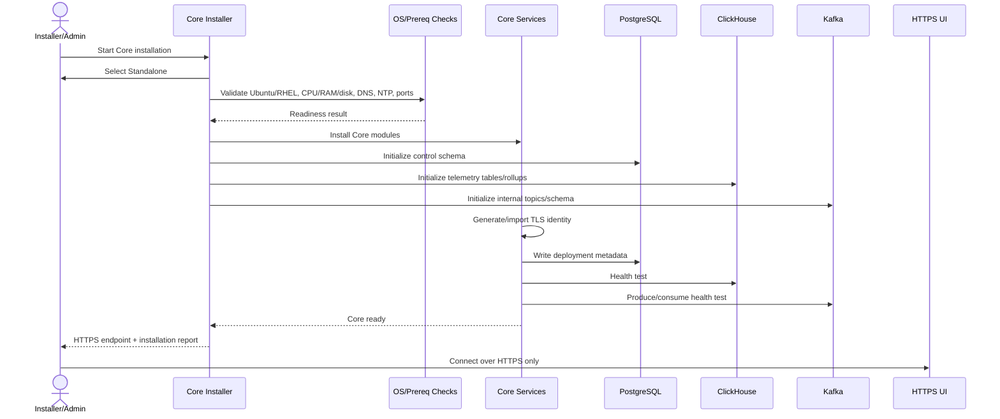

Failure behavior: installer never reports success if required Core data services are unhealthy.

**Certification envelope / Issue #200:** DF-001 is the **Phase 1** standalone Core installation path (one authoritative Core). Tenant-aware identity/contracts remain mandatory even for single-customer enterprise. Completing DF-001 does not certify Core HA, MSP isolation or Phase 1.5 continuity.

---

## 3. Flow DF-002 — Two-Core HA installation and pairing

```mermaid
sequenceDiagram
  actor A as Admin
  participant A1 as Core-A Installer/HA Manager
  participant B1 as Core-B Installer/HA Manager
  participant HA as Stable HA Endpoint/VIP
  participant DB as Core State/Data Services

  A->>A1: Install Core-A; select HA; provide HA endpoint/peer plan
  A1->>A1: Create deployment ID + one-time peer token
  A1->>A1: Enter WAITING_FOR_PEER
  A->>B1: Install Core-B; provide HA endpoint/Core-A + peer token
  B1->>A1: Secure peer handshake
  A1->>B1: Verify token/deployment/certificates
  A1->>B1: Establish mutual node trust
  A1->>DB: Initialize Active state
  B1->>DB: Initialize Standby replica/sync
  A1<->>B1: Synchronize persistent state + HA metadata
  A1->>HA: Claim stable endpoint as ACTIVE
  B1->>B1: Enter STANDBY_READY
  A1-->>A: HA Ready: Active/Standby/sync status
```

The one-time pairing token is invalidated after successful pairing.

**Certification envelope / Issue #200:** DF-002 is the **Phase 1.5** exactly-two-Core Active/Standby installation/pairing path. It is fixed architecture and must not be downgraded, but a Phase 1 standalone certificate must not imply this flow is certified. HA ≠ DR. Physical fencing/replication selections remain OPEN P0.

---

## 4. Flow DF-003 — Sensor installation and enrollment

```mermaid
sequenceDiagram
  actor A as Admin
  participant SI as Sensor Installer
  participant CE as Stable Core Endpoint
  participant EN as Enrollment Service
  participant SC as Sensor Control Service
  participant S as Sensor Runtime

  A->>SI: Install Sensor; Core endpoint; token; role/site/pool hints
  SI->>SI: Validate OS/CPU/RAM/disk/time/DNS
  SI->>CE: HTTPS/mTLS bootstrap request + enrollment token
  CE->>EN: Validate token/tenant/deployment
  EN-->>SI: Sensor ID + unique certificate + trust bundle
  SI->>S: Start runtime
  S->>SC: Authenticated heartbeat/capabilities
  SC->>SC: Resolve Sensor Pool/site/role/policies
  SC-->>S: Signed configuration + Device Packs + assignment version
  S->>S: Self-test protocol workers/spool/uploader
  S->>SC: READY heartbeat
  SC-->>A: Sensor healthy and available for placement
```

Sensor is centrally managed after enrollment; no routine local configuration is required.

---

## 5. Flow DF-004 — Agent installation and Core-directed Sensor assignment

```mermaid
sequenceDiagram
  actor A as Admin/Automation
  participant AG as Agent
  participant CE as Core Endpoint
  participant EN as Agent Enrollment
  participant PS as Placement/Sensor Control
  participant ONB as Onboarding/Policy
  participant S as Assigned Sensor

  A->>AG: Install Agent with Core endpoint + enrollment token
  AG->>CE: Secure bootstrap
  CE->>EN: Validate tenant/token/host metadata
  EN-->>AG: Agent ID + mTLS certificate
  EN->>PS: Request eligible Sensor for provisional enrollment transport
  PS->>PS: Evaluate eligible Sensors + locality + capacity + HA
  PS-->>AG: Primary + fallback Sensor endpoints, provisional assignment version
  AG->>S: Establish authenticated mTLS onboarding/control transport
  S-->>AG: Accept bounded bootstrap/health evidence only
  EN->>ONB: Create/reconcile candidate; PENDING_APPROVAL by default
  Note over AG,S: Provisional transport association is not monitoring/licence activation
  alt Authorized APPROVE or trusted auto-approval
    ONB->>PS: Confirm entitlement/capacity/policy; retain or re-evaluate Sensor
    PS-->>AG: Active monitoring assignment/profile version
    S-->>AG: Activate normal monitoring/test profile
    AG->>S: Normal recurring host metrics / Edge Test results
  else Pending/Unmanaged/Rejected/Excluded
    S-->>AG: No normal monitoring workload/profile
  end
```

The provisional and active phases use the same Sensor Control assignment authority and assignment/versioning contract; approval does not introduce a second Sensor authority mechanism. If Sensor capacity/location changes, Core sends a newer signed assignment; Agent reconnects without reinstall.

---

## 6. Flow DF-005 — Individual network-device provisioning

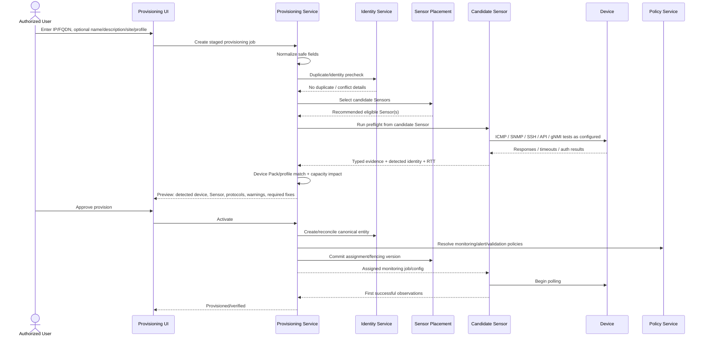

---

## 7. Flow DF-006 — Provisioning failure diagnosis

```mermaid
sequenceDiagram
  participant P as Provisioning Service
  participant S as Candidate Sensor
  participant D as Device
  participant UI as UI
  participant AI as AI Gateway optional

  P->>S: Run SNMP preflight
  S->>D: ICMP
  D-->>S: PASS
  S->>D: UDP/161 SNMP request
  D-->>S: No response / auth report / error
  S-->>P: Structured evidence
  P->>P: Classify exact/suspected failure
  P-->>UI: Error code + evidence + uncertainty + remediation
  opt User requests explanation
    UI->>AI: Explain provisioning failure using typed evidence
    AI-->>UI: Evidence-grounded human explanation; no invented certainty
  end
```

Example outputs distinguish authentication failure, authorization failure, no response, suspected firewall/ACL, protocol disabled suspected and Sensor-path issue.

---

## 8. Flow DF-007 — Bulk CSV/XLSX provisioning

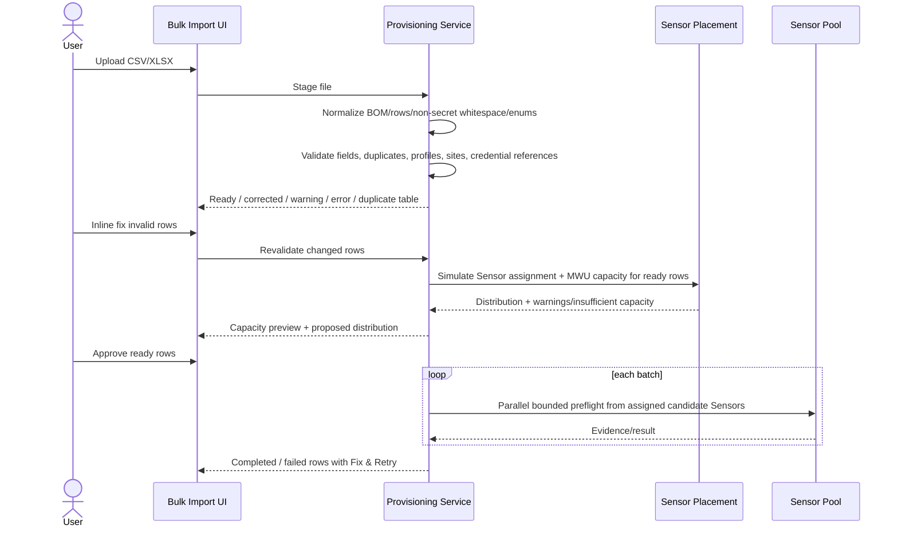

Credentials should normally be references to Credential Profiles, not secrets in the file.

---

## 9. Flow DF-008 — Auto-discovery

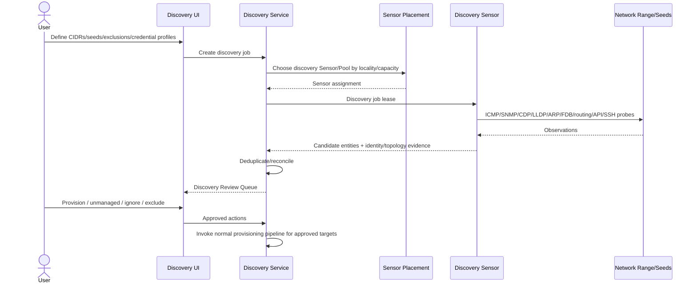

Discovery does not automatically consume monitoring licences unless policy explicitly allows auto-approval.

---

## 10. Flow DF-009 — Sensor placement and capacity simulation

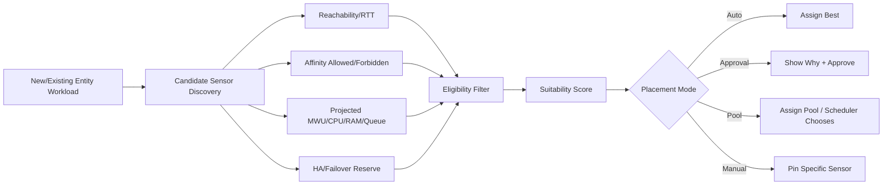

---

## 11. Flow DF-010 — Sensor automatic rebalance

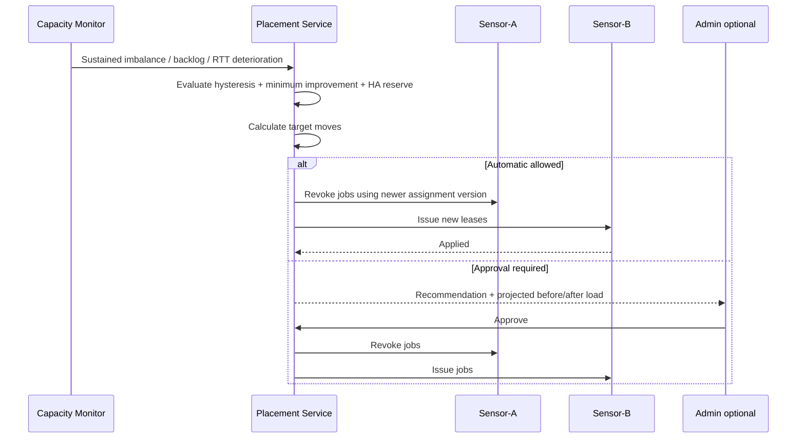

Assignment/fencing version prevents obsolete Sensor from continuing a superseded job after it sees the new epoch.

---

## 12. Flow DF-011 — SNMP polling, typed normalization and exact-counter ingestion

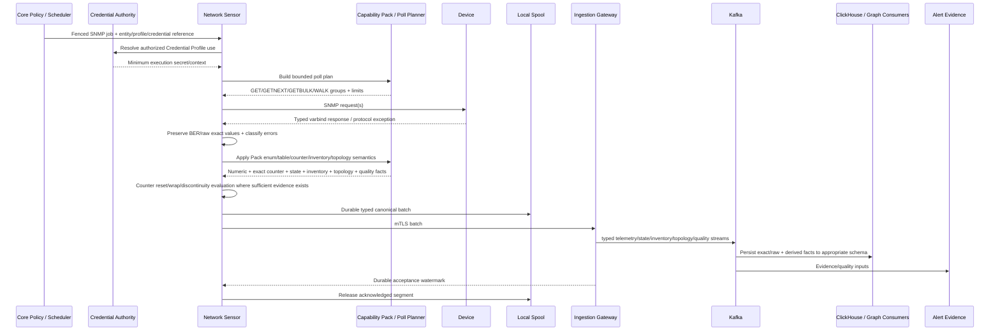

A single unsupported optional OID may produce explicit `NO_SUCH_OBJECT/INSTANCE` quality evidence without forcing unrelated valid observations in the same logical poll to become invalid. Pack policy decides whether a mandatory OID failure degrades the monitor.

Raw Counter64 remains exact through acceptance/persistence; floating-point rate/utilization is derived only after exact delta/reset/discontinuity logic. Normal scheduled SNMP operational metrics default to **5 minutes** unless a more specific inherited policy/monitor definition overrides; that default does not poll every available OID every five minutes.

Typed SNMP/ICMP observations retain quality/provenance. Collection/transport/ingestion failure, missing samples or `UNKNOWN`/`PARTIAL` quality must not automatically assert DEVICE_DOWN (`No Data != Device Down`). **Issue #218:** Core numeric-only ingestion currently rejects Sensor `icmp_observation_v1` shapes before durable Kafka/ACK; architecture still requires governed Core acceptance of typed ICMP evidence. Do not treat unresolved Core acceptance as implemented or certified.

---

## 13. Flow DF-012 — SNMP trap/inform ingestion and storm control

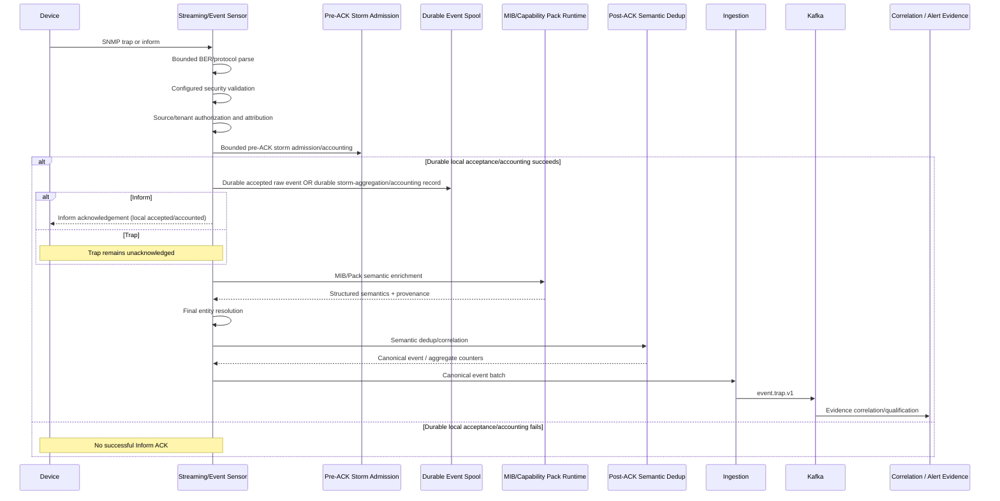

Conceptual Inform path:

```text
Device
→ Sensor parse/security/source validation
→ bounded storm admission/accounting
→ durable raw accepted/aggregate record
→ Inform ACK
→ MIB/Pack semantic enrichment
→ entity resolution / semantic storm-dedup / correlation
→ ingestion
```

v1/v2c trap source identity is weak evidence and never independently proves device/link failure. Pre-ACK admission/accounting and post-ACK semantic dedup retain first/last seen, count and affected-source context. Every rate-limit/drop decision is measurable.

SNMP Trap is unacknowledged. Successful Inform ACK requires durable local receiver acceptance/accounting after bounded BER/protocol parsing, configured SNMP security validation, sufficient source/tenant attribution and the bounded pre-ACK storm admission/accounting decision, while preserving the raw typed notification. MIB/Capability Pack enrichment, final entity resolution, semantic dedup/correlation, alert correlation, Core delivery, Kafka persistence, ClickHouse persistence and incident creation are **not** ACK prerequisites. Inform ACK means `LOCAL RECEIVER ACCEPTED/ACCOUNTED` only. This boundary is distinct from the Sensor→Core telemetry ACK model.

---

## 14. Flow DF-013 — Flow ingestion and enrichment

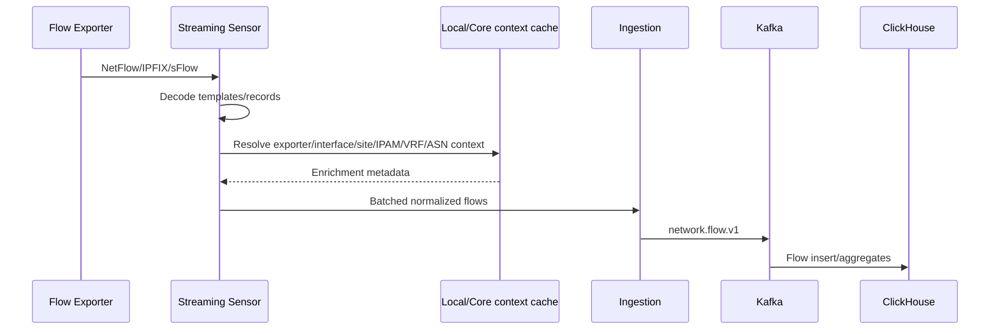

Every forced drop/template miss is counted and exposed through telemetry-quality/platform-health data.

---

## 15. Flow DF-014 — Syslog ingestion

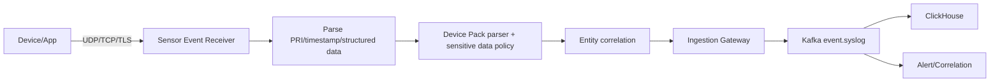

---

## 16. Flow DF-015 — gNMI streaming telemetry

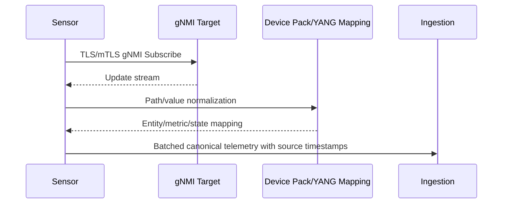

Subscription health is separately monitored so stream failure is not misclassified as device failure.

---

## 17. Flow DF-016 — Infrastructure Agent telemetry

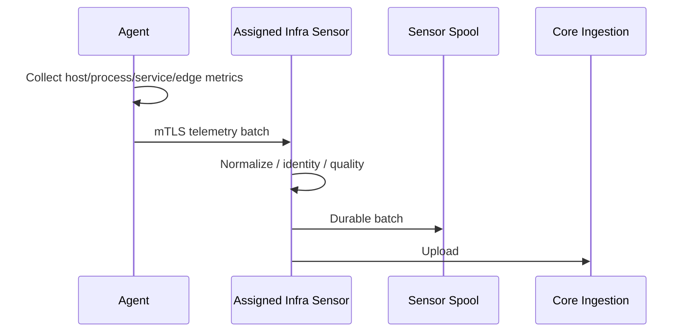

---

## 18. Flow DF-017 — Agentless SSH/WinRM monitoring

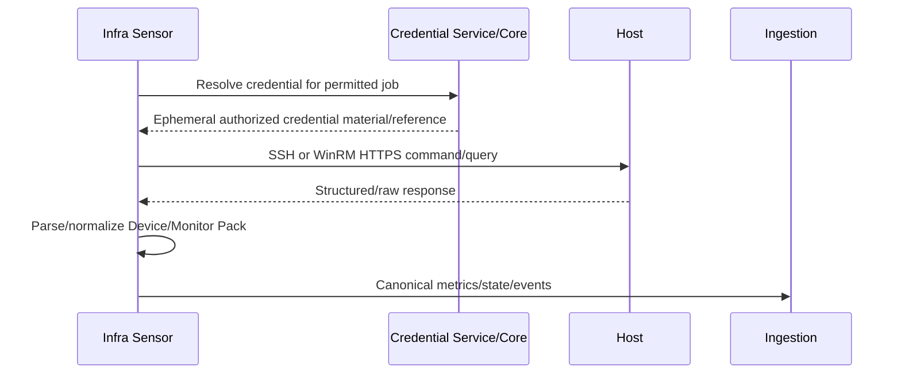

---

## 19. Flow DF-018 — Synthetic test

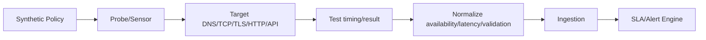

---

## 20. Flow DF-019 — Primary monitor failure → Alert Qualification

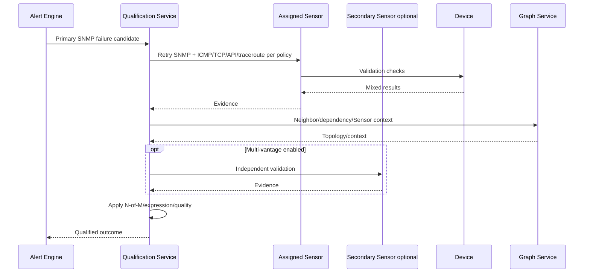

Possible output is Monitoring Degraded, Credential Failure, Path Failure, Device Down, Sensor Failure or Inconclusive.

---

## 21. Flow DF-020 — Alert storm compression

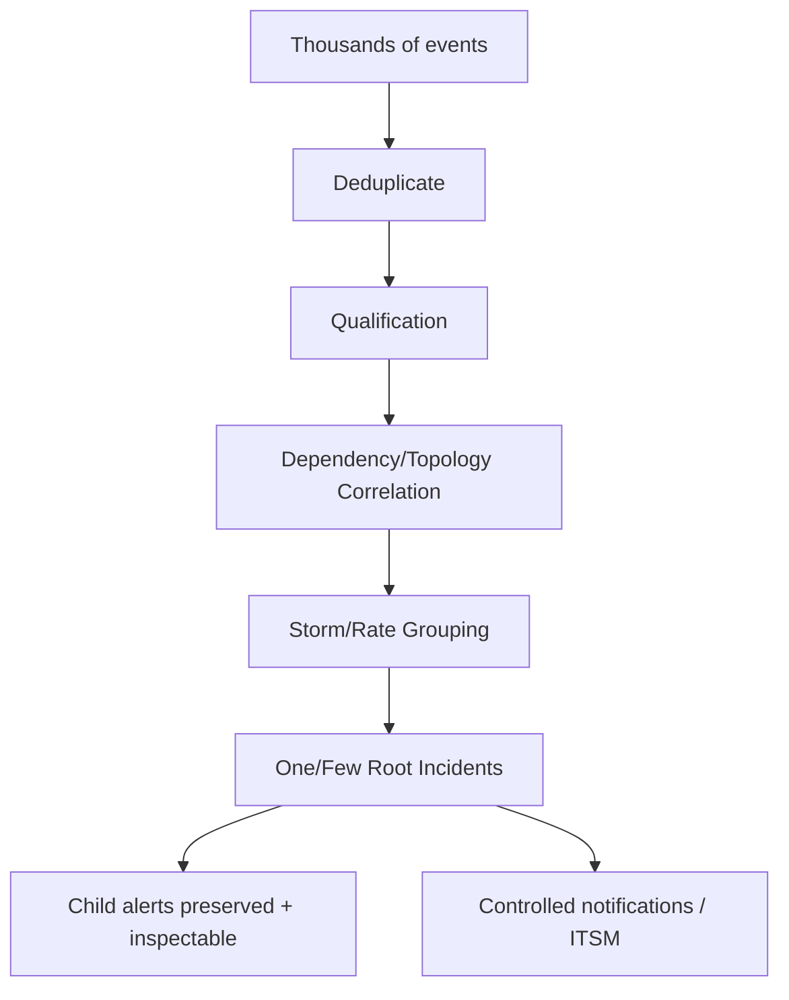

---

## 22. Flow DF-021 — Incident correlation → RCA

```mermaid
sequenceDiagram
  participant C as Correlation Service
  participant R as RCA Service
  participant G as Graph Service
  participant CH as ClickHouse
  participant NCM as Change/Audit Sources
  participant ML as Anomaly/GNN Scorers

  C->>R: Incident candidate + child alerts
  R->>G: Extract temporal subgraph
  G-->>R: Nodes/edges/provenance/history
  R->>CH: Metrics/events/flow/telemetry-quality window
  CH-->>R: Evidence
  R->>NCM: Recent config/audit/maintenance changes
  NCM-->>R: Change evidence
  R->>R: Protocol/causal rules + temporal ordering
  R->>ML: Request anomaly/GNN scores when enabled
  ML-->>R: Learned scores + model/version
  R->>R: Fuse + contradiction check + confidence
  alt Sufficient evidence
    R-->>C: Root cause + causal chain + blast radius + evidence
  else Insufficient evidence
    R-->>C: INCONCLUSIVE + missing evidence + recommended checks
  end
```

---

## 23. Flow DF-022 — GNN shadow-mode evaluation

```mermaid
sequenceDiagram
  participant R as RCA Service
  participant F as Feature Builder
  participant G as GNN Runtime
  participant MR as Model Registry
  participant QA as Evaluation Store

  R->>F: Bounded temporal subgraph + evidence window
  F->>MR: Resolve approved SHADOW model
  MR-->>F: Model/schema/version
  F->>G: Node/edge/time features
  G-->>F: Root/edge/impact scores
  F->>QA: Save score + input snapshot + model version
  Note over R,G: Shadow result does not change production RCA conclusion
```

Promotion to production scoring requires benchmark acceptance.

---

## 24. Flow DF-023 — Conversational AI “Ask the network”

```mermaid
sequenceDiagram
  actor U as User
  participant UI as AI/Investigation UI
  participant AG as AI Gateway
  participant AUTH as Authorization
  participant T as Platform Tools
  participant GM as Gemini

  U->>UI: Natural-language operational question
  UI->>AG: Query + user/tenant context
  AG->>AUTH: Verify scope/tools/data policy
  AUTH-->>AG: Allowed tool set/data boundary
  AG->>T: Search/query graph/metrics/incidents as needed
  T-->>AG: Structured evidence with source IDs
  AG->>AG: Redact/mask sensitive fields
  AG->>GM: Grounded prompt + evidence/tool results
  GM-->>AG: Explanation/structured response
  AG->>AG: Validate referenced evidence/guardrails
  AG-->>UI: Answer + evidence links + uncertainty
```

LLM has no direct credential or unrestricted database access.

---

## 25. Flow DF-024 — RCA feedback

```mermaid
flowchart LR
  RCA[RCA Result] --> U[Operator feedback: Correct / Partial / Incorrect]
  U --> F[Feedback Store]
  F --> E[Evaluation / Model Quality Dashboard]
  F -. controlled offline process .-> TRAIN[Future Model Training]
```

Feedback never auto-retrains production models without governance.

---

## 26. Flow DF-025 — NCM backup

```mermaid
sequenceDiagram
  actor U as User/Schedule
  participant N as Core NCM
  participant P as Policy/RBAC
  participant S as Network Sensor
  participant D as Device
  participant ST as Config Store/Metadata
  participant TL as Timeline

  U->>N: Backup now / scheduled job
  N->>P: Authorization/window/credential check
  P-->>N: Allowed
  N->>S: Signed job lease + adapter + credential ref
  S->>D: SSH/NETCONF/API backup
  D-->>S: Configuration
  S-->>N: Config + hash + execution evidence
  N->>ST: Store version/metadata
  N->>TL: Emit config backup/change fact
```

---

## 27. Flow DF-026 — NCM push with approval and validation

```mermaid
sequenceDiagram
  actor R as Requester
  actor A as Approver
  participant N as NCM Service
  participant S as Sensor
  participant D as Device

  R->>N: Submit change + scope + ticket + dry run
  N->>N: RBAC, impact preview, Device Pack capability, window
  N-->>A: Approval request
  A->>N: Approve
  N->>S: Signed execution job
  S->>D: Pre-check / backup
  D-->>S: Pre-state
  S->>D: Config change
  D-->>S: Result
  S->>D: Post-validation
  alt Validation success
    S-->>N: Success + evidence
  else Validation failure and rollback supported
    S->>D: Rollback
    D-->>S: Rollback result
    S-->>N: Failed/rolled back + evidence
  end
```

**Phase 1 / Phase 1.5 NCM envelope (Issue #200):** Phase 1 independently certifiable NCM subset remains config backup/version/diff/compliance/golden-state; controlled manual CLI remains Phase 1 only when RBAC/credential/audit contracts are certified. DF-025 depicts configuration backup and version storage only—not comparison, compliance or golden-state evaluation. DF-026 depicts one approved configuration push with pre-check, validation and optional rollback—not mass deployment, canary execution or the full controlled-remediation workflow. Mass push / canary / automated privileged remediation defaults to **Phase 1.5** unless Founder change control promotes it. Schema presence of push/rollback paths is not Phase 1 certification.

---

## 28. Flow DF-027 — Browser CLI session

```mermaid
sequenceDiagram
  actor U as Engineer
  participant UI as xterm UI
  participant B as Core CLI Broker
  participant AUTH as RBAC/JIT/MFA Policy
  participant S as Network Sensor
  participant D as Device
  participant AUD as Audit

  U->>B: Request CLI(entity, reason/ticket)
  B->>AUTH: Evaluate role/scope/conditions
  AUTH-->>B: Allowed privilege level
  B->>S: Open short-lived authorized SSH session
  S->>D: SSH with protected credential
  D-->>S: Terminal
  S-->>B: Stream
  B-->>UI: WebSocket stream
  loop commands
    UI->>B: command
    B->>AUTH: command policy check if required
    B->>S: forward
    S->>D: command
    D-->>S: output
    S-->>B: output
    B->>AUD: command/result/session evidence
    B-->>UI: output
  end
```

---

## 29. Flow DF-027A — Contextual on-demand diagnostic / multi-vantage verification

```mermaid
sequenceDiagram
  actor U as NOC User
  participant UI as Entity/Alert/Incident UI
  participant D as Diagnostic Orchestrator
  participant AUTH as RBAC/Scope/Policy
  participant SC as Sensor Control
  participant S1 as Assigned Sensor
  participant S2 as Alternate Sensor/Agent optional
  participant T as Target
  participant E as Evidence/Investigation

  U->>UI: Ping / Trace / SNMP / Verify Now
  UI->>D: diagnostic(origin,target,type,params,vantage mode)
  D->>AUTH: Authorize actor + target + action + parameters
  AUTH-->>D: Allowed/denied + limits
  D->>SC: Resolve eligible vantage(s) + capacity
  SC-->>D: Assigned/eligible bounded execution set
  par Assigned vantage
    D->>S1: Execute bounded typed test
    S1->>T: Protocol/network check
    T-->>S1: Result/timeout/error
    S1-->>D: Typed evidence + quality
  and Optional independent vantage
    D->>S2: Execute same bounded validation
    S2->>T: Protocol/network check
    T-->>S2: Result/timeout/error
    S2-->>D: Typed evidence + quality
  end
  D->>E: Persist/audit result refs + correlation
  D-->>UI: Per-vantage results + monitored-vs-live comparison
```

Contradictory vantage evidence is shown, not averaged into a false definitive state. Operator-triggered verification does not automatically rewrite continuously monitored state; qualification/evidence policy decides any state transition.

---

## 30. Flow DF-027B — Investigation Session evidence capture

```mermaid
sequenceDiagram
  actor U as Engineer
  participant UI as Troubleshoot Workspace
  participant INV as Investigation Service
  participant DIAG as Diagnostics
  participant CLI as CLI Broker
  participant Q as Query/Graph/NCM/Flow
  participant INC as Incident Service

  U->>INV: Start Investigation(origin, reason)
  INV-->>UI: investigation_session_id
  U->>DIAG: Run diagnostic in investigation context
  DIAG-->>INV: Attach typed result reference
  U->>CLI: Open CLI in investigation context
  CLI-->>INV: Attach session/command evidence reference
  U->>Q: View/compare topology, config, flow, changes
  Q-->>INV: Attach selected evidence/snapshot references
  opt Incident exists or user links it
    INV->>INC: Link investigation + evidence index
  end
  U->>INV: Close Investigation
  INV-->>UI: Evidence summary + unresolved items
```

Investigation storage references authoritative evidence instead of copying entire telemetry datasets. Authorization is re-evaluated for each privileged action; being inside an investigation does not grant extra privilege.

---

## 31. Flow DF-028 — ITSM incident creation/update

```mermaid
sequenceDiagram
  participant I as Incident Service
  participant Q as Durable Integration Queue
  participant C as ITSM Connector
  participant T as ServiceNow/BMC/etc.

  I->>Q: Enqueue create/update with idempotency key
  Q->>C: Deliver
  C->>T: API request
  alt Success
    T-->>C: Ticket ID/state
    C-->>Q: Ack
    C->>I: Store correlation/ticket state
  else Failure
    T-->>C: Error/timeout
    C-->>Q: Retryable/non-retryable error
    Q->>Q: Backoff/retry/dead-letter policy
  end
```

Connector health exposes stuck/rejected operations.

---

## 32. Flow DF-029 — Incident recovery → ITSM resolution

```mermaid
sequenceDiagram
  participant AE as Alert/Recovery Engine
  participant I as Incident Service
  participant Q as Integration Queue
  participant T as ITSM

  AE->>AE: Primary recovery evidence
  AE->>AE: Stability/recovery qualification window
  alt Stable recovery
    AE->>I: Resolve Platform incident
    I->>Q: Apply configured ITSM recovery policy
    Q->>T: Update/resolve/close or add work note
  else Flapping/unstable
    AE->>I: Keep incident open / monitoring recovery
  end
```

---

## 33. Flow DF-030 — Policy change with impact preview

```mermaid
sequenceDiagram
  actor A as Admin
  participant UI as Policy UI
  participant P as Policy Service
  participant CH as Historical Analytics
  participant CAP as Capacity Model

  A->>UI: Change polling/threshold/retention policy
  UI->>P: Preview draft
  P->>CH: Simulate historical alert/data impact where applicable
  P->>CAP: Calculate Sensor/Core/storage impact
  CH-->>P: Estimated alerts/affected entities
  CAP-->>P: Capacity/storage projection
  P-->>UI: SAFE/WARNING/UNSAFE + details
  A->>UI: Apply/Cancel
  UI->>P: Create immutable new version
  P->>P: Audit + distribute effective config
```

---

## 34. Flow DF-031 — Adaptive polling

```mermaid
flowchart LR
  T[Trigger: alert/trap/syslog/anomaly/config/manual] --> P[Adaptive Policy]
  P --> C{Capacity/Safety Check}
  C -- Safe --> F[Increase polling temporarily]
  C -- Unsafe --> W[Limit/deny + warning]
  F --> OBS[Collect deeper/faster evidence]
  OBS --> E{Return condition/cooldown}
  E --> BASE[Restore baseline polling]
```

---

## 35. Flow DF-032 — Retention rollup

```mermaid
flowchart LR
  RAW[Raw telemetry] --> R1[Configured rollup 1]
  R1 --> R2[Configured rollup 2]
  R2 --> RL[Long-term rollup]
  RAW --> TTL{Raw retention expired?}
  TTL -- yes and required rollup complete --> DEL[Delete raw partition]
  TTL -- no --> KEEP[Keep]
  RL --> ARCH[Optional archive]
```

Rollup interval and retention are customer-configurable; labels here do not imply fixed periods.

---

## 36. Flow DF-033 — Historical dashboard query with automatic resolution

```mermaid
sequenceDiagram
  actor U as User
  participant UI as Dashboard
  participant Q as Query Service
  participant R as Retention/Resolution Catalogue
  participant CH as ClickHouse

  U->>UI: Select 2-year time range
  UI->>Q: Query(resolution=AUTO)
  Q->>R: Find available resolutions/retention
  R-->>Q: e.g. hourly rollup available
  Q->>CH: Query appropriate rollup
  CH-->>Q: Aggregated result
  Q-->>UI: Data + effectiveResolution
  UI-->>U: Chart + "hourly rollup" indicator
```

---

## 37. Flow DF-034 — Core 80% storage protection

```mermaid
sequenceDiagram
  participant M as Storage Monitor
  participant L as Lifecycle Service
  participant P as Purge Planner
  participant CH as ClickHouse/Volumes
  participant A as Audit/Alert

  M->>L: Volume usage >=80%
  L->>P: Build emergency reclaim plan
  P->>P: Respect data class priority, rollups, legal holds, recent window
  P->>CH: Drop/delete oldest eligible partitions/segments
  CH-->>P: Bytes reclaimed
  P->>M: Recheck utilization
  alt Safe headroom reached
    L->>A: Storage protection success + exact deleted ranges/classes
  else Insufficient eligible data
    L->>A: CRITICAL reclamation insufficient + required admin action
  end
```

Monitoring ingestion remains active throughout to the greatest technically safe extent.

---

## 38. Flow DF-035 — Sensor 80% storage protection during WAN outage

```mermaid
sequenceDiagram
  participant S as Sensor
  participant SP as Local Spool
  participant M as Sensor Storage Protector
  participant C as Core unreachable

  S->>SP: Continue polling + append telemetry
  S--xC: Upload fails
  M->>SP: Usage reaches warnings/80%
  M->>SP: Remove acknowledged/temp/old logs first
  alt Still above emergency threshold
    M->>SP: Apply oldest low-priority unacknowledged emergency drop policy
    M->>M: Count exact loss + preserve recent/high-priority data
  end
  M->>S: Continue current monitoring
  Note over S,M: On reconnect, lost-data counters are uploaded; no silent loss
```

---

## 39. Flow DF-036 — Legal/investigation hold

```mermaid
sequenceDiagram
  actor U as Authorized User
  participant H as Retention Hold Service
  participant P as Purge Planner

  U->>H: Hold incident/time range/data classes + reason
  H->>H: Validate privilege/approval and persist hold
  P->>H: Query protected ranges during retention/purge
  H-->>P: Exclusions
  P->>P: Purge other eligible data first
```

---

## 40. Flow DF-037 — Core Active failure and HA failover

```mermaid
sequenceDiagram
  participant A as Core-A Active
  participant B as Core-B Standby
  participant HA as HA Manager/VIP
  participant S as Sensors
  participant DB as Data Services

  A--xB: Heartbeat stops / node failure
  S->>S: Continue polling + local spool
  B->>HA: Evaluate failure/fencing safety
  alt Safe to promote
    B->>DB: Promote required standby data services
    B->>B: Start/promote Active Core modules
    B->>HA: Claim stable endpoint
    HA-->>S: Endpoint available on Core-B
    S->>B: Reconnect and replay buffered data
  else Ambiguous partition
    B->>B: Enter SPLIT_BRAIN_PREVENTED / do not become writable Active
    S->>S: Continue buffering
  end
```

Certified safe failure cases must restore Core service in <60 seconds under the **Phase 1.5** HA envelope. Ambiguous partition remains fail-closed (`SPLIT_BRAIN_PREVENTED`). Sensors continue collecting/buffering while capacity permits; Phase 1.5 deletion-ACK target for permanent one-Core HA failures is `ACKED-FOR-DELETION TELEMETRY RPO = 0` (distinct from Phase 1 standalone deletion-ACK durability and from site/DR RPO). Physical mechanisms remain unselected.

---

## 41. Flow DF-038 — Former Active returns after failover

```mermaid
sequenceDiagram
  participant A as Former Core-A
  participant B as Current Core-B Active
  participant HA as HA Manager

  A->>HA: Rejoin request with old cluster epoch
  HA->>A: Reject active writes; force STANDBY_SYNCING
  A<->>B: Resynchronize PostgreSQL/ClickHouse/Kafka/application state per certified procedures
  B-->>A: Current epoch/config
  A->>HA: Sync complete
  HA->>A: STANDBY_READY
```

Old Core may never independently resume Active because it used to be Active.

---

## 42. Flow DF-039 — Sensor failure and polling reassignment

```mermaid
sequenceDiagram
  participant S1 as Sensor-1
  participant C as Sensor Control
  participant S2 as Sensor-2
  participant D as Devices

  S1--xC: Heartbeats stop
  C->>C: Lease expiry + capacity/locality evaluation
  C->>S2: Issue newer assignment/fencing versions
  S2->>D: Begin polling reassigned targets
  S2-->>C: First observations
  opt S1 returns
    S1->>C: Rejoin with stale assignment versions
    C-->>S1: New state; do not resume superseded jobs
  end
```

---

## 43. Flow DF-040 — Licence expiration lifecycle

```mermaid
sequenceDiagram
  participant L as Licence Service
  participant UI as Dashboards
  participant S as Scheduler/Sensor Control
  participant H as Historical Query

  L->>UI: 30-day warning notification
  L->>UI: 7-day global pre-expiry banner (T-7)
  L->>L: Licence expires; enter EXPIRED_GRACE_15D (Founder-approved 15-day post-expiry grace)
  L->>S: Keep polling enabled during 15-day grace
  L->>L: 15-day grace expires
  L->>S: Disable new polling assignments / signed polling-stop state
  L->>H: Historical queries remain enabled
  Note over L,H: Licence admin remains accessible for extension/renewal
```

---

## 44. Flow DF-041 — Licence renewed after polling stop

```mermaid
sequenceDiagram
  actor A as Licence Admin
  participant L as Licence Service
  participant P as Policy/Scheduler
  participant S as Sensors

  A->>L: Import/activate renewed licence
  L->>L: Validate signature/entitlements
  L->>P: Re-enable polling eligibility
  P->>S: New policy/assignment version
  S->>S: Resume polling
```

---

## 45. Flow DF-042 — Dashboard query and fast UI response

```mermaid
sequenceDiagram
  actor U as User
  participant UI as React UI
  participant API as Query API
  participant AUTH as RBAC
  participant V as Valkey
  participant CH as ClickHouse

  U->>UI: Open dashboard/filter/time range
  UI->>API: Typed query
  API->>AUTH: Scope authorization
  AUTH-->>API: Allowed scope
  API->>V: Cache lookup
  alt Cache hit
    V-->>API: Result
  else Miss
    API->>CH: Bounded optimized query / rollup
    CH-->>API: Result
    API->>V: Cache safe derived result
  end
  API-->>UI: Data + resolution + freshness
```

Large tables use server-side pagination; oversized exports become background jobs.

---

## 46. Flow DF-043 — Report execution

```mermaid
flowchart LR
  DEF[Report Definition + Schedule] --> JOB[Async Report Job]
  JOB --> AUTH[Scope/RBAC snapshot]
  AUTH --> Q[Query Service]
  Q --> DATA[ClickHouse/PostgreSQL Aggregates]
  DATA --> CALC[Safe formula/CEL calculations]
  CALC --> RENDER[PDFBox/POI/CSV/JSON renderer]
  RENDER --> DELIV[Download / Email / Integration]
  DELIV --> HIST[Execution history / audit]
```

---

## 47. Flow DF-044 — Device Pack creation from MIB

```mermaid
sequenceDiagram
  actor U as Admin/Engineer
  participant MS as MIB Studio
  participant AI as AI Gateway optional
  participant DP as Device Pack Studio
  participant T as Test Device/Sample

  U->>MS: Upload MIB(s)
  MS->>MS: Provenance/hash/dependency/compile/OID tree
  MS->>T: Optional walk/test
  T-->>MS: Sample values
  opt AI semantic help
    MS->>AI: Ask for metric/enum/visualization suggestions using parsed MIB context
    AI-->>MS: AI Suggested mappings
  end
  U->>MS: Confirm/edit mappings
  MS->>DP: Create Monitor Definitions/traps/topology semantics
  DP->>DP: Version/sign/test/publish
```

---

## 48. Flow DF-045 — API Studio connector creation

```mermaid
sequenceDiagram
  actor U as Admin
  participant AS as API Studio
  participant T as Target API
  participant AI as AI Gateway optional
  participant DP as Device Pack/Connector Store

  U->>AS: OpenAPI URL/file or manual endpoint
  AS->>T: Authenticated test request
  T-->>AS: JSON/XML response
  AS->>AS: Schema/entity/collection inference
  opt AI help
    AS->>AI: Suggest semantic mappings
    AI-->>AS: AI Suggested mappings
  end
  AS->>AS: Cardinality/MWU/rate preview
  U->>AS: Confirm mappings
  AS->>DP: Version/sign/publish connector
```

---

## 49. Flow DF-046 — Data masking before AI

```mermaid
flowchart LR
  SRC[Logs / Config / Inventory / RCA Evidence] --> CLASS[Data Classification]
  CLASS --> POL[AI Data Boundary Policy]
  POL --> DROP[Drop fields]
  POL --> MASK[Mask/hash fields]
  POL --> ALLOW[Allowed evidence]
  MASK --> CTX[AI Context Builder]
  ALLOW --> CTX
  CTX --> GEM[Gemini/Provider]
```

Credentials/private keys never enter the allowed path.

---

## 50. Flow DF-047 — Backup and restore verification

```mermaid
sequenceDiagram
  participant B as Backup Service
  participant PG as PostgreSQL
  participant CH as ClickHouse
  participant FS as Artifact/Object Store
  participant V as Verification

  B->>PG: Snapshot/backup
  PG-->>B: Backup reference/hash
  B->>CH: Backup required partitions/metadata
  CH-->>B: Backup reference/hash
  B->>FS: Save Device Packs/dashboards/policies/certs per secure policy
  B->>V: Build signed manifest + checksums
  V->>V: Verify readability/integrity/compatibility metadata
  V-->>B: VERIFIED or FAILED
```

A backup failure is a Platform alert.

---

## 51. Flow DF-048 — DR activation (architecture-level, exact RPO/RTO TBD)

```mermaid
sequenceDiagram
  actor A as Authorized DR Operator
  participant P as Primary Core/Site
  participant D as DR Core/Site
  participant S as Sensors/Agents
  participant DNS as DR Endpoint/DNS/VIP mechanism

  A->>D: Run DR readiness/restore/replication validation
  D-->>A: Ready / blocking issues
  A->>P: Confirm primary unavailable or planned DR switch
  A->>D: Authorize DR activation
  D->>D: Promote restored/replicated state per certified runbook
  A->>DNS: Activate DR stable Core endpoint
  DNS-->>S: Resolve/reconnect to DR Core
  S->>D: Re-enroll/reconnect using preserved trust/DR policy
  S->>D: Replay buffered telemetry as supported
```

Exact automation, node count and RPO/RTO remain TBD.

**Certification envelope / Issue #200:** DF-048 is **Phase 1 mandatory** site-loss DR / restore activation for the declared Phase-1 DR profile. HA ≠ DR. Completing Phase 1.5 two-Core HA certification does not replace backup/restore or site-loss DR evidence, and a Phase 1 DR certificate does not imply Active/Standby HA continuity.

---

## 52. Flow DF-049 — Core upgrade in HA

```mermaid
sequenceDiagram
  actor A as Admin
  participant U as Upgrade Orchestrator
  participant CA as Core-A Active
  participant CB as Core-B Standby
  participant S as Sensors

  A->>U: Start approved upgrade
  U->>U: Preflight + backup + compatibility
  U->>CB: Upgrade Standby first where release supports
  CB-->>U: Health/schema compatibility ready
  U->>CA: Controlled switchover/drain if required
  S->>S: Continue polling/buffer through switch
  U->>CB: Promote upgraded node Active
  U->>CA: Upgrade former Active
  CA-->>U: Rejoin Standby and sync
  U-->>A: HA healthy / upgrade complete
```

Exact sequence may differ for schema-breaking releases but must remain documented/tested.

---

## 53. Flow DF-050 — Sensor canary upgrade

```mermaid
flowchart LR
  REL[New Sensor Release] --> C1[Canary Sensor/Pool Cohort]
  C1 --> DRN[Drain jobs to peers]
  DRN --> UP[Upgrade]
  UP --> VAL[Self-test + poll/replay validation]
  VAL -->|Pass| NEXT[Expand cohort]
  VAL -->|Fail| RB[Rollback/stop rollout]
  NEXT --> FULL[Full rollout]
```

---

## 54. Flow DF-051 — Cardinality explosion protection

```mermaid
sequenceDiagram
  participant I as Ingestion/Connector Runtime
  participant G as Telemetry Guardrail
  participant A as Admin UI

  I->>G: New labels/entities/metric series rate
  G->>G: Compare with baseline/limits
  alt Explosion detected
    G-->>A: Critical warning + offending connector/field + projected storage
    G->>I: Enforce configured rate/cardinality guardrail if safety policy requires
  end
```

The system reports dropped/rejected records explicitly.

---

## 55. Flow DF-052 — Telemetry quality → RCA confidence

```mermaid
flowchart LR
  EXP[Expected polls/streams] --> Q[Quality Engine]
  GOT[Received/late/duplicate/failed/clock state] --> Q
  Q --> SCORE[Quality score + missing evidence]
  SCORE --> RCA[RCA Confidence Calibrator]
  RCA --> OUT[Result / lower confidence / INCONCLUSIVE]
```

---

## 56. Flow DF-053 — Historical topology during incident investigation

```mermaid
sequenceDiagram
  actor U as Investigator
  participant UI as Incident/Topology UI
  participant G as Graph Service
  participant H as Topology History

  U->>UI: View topology at incident time
  UI->>G: getGraph(asOf=incident timestamp, layers=...)
  G->>H: Reconstruct relationships valid at time
  H-->>G: Historical edges/provenance
  G-->>UI: Time-consistent graph
```

---

## 57. Flow DF-054 — Unified Operations Timeline

```mermaid
flowchart TB
  MET[Metric anomalies/state changes] --> T[Timeline Aggregator]
  EVT[Traps/Syslog/Events] --> T
  AL[Alerts/Incidents] --> T
  CFG[NCM/Config changes] --> T
  TOPO[Topology changes] --> T
  AUD[User/Audit actions] --> T
  SENS[Sensor assignment/health] --> T
  ITSM[ITSM lifecycle] --> T
  RCA[RCA runs] --> T
  T --> UI[Typed chronological timeline with source links]
```

---

## 58. Flow DF-055 — Query-too-large protection

```mermaid
sequenceDiagram
  actor U as User
  participant UI as UI
  participant Q as Query Service

  U->>UI: Request 5 years raw flow export
  UI->>Q: Query
  Q->>Q: Estimate scan/rows/cost exceeds interactive limits
  Q-->>UI: Refuse interactive execution; offer background export / aggregate resolution
  U->>UI: Choose background export
  UI->>Q: Submit async job
```

---

## 59. Flow DF-056 — Integration test sandbox

```mermaid
sequenceDiagram
  actor A as Integration Admin
  participant UI as Integration Studio
  participant C as Connector
  participant T as ITSM/Endpoint

  A->>UI: Test connector
  UI->>C: Connection/auth test
  C->>T: Health/auth
  T-->>C: Success
  C->>T: Create test item
  T-->>C: ID
  C->>T: Update test item
  C->>T: Resolve/delete according to sandbox semantics
  C-->>UI: PASS/FAIL per stage + field mapping evidence
```

---

## 60. Flow DF-057 — Support bundle

```mermaid
flowchart LR
  REQ[Authorized support-bundle request] --> COL[Collect versions/health/logs/config metadata]
  COL --> RED[Redact credentials/tokens/private keys/sensitive fields]
  RED --> MAN[Manifest + correlation IDs + timestamps]
  MAN --> B[Encrypted/signed support bundle]
  B --> AUD[Audit event]
```

---

## 61. Flow DF-058 — Change freeze calendar

```mermaid
sequenceDiagram
  actor U as User
  participant OP as Operational Calendar
  participant N as NCM/Upgrade/Device Pack Job

  U->>N: Request risky change during freeze
  N->>OP: Evaluate freeze/maintenance/business calendar
  OP-->>N: BLOCKED unless emergency override role/approval
  N-->>U: Explain freeze window and allowed override process
```

---

## 62. Flow DF-059 — Post-incident review generation

```mermaid
flowchart LR
  INC[Closed Incident] --> PIR[PIR Generator]
  TL[Unified Timeline] --> PIR
  RCA[RCA/Evidence] --> PIR
  ITSM[Ticket/Notes] --> PIR
  CHG[Config/Changes] --> PIR
  PIR --> DRAFT[Draft PIR: impact, cause, evidence, actions, recovery]
  DRAFT --> HUMAN[Human corrective/preventive actions + approval]
  HUMAN --> PDF[Report/export]
```

---

## 63. Flow DF-060 — Platform self-monitoring

```mermaid
flowchart TB
  CORE[Core health] --> PH[Platform Health Engine]
  PG[PostgreSQL] --> PH
  CH[ClickHouse] --> PH
  K[Kafka] --> PH
  S[Sensor fleet] --> PH
  AG[Agents] --> PH
  INT[Integrations] --> PH
  CERT[Certificates/Licence] --> PH
  ST[Storage] --> PH
  PH --> DASH[Platform Operations Dashboard]
  PH --> ALERT[Internal Platform Alerts]
```

Internal platform failure alerts are classified separately from customer-device alerts.

---

## 64. Flow DF-061 — User access request and authorization

```mermaid
sequenceDiagram
  actor U as User
  participant UI as UI
  participant IDP as IdP/Local Auth
  participant API as Core API
  participant AUTH as Authorization Engine

  U->>UI: Login
  UI->>IDP: OIDC/SAML/local/MFA
  IDP-->>UI: Authenticated subject/session
  UI->>API: Request resource/action
  API->>AUTH: Who + tenant + resource + action + conditions
  AUTH-->>API: Allow/Deny + explanation
  alt Allow
    API-->>UI: Scoped result
  else Deny
    API-->>UI: 403 / policy explanation according to role
  end
```

---

## 65. Flow DF-062 — Credential rotation

```mermaid
sequenceDiagram
  actor A as Credential Admin
  participant C as Credential Service
  participant T as Test Sensor
  participant D as Sample Target
  participant P as Policy/Assignments

  A->>C: Update/rotate credential profile
  C->>C: Store new encrypted version; preserve audit metadata
  C->>T: Test new version from eligible Sensor
  T->>D: Protocol authentication test
  D-->>T: Result
  T-->>C: Verified/failed
  alt Verified
    C->>P: Activate credential version for scoped targets
  else Failed
    C-->>A: Do not activate / provide diagnostic evidence
  end
```

---

## 66. Flow DF-063 — Data deletion due to normal retention vs emergency

```mermaid
flowchart TB
  DATA[Data partition/segment] --> MODE{Deletion reason}
  MODE -->|Normal TTL| ROLL{Required rollup/archive complete?}
  ROLL -- No --> KEEP[Retain / retry rollup]
  ROLL -- Yes --> HOLD{Protected/legal hold?}
  MODE -->|Emergency >=80%| HOLD
  HOLD -- Yes --> ALT[Choose another eligible target / raise conflict if insufficient]
  HOLD -- No --> DEL[Delete oldest eligible]
  DEL --> AUD[Audit exact range/class/bytes/reason]
```

---

## 67. Flow DF-064 — Device comparison

```mermaid
sequenceDiagram
  actor U as Engineer
  participant UI as Compare UI
  participant Q as Query Service
  participant G as Graph/Inventory
  participant N as NCM

  U->>UI: Compare Device A vs Device B / time A vs time B
  UI->>G: Identity/model/profile/topology attributes
  UI->>Q: Metrics/alerts/events same normalized keys/time
  UI->>N: Config versions/diff where authorized
  G-->>UI: Inventory/topology differences
  Q-->>UI: Performance/state differences
  N-->>UI: Config differences
  UI-->>U: Aligned comparison with missing/incompatible fields marked
```

---

## 68. Flow DF-065 — Runbook recommendation

```mermaid
flowchart LR
  RCA[RCA cause + entity/device pack + symptoms] --> KB[Approved Runbook Library]
  KB --> MATCH[Rank relevant approved runbooks]
  MATCH --> UI[Operator recommendation]
  UI --> AI[Optional AI summary of approved runbook]
```

Customer-approved runbook remains authoritative; AI summary cannot modify executable steps.

---

## 69. Flow DF-066 — Future controlled remediation

Future/Phase 2 only:

```mermaid
flowchart LR
  RCA[Evidence-backed RCA] --> REC[Recommended action]
  REC --> PRE[Preconditions / blast radius]
  PRE --> APP[Approval / policy gate]
  APP --> EX[Execute via Sensor/automation adapter]
  EX --> VAL[Validate service/alert state]
  VAL -->|Pass| CLOSE[Record success]
  VAL -->|Fail| RB[Rollback if supported]
  RB --> AUD[Audit / escalation]
```

No direct LLM-to-device execution.

---

## 70. Data ownership matrix

| Data | System of record | Secondary/history |
|---|---|---|
| Tenant/users/roles | PostgreSQL | Audit history |
| Current inventory | PostgreSQL | ClickHouse observation/history |
| Relationships current | Graph metadata/PostgreSQL projection | ClickHouse topology history |
| Monitoring policies | PostgreSQL immutable versions | Audit/export |
| Credentials | Encrypted secret subsystem + PostgreSQL metadata | No plaintext history |
| Metrics | ClickHouse | Optional archive/rollups |
| Flow | ClickHouse | Rollups/archive |
| Raw events/syslog/traps | ClickHouse | Archive/rollups |
| Current alerts/incidents | PostgreSQL | ClickHouse lifecycle history |
| NCM metadata/current versions | PostgreSQL + protected config artifact store | Version history/audit |
| IPAM current | PostgreSQL | ClickHouse utilization/history |
| Dashboards/reports | PostgreSQL | Export/backup |
| Audit | ClickHouse/tamper-evident history + indexes | SIEM/archive |
| Sensor spool | Sensor local disk | Deleted after durable acceptance |
| GNN/model metadata | PostgreSQL/model artifact store | Evaluation history |
| Kafka | Internal transient/durable stream | Not long-term system of record |

---

## 71. Dataflow invariants

1. Tenant context is present from ingestion through storage/query.
2. Sensor/Agent identity is cryptographically verified.
3. No browser gets direct DB credentials or reusable device secrets.
4. No Sensor needs synchronous WAN database access to complete a poll.
5. No local spool segment is silently dropped; emergency loss is counted/audited.
6. Event time and ingest time remain distinct.
7. Duplicate/replay is expected and must be idempotently handled.
8. Correlation never destroys underlying evidence.
9. AI output is not a replacement for source evidence.
10. GNN score is not proof of causality.
11. Historical data may be purged to protect live monitoring at the mandatory storage watermark according to policy.
12. HA ambiguity must not create two writable authoritative Core nodes.

---

## 72. Dataflow acceptance tests

QA must trace correlation IDs end-to-end for at least:

- one SNMP sample;
- one SNMP auth failure provisioning case;
- one trap;
- one NetFlow record;
- one Agent metric;
- one device-down qualification;
- one correlated incident/RCA;
- one ITSM ticket lifecycle;
- one NCM change;
- one storage emergency purge;
- one Core failover/replay;
- one Sensor failure/reassignment;
- one licence stop/resume;
- one AI query with evidence/tool audit;
- one GNN shadow run;
- one historical topology reconstruction.

Each test must prove source → normalized message → persistence → downstream outcome → audit/visibility with no unexplained data loss.

---

## 73. Explicit Dataflow TBDs

- Exact durable ingest acknowledgment boundary under the final two-Core Kafka/ClickHouse design.
- Exact HA fencing mechanism.
- Exact DR activation/endpoint switch automation and RPO/RTO.
- GNN runtime/framework and feature serving transport.
- Exact default Sensor spool size/retention by profile after benchmark.


---

## 74. Flow DF-067 — Desired state reconciliation

```mermaid
sequenceDiagram
  participant P as Policy/Sensor Control
  participant S as Sensor/Agent
  participant R as Reconciliation Service
  participant O as Platform Operations

  P->>S: Desired assignment/policy/version hash
  S-->>P: Applied/observed version hash
  P->>R: Desired state
  S->>R: Observed state
  R->>R: Compare
  alt Mismatch
    R->>O: Drift case + explanation/remediation
  else Match
    R->>O: In sync
  end
```

## 75. Flow DF-068 — Migration Studio import

```mermaid
flowchart LR
  SRC[Existing tool export/API/CSV] --> ADP[Source Adapter]
  ADP --> STG[Staging Canonical Model]
  STG --> MAP[Map entities/sites/groups/settings]
  MAP --> VAL[Identity/capacity/semantic validation]
  VAL --> REV[User Review: mapped / warning / unsupported]
  REV --> COM[Commit approved objects]
  COM --> PROV[Normal Platform provisioning/reconciliation]
```

## 76. Flow DF-069 — Alert policy effectiveness recommendation

```mermaid
flowchart LR
  HIST[Alert/Incident/Suppression History] --> E[Effectiveness Analyzer]
  E --> SCORE[Noise/repeat/incident-conversion metrics]
  SCORE --> REC[Review recommendation]
  REC --> USER[Admin review]
  USER -->|approved change| POL[Normal policy preview/version workflow]
```

## 77. Flow DF-070 — Pipeline integrity reconciliation

```mermaid
flowchart LR
  S[Sensor produced/acked watermarks] --> R[Integrity Reconciler]
  I[Ingestion accepted/rejected] --> R
  K[Kafka produced/consumer counts] --> R
  C[ClickHouse inserted/deduped] --> R
  R --> Q{Explained?}
  Q -- Yes --> DASH[Integrity dashboard]
  Q -- No --> ALERT[Internal data-loss/gap alert]
```


---

## 78. Cross-cutting dataflow capability completeness (absorbed)

The following cross-cutting capabilities remain mandatory where applicable and must appear in relevant flows, failure behavior and acceptance tests. Canonical requirement IDs remain in `Platform_08_Requirements_Traceability.md`.

- asset lifecycle/reconciliation, stale/disappeared/replaced device handling and decommission workflow;
- technology lifecycle/EOL/EOS/firmware risk visibility without pretending to be a vulnerability scanner;
- backup, restore verification, v1.0 DR, low-downtime upgrade, rollback, canary and feature-flag controls;
- desired-vs-actual monitoring state, drift detection, change impact preview and dry-run;
- path analysis, device/time comparison, circuit inventory, business/service ownership and shift handover;
- learned baselines/seasonality, alert storm protection, flapping detection, event compression and alert-policy effectiveness;
- unified Operations Timeline combining telemetry, events, topology, NCM, audit, user action, sensor activity, ITSM and RCA;
- data provenance/quality/confidence, topology relationship provenance/confidence and historical topology;
- global search, command palette, contextual troubleshooting actions, support bundle and customer-visible Platform Health;
- licensing/usage dashboard, data-growth forecast and entitlement-aware UI;
- sensitive-field classification, masking/drop/hash/store policy, AI data boundaries and AI audit;
- Device Pack certification/test simulator, import/export, template library, onboarding wizard and contextual help;
- API-first implementation, webhooks/outbound events, API governance, rate limits and query protection;
- integration test sandbox, timezone/site timezone handling, internationalization foundations and accessibility;
- telemetry/cardinality explosion protection, tenant/noisy-neighbor quotas, ingestion dedupe, late/out-of-order/replay handling and legal hold;
- Migration Studio and Environment Readiness Scanner;
- change-freeze/business calendars, runbook/knowledge library and post-incident review/problem management;
- RCA accuracy/feedback metrics, monitoring optimization recommendations and Sensor placement learning;
- certificate/PKI lifecycle, proxy/no-proxy and data-sovereignty/regional-placement readiness;
- IPv6/dual-stack first-class behavior;
- scheduled housekeeping and end-to-end pipeline-integrity visibility;
- stable customer-facing error codes/correlation IDs and **No Silent Failure**.

## 79. Supporting mother-reference ownership

- `Platform_03_Architecture.md` — architecture/topology/invariants.
- `Platform_04_HLD.md` — high-level component/service design.
- `Platform_05_LLD.md` — detailed logical design.
- `Platform_07_OSS_Catalog.md` — OSS catalogue (TRANSITIONAL_LEGACY until A2.3).
- `Platform_10_Protocol_Security_Connector_Master.md` — protocol/security mechanics.
- `Platform_11_Sizing_Capacity_Storage_Master.md` — capacity/storage constants.
- `Platform_17_API_Event_and_Data_Model_Contracts.md` — exact API/event contracts.

## 80. Flow DF-071 — OSS dependency admission and release

```mermaid
sequenceDiagram
  actor Dev as Engineer
  participant Cat as OSS Catalogue
  participant CI as CI Pipeline
  participant ORT as ORT
  participant Syft as Syft
  participant Trivy as Trivy
  participant SC as ScanCode
  participant Rel as Release Store
  Dev->>Cat: Propose exact component/version
  Cat-->>Dev: Approved / Yellow review / Rejected
  Dev->>CI: Commit dependency lock
  CI->>ORT: License/policy/transitive evaluation
  CI->>Syft: Generate SPDX + CycloneDX SBOM
  CI->>Trivy: Vulnerability/license/secret scan
  alt Ambiguous/source-level review required
    CI->>SC: Deep license/provenance scan
  end
  alt RED or unapproved YELLOW/UNKNOWN
    CI-->>Dev: Build fails with evidence
  else Approved
    CI->>Rel: Package binary + SBOM + notices + licenses + checksums + provenance
  end
```

## 81. Flow DF-072 — SNMP polling through GoSNMP adapter

```mermaid
sequenceDiagram
  participant C as Core Scheduler
  participant S as Network Sensor
  participant A as SnmpAdapter/GoSNMP
  participant D as Device
  participant I as Core Ingestion
  C-->>S: Desired monitoring job/profile
  S->>S: Capacity + credential + Device Pack validation
  S->>A: Execute planned GetBulk/Walk
  A->>D: SNMP request using configured v1/v2c/v3 security
  D-->>A: Response / protocol error / timeout
  A-->>S: Canonical observations + normalized error
  S->>S: Qualification/retry policy
  S->>I: mTLS batch with source sequence IDs
```

## 82. Flow DF-073 — MIB Studio to Device Pack

```mermaid
sequenceDiagram
  actor Admin
  participant UI as MIB Studio
  participant MC as MibCompiler/gosmi
  participant Prov as Provenance Store
  participant Test as Test Device
  participant Pack as Device Pack Registry
  Admin->>UI: Upload MIB(s)
  UI->>Prov: Record source/owner/license/redistribution status
  UI->>MC: Parse + resolve imports + validate
  MC-->>UI: OID tree/tables/enums/traps/errors
  Admin->>UI: Select/confirm metrics and semantics
  UI->>Test: Walk/test selected definitions via eligible Sensor
  Test-->>UI: Sample values/types/errors
  Admin->>UI: Confirm mapping/dashboard/alerts
  UI->>Pack: Build versioned signed Device Pack
```

## 83. Flow DF-074 — Flow ingestion through GoFlow2

```mermaid
sequenceDiagram
  participant E as Exporter
  participant SS as Streaming Sensor
  participant F as FlowDecoder/GoFlow2
  participant I as Core Ingestion
  participant K as Kafka
  participant EN as Enrichment
  participant CH as ClickHouse
  E->>SS: NetFlow/IPFIX/sFlow datagrams
  SS->>F: Decode template/record
  F-->>SS: Canonical raw flow
  SS->>SS: local sequence + buffer/cardinality protection
  SS->>I: mTLS batched Flow records
  I->>K: telemetry.flow.v1
  K->>EN: consume
  EN->>EN: enrich entity/interface/site/IPAM/ASN/VRF/QoS
  EN->>CH: Insert network_flow
```

## 84. Flow DF-075 — gNMI/YANG subscription

Sensor loads Device Pack/YANG mapping, validates subscription paths using goyang/ygot metadata, establishes OpenConfig gNMI subscription, applies backpressure/rate policy, converts updates/deletes to canonical telemetry, and sends batches through Core Ingestion. Subscription failure produces a structured collection-health event rather than a generic `device down` condition.

## 85. Flow DF-076 — API Studio OpenAPI connector

User imports OpenAPI/Swagger or configures endpoint -> kin-openapi validates schema -> authentication/test executes through selected Sensor -> response preview/inference -> user confirms entity/metric mapping -> Device Pack/Connector version is published -> scheduler issues jobs -> Sensor executes paging/token refresh/chained calls -> canonical observations enter ingestion.

## 86. Flow DF-077 — NCM controlled change using OSS worker

Core creates approved NCM job -> NCM Worker uses Nornir/scrapli/scrapli_cfg/approved driver -> retrieves pre-change config -> computes diff -> maker/checker approval where policy requires -> executes -> validates -> captures post-change config -> rollback on policy/validation failure -> emits NCM change evidence to audit and RCA timeline.

## 87. Flow DF-078 — Dashboard query path

Browser React/TanStack Query -> Core Query API -> authorization/resource-scope check -> query planner selects raw or rollup resolution -> ClickHouse/PostgreSQL as appropriate -> result limits/timeout -> response -> ECharts/TanStack/Cytoscape/MapLibre render. Browser never directly queries databases.

## 88. Flow DF-079 — 80% Core storage protection

Per-volume Storage Lifecycle monitor detects managed volume >=80% -> marks emergency protection active -> calculates protected/legal-hold/nonpurgeable data -> selects oldest eligible raw partitions by configured purge priority -> preserves rollups/recent minimum where possible -> drops/TTLs efficient partitions -> continues ingestion -> records reclaimed bytes, effective retention loss and actions -> raises visible Platform event/audit until safe headroom restored.

## 89. Flow DF-080 — Sensor 80% disk protection

Sensor local volume reaches protection watermark -> clean disposable logs/cache/temp first -> evaluate spool age/priority -> preserve recent/critical unsent records first -> discard only oldest eligible lower-priority buffered data when unavoidable -> continue polling -> increment `sensor_data_dropped_due_to_storage` counters -> report exact loss to Core when connectivity resumes.

## 90. Flow DF-081 — License expiry

T-30 warning event -> T-7 persistent dashboard banner (pre-expiry) -> expiry enters `EXPIRED_GRACE_15D` (Founder-approved 15-day post-expiry grace; supersedes historical seven-day post-expiry / `FOUNDER-LIC-GRACE UNRESOLVED`) while Scheduler continues -> grace expiry transitions deployment to `POLLING_SUSPENDED` -> Scheduler stops new/renewed poll jobs -> Sensors receive suspension desired state -> historical query/UI/admin/license import remain available -> renewal returns state to VALID and polling resumes.

## 91. Flow DF-082 — GNN evidence scoring and RCA fusion

Incident candidate graph/time window -> Graph Feature Builder -> versioned graph snapshot -> GraphScoringService (candidate PyTorch/PyG) -> root/propagation/impact scores -> RCA Fusion combines protocol/topology/config/anomaly/telemetry-quality evidence -> contradiction/missing-evidence checks -> root hypothesis or INCONCLUSIVE -> evidence/causal chain/blast radius stored -> Gemini may explain/summarize through AI Gateway but cannot alter RCA truth.

## 92. Flow DF-083 — Legal hold

Authorized user selects incident/time/entities -> Legal Hold Service resolves raw/rollup/event/flow/config/audit evidence references -> marks eligible partitions/records as protected -> storage-purge planner excludes held evidence where feasible/required -> hold release requires authorized audited action.

## 93. Flow DF-084 — Integration test sandbox

Admin configures ITSM/notification connector -> Test Sandbox verifies DNS/TLS/auth -> executes safe test create/update/resolve where supported -> validates field mapping and permissions -> connector cannot be marked Production Ready until required checks pass or an authorized exception is recorded.

## 94. Flow DF-085 — Migration Studio

Import source/CSV/API -> parse source inventory/groups/tags/threshold metadata -> normalize -> map to Platform entities/sites/groups/credential/profile placeholders -> classify automatically mapped / review / unsupported -> user approves staging -> run normal Provisioning Preflight/Sensor Placement/Capacity Simulation -> activate only approved entities.

## 95. Flow DF-086 — Support bundle

Authorized admin requests support bundle -> Support Bundle Service gathers versions/health/config metadata/relevant logs/Kafka/ClickHouse/PostgreSQL/Sensor diagnostics -> Secret Redaction Engine removes credentials/tokens/keys -> manifest/checksums generated -> audit records bundle creation/download.

## 96. Flow DF-087 — Certificate rotation

PKI admin imports/generates new certificate/CA -> validation -> staged trust overlap -> Core/Sensor/Agent receives new trust material through secure policy -> endpoints rotate -> health validation -> old certificate removed after overlap -> audit event. Failed rotation retains old trusted path until policy-expiry/safety rule.

## 97. Flow DF-088 — Change impact/dry-run

Admin proposes broad polling/threshold/NCM/retention/Sensor policy change -> Impact Service evaluates affected entities, Sensor workload, storage, expected historical alert rate or NCM targets -> returns SAFE/WARNING/UNSAFE with evidence -> dry-run produces no production mutation -> authorized user applies only after review/approval policy.


## 98. Flow DF-089 — Future regional data-sovereignty routing

**Status:** architecture-ready/future federation, not initial multi-Core scope.

1. Tenant/site policy resolves permitted data region.
2. Regional Core/Sensor placement validates policy before telemetry assignment.
3. Raw telemetry remains in the permitted regional store.
4. Only policy-permitted summaries/incidents/inventory are federated to Master Core.
5. Cross-region drill-down queries are authorized and routed to the owning region rather than copying unrestricted raw data centrally.
6. Audit records the requesting user, region and data class.

No production claim is made until this architecture is implemented and validated.

## 99. Flow DF-090 — Developer laptop reboot / Docker Compose recovery

1. Engineer shuts down/reboots laptop normally.
2. Docker daemon stops containers; named volumes retain durable state.
3. Host boots and Docker daemon starts automatically.
4. `dev` services configured with restart policy restart.
5. Data services perform their own crash/recovery checks.
6. Health checks prevent dependent Platform services from treating process start as readiness.
7. Core/Sensors/UI reconnect using retry/backoff.
8. Developer can verify `docker compose ps`/Platform health and continue without host-runtime repair.
9. If recovery fails, documented reset/rebuild path exists and failure logs are retained.

## 100. Flow DF-091 — Linux mandatory-runtime boot and recovery

1. Linux host boots.
2. `systemd` starts every enabled mandatory service for the selected profile in dependency-aware order. For Core this includes separately managed PostgreSQL, ClickHouse, Kafka and Valkey services where applicable, followed by required Platform Core application/ingest/query services; Sensor and Linux Agent required services follow the same invariant.
3. Each service loads protected configuration/identity/state and emits a STARTING lifecycle event.
4. Readiness/health checks distinguish process start from dependency-ready operation.
5. Dependency connections use bounded retry/backoff.
6. The required profile reaches HEALTHY or an explicit DEGRADED state with reason code; no routine customer process-start command is required after reboot. Automatic start preserves existing authority/role/fencing/replication/durability/rejoin contracts and does not self-promote Standby, create dual-active authority, or treat process existence as readiness/recovery success.
7. If a mandatory process crashes, its supervisor performs bounded automatic restart according to policy only when safe for the component's authority/fencing/durability/rejoin state. Standalone/non-HA deployments retain normal bounded supervised restart.
8. If safe automatic recovery cannot be established (for example known-unsafe/corrupt/incompatible local state, fencing/replication/rejoin constraints, or ambiguous Active/Standby authority), the component remains FAILED/DEGRADED/RECOVERING with actionable evidence and a governed operator/runbook path rather than forcing unsafe restart. BUILD-120–124 own exactly-two-Core HA authority/fencing and stateful failover/rejoin mechanics.
9. If a dependency remains unavailable, dependents remain DEGRADED/RECOVERING and continue safe retries rather than entering tight restart loops.
10. Repeated failure creates a visible crash-loop/health condition and preserves diagnostic logs.
11. Optional, scheduled or on-demand workers remain inactive when not enabled or when no work is due.

## 101. Flow DF-092 — Windows Agent boot and recovery

1. Windows boots.
2. SCM starts PlatformAgent service automatically.
3. Agent loads enrollment identity/certificate/configuration.
4. Agent contacts Core, receives/refreshes Sensor assignment as required.
5. Agent resumes collection and store-and-forward sequence.
6. Failure triggers configured SCM recovery action.
7. Repeated failures are logged to Windows Event Log/Agent diagnostics and surfaced to Core when communication resumes.

## 102. Flow DF-093 — Native package upgrade

1. Preflight validates OS, free disk, compatibility and package signature.
2. Current configuration/state is backed up or checkpointed.
3. Service drains or pauses safely according to component role.
4. Package manager installs signed `.deb`/`.rpm` or MSI update.
5. Migration runs idempotently.
6. Service restarts automatically.
7. Health/compatibility checks execute.
8. On failure, rollback path is invoked where supported and incident/support evidence is retained.

---

## 103. Flow DF-094 — Capture-eligible endpoint condition to EDS Diagnostic Job evidence

```text
normal Agent sample
 -> normalize/persist under existing Agent telemetry flow
 -> local capture-eligibility evaluator (INELIGIBLE|QUALIFYING|CAPTURE_ELIGIBLE|COOLDOWN)
 -> CAPTURE_ELIGIBLE after policy duration/hysteresis
 -> validate current Core-issued assignment/policy/control generation
 -> local resource/storm/cooldown gate (monitoring durability wins over EDS)
 -> create Diagnostic Job profile ENDPOINT_DIAGNOSTIC_SNAPSHOT (diagnostic_job_id)
 -> run bounded OS-specific EDS collectors
 -> normalize typed evidence + missing/partial/suppressed reasons
 -> durable Agent queue (same Agent->Sensor->Core path; no second EDS transport)
 -> assigned Infrastructure Sensor Agent receiver
 -> Sensor durable path / Core ingest
 -> Live Evidence / Investigation association
 -> deterministic Core RCA/correlation
 -> optional bounded ML/GNN/LLM assistance
 -> COOLDOWN / recovery eligibility
```

Capture-eligibility states are not authoritative host-health states. Agent transport/ACK/replay semantics remain the existing authoritative Agent -> Sensor -> Core contract. EDS does not bypass durable delivery. Incomplete/suppressed/shed diagnostic evidence is explicit; routine telemetry durability is never silently sacrificed for EDS.

## 104. Flow DF-095 — Agentless infrastructure EDS

```text
scheduled monitor or authorized investigation Diagnostic Job
 -> Core validates current authority/generation/fencing
 -> Core/Sensor policy decides diagnostic eligibility
 -> eligible Infrastructure Sensor
 -> credential/security-profile resolution
 -> signed/versioned SSH or WinRM/WMI/CIM query pack
    (fixed operation + structured parameters; no arbitrary shell/PowerShell)
 -> timeout/output/resource gate
 -> target execution
 -> parser/normalization
 -> Diagnostic Job state + capture_status COMPLETE/PARTIAL/FAILED/SUPPRESSED
 -> Sensor durable spool
 -> Core ingest
 -> Live Evidence / Investigation / RCA correlation
```

A remote collection/auth/path failure is stored as monitoring-quality evidence and does not by itself become proof that the target host/service failed.

## 105. Flow DF-096 — Local/private AI assistance isolation

```text
Core evidence/RCA context
 -> deterministic authorization + redaction + context builder
 -> AI Gateway (optional; all-AI-disabled remains supported)
 -> certified on-Core inference OR optional dedicated local/private inference provider
 -> bounded model response
 -> schema/evidence/tool-policy validation
 -> assistance result
```

**If** the dedicated inference provider is supported/enabled, it has no direct Agent/Sensor/device credential path and owns no authoritative Platform state. Its outage returns AI unavailable/degraded state while deterministic monitoring/RCA continues. The provider is not required for EDS or base monitoring.


## 106. Flow DF-SCHED-001 — Recurring schedule execution

```text
Core desired policy
→ placement/assignment generation + fencing
→ Sensor durable recurring desired state
→ deterministic due-time (cadence + phase)
→ admission (class → freshness → fairness → cost/capacity)
→ execution
→ durable observation
→ upload (reserve → Kafka → finalize → ACK)
```

Missed cycles coalesce/skip with quality evidence. No fabricated historical samples. No infinite catch-up.

## 107. Flow DF-SCHED-002 — Failure-domain recovery

```text
collection failure
→ qualify target vs dependency vs source/collector health
→ bounded retry / dependency-aware backoff
→ cheap recovery probe
→ staged recovery ramp (liveness → critical → operational → detail → topology → inventory)
```

`No Data != Device Down`. Broad site/controller/API outages must not stampede expensive retries.

## 108. Flow DF-TIME-001 — Display timezone rendering

```text
UTC instant (authoritative)
→ authorized query
→ resolve effective display IANA zone (override → user preference → browser local → tenant.timezone → UTC)
→ render / calendar group
```

Underlying stored instant remains UTC. Display flow must not mutate telemetry, alerts, SLA/maintenance schedules or other operational policy timezones.
---

## 109. Flow DF-SLA-001 — Service Assurance measurement, period close and reporting

```mermaid
flowchart LR
  SRC[Monitoring / Synthetics / Incidents / Governed External Evidence] --> Q[Evidence Quality + Qualification]
  POL[Versioned SLA/OLA/Provider-SLA/SLO Policy] --> CAL[Service Time / Shift / Calendar]
  Q --> MEAS[Deterministic Measurement Engine]
  CAL --> MEAS
  SCOPE[Scope / Dependency Snapshot] --> MEAS
  MEAS --> LEDGER[Measurement Ledger: raw + exclusions + adjustments + quality]
  LEDGER --> PERIOD[OPEN -> PRELIMINARY -> REVIEW -> FINAL]
  PERIOD --> RPT[Report Obligation / Run]
  RPT --> PDF[PDF]
  RPT --> CSV[CSV]
  RPT --> ATT[Review / Attestation / Delivery]
```

Rules:
- policy simulation/backtest is read-only and never mutates authoritative periods;
- finalized periods are immutable; corrections create audited `RESTATED` revisions;
- stale/missing/conflicting monitoring evidence is explicit and cannot silently become downtime or perfect compliance;
- direct monitoring/service evidence remains authoritative where the policy declares it so; tickets remain supporting evidence unless the policy explicitly measures tickets;
- team/shift attribution uses effective ownership intervals and preserves handoffs;
- report scheduling supports governed business-day/calendar due rules;
- only PDF/CSV report artifacts are emitted; generated PDF reports prominently display the effective commercial product logo (defaulting to the governed AmrudAi logo: matching light/dark background, preserving aspect ratio, or licensed tenant/MSP logo where a governed white-label configuration is active) and effective customer-facing commercial product branding; CSV reports contain data only without embedded imagery; APIs remain separate interfaces;
- report queries/workers are bounded and yield to live telemetry, alerting and incident workloads.

---

## 110. Flow DF-INF-003 — Linux Agent eBPF process-to-network telemetry collection and ingestion

> **Reconciliation reference:** Issue #142 (Master Chat comments `5909076167` and `5909787672`). Governed by `REQ-INF-013` and `DEC-ARCH-036`. Target Phase-1 capabilities are subject to applicable implementation, benchmark, and certification gates.

```mermaid
sequenceDiagram
  participant K as Linux Kernel (eBPF Probes / Ring Buffer)
  participant A as Linux Agent Collector & Aggregator
  participant AQ as Agent Durable Queue (Disk Spool)
  participant S as Assigned Sensor Ingestion
  participant SQ as Sensor Durable Spool
  participant C as Core Ingestion Service
  participant KF as Kafka (process-network stream)
  participant CH as ClickHouse (process-network storage)
  participant G as Temporal Operational Graph
  participant RCA as Deterministic RCA Engine

  Note over K,A: Socket lifecycle events (connect, close, retransmit, RTT)
  K->>A: Stream socket event records via BPF ring buffer
  A->>A: Aggregate locally: process/service + remote IP/port + bounded time bucket
  A->>A: Track active/new/closed sockets, bytes TX/RX, RTT, drops/sheds
  A->>AQ: Enqueue bounded ProcessNetworkEvidence (drop/shed flags if overloaded)
  AQ->>S: Deliver over versioned Agent->Sensor mTLS HTTPS/gRPC transport
  S->>SQ: Spool to Sensor durable queue
  SQ->>C: Push batch to Core Ingestion Service (POST /api/v1/sensor/agent-telemetry)
  C->>C: Core reservation & entity resolution (resolve remote canonical entity)
  C->>KF: Transactional produce to Kafka
  C-->>S: Ingestion ACK
  S-->>AQ: Spool ACK & watermark advance
  AQ-->>A: Free queue capacity
  KF->>CH: Async batch insert to ClickHouse
  KF->>G: Update process-to-service communication edges
  KF->>RCA: Corroborate connection failure / timeout evidence
```

Rules:
- Strictly no separate eBPF backend or datastore; all data flows through standard Agent queue → Sensor spool → Core ingestion → ClickHouse.
- Agent delivers aggregated process-network telemetry to its assigned Sensor over versioned mTLS HTTPS/gRPC transport; Sensor buffers in durable spool and delivers batches to Core via canonical route `POST /api/v1/sensor/agent-telemetry` (handled by `SensorAgentIngestionController`). Future extension and versioning of the physical envelope belongs to BUILD-016 / BUILD-062 and must preserve authority, idempotency, ACK, and durability contracts.
- Zero payload capture, zero TLS decryption, zero packet inspection; telemetry is strictly socket-level connection performance and process metadata.
- If kernel buffer capacity or Agent memory budget (derived from BUILD-019 / BUILD-130 benchmark certification) is exceeded, collector enters `RESOURCE_GUARDED`, sheds records to aggregate bucket, and marks records with `shed_records_count > 0`.

---

## 111. Flow DF-NET-007 — Active path hop-by-hop probing, change detection and multi-vantage verification

> **Reconciliation reference:** Issue #142 (Master Chat comments `5909076167` and `5909787672`). Governed by `REQ-NET-016` and `DEC-ARCH-037`. Target Phase-1 capabilities are subject to applicable implementation, benchmark, and certification gates.

```mermaid
sequenceDiagram
  participant SCH as Core Scheduler / Operator / Verify Now
  participant S1 as Network Sensor 1 (Primary Vantage)
  participant S2 as Network Sensor 2 (Secondary Vantage)
  participant NET as Intermediate Network Hops (Routers / Middleboxes)
  participant T as Target Monitored Entity
  participant C as Core Telemetry Ingestion
  participant KF as Kafka (path events)
  participant CH as ClickHouse (path storage)
  participant G as Operational Graph / Topology
  participant RCA as Deterministic RCA Engine

  SCH->>S1: Trigger active path probe (target IP, flow-stable probing)
  SCH->>S2: Trigger multi-vantage verification probe (same target)
  par Sensor 1 probing
    S1->>NET: Send flow-stable traceroute probes
    NET-->>S1: ICMP Time Exceeded per hop (or unresponsive / timeout)
    S1->>T: Final probe packet
    T-->>S1: Port unreachable / TCP SYN-ACK / Echo reply
    S1->>S1: Compute hop RTT min/mean/max, packet loss, jitter
    S1->>S1: Calculate path fingerprint (hash of responsive hops)
    S1->>S1: Detect fingerprint change -> emit PathChangeEvidence
  and Sensor 2 probing
    S2->>NET: Send flow-stable traceroute probes from Vantage 2
    NET-->>S2: Hop responses
    S2->>T: Final probe packet
    T-->>S2: Target response
    S2->>S2: Compute Vantage 2 path metrics
  end
  S1->>C: Deliver ActivePathObservation & PathChangeEvidence
  S2->>C: Deliver Vantage 2 ActivePathObservation
  C->>KF: Publish path telemetry & change events
  KF->>CH: Persist hop metrics to ClickHouse
  KF->>G: Update physical/logical path hops on graph
  KF->>RCA: Corroborate path divergence & latency shifts with alert symptoms
```

Rules:
- Flow-stable probing techniques (evaluated in BUILD-040) maintain constant flow identifiers across probes, avoiding ECMP routing artifacts.
- Unresponsive intermediate hops or middlebox ICMP suppressions set `hop_state = UNRESPONSIVE` and do NOT assert target DOWN.
- Multi-vantage divergence (e.g. Vantage 1 degraded, Vantage 2 normal) preserves independent results and contradiction evidence.

---

## 112. Flow DF-OTEL-002 — OpenTelemetry trace reference boundary and Phase-1.5 deferral flow

> **Reconciliation reference:** Issue #142 (Master Chat comments `5909076167` and `5909787672`). Governed by `REQ-INF-010` and `DEC-ARCH-044`.

```mermaid
flowchart LR
  APP[Application Workloads] -->|OTLP gRPC/HTTP| OIC[Core OTLP Ingestion Collector]
  OIC -->|Metrics / Gauges / Counters| MET[Kafka: telemetry.metrics.v1 -> ClickHouse]
  OIC -->|Structured Logs| LOG[Kafka: telemetry.logs.v1 -> ClickHouse]
  OIC -->|Extract W3C trace_id / span_id| REF[Correlate Reference Attributes on Logs & Events]
  REF -->|Reference Context| INV[Investigation Sessions & RCA Evidence]
  OIC -.->|Phase 1.5: Bounded Trace & Dependency Evidence| DEF[Phase 1.5 Trace / Dependency Summaries: Separately Certified]
```

Rules:
- OpenTelemetry metrics and structured logs are fully ingested and stored in ClickHouse in Phase 1.
- Trace context (`trace_id`, `span_id`) is extracted as reference metadata and attached to corresponding logs, events, and investigation evidence.
- Phase 1.5 may add bounded customer-provided trace/dependency evidence (e.g. trace_id, span_id, service identity, dependency edge, latency/error summary, selected exemplar) under separate implementation and certification.
- Full distributed trace span payloads, span storage backends, and full distributed waterfall reconstructions are not part of Phase 1 or 1.5 and require future explicit architecture change control. No trace database is operated in Phase 1.

---

## Phase-1 endpoint operations dataflows — Issues #169/#170

### DF-ENDPOINT-INV-001 — Installed software reconciliation

Logical target path:

```text
deterministically spread periodic trigger OR trustworthy OS/package change signal
→ local resource/admission check
→ bounded OS-native inventory enumeration
→ versioned software_inventory_snapshot (FULL|TARGETED; COMPLETE|PARTIAL|FAILED; truncation/quality)
→ typed Agent evidence boundary (BUILD-011/014) or governed agentless Sensor producer (BUILD-030/031 when certified)
→ physical Agent structured-envelope/durable delivery (BUILD-016) when Agent path
→ Core envelope acceptance/authority (BUILD-062)
→ physical stream/history realization as required (BUILD-063/064)
→ BUILD-098 software inventory reconciliation / current state / change evidence / query
→ SOFTWARE_INSTALLED | SOFTWARE_REMOVED | SOFTWARE_VERSION_CHANGED (only under removal-safety rules)
→ Timeline / Investigation / deterministic RCA evidence consumers (when available)
```

Current implementation state: production Agent collection remains scalar (`HostCollector → Sample → Observation → CollectionBatch`) and must not fake structured inventory through metric labels. End-to-end persistence is not claimed until BUILD-016/062/063/064/098 foundations exist.

Change-triggered refresh is coalesced; it does not replace periodic authoritative reconciliation. Only a `COMPLETE`, non-truncated, authoritative `FULL` snapshot for the same endpoint authority + native source + stable/versioned `inventory_scope` may infer general absence/removal. `PARTIAL`/`FAILED`/truncated/`TARGETED` captures and permission/access failures yield quality/degraded evidence and must not generate mass or unrelated removals. Same-capture retries keep a stable `snapshot_id` and are idempotent; duplicate replay must not emit duplicate `SOFTWARE_*` events or fabricate first/last-seen. Older/stale FULL snapshots arriving after newer authoritative FULL state may be retained as historical/late evidence but must not roll current authority backwards or create reverse change events; ordering prefers enclosing Agent/Sensor/Diagnostic Job transport/job sequencing over wall-clock-only arrival.

### DF-ENDPOINT-MON-001 — Customer selects process/service to monitor

```text
Server/VM/Endpoint → Processes/Services
→ select discovered stable service/process identity
→ Monitor
→ choose supported conditions
→ effective Monitoring Profile / policy preview
→ RBAC + tenant scope + capacity/MWU admission
→ versioned policy save + audit
→ desired-state reconciliation
→ deterministic spread
→ collectors execute effective selector/policy
```

PID is never durable selector authority. Stop Monitoring updates the governed definition; it does not require local Agent config editing.

### DF-ENDPOINT-PROFILE-001 — Criticality-driven profile

```text
Criticality change
→ resolve AUTO_FROM_CRITICALITY vs EXPLICIT_PROFILE
→ calculate suggested/effective Monitoring Profile
→ preview capacity/MWU/coverage delta
→ admission
→ versioned desired state
→ deterministic spread/reconciliation
```

Under `EXPLICIT_PROFILE`, Criticality changes do not silently replace the effective profile.

### DF-RCA-001 — Triggered Fast RCA

```text
normal monitoring observation
→ capture eligibility
→ trigger-specific EDS definition
→ authority/expiry/resource/cooldown/storm gate
→ bounded endpoint EDS
→ durable evidence
→ Live Evidence / Investigation / Incident Evidence Window
→ relation/capability-aware optional evidence from OOB / VMware / storage / path
→ independent provenance + missing/contradictory evidence
→ deterministic Core RCA
→ immutable RCA revision
→ later evidence may create a new revision; history is preserved
```

No all-source fan-out occurs for every alert. Guest EDS never directly interrogates a hypervisor as causal authority; endpoint OS evidence never fabricates BMC/RAID/power facts.


---

## 114. v3.3.0 cross-domain dataflows

### DF-ACP-001 — Phase-1 OTLP metrics/logs

```text
OTel SDK / customer Collector
 -> certified Sensor OTLP ingress OR controlled Core OTLP ingress
 -> authenticate connector/source; derive tenant server-side
 -> request/decompression bounds + schema checks + sensitive-field/cardinality policy
 -> canonical resource/service/entity reconciliation preview/result
 -> signal-specific normalization
 -> bounded durable path / Kafka
 -> ClickHouse metrics/log history + quality/drop/reject accounting
 -> existing alert/investigation/graph consumers

trace_id/span_id/exemplar links are preserved when supplied; retained distributed spans are not a Phase-1 GA requirement.
```

### DF-ACP-002 — Phase-1.5 bounded spans

```text
qualified OTLP spans
 -> authenticated Phase-1 ingress contract
 -> head/tail sampling policy (tail only after benchmark/certification)
 -> bounded short-retention sampled-span history in existing analytical store
 -> trace/service-edge derivation with provenance
 -> Investigation Workbench / RCA / Change Intelligence
 -> optional Incident Flight Recorder evidence pinning
```

Numerical rates, retention and sampling budgets remain P0 benchmark outputs.

### DF-ACP-003 — Bidirectional ITSM delivery

```text
Platform domain transaction
 -> same transaction records integration_outbox intent
 -> Integration worker
 -> capability/permission/mapping validation
 -> vendor API with rate budget + deterministic operation/idempotency identity
 -> success binding/version update OR retry/quarantine/DLQ

Vendor webhook/event
 -> authenticate/signature/replay/connector binding
 -> server-derived tenant
 -> integration_inbox de-duplicate/version check
 -> adapter normalization
 -> authority/conflict/policy evaluation
 -> governed domain update

No adequate vendor event path
 -> bounded updated-since/cursor incremental poll
 -> checkpoint/pagination/rate protection
 -> same integration_inbox path
```

External closure never sets a monitored entity UP. It may create a synchronization conflict or policy-driven ticket update/reopen workflow.

### DF-ACP-004 — CMDB reconciliation

```text
external CI/relationship
 -> authenticated connector
 -> ExternalBinding lookup/match evidence
 -> authority profile + confidence
 -> enrich canonical entity OR publish explicit conflict
 -> declared relationship enters canonical graph with external provenance

Platform observed entity/approved stable relationship
 -> publication policy
 -> mapping/preview
 -> vendor reconciliation API (ServiceNow IRE for certified ServiceNow CI publication)
 -> external binding/version update
```

Missing external CIs do not automatically delete Platform entities. Observed and declared relationships remain distinguishable.

### DF-ACP-005 — NCM + external Change

```text
authorized Change Plan
 -> exact targets -> fresh verified backup -> render/diff -> prechecks
 -> deterministic risk + graph blast-radius snapshot
 -> freeze plan/version + target/config hashes
 -> create/update ITSM Change + evidence
 -> receive authenticated approval
 -> verify workflow/approver + exact plan/hash/targets/window
 -> local RBAC/policy/preconditions
 -> optional governed maintenance
 -> canary -> validate -> fixed bounded batches
 -> stop on failure -> certified rollback or escalation
 -> postcheck -> stabilization -> before/after comparison
 -> update ITSM -> end maintenance
 -> finalize Change Assurance Record + audit
```

ITSM approval is necessary where policy requires but is never sufficient to bypass local safety/authorization.


### DF-ACP-006 Formal v3.3 integration requirement anchors

- `REQ-INT-007` — Outbound integration flow is domain transaction -> PostgreSQL transactional outbox -> connector worker -> vendor API with deterministic operation identity, idempotency, retry/backoff+jitter, rate limits, quarantine/DLQ, pause/drain/replay, per-tenant quotas and lineage.
- `REQ-INT-008` — Inbound flow is authenticated vendor event/webhook -> connector/tenant binding -> replay/idempotency validation -> PostgreSQL inbox -> normalized governed event; bounded updated-since/cursor polling is fallback when events are inadequate.

---

## 115. Phase 1 / Phase 1.5 certification envelopes — Issue #200 / #203

Architecture target ≠ implementation ≠ tested ≠ benchmarked ≠ certified ≠ deployed. Mother Reference set version remains **3.3.0** through Tranche B; v3.4.0 is reserved for gated Tranche D.

| Envelope | Authoritative flows | Continuity / ACK | Explicit nonclaims |
|---|---|---|---|
| **Phase 1** | DF-001 standalone Core; multi-Sensor enrollment/assignment/fencing; SNMP typed ingestion; DF-025 NCM backup subset; DF-047/048 backup/DR | Standalone deletion-ACK for certified recoverable failures; Sensors continue collect/buffer during Core unavailability within storage protection | No Core-HA claim from DF-001; no MSP isolation cert; Issue #218 ICMP Core acceptance gap open; DF-026 automation defaults not Phase 1 certified |
| **Phase 1.5** | DF-002 HA pairing; DF-037/038 failover/rejoin; PG/Kafka/ClickHouse continuity; DF-026 privileged automation defaults | `ACKED-FOR-DELETION TELEMETRY RPO = 0` for certified permanent one-Core HA failures; Sensor reconnect/re-anchor + push continuity | Physical fencing/replication unselected; HA does not replace DR; no third Core/witness/journal preselected |
