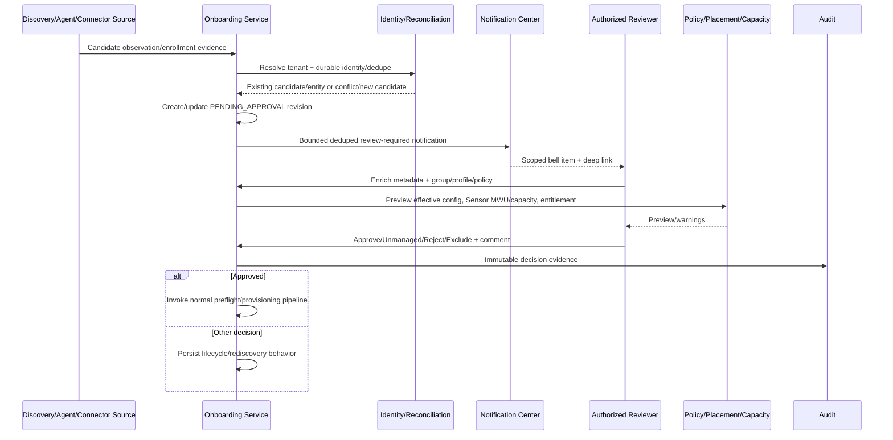

# Platform — Discovery, Onboarding, Identity & Notification Master

**Document ID:** PLATFORM-ONBOARDING-001
**Version:** 3.2.2
**Status:** **Authoritative Mother Reference — Discovery / Onboarding / Identity / Notification**
**Product:** Platform
**Change class:** Additive approved product scope clarification; does not remove or weaken any v3.2.1/v3.2.2 requirement

---

## 1. Authority and purpose

This document is the authoritative v3.2.2 specialized master for governed discovery, endpoint onboarding, Agent identity continuity and the in-product Notification Center.

It follows the same consolidated logical-layer model used by `Platform_19_Operational_Intelligence_MTTR_and_Value_Addendum.md`: requirements are defined once and mapped to the product, architecture, HLD, LLD/data, dataflow, UI, security, quality and operations layers so implementation does not invent or duplicate load-bearing behavior across many files.

Logical authority in this document is:

- §3 = business/product requirements (BRD/PRD supplement);
- §4 = governing architecture;
- §5 = HLD subsystem/ownership contract;
- §6 = LLD/data/API/event contracts;
- §7 = end-to-end dataflows;
- §8 = UI/UX requirements;
- §9 = protocol/enrollment/security requirements;
- §10 = threat/security requirements;
- §11 = quality/release requirements;
- §12 = operations/runbook requirements;
- §13 = formal requirements-traceability supplement.

`Platform_00_Document_Index.md` defines precedence. This master may add behavior where existing v3.2.2 files are silent, but it may not silently override an explicit higher-precedence requirement. If an actual contradiction is found, change control must reconcile it before implementation.

This document does **not** select a new OSS dependency, database, mandatory microservice, commercial SKU, pricing model or licensing quantity.

---

## 2. Non-negotiable principles

1. **Discovery is not automatic activation.** Finding or enrolling an entity creates governed candidate state; full monitoring/licence activation requires authorized review unless explicit trusted auto-approval policy applies.
2. **One lifecycle, many sources.** Network discovery, Agent enrollment and other candidate-producing sources converge on one tenant-scoped onboarding/review lifecycle.
3. **Human decisions are attributable.** Approve/reject/unmanaged/exclude decisions carry actor, timestamp and operator comment/reason and are auditable.
4. **Enrich before activation.** Customer-controlled metadata, grouping and policy assignment are reviewable before monitoring starts.
5. **Identity is not IP.** Agent-backed endpoint continuity is anchored to canonical entity + Agent/mTLS identity. IP/MAC are mutable observations.
6. **Hostname is human-readable, not immutable authority.** System/host name may change or collide; it must not silently merge endpoints.
7. **Conflicts become workflows.** Reinstall, reimage, clone and conflicting stable identifiers create explicit reconciliation/security states.
8. **One Notification Center.** The global bell is a single role-aware per-user surface with categories, unread state, preferences and deep links; do not proliferate separate bell icons per domain.
9. **Notifications are not alerts.** Platform/workflow notifications and monitored-environment Alerts/Incidents remain distinct domain objects even when surfaced together.
10. **Server-side scope is mandatory.** Notification/candidate visibility and actions are enforced by tenant, RBAC, resource scope and entitlement, not UI hiding.
11. **Storms are bounded.** Rediscovery, reconnect and scan churn are deduplicated/rate-limited and must not generate notification floods.
12. **Safe auto-approval is explicit.** Auto-approval is a scoped customer policy through the same identity/preflight/audit checks, never a bypass.

---

## 3. Formal product requirements

The following IDs are authoritative PRD supplements for v3.2.2.

| PRD ID | Requirement |
|---|---|
| `PRD-ONB-001` | Network auto-discovery, Windows/Linux Agent enrollment and other candidate-producing onboarding sources shall feed a tenant-scoped governed review lifecycle before full monitoring activation, unless an explicitly authorized trusted auto-approval policy applies. |
| `PRD-ONB-002` | Candidate lifecycle shall distinguish at least discovered/enrolled, pending approval, provisioning, active, unmanaged, rejected/excluded and retired/decommissioned outcomes; rediscovery shall reconcile rather than blindly duplicate. |
| `PRD-ONB-003` | New discovery/enrollment candidates shall create a bounded in-product notification for appropriate authorized recipients with a deep link to the review item; notification creation shall be deduplicated/rate-limited. |
| `PRD-ONB-004` | Approve, Reject, Leave Unmanaged and Exclude decisions shall require an operator comment/reason and shall record actor, tenant, timestamp, source evidence, decision and resulting lifecycle/policy state in audit history. |
| `PRD-ONB-005` | Before activation, authorized reviewers shall be able to edit customer-controlled Display Name, Alias, Description, Site, Group/Sub-group, Tags and Criticality and to review/edit applicable monitoring profile, alert/validation policy assignment/inheritance and Sensor assignment where permitted. |
| `PRD-ONB-006` | The review experience shall preview effective group-policy inheritance plus material licence/entitlement, Monitoring Work Unit/Sensor-capacity and monitoring-capability impact before approval. Overrides shall be explicit and auditable. |
| `PRD-ONB-007` | Bulk approve/reject/unmanaged/exclude operations shall be supported with bounded batch size, a required common decision comment/reason, optional per-item override where appropriate, per-item validation/results and no hidden all-or-nothing failure. |
| `PRD-ONB-008` | Manual review is the safe default. Trusted auto-approval MAY be configured only by authorized administrators for explicit tenant/source/site/deployment/profile scope, shall use the same validation/preflight/identity checks, and shall be auditable/revocable. |
| `PRD-ONB-009` | Agent-backed endpoint identity shall be anchored to canonical `entity_id` plus unique `agent_id` and certificate identity. Host/system name is the preferred human-readable technical name. IP and MAC addresses are time-varying observations and an address change alone shall not create a new endpoint. |
| `PRD-ONB-010` | Agent reinstall/reimage, cloned identity/certificate, hostname collision and conflicting stable identifiers shall enter an explicit reconciliation/security workflow. Platform shall not silently merge distinct endpoints or silently create duplicates when durable evidence conflicts. |
| `PRD-ONB-011` | The authenticated global shell shall provide one role-aware Notification Center/bell with unread counts/state, categories, filtering, deep links and user/team subscription/preferences including allowed mute/digest behavior. Recipient visibility shall be enforced server-side by tenant, RBAC, resource scope and entitlement. |
| `PRD-ONB-012` | Operational Alerts/Incidents and Platform/workflow notifications are distinct domain objects. The Notification Center may surface both, but shall preserve source/type, priority/severity, acknowledgement/read state and links to the underlying object. |
| `PRD-ONB-013` | Material discovery drift such as a new entity, sustained disappearance, identity conflict, unexpected site/ownership movement or a newly observed critical relationship may notify according to policy; routine rediscovery churn, transient dynamic-IP changes and high-volume scan/reconnect storms shall be deduplicated/rate-limited. |
| `PRD-ONB-014` | Discovery/enrollment workflows shall enforce credential scope, probe/rate bounds, tenant isolation, enrollment-token controls, unique Agent mTLS identity, audit, and safe handling of unauthorized/rogue candidates. |
| `PRD-ONB-015` | Platform shall support an optional customer-defined Region locality layer and first-class Sensor Pools. Regions are tenant-scoped logical/locality groupings, are not hard-coded to vendor/geographic names, and may contain Sites; Sensor Pools express placement scope, role/capability, capacity, health and failure-domain policy. |
| `PRD-ONB-016` | Core shall own authoritative Sensor Pool membership/placement and Agent→Sensor assignment with monotonically advancing generation/fencing semantics so stale or superseded assignments cannot regain authority after reassignment/failover. |
| `PRD-ONB-017` | Production Sensor bootstrap shall use a short-lived single-use scoped enrollment authority. The Sensor generates its private key locally, proves possession through an authenticated CSR/enrollment exchange, receives/binds its service certificate and authoritative Core endpoint/assignment, and never transmits or stores a reusable private key in Core. |
| `PRD-ONB-018` | Production Agent bootstrap shall use the same identity principles: short-lived scoped enrollment, local private-key generation, unique Agent certificate identity, explicit tenant/site/entity association and authoritative Agent→Sensor assignment. Normal Agent telemetry remains Agent→assigned Sensor→Core rather than hairpinning through Core. |
| `PRD-ONB-019` | Platform-owned Sensor↔Core and Agent↔Sensor control/telemetry trust boundaries shall remain authenticated and encrypted; mTLS remains the default/required production mechanism where currently specified. A plaintext Platform transport mode is not approved by this reconciliation. Legacy insecure monitored-device protocols may be supported only as explicitly labelled compatibility modes and do not weaken Platform-owned channels. |
| `PRD-ONB-020` | Sensor/Agent provisioning and placement shall be capacity-aware and locality-aware without making hardware increases the first response to load. Core shall prefer bounded workload placement, batching/data-path efficiency and healthy eligible pools before requiring larger resource profiles; capacity certification remains owned by Platform_11/14. |
| `PRD-ONB-021` | Platform shall support governed recurring Network Discovery schedules in addition to Run Now/one-time execution. Customer-safe schedules include Daily, Weekly and Monthly recurrence with explicit IANA timezone, start/effective date, pause/resume, next/last run, run history/failure state, max duration/rate/concurrency bounds, Sensor/Sensor-Pool placement, Credential Profile references, protocol/scope/exclusions and review/auto-approval policy. Ordinary users are not given unrestricted cron. Missed runs follow explicit skip/coalesce policy and deterministic spreading prevents fleet scan stampedes. |

### 3.1A Governed recurring Discovery scheduling — `PRD-ONB-021`

Discovery scheduling reuses the existing Core-owned scheduling authority; it does not create a second scheduler service.

Supported customer-safe modes for the initial contract are:

- **Run Now**;
- **Run Once** from an explicit requested local wall-clock + IANA timezone, resolved once and persisted as the authoritative UTC execution instant while retaining the original wall-clock/timezone input for audit/display;
- **Daily** at local wall-clock time + IANA timezone;
- **Weekly** on selected weekday(s) + local time + IANA timezone;
- **Monthly** on day 1–31 + local time + IANA timezone. When the requested day does not exist in a month, Platform uses **LAST_VALID_DAY** for that month and makes that behavior explicit in schedule UI/preview; there is no hidden skip and no user-selectable missing-day policy in the initial contract.

Advanced recurrence is deferred unless a real customer requirement justifies it; unrestricted raw cron is not the default ordinary-user contract.

The authoritative schedule/control state includes schedule identity, tenant, discovery profile/scope/exclusions, protocol set, Credential Profile references, Sensor/Sensor-Pool placement policy, recurrence/timezone, enabled/paused state, generation/revision, authoritative `next_run` UTC instant, last run, max duration, rate/concurrency limits, failure state and audit metadata. Run history is retained separately from the reusable schedule definition.

Execution rules:

- Core owns schedule desired state and generation/fencing; Sensor executes only currently authorized work;
- recurring scans are deterministically spread and bounded so many tenants/sites do not align at the same minute boundary;
- for a nonexistent local time during a DST forward transition, that occurrence runs once at the first valid local instant after the gap and the resolved UTC instant is recorded;
- for an ambiguous local time during a DST fall-back transition, that occurrence runs exactly once at the **earlier** of the two valid instants;
- after Core/scheduler unavailability, missed recurring occurrences **COALESCE to at most one** recovery execution; older missed occurrences are not replayed, and recovery executions remain deterministically spread/rate bounded to prevent a restart stampede;
- pause never accumulates catch-up work. Resume computes the next scheduled occurrence strictly after resume time; an operator who wants immediate execution uses Run Now;
- schedule edit/cancel advances generation. Queued or not-yet-started work from an obsolete generation must fail closed before execution. Work already in flight is cancellation-best-effort; any late obsolete-generation result is fenced from current schedule state and trusted auto-approval/activation and is retained only as auditable evidence unless explicitly reviewed;
- discovery result remains candidate evidence and does not bypass governed review/entitlement/activation;
- trusted auto-approval, where enabled, remains separately governed by `PRD-ONB-008`;
- display timezone never changes recurrence or the persisted Run Once UTC execution instant.

### 3.1 Supported candidate sources

The unified onboarding/review model applies first to:

- Network Auto Discovery;
- Windows Agent enrollment;
- Linux Agent enrollment.

It also applies to candidate-producing Cloud, virtualization, storage, database, Kubernetes and API/connector discovery as those sources expose candidate managed entities. A source-specific workflow may collect different evidence, but it may not invent a separate lifecycle that bypasses the common identity, review, audit and activation contract.

### 3.2 Candidate decisions

Authorized decisions are:

- **Approve** — continue through normal preflight/provisioning and activate the effective monitoring configuration;
- **Leave Unmanaged** — preserve inventory/reconciliation visibility but do not run normal monitoring/licence workload;
- **Reject** — deny this candidate/enrollment outcome; for unauthorized Agent enrollment, identity/certificate is revoked/invalidated as policy requires;
- **Exclude** — create a persistent/permanent exclusion for the matching scoped identity so rediscovery, Agent reconnect, later scans or passage of time do not automatically recreate or re-notify the candidate. Reversal requires an explicit authorized administrative action to remove/reopen the exclusion and must be audited.

Temporary suppression, snooze or notification muting is a separate concept and must not be represented as **Exclude**.

Every decision requires an operator comment/reason. Bulk actions require a common decision comment/reason and per-item result evidence; where an item requires a different reason, an authorized per-item override may be recorded.

### 3.3 Review enrichment and policy preview

Before approval, authorized users can review/correct:

- Display Name;
- Alias;
- Description;
- Site;
- Group and Sub-group;
- Tags;
- Criticality;
- Monitoring Profile;
- Alert/Validation Policy assignment or inherited group policy;
- Sensor assignment mode/selection where allowed.

The review screen shows effective policy inheritance, monitoring capability, Sensor MWU/capacity impact and material licence/entitlement impact before activation. An explicit override is visible and audited; the user is never required to infer whether a group policy will apply.

### 3.4 Agent identity and dynamic addressing

For Agent-backed endpoints:

- canonical `entity_id` identifies the monitored endpoint inside the tenant;
- unique `agent_id` and enrolled mTLS certificate identity bind the installed Agent to that entity;
- System/Host Name is the preferred human-readable technical name;
- customer Display Name/Alias are presentation metadata;
- IPv4/IPv6/MAC values are observed, time-varying identifiers with history/provenance.

DHCP, Wi-Fi, VPN or network movement may change addresses repeatedly. Such changes update observations and network attachment history; they do not create a new endpoint or a 'new device' notification by themselves.

### 3.5 Identity conflict and reconciliation

The product shall surface an explicit review/security condition for cases including:

- Agent reinstall with ambiguous previous identity;
- OS reimage;
- VM/image clone carrying duplicated Agent identity;
- certificate/Agent ID reuse from conflicting hosts;
- hostname collision;
- conflicting serial/hardware/cloud/OS identifiers;
- improbable simultaneous heartbeats from the same Agent identity;
- manual merge/split request.

Platform shall preserve evidence and require an authorized reconciliation decision. It shall not silently merge distinct endpoints or allow two active bindings for one unique Agent identity.

### 3.6 Notification Center semantics

The global Notification Center/bell is a per-user operational inbox. Recommended categories include:

- My Action Required;
- Incidents;
- Network;
- Infrastructure;
- Database;
- SD-WAN / Cloud / Kubernetes where applicable;
- Discovery & New Assets;
- Approvals;
- Platform Health;
- Reports / Integrations / Licensing where applicable.

Categories are views over typed notifications, not separate notification subsystems or separate bell icons.

Marking a notification read does **not** acknowledge/resolve an Alert or Incident. Conversely, acknowledging an Alert does not automatically represent every related workflow notification as read unless explicitly defined by the lifecycle contract.

---

## 4. Governing architecture

### 4.1 Unified onboarding architecture

The existing Core Provisioning, Identity, Policy, Sensor Control and Audit modules are extended; this scope does not justify a new mandatory microservice.

```text
candidate observation/enrollment
  -> normalize + tenant/source validation
  -> canonical identity/reconciliation
  -> PENDING_APPROVAL
  -> notify eligible reviewers
  -> enrich + policy/capacity/licence preview
  -> APPROVE | UNMANAGED | REJECT | EXCLUDE
  -> normal preflight/provisioning when approved
```

For Agent enrollment, Core may establish the existing Sensor Control assignment before approval as a **provisional enrollment/control/transport association**. That association exists only to establish certificate/identity authority, Agent→Sensor authenticated transport, bounded bootstrap/health evidence and candidate/reconciliation state. It does not itself activate normal monitoring, commercial/licence consumption, normal monitoring profiles, customer operational alerts or recurring monitored workload.

After explicit authorized **Approve** or trusted auto-approval, normal entitlement, capacity and policy checks authorize the active monitoring workload. The existing Sensor Control/assignment mechanism remains the single authority: activation may retain the provisional Sensor or re-evaluate/reassign it through the same assignment/versioning contract. No second Sensor authority mechanism is introduced.

Trusted auto-approval traverses the same identity/preflight/capacity/licence/audit path with policy provenance recorded as the authorizing decision.

### 4.2 Identity architecture

Canonical identity remains protocol-independent and tenant-scoped. For Agent-backed endpoints, `entity_id` + unique `agent_id`/certificate identity is the durable binding. IP address is never the authoritative identity key.

Address/hostname changes are modeled as observations/attributes/history. Reconciliation uses stable evidence and provenance; ambiguity produces a review state rather than an invented identity decision.

### 4.3 Notification Center architecture

The modular Core owns an in-product Notification Center module. PostgreSQL owns authoritative notification metadata, recipient state and subscription/preferences. High-volume raw monitoring events remain in their normal telemetry/event path; they are not copied wholesale into per-user notification state.

External email/Teams/Slack/PagerDuty/etc. delivery remains owned by the Integration Service. The in-product Notification Center may trigger external delivery according to policy, but the two concerns remain separable.

Recipient expansion and retrieval are server-side authorized. Generation uses deterministic dedupe keys, bounded fan-out and rate limits.

### 4.4 Region / Sensor Pool and placement architecture

Region is an optional tenant-scoped locality/organizational layer used for placement, policy and operator context. Region names are customer-defined and do not create a second tenant/security boundary. Sites remain concrete monitored-estate locations; deployments may omit Region where it adds no value.

Sensor Pool is the Core-owned placement abstraction over one or more eligible Sensors. Pool eligibility combines tenant/scope, Region/Site affinity where configured, Sensor role/capabilities, capacity/headroom, health/maintenance state and failure-domain policy. A pool may be site-local or broader when policy explicitly permits.

Core remains the only assignment authority. Pool membership and Agent→Sensor assignment use monotonically advancing generations/fences so a stale Sensor or Agent cannot regain ownership after reassignment, restart or failover. Sensors execute current authorized desired state; they do not elect ownership independently.

Provisioning must prefer efficient placement and bounded workload controls before raising certified hardware requirements, but may never trade away freshness, telemetry durability, security or tenant isolation.

---

## 5. HLD subsystem and ownership contract

### 5.1 Provisioning/Onboarding Service

Owns:

- candidate creation/update;
- source normalization;
- identity/dedup/reconciliation request;
- lifecycle state/revision;
- editable proposed metadata;
- group/policy preview;
- Sensor/capacity/licence preview;
- decision processing;
- bulk-job coordination;
- trusted auto-approval policy evaluation;
- handoff to normal provisioning/preflight.

### 5.2 Identity/Reconciliation responsibility

Owns:

- candidate/entity matching;
- Agent/entity binding;
- stable identifier provenance;
- dynamic-address continuity;
- duplicate/clone/conflict detection;
- security/reconciliation hold;
- authorized merge/split/rebind result.

### 5.3 Notification Center module

Owns:

- typed notification objects and dedupe keys;
- recipient expansion;
- unread/read/dismiss/action state per user;
- categories/types/priority;
- deep links;
- user/team subscriptions/preferences;
- permitted mute/digest/quiet-window behavior;
- expiry/retention policy hooks;
- bounded fan-out/rate limiting;
- notification API/UI contracts.

It does not own Alert Qualification/Incident state and does not convert every raw event into a notification.

### 5.4 Agent onboarding

Secure bootstrap establishes unique Agent identity/certificate. Core selects an eligible Sensor through the existing Sensor Control authority so the Agent can establish a provisional authenticated Agent→Sensor control/transport association. Before approval that association is limited to certificate/identity authority, onboarding/bootstrap validation, bounded health/bootstrap evidence and candidate/reconciliation traffic.

Default state is `PENDING_APPROVAL`. The provisional Sensor association does **not** activate commercial/licence consumption, customer operational alerts, the normal monitoring profile or recurring monitored workload. Normal monitoring/test workload becomes active only after explicit authorized **Approve** or trusted auto-approval and the normal entitlement/capacity/policy checks. Activation retains or re-evaluates the provisional assignment through the same Sensor Control assignment/versioning mechanism; no second Sensor authority exists.

`UNMANAGED` may retain bounded management identity/inventory visibility without full monitoring. `REJECTED` unauthorized enrollment revokes/invalidates identity as policy requires. `EXCLUDED` is a persistent/permanent automatic-onboarding exclusion and remains effective across rediscovery, Agent reconnect, later scans and passage of time until an explicit authorized audited administrative action removes/reopens it.

### 5.4.1 Agent capability inventory and eBPF state reporting — v3.2.2 reconciliation

> **Reconciliation reference:** Issue #142 (Master Chat comment `5909076167`). Governed by `REQ-INF-013` and `DEC-ARCH-036`.

The Linux Agent capability inventory reported during bootstrap, heartbeat, or onboarding review may include the current eBPF process-network capability state:

```text
ebpf_capability_state: UNSUPPORTED | UNAVAILABLE | PRIVILEGE_DENIED | KERNEL_INCOMPATIBLE | RESOURCE_GUARDED | ACTIVE
```

**Architectural boundaries and non-goals:**
- **Capability state only:** This field reflects local kernel support, privilege, and runtime resource health. It is an operational capability indicator and does **NOT** represent an endpoint identity, entity ID, or network address.
- **No new onboarding lifecycle:** eBPF capability state does not alter the governed candidate lifecycle (`DISCOVERED|ENROLLED -> PENDING_APPROVAL -> ACTIVE`).
- **No auto-enablement or approval bypass:** Reporting an active eBPF capability does not automatically approve the agent, license the entity, or bypass the human-in-the-loop review process.
- **Graceful degradation:** If eBPF state is `UNSUPPORTED`, `UNAVAILABLE`, `PRIVILEGE_DENIED`, `KERNEL_INCOMPATIBLE`, or `RESOURCE_GUARDED`, the Agent continues all routine base OS/host metrics collection (`CPU`, `memory`, `disk`, `network interface stats`). Base agent monitoring is never disabled due to eBPF limitations.

### 5.5 Sensor Control / Placement ownership

Sensor Control owns Region/Site/Pool-aware eligibility, membership state, placement generations, drain/maintenance state, Sensor reassignment and Agent→Sensor assignment. Provisioning/Onboarding requests placement and receives an authoritative result; it does not maintain a second placement registry.

Enrollment/Identity owns bootstrap authority validation and certificate binding. Sensor Runtime owns execution of the assignment currently authorized by Core. Capacity policy remains governed by Platform_11/14 evidence and Sensor self-observability.

---

## 6. LLD, data, API and event contracts

### 6.1 PostgreSQL candidate model

```text
onboarding_candidate
  candidate_id PK
  tenant_id
  source_type NETWORK_DISCOVERY|AGENT_ENROLLMENT|CLOUD|VIRTUALIZATION|STORAGE|DATABASE|K8S|API|OTHER
  source_ref
  entity_id nullable
  agent_id nullable
  lifecycle_state DISCOVERED|ENROLLED|PENDING_APPROVAL|PROVISIONING|ACTIVE|UNMANAGED|REJECTED|EXCLUDED|DECOMMISSION_REQUESTED|DECOMMISSIONED|RETIRED
  identity_conflict_state NONE|REVIEW_REQUIRED|SECURITY_HOLD
  discovered_name nullable
  proposed_display_name nullable
  proposed_alias nullable
  proposed_description nullable
  proposed_site_id nullable
  proposed_group_ids
  proposed_tags
  proposed_criticality nullable
  proposed_monitoring_profile_id nullable
  proposed_alert_policy_id nullable
  proposed_sensor_assignment nullable
  first_seen_at
  last_seen_at
  revision
  dedupe_key
```

`onboarding_decision` stores candidate, decision, actor, timestamp, required comment/reason, before/after revision, source evidence reference, effective group/profile/policy/assignment and per-item result.

### 6.2 Lifecycle

```text
DISCOVERED|ENROLLED -> PENDING_APPROVAL
PENDING_APPROVAL -> PROVISIONING -> ACTIVE
PENDING_APPROVAL -> UNMANAGED
PENDING_APPROVAL -> REJECTED
PENDING_APPROVAL -> EXCLUDED
ACTIVE -> DECOMMISSION_REQUESTED -> DECOMMISSIONED
DECOMMISSIONED -> RETIRED  # optional archival/presentation terminal state where used
```

`DECOMMISSION_REQUESTED` and `DECOMMISSIONED` are explicit lifecycle states. `RETIRED` may be used only as an optional post-decommission archival/presentation terminal state; it does not replace or bypass `DECOMMISSIONED`.

Discovery absence does not automatically decommission an entity. Sustained disappearance creates reconciliation/review according to policy.

### 6.3 Agent identity binding

```text
entity_agent_binding
  tenant_id
  entity_id
  agent_id UNIQUE within tenant/deployment
  certificate_identity UNIQUE within deployment
  system_name
  os_identity nullable
  first_enrolled_at
  last_heartbeat_at
  binding_state PENDING_APPROVAL|ACTIVE|UNMANAGED|REVOKED|SECURITY_HOLD
  reinstall_generation
```

Observed IPv4/IPv6/MAC remain temporal identifiers/observations with first/last seen and provenance. Address change alone never changes `entity_id`/`agent_id`.

### 6.4 Notification data model

```text
user_notification
  notification_id PK
  tenant_id
  category INCIDENT|NETWORK|INFRASTRUCTURE|DATABASE|SDWAN_CLOUD|DISCOVERY_NEW_ASSET|APPROVAL|PLATFORM_HEALTH|OTHER
  notification_type
  source_object_type
  source_object_id
  priority
  title_key/message_fields
  dedupe_key
  created_at
  updated_at
  expires_at nullable
  action_required bool

user_notification_recipient
  notification_id
  user_id
  delivered_at
  read_at nullable
  dismissed_at nullable
  action_state nullable

notification_subscription
  tenant_id
  principal_type USER|TEAM
  principal_id
  category/type filters
  resource_scope_id
  delivery_mode IMMEDIATE|DIGEST|MUTED where policy permits
  quiet_window nullable
```

Every notification retrieval/action rechecks current authorization. A persisted recipient row is not an authorization grant.

### 6.5 API behavior

- Candidate/review list APIs are paginated, filterable and tenant/resource scoped.
- Candidate detail exposes revision/ETag-equivalent for optimistic concurrency.
- Approve/reject/unmanaged/exclude and bulk review mutations require idempotency key plus required decision comment/reason.
- Removing/reopening an `EXCLUDED` candidate is a separate explicit authorized administrative mutation with audit evidence; EXCLUDE has no automatic expiry.
- Stale candidate revision returns a stable conflict error and requires refresh.
- Bulk operations return per-item success/failure/remediation.
- Notification list/count/read/dismiss/action APIs are tenant/resource scoped and re-authorize the source object.
- Notification unread/read state is separate from Alert/Incident acknowledgement/resolution.
- Comments are length-bounded, safely encoded/rendered and never interpreted as executable content.

### 6.6 Event families

Where asynchronous events are needed:

- `onboarding.candidate.v1`;
- `onboarding.lifecycle.v1`;
- `agent.identity.v1`;
- `notification.lifecycle.v1`.

Events carry schema version, tenant, source identity, event ID, event/ingest time, provenance/quality where applicable and correlation ID. Producers/consumers are replay/idempotency safe. No secret credential material is emitted.

### 6.7 Region / Sensor Pool / bootstrap control state

The canonical field-level Region, Sensor Pool, membership, Agent assignment and enrollment-control contract is owned by `Platform_17_API_Event_and_Data_Model_Contracts.md`. Platform_20 owns lifecycle and product semantics; implementations must not fork duplicate schemas.

Mutations are tenant-scoped, optimistic-concurrency/idempotency safe and audited. Assignment/membership generations only advance. Enrollment material is single-use/short-lived; endpoint private keys are generated locally and are prohibited from normal Core persistence, events, audit payloads and support output.

Lifecycle events may extend the existing Sensor/Agent control families with Region/Pool/placement references, but must carry tenant, generation/revision, event/ingest time and correlation provenance. No event grants authority merely because it contains a claimed pool or assignment.

---

## 7. End-to-end dataflows

### DF-ONB-001 — Unified discovery/enrollment review



### DF-ONB-002 — Agent enrollment and dynamic address continuity

```mermaid
sequenceDiagram
  participant AG as Agent
  participant EN as Enrollment
  participant ID as Identity/Reconciliation
  participant ONB as Onboarding
  participant P as Sensor Placement/Control
  participant N as Notification Center
  participant S as Sensor

  AG->>EN: Single-use token + host metadata
  EN->>ID: Validate tenant/token and existing Agent/entity identity
  ID-->>EN: Binding/new candidate/conflict
  EN-->>AG: Unique Agent ID + mTLS cert (or deny/hold)
  EN->>P: Select eligible Sensor for provisional enrollment transport
  P-->>AG: Provisional Sensor endpoints + assignment version
  AG->>S: Establish authenticated mTLS onboarding/control transport
  S-->>AG: Accept bounded bootstrap/health evidence only
  EN->>ONB: ENROLLED candidate + minimal metadata
  ONB->>N: Review-required notification
  Note over AG,ONB: PENDING_APPROVAL by default; provisional transport is not monitoring/licence activation
  alt Authorized APPROVE or trusted auto-approval
    ONB->>P: Run entitlement/capacity/policy checks; retain or re-evaluate assignment
    P-->>AG: Active monitoring assignment/profile version
    S-->>AG: Activate normal monitoring/test profile
    AG->>S: Normal recurring host metrics / Edge Test results
  else Pending/Unmanaged/Rejected/Excluded
    S-->>AG: No normal monitoring workload/profile
  end
  AG->>ONB: Later heartbeat with changed IP/VPN/Wi-Fi address
  ONB->>ID: Update observed address/history for same identity
  ID-->>ONB: Same endpoint unless durable identity conflict exists
```

The provisional and active phases use the same Sensor Control assignment authority and assignment/versioning contract. Approval does not introduce a second Sensor authority mechanism.

### DF-ONB-003 — Notification delivery

Notification generation resolves source object -> tenant/resource scope -> eligible users/teams/subscriptions -> dedupe/rate limit -> durable notification -> per-user unread/action state. List/read/dismiss/action APIs re-authorize current access. A user losing resource scope can no longer retrieve the underlying notification/object even if previously notified.

### DF-ONB-004 — Identity conflict/reinstall/clone

Conflicting Agent/certificate/stable-host identifiers, simultaneous improbable heartbeats or reinstall/reimage evidence enters `REVIEW_REQUIRED`/`SECURITY_HOLD`. Core does not silently merge or create a second independent active binding. Authorized reconciliation records evidence, actor/comment and resulting binding; revoked identities are denied subsequently.

### DF-ONB-005 — Sensor bootstrap, pool placement and fenced Agent assignment

```mermaid
sequenceDiagram
  participant I as Installer / Endpoint
  participant E as Enrollment
  participant SC as Sensor Control / Placement
  participant S as Sensor
  participant A as Agent

  I->>E: Stable Core endpoint + short-lived scoped enrollment authority
  I->>I: Generate private key locally
  I->>E: CSR/proof-of-possession + scoped bootstrap request
  E->>SC: Validate tenant/Region/Site/Pool/role eligibility
  SC-->>E: Authoritative Sensor identity/placement generation
  E-->>I: Bound certificate + authorized control endpoint metadata
  Note over I,E: CA/SAN identity verification remains enabled; no plaintext fallback
  A->>E: Agent enrollment with local key + scoped authority
  E->>SC: Request eligible Agent→Sensor assignment
  SC-->>A: Sensor endpoint + monotonically advancing assignment generation
  A->>S: mTLS control/telemetry using current generation
  S->>SC: Health/capacity/assignment state
  alt Sensor degraded/drained/reassigned
    SC-->>A: New Sensor assignment with higher generation
    A->>S: Old generation rejected / new assignment activated
  end
```

Normal Agent telemetry remains Agent→assigned Sensor→Core. Enrollment/bootstrap does not authorize a direct normal Agent→Core telemetry bypass.

---

## 8. UI/UX requirements

### 8.1 Global Notification Center

The authenticated top bar contains **one** Notification Center/bell. It shows the current user's unread count and opens a categorized inbox.

Required behavior:

- categories and filters;
- read/unread/dismiss/action-required state;
- source/type and priority/severity semantics;
- created/updated time;
- deep link to candidate/entity/alert/incident/approval/platform-health object;
- tenant/site/group/resource context where useful;
- user/team subscription/preferences;
- permitted mute/digest/quiet-window controls;
- accessible keyboard/focus/status semantics;
- server-side authorization on every retrieval/action.

Mandatory security/platform-critical notifications may be non-mutable by policy.

### 8.2 Discovery & Onboarding Review

`Inventory → Provisioning & Discovery` exposes a unified **Discovery & Onboarding Review** table/view while retaining the existing provisioning/discovery workspace.

Required filters/columns include:

- Source;
- Candidate/Entity;
- System/Discovered Name;
- observed address(es);
- Agent ID where applicable;
- Site;
- Group/Sub-group;
- Tags;
- Criticality;
- Identity/Conflict state;
- Lifecycle state;
- First Seen;
- Last Seen/Heartbeat;
- proposed Monitoring Profile;
- proposed Alert/Validation Policy;
- Sensor assignment;
- entitlement/capacity impact;
- Reviewer/Action state where used.

Candidate detail shows identity evidence/provenance, editable metadata/grouping, effective policy inheritance, capacity/licence impact, preflight/compatibility/conflict evidence and audit/history.

Actions are **Approve**, **Leave Unmanaged**, **Reject**, **Exclude Permanently** according to permission. Every action requires a comment/reason. Bulk actions show per-item outcomes. Reopening/removing a permanent exclusion is a distinct authorized audited administrative action, not an expiry behavior.

### 8.3 Agent review UX

Agent candidates show System/Host Name as the primary technical label and Display Name/Alias as customer-controlled presentation. Authorized support/admin roles may view `agent_id` and certificate/enrollment status. IP/MAC values are current/history observations, not primary identity.

Dynamic-IP change updates the same endpoint timeline and does not create a new-device notification. Identity conflict is high-visibility and requires reconciliation.

### 8.4 Discovery drift notifications

Policy may notify on material drift:

- new entity;
- sustained disappearance;
- identity conflict;
- unexpected site/ownership movement;
- newly observed critical adjacency/relationship.

Routine identical observations, transient address changes and repeated scan/reconnect churn are grouped/deduplicated. A matching permanent exclusion prevents automatic candidate recreation/re-notification until explicitly removed by an authorized audited action.

---

### 8.5 Region / Sensor Pool and provisioning UX

Where Region is enabled for a tenant, onboarding/provisioning surfaces expose **Region → Site → Sensor Pool → Sensor** as locality/placement context without forcing every deployment to use every level. Region names are customer-defined; examples such as EMEA/APAC/AMERICAS are not product enums.

Sensor Pool administration shows pool scope, eligible Sensor roles/capabilities, capacity/headroom, health/degraded state, failure-domain/placement policy and current assignment counts. Operators may request placement/reassignment only through authorized Core control APIs; the UI never mutates Sensor-local ownership directly.

Sensor/Agent bootstrap workflows accept only the minimum bootstrap information needed to reach the trusted Platform endpoint plus a short-lived scoped enrollment token/authority. The UI/installer never asks customers to paste implementation-internal service URLs when the stable Core endpoint can be supplied.

---

## 9. Protocol, enrollment and security requirements

- Discovery profiles are tenant/site/scope constrained and rate/burst bounded.
- Discovery Credential Profiles retain normal `USE` authorization; review users do not gain secret access because a candidate was found.
- Agent enrollment tokens are short-lived/single-use and scoped to tenant/deployment plus optional site/profile/auto-approval policy.
- Sensor enrollment tokens/authorities are likewise short-lived/single-use and scoped to tenant/deployment plus optional Region/Site/Pool/role constraints.
- Sensor and Agent private keys are generated and retained locally; Core receives proof/CSR/public-certificate material, never a reusable private key.
- Endpoint bootstrap may use DNS name or IP/VIP only when certificate identity validation is correct for that endpoint (for example SAN coverage); hostname/certificate verification is never disabled to make bootstrap easier.
- Platform-owned Sensor↔Core and Agent↔Sensor control/telemetry channels remain encrypted and mutually authenticated in production. Plaintext is not an approved optimization path; monitored-device legacy protocols remain a separate compatibility concern.
- Successful bootstrap establishes unique `agent_id` + mTLS certificate identity and may establish the provisional Sensor association required for authenticated onboarding/control transport.
- Pre-approval Agent→Sensor traffic is limited to enrollment/control/bootstrap validation and bounded health/bootstrap evidence; it does not authorize normal monitoring, licence activation, normal monitoring profiles or customer operational alerts.
- Full monitoring remains pending review by default; trusted auto-approval may activate only after normal identity/preflight/entitlement/capacity/policy/audit checks using the same Sensor Control authority.
- Reuse of Agent identity/certificate by conflicting endpoints, clone/reimage evidence or durable-identity conflict enters security/reconciliation hold.
- IP/MAC change on authenticated Agent is an observation, not new identity.
- Review/auto-approval decisions are security-sensitive audit events with actor/policy, tenant, candidate/entity, result, comment/reason and request/correlation context.
- Candidate and Notification Center APIs are bounded, paginated and protected against enumeration/fan-out abuse.

---

## 10. Threat/security model additions

Additional threat classes:

- discovery amplification/scan abuse;
- credential-scope misuse;
- rogue device/Agent flooding onboarding;
- stolen/replayed enrollment material;
- cloned Agent certificate/identity or image-clone collisions;
- hostile identity takeover;
- incorrect automatic merge or duplicate active binding;
- unauthorized auto-approval/approval bypass;
- cross-tenant/resource notification leakage;
- stale-recipient access after RBAC/scope change;
- notification fan-out/spam/resource exhaustion;
- malicious decision comment rendering;
- missing/tampered decision audit.

Required mitigations include scoped single-use tokens, unique mTLS identities, explicit conflict/security-hold workflows, no IP-only Agent identity, server-side authorization, bounded discovery/notification generation, dedupe/rate limits, safe comment rendering/length bounds, immutable decision audit and least-privilege auto-approval policy.

---

## 11. Quality and release gates

Mandatory regression coverage includes:

1. Network discovery candidate enters review without active monitoring/licence by default.
2. Agent enrollment establishes unique identity and may establish the provisional authenticated Sensor transport association, but remains pending review until approval/trusted auto-approval.
3. Unapproved Agent may exchange only bounded onboarding/control/bootstrap health evidence and does not receive normal monitoring workload/profile, commercial/licence activation or customer operational alerts.
4. Approve/reject/unmanaged/exclude require comment/reason and complete audit evidence.
5. Edited metadata/group/sub-group/profile/alert policy produces expected inherited effective configuration after activation.
6. Bulk review is bounded and reports per-item success/failure.
7. Trusted auto-approval cannot cross configured tenant/source/site/profile scope and still executes identity/preflight/capacity/licence checks.
8. DHCP/VPN/Wi-Fi IP changes update the same Agent/entity and do not create duplicate endpoints/new-device notifications.
9. Reinstall/reimage/clone/certificate reuse/stable-identifier conflict enters review/security hold and never silently creates two active bindings.
10. Notification recipient expansion/list/read/dismiss/action/deep links pass tenant/RBAC/resource-scope negative tests.
11. User losing scope cannot retrieve a previously delivered notification/source object.
12. Notification read state is independent of Alert/Incident acknowledgement lifecycle.
13. Discovery/reconnect storms are deduplicated/rate-limited without unbounded PostgreSQL growth/browser fan-out.
14. Material discovery drift produces bounded review notifications; routine identical observations/dynamic-IP churn do not.
15. Decision comments are safely rendered and cannot inject executable UI/script content.
16. `EXCLUDED` candidates remain permanently excluded across rediscovery, Agent reconnect, scans and time passage; only an explicit authorized audited remove/reopen action reverses the exclusion.
17. Lifecycle persistence and transitions represent `ACTIVE -> DECOMMISSION_REQUESTED -> DECOMMISSIONED`; optional `RETIRED` state, where used, occurs only after decommissioning.
18. Region/Site/Pool placement enforces tenant scope and eligible role/capacity/failure-domain policy; a Region rename/reparent does not silently change tenant authority.
19. Sensor bootstrap token replay, expiry, wrong tenant/site/pool/role and certificate/key-possession failures are denied and audited; private key material never appears in Core persistence/logs/support evidence.
20. Agent assignment generation/fencing rejects stale/replayed/superseded Agent→Sensor assignments after reassignment/failover.
21. Certificate validation remains enabled for DNS and IP/VIP bootstrap forms; missing/mismatched SAN/trust fails closed.
22. Security-negative tests prove no production plaintext Sensor↔Core or Agent↔Sensor path exists and legacy monitored-device plaintext protocols cannot downgrade Platform-owned transport.
23. Capacity/placement tests prove Core prefers healthy eligible pools and bounded workload/data-path controls before declaring larger hardware necessary, without violating freshness/durability.

A tenant-isolation leak through onboarding/notifications, approval bypass, or identity collision/merge that can bind one customer's endpoint incorrectly is a release blocker under existing tenant/security/data-integrity gates.

---

## 12. Operational/runbook requirements

Required runbooks/additions:

- Agent identity conflict / clone / reimage reconciliation;
- rejected/rogue Agent enrollment;
- onboarding queue backlog;
- notification-generation backlog/failure;
- notification recipient scope/authorization investigation;
- permanent-exclusion removal/reopen and unmanaged-state correction;
- bulk-review partial failure;
- auto-approval policy disable/rollback.

Support evidence includes candidate/Agent/entity IDs, correlation IDs, lifecycle/revision, decision/audit references, notification IDs/dedupe keys and sanitized identity facts. Credentials/private keys are never exposed.

**Current Sensor enrollment implementation truth** (`sensor/internal/identity`, bounded; does **not** claim full PKI lifecycle, rotation, revocation, BUILD-017, or BUILD-025 certified):

| Fact | Maturity |
|---|---|
| Sensor local private-key generation | **IMPLEMENTED + TESTED** |
| CSR locally generated and sent to Core | **IMPLEMENTED + TESTED** |
| `privateKeyPem` transmitted from Sensor | **NO** |
| `privateKeyPem` returned as accepted Core enrollment contract | **NO** |
| Legacy Core response containing private-key material | **REJECTED** |

Public production Core enrollment issuer/API and full Sensor/Agent bootstrap certification remain separately owned.

Operational self-monitoring includes candidate queue depth/age, review backlog, identity-conflict count, notification generation/delivery lag, dedupe/rate-limit drops, recipient expansion failures and storage/query health for current notification state.

---

## 13. Formal requirements traceability supplement

| REQ ID | Requirement | Governing PRD | Architecture/HLD/LLD/Dataflow | UI/Security/Quality |
|---|---|---|---|---|
| `REQ-ONB-001` | Unified governed review lifecycle for network discovery, Agent enrollment and candidate-producing sources | `PRD-ONB-001/002` | §§4–7 | §§8–12 |
| `REQ-ONB-002` | Review before full monitoring/licence by default; provisional Agent transport association is not activation; scoped trusted auto-approval | `PRD-ONB-001/008` | §§4–7 | §§9–11 |
| `REQ-ONB-003` | New candidate notification to authorized users with deep link, dedupe/rate limit | `PRD-ONB-003` | §§4–7 | §§8,10,11 |
| `REQ-ONB-004` | Approve/reject/unmanaged/exclude require comment/reason and audit | `PRD-ONB-004` | §§5–7 | §§8–12 |
| `REQ-ONB-005` | Review/edit customer metadata, site/group/sub-group/tags/criticality | `PRD-ONB-005` | §§5–7 | §8 |
| `REQ-ONB-006` | Preview monitoring/alert policy inheritance plus Sensor/licence/capacity impact | `PRD-ONB-005/006` | §§4–7 | §8 |
| `REQ-ONB-007` | Safe bounded bulk review with per-item result | `PRD-ONB-007` | §§5–7 | §§8,11 |
| `REQ-ONB-008` | Agent identity anchored to entity_id + agent_id + mTLS; IP/MAC mutable | `PRD-ONB-009` | §§4–7 | §§8–11 |
| `REQ-ONB-009` | Reinstall/reimage/clone/identity conflict requires explicit reconciliation | `PRD-ONB-010` | §§4–7 | §§8–12 |
| `REQ-ONB-010` | One global per-user Notification Center with categories/unread/preferences/server-side scope | `PRD-ONB-011/012` | §§4–7 | §§8,10,11 |
| `REQ-ONB-011` | Alerts/Incidents remain distinct from Platform/workflow notifications | `PRD-ONB-012` | §§4–7 | §8 |
| `REQ-ONB-012` | Material discovery drift notifications are policy-driven and storm-bounded | `PRD-ONB-013` | §§4–7 | §§8,11,12 |
| `REQ-ONB-013` | Discovery/enrollment credential scope, bounds, rogue-candidate protection, audit and tenant isolation | `PRD-ONB-014` | §§4–7 | §§9–11 |
| `REQ-ONB-014` | Customer-defined Region + first-class Sensor Pool locality/placement semantics | `PRD-ONB-015` | §§4–7 | §§8.5,11,12 |
| `REQ-ONB-015` | Core-authoritative pool membership and Agent→Sensor generation/fencing | `PRD-ONB-016` | §§4–7 | §§9–12 |
| `REQ-ONB-016` | Sensor bootstrap uses scoped single-use enrollment + local key generation + certificate binding | `PRD-ONB-017` | §§4–7 | §§9–12 |
| `REQ-ONB-017` | Agent bootstrap and normal Agent→Sensor→Core assignment semantics | `PRD-ONB-018` | §§4–7 | §§8.5–12 |
| `REQ-ONB-018` | Platform-owned Sensor/Core and Agent/Sensor channels remain encrypted/authenticated; no approved plaintext production mode | `PRD-ONB-019` | §§4–7 | §§9–11 |
| `REQ-ONB-019` | Provisioning/placement efficiency and capacity-aware pool selection without hardware-first scaling | `PRD-ONB-020` | §§4–7 | §§8.5,11,12 |
| `REQ-ONB-020` | Governed recurring Discovery schedules with explicit timezone, bounds, placement, history, skip/coalesce and deterministic spread | `PRD-ONB-021` | §§3.1A,4–7 | §§8,11,12 |

### 13.1 Definition of done

Implementation of this capability family is not complete until the applicable requirements above have code, tests, observability, security/tenant-isolation coverage, upgrade/migration behavior where state is introduced, UI states, audit evidence and operational runbooks. A UI-only queue or bell without server-side scope, lifecycle and durable identity semantics is non-conformant.

---

## Criticality and Monitoring Profile assignment reconciliation — Issue #169

Onboarding continues to collect/review Criticality and proposed Monitoring Profile, but their semantics are now explicit:

- **Criticality** = business importance metadata.
- **Monitoring Profile** = effective monitoring behavior.
- **Assignment mode** = `AUTO_FROM_CRITICALITY` or `EXPLICIT_PROFILE`.

During onboarding the review screen shows Criticality, suggested profile, effective profile, inheritance source, assignment mode and capacity impact.

After activation, Criticality/Profile changes use the normal BUILD-070 policy/desired-state path; onboarding does not become a second policy engine.

If `EXPLICIT_PROFILE` is active, a later Criticality change may update the suggestion but must not silently replace the effective profile. Switching back to automatic mapping is an explicit authorized/audited action.

Bulk Criticality/profile changes require capacity/MWU preview and deterministic spread before activation so onboarding or later metadata edits cannot generate synchronized collection storms.
